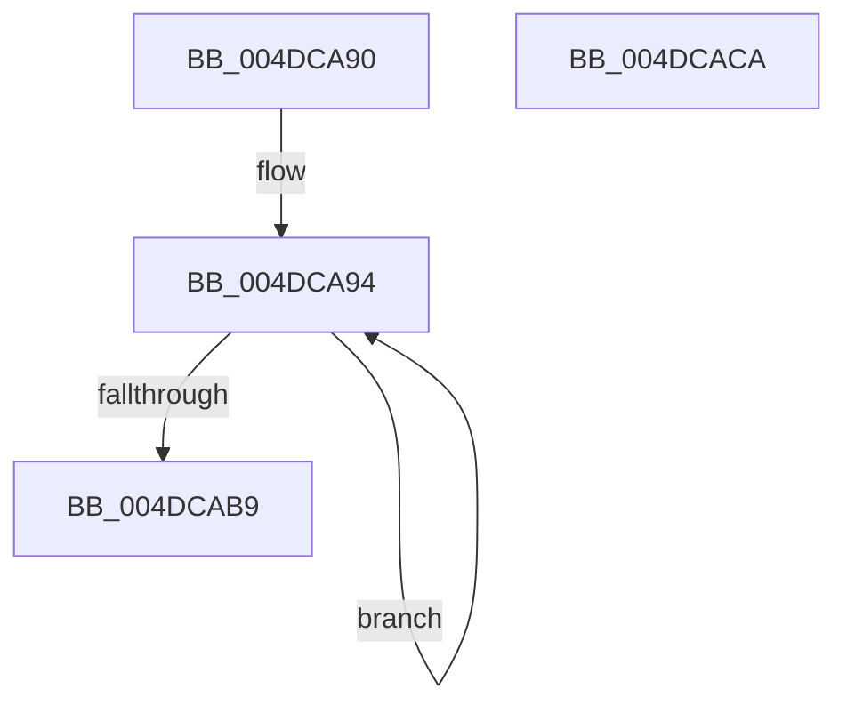

# CmFcpManagerFlushUsageTimerRoutine

- RVA: `0x004DCA90`–`0x004DCACB` (길이 `59` bytes)
- VA: `0x00000001404DCA90`
- 실행 섹션: `.text`
- PDB 이름 있음: `예`; PDB Function 태그: `아니요`
- unwind 정보 RVA: `0x0005C788`
- 디코드: `15`개 명령, `59/59` bytes 표시
- 미해석 바이트: `0` (있으면 어셈블리에 `.byte`로 보존)

> 이 문서는 커널 이미지의 기계어와 PDB 기호를 분석해 생성했습니다. 4번과 5번은 함수 원형과 자료형을 바이너리 사용 방식에서 추정한 C 해석이며 원본 소스 복구 결과는 아닙니다.

## 1. Dependencies

- 직접 호출 지점: **1**; 고유 호출 대상: **1**
- 직접 호출자로 확인된 함수: **0**
- RIP 상대 이미지 참조: **0**

### Outgoing calls
- `0x004DCAC0` → [CmpWorkItemQueueWork](../37/CmpWorkItemQueueWork_function_00378D4C.md) (function, `0x00378D4C`)

### Direct callers
- 이 함수 시작 RVA로 연결되는 직접 call은 확인되지 않았습니다. 간접 호출은 완전히 역산할 수 없습니다.

### Static image references
- 디코드된 RIP-relative 메모리 참조가 없습니다.

## 2. Other-region calls and transfers

- 다른 실행 섹션으로 향하는 call: **0**
- 별도 외부 분기/꼬리 이동을 확인하지 못했습니다.

## 3. Assembly (complete function range)

```asm
004DCA90  48 83 EC 28                     sub rsp, 0x28
004DCA94  8B 82 30 07 00 00               mov eax, dword ptr [rdx + 0x730]
004DCA9A  44 8B C8                        mov r9d, eax
004DCA9D  41 83 E1 FD                     and r9d, 0xfffffffd
004DCAA1  45 8B C1                        mov r8d, r9d
004DCAA4  41 83 C8 10                     or r8d, 0x10
004DCAA8  A8 01                           test al, 1
004DCAAA  45 0F 44 C1                     cmove r8d, r9d
004DCAAE  F0 44 0F B1 82 30 07 00 00      lock cmpxchg dword ptr [rdx + 0x730], r8d
004DCAB7  75 DB                           jne 0x1404dca94
004DCAB9  48 8D 8A 70 06 00 00            lea rcx, [rdx + 0x670]
004DCAC0  E8 87 C2 E9 FF                  call 0x140378d4c
004DCAC5  48 83 C4 28                     add rsp, 0x28
004DCAC9  C3                              ret
004DCACA  CC                              int3
```

## 4. C-style interpretation (structured pseudocode)

```c
__int64 __fastcall CmFcpManagerFlushUsageTimerRoutine(__int64 a1, __int64 a2)
{
    __int64 result;
    __int64 v_rsp;

    v_rsp = (v_rsp) - (40);
loc_004DCA94:
    a4 = (unsigned int)(((unsigned int)((unsigned int)((unsigned int)(*(unsigned int *)(a2 + 1840))))) & (0xFFFFFFFDULL));
    a3 = (unsigned int)(((unsigned int)((unsigned int)(a4))) | (16));
    if ((((unsigned __int8)((unsigned int)(*(unsigned int *)(a2 + 1840)))) & (1)) == 0) { a3 = (unsigned int)(a4); }
    if ((((unsigned __int8)((unsigned int)(*(unsigned int *)(a2 + 1840)))) & (1)) != 0) goto loc_004DCA94;
    result = CmpWorkItemQueueWork(a2 + 1648, a2, a3, a4);
    v_rsp = (v_rsp) + (40);
    return result;
}
```

## 5. (Beta) C Style

```c
int64_t CmFcpManagerFlushUsageTimerRoutine(int64_t Arg1, void *Arg2)
{
    uint8_t *arg2 = (uint8_t *)Arg2;

    int64_t result;
    int64_t local_rsp;

    local_rsp = (local_rsp) - (40);
loc_004DCA94:
    a4 = (uint32_t)(((uint32_t)((uint32_t)((uint32_t)(*(uint32_t *)(arg2 + 0x730))))) & (0xFFFFFFFDULL));
    a3 = (uint32_t)(((uint32_t)((uint32_t)(a4))) | (16));
    if ((((uint8_t)((uint32_t)(*(uint32_t *)(arg2 + 0x730)))) & (1)) == 0) { a3 = (uint32_t)(a4); }
    if ((((uint8_t)((uint32_t)(*(uint32_t *)(arg2 + 0x730)))) & (1)) != 0) goto loc_004DCA94;
    result = CmpWorkItemQueueWork(Arg2 + 1648, Arg2, a3, a4);
    local_rsp = (local_rsp) + (40);
    return result;
}
```

### 관측된 메모리 오프셋

구조체 형식이 확인되지 않은 접근은 인자 기준의 오프셋으로만 기록했습니다.

| 기준 인자 | 오프셋 표현 | 폭 (bit) | 접근 |
|---|---:|---:|---|
| `Arg2` | `+ 0x670` | `64` | `R` |
| `Arg2` | `+ 0x730` | `32` | `R` |

## 6. Execution-region graph

[열기: 2D/3D 그래프와 함수 탐색 컨트롤 패널](../../../control-panel.html?section=text&rva=0x004DCA90&view=graph)

- 2D 그래프는 위에서 아래로 흐르고, 3D 그래프는 빈 공간을 드래그해 회전합니다. Shift+드래그는 이동, 휠은 확대·축소, 함수 노드 선택은 대상 보고서 이동입니다.

### Static fallback


