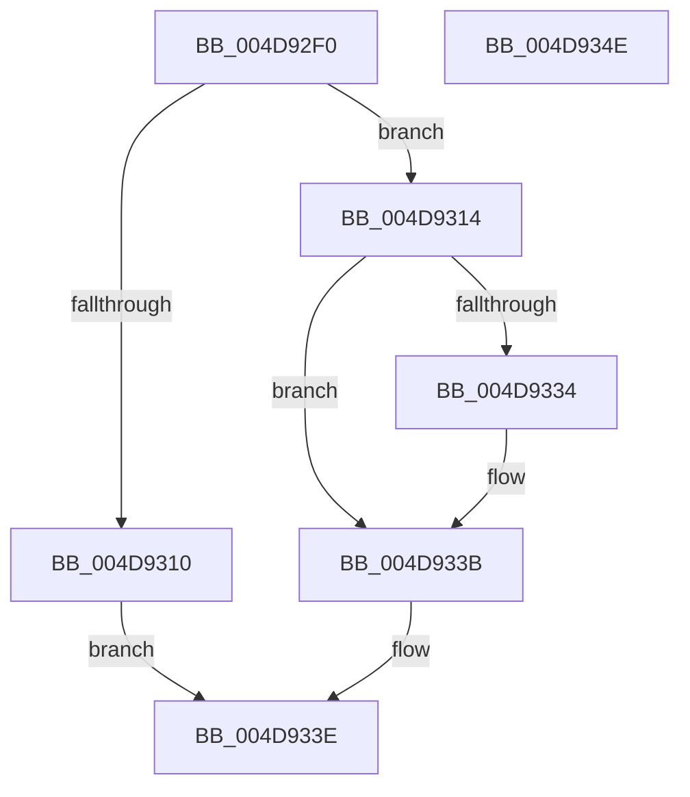

# CmpAllocateForNonPagedHive

- RVA: `0x004D92F0`–`0x004D934F` (길이 `95` bytes)
- VA: `0x00000001404D92F0`
- 실행 섹션: `.text`
- PDB 이름 있음: `예`; PDB Function 태그: `아니요`
- unwind 정보 RVA: `0x00060BC4`
- 디코드: `31`개 명령, `95/95` bytes 표시
- 미해석 바이트: `0` (있으면 어셈블리에 `.byte`로 보존)

> 이 문서는 커널 이미지의 기계어와 PDB 기호를 분석해 생성했습니다. 4번과 5번은 함수 원형과 자료형을 바이너리 사용 방식에서 추정한 C 해석이며 원본 소스 복구 결과는 아닙니다.

## 1. Dependencies

- 직접 호출 지점: **3**; 고유 호출 대상: **3**
- 직접 호출자로 확인된 함수: **2**
- RIP 상대 이미지 참조: **0**

### Outgoing calls
- `0x004D9307` → [CmpClaimGlobalQuota](../../page/84/CmpClaimGlobalQuota_function_0084DDAC.md) (function, `0x0084DDAC`)
- `0x004D9327` → [ExAllocatePool2](../../poolcode/B8/ExAllocatePool2_function_00B820F0.md) (function, `0x00B820F0`)
- `0x004D9336` → [CmpReleaseGlobalQuota](../../page/84/CmpReleaseGlobalQuota_function_0084DB40.md) (function, `0x0084DB40`)

### Direct callers
- [CmpCreateEmptyHiveClone](../../page/7E/CmpCreateEmptyHiveClone_function_007EE2E0.md) at `0x007EE33C`
- [CmpCreateHive](../../page/87/CmpCreateHive_function_00879DF0.md) at `0x0087A305`

### Static image references
- 디코드된 RIP-relative 메모리 참조가 없습니다.

## 2. Other-region calls and transfers

- 다른 실행 섹션으로 향하는 call: **3**
  - `0x004D9307` → [CmpClaimGlobalQuota](../../page/84/CmpClaimGlobalQuota_function_0084DDAC.md) (`.text` → `PAGE`)
  - `0x004D9327` → [ExAllocatePool2](../../poolcode/B8/ExAllocatePool2_function_00B820F0.md) (`.text` → `POOLCODE`)
  - `0x004D9336` → [CmpReleaseGlobalQuota](../../page/84/CmpReleaseGlobalQuota_function_0084DB40.md) (`.text` → `PAGE`)
- 별도 외부 분기/꼬리 이동을 확인하지 못했습니다.

## 3. Assembly (complete function range)

```asm
004D92F0  48 89 5C 24 08                  mov qword ptr [rsp + 8], rbx
004D92F5  48 89 74 24 10                  mov qword ptr [rsp + 0x10], rsi
004D92FA  57                              push rdi
004D92FB  48 83 EC 20                     sub rsp, 0x20
004D92FF  41 8B F0                        mov esi, r8d
004D9302  8B D9                           mov ebx, ecx
004D9304  40 8A FA                        mov dil, dl
004D9307  E8 A0 4A 37 00                  call 0x14084ddac
004D930C  84 C0                           test al, al
004D930E  75 04                           jne 0x1404d9314
004D9310  33 C0                           xor eax, eax
004D9312  EB 2A                           jmp 0x1404d933e
004D9314  40 F6 DF                        neg dil
004D9317  48 8B D3                        mov rdx, rbx
004D931A  44 8B C6                        mov r8d, esi
004D931D  48 1B C9                        sbb rcx, rcx
004D9320  83 E1 08                        and ecx, 8
004D9323  48 83 C1 40                     add rcx, 0x40
004D9327  E8 C4 8D 6A 00                  call 0x140b820f0
004D932C  48 8B F8                        mov rdi, rax
004D932F  48 85 C0                        test rax, rax
004D9332  75 07                           jne 0x1404d933b
004D9334  8B CB                           mov ecx, ebx
004D9336  E8 05 48 37 00                  call 0x14084db40
004D933B  48 8B C7                        mov rax, rdi
004D933E  48 8B 5C 24 30                  mov rbx, qword ptr [rsp + 0x30]
004D9343  48 8B 74 24 38                  mov rsi, qword ptr [rsp + 0x38]
004D9348  48 83 C4 20                     add rsp, 0x20
004D934C  5F                              pop rdi
004D934D  C3                              ret
004D934E  CC                              int3
```

## 4. C-style interpretation (structured pseudocode)

```c
__int64 __fastcall CmpAllocateForNonPagedHive(__int64 a1, unsigned __int8 a2, int a3)
{
    __int64 result;
    __int64 v_rdi;
    __int64 v_rsp;
    unsigned __int64 v_stack_p10;
    unsigned __int64 v_stack_p8;

    v_stack_p8 = v_rbx;
    v_stack_p10 = v_rsi;
    v_rsp = (v_rsp) - (32);
    result = CmpClaimGlobalQuota(a1, a2, a3, a4);
    if ((unsigned __int8)(result) != 0) goto loc_004D9314;
    result = 0;
    goto loc_004D933E;
loc_004D9314:
    v_rdi = (unsigned __int8)(-(a2));
    a1 = (unsigned int)((a1) & (8));
    a1 = (a1) + (64);
    result = ExAllocatePool2(a1, (unsigned int)((unsigned int)(a1)), (unsigned int)((unsigned int)((unsigned int)(a3))), a4);
    if (result == 0) {
        a1 = (unsigned int)((unsigned int)((unsigned int)(a1)));
        result = CmpReleaseGlobalQuota(a1, (unsigned int)((unsigned int)(a1)), (unsigned int)((unsigned int)((unsigned int)(a3))), a4);
    }
loc_004D933E:
    v_rsp = (v_rsp) + (32);
    return result;
}
```

## 5. (Beta) C Style

```c
int64_t CmpAllocateForNonPagedHive(int64_t Arg1, uint8_t Arg2, int32_t Arg3)
{
    int64_t result;
    int64_t local_rdi;
    int64_t local_rsp;
    uint64_t v_stack_p10;
    uint64_t v_stack_p8;

    v_stack_p8 = local_rbx;
    v_stack_p10 = local_rsi;
    local_rsp = (local_rsp) - (32);
    result = CmpClaimGlobalQuota(Arg1, Arg2, Arg3, a4);
    if ((uint8_t)(result) != 0) goto loc_004D9314;
    result = 0;
    goto loc_004D933E;
loc_004D9314:
    local_rdi = (uint8_t)(-(Arg2));
    Arg1 = (uint32_t)((Arg1) & (8));
    Arg1 = (Arg1) + (64);
    result = ExAllocatePool2(Arg1, (uint32_t)((uint32_t)(Arg1)), (uint32_t)((uint32_t)((uint32_t)(Arg3))), a4);
    if (result == 0) {
        Arg1 = (uint32_t)((uint32_t)((uint32_t)(Arg1)));
        result = CmpReleaseGlobalQuota(Arg1, (uint32_t)((uint32_t)(Arg1)), (uint32_t)((uint32_t)((uint32_t)(Arg3))), a4);
    }
loc_004D933E:
    local_rsp = (local_rsp) + (32);
    return result;
}
```

## 6. Execution-region graph

[열기: 2D/3D 그래프와 함수 탐색 컨트롤 패널](../../../control-panel.html?section=text&rva=0x004D92F0&view=graph)

- 2D 그래프는 위에서 아래로 흐르고, 3D 그래프는 빈 공간을 드래그해 회전합니다. Shift+드래그는 이동, 휠은 확대·축소, 함수 노드 선택은 대상 보고서 이동입니다.

### Static fallback


