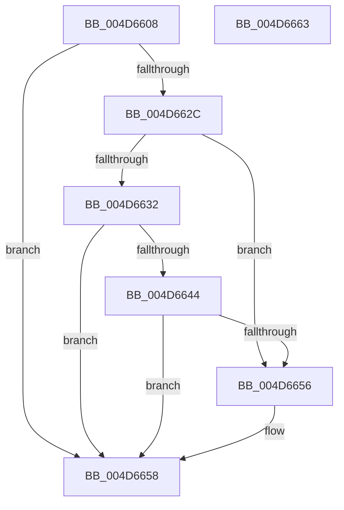

# CmpKeySecurityMarkDirtyForReferenceCountDecrement

- RVA: `0x004D6608`–`0x004D6664` (길이 `92` bytes)
- VA: `0x00000001404D6608`
- 실행 섹션: `.text`
- PDB 이름 있음: `예`; PDB Function 태그: `아니요`
- unwind 정보 RVA: `0x0005CAAC`
- 디코드: `32`개 명령, `92/92` bytes 표시
- 미해석 바이트: `0` (있으면 어셈블리에 `.byte`로 보존)

> 이 문서는 커널 이미지의 기계어와 PDB 기호를 분석해 생성했습니다. 4번과 5번은 함수 원형과 자료형을 바이너리 사용 방식에서 추정한 C 해석이며 원본 소스 복구 결과는 아닙니다.

## 1. Dependencies

- 직접 호출 지점: **3**; 고유 호출 대상: **1**
- 직접 호출자로 확인된 함수: **1**
- RIP 상대 이미지 참조: **0**

### Outgoing calls
- `0x004D6623` → [HvMarkCellDirty](../../page/85/HvMarkCellDirty_function_00859758.md) (function, `0x00859758`)
- `0x004D663B` → [HvMarkCellDirty](../../page/85/HvMarkCellDirty_function_00859758.md) (function, `0x00859758`)
- `0x004D664D` → [HvMarkCellDirty](../../page/85/HvMarkCellDirty_function_00859758.md) (function, `0x00859758`)

### Direct callers
- [CmpSetSecurityDescriptorInfo](../../page/94/CmpSetSecurityDescriptorInfo_function_00949688.md) at `0x00949B89`
- [CmpSetSecurityDescriptorInfo](../../page/94/CmpSetSecurityDescriptorInfo_function_00949688.md) at `0x00949D18`

### Static image references
- 디코드된 RIP-relative 메모리 참조가 없습니다.

## 2. Other-region calls and transfers

- 다른 실행 섹션으로 향하는 call: **3**
  - `0x004D6623` → [HvMarkCellDirty](../../page/85/HvMarkCellDirty_function_00859758.md) (`.text` → `PAGE`)
  - `0x004D663B` → [HvMarkCellDirty](../../page/85/HvMarkCellDirty_function_00859758.md) (`.text` → `PAGE`)
  - `0x004D664D` → [HvMarkCellDirty](../../page/85/HvMarkCellDirty_function_00859758.md) (`.text` → `PAGE`)
- 별도 외부 분기/꼬리 이동을 확인하지 못했습니다.

## 3. Assembly (complete function range)

```asm
004D6608  48 89 5C 24 08                  mov qword ptr [rsp + 8], rbx
004D660D  57                              push rdi
004D660E  48 83 EC 20                     sub rsp, 0x20
004D6612  41 8B C0                        mov eax, r8d
004D6615  48 8B FA                        mov rdi, rdx
004D6618  48 8B D9                        mov rbx, rcx
004D661B  8B D0                           mov edx, eax
004D661D  48 8B CF                        mov rcx, rdi
004D6620  45 33 C0                        xor r8d, r8d
004D6623  E8 30 31 38 00                  call 0x140859758
004D6628  85 C0                           test eax, eax
004D662A  78 2C                           js 0x1404d6658
004D662C  83 7B 0C 01                     cmp dword ptr [rbx + 0xc], 1
004D6630  75 24                           jne 0x1404d6656
004D6632  8B 53 04                        mov edx, dword ptr [rbx + 4]
004D6635  45 33 C0                        xor r8d, r8d
004D6638  48 8B CF                        mov rcx, rdi
004D663B  E8 18 31 38 00                  call 0x140859758
004D6640  85 C0                           test eax, eax
004D6642  78 14                           js 0x1404d6658
004D6644  8B 53 08                        mov edx, dword ptr [rbx + 8]
004D6647  45 33 C0                        xor r8d, r8d
004D664A  48 8B CF                        mov rcx, rdi
004D664D  E8 06 31 38 00                  call 0x140859758
004D6652  85 C0                           test eax, eax
004D6654  78 02                           js 0x1404d6658
004D6656  33 C0                           xor eax, eax
004D6658  48 8B 5C 24 30                  mov rbx, qword ptr [rsp + 0x30]
004D665D  48 83 C4 20                     add rsp, 0x20
004D6661  5F                              pop rdi
004D6662  C3                              ret
004D6663  CC                              int3
```

## 4. C-style interpretation (structured pseudocode)

```c
__int64 __fastcall CmpKeySecurityMarkDirtyForReferenceCountDecrement(__int64 a1, __int64 a2, int a3)
{
    __int64 result;
    __int64 v_rsp;
    unsigned __int64 v_stack_p8;

    v_stack_p8 = v_rbx;
    v_rsp = (v_rsp) - (32);
    a3 = 0;
    result = HvMarkCellDirty(a2, (unsigned int)((unsigned int)((unsigned int)(a3))), a3, a4);
    if (sign_flag) goto loc_004D6658;
    if ((*(unsigned int *)(a1 + 12)) != 1) goto loc_004D6656;
    a3 = 0;
    result = HvMarkCellDirty(a2, (unsigned int)(*(unsigned int *)(a1 + 4)), a3, a4);
    if (sign_flag) goto loc_004D6658;
    a3 = 0;
    result = HvMarkCellDirty(a2, (unsigned int)(*(unsigned int *)(a1 + 8)), a3, a4);
    if (!(sign_flag)) {
        result = 0;
    }
    v_rsp = (v_rsp) + (32);
    return result;
}
```

## 5. (Beta) C Style

```c
int64_t CmpKeySecurityMarkDirtyForReferenceCountDecrement(void *Arg1, int64_t Arg2, int32_t Arg3)
{
    uint8_t *arg1 = (uint8_t *)Arg1;

    int64_t result;
    int64_t local_rsp;
    uint64_t v_stack_p8;

    v_stack_p8 = local_rbx;
    local_rsp = (local_rsp) - (32);
    Arg3 = 0;
    result = HvMarkCellDirty(Arg2, (uint32_t)((uint32_t)((uint32_t)(Arg3))), Arg3, a4);
    if (sign_flag) goto loc_004D6658;
    if ((*(uint32_t *)(arg1 + 0xC)) != 1) goto loc_004D6656;
    Arg3 = 0;
    result = HvMarkCellDirty(Arg2, (uint32_t)(*(uint32_t *)(arg1 + 0x4)), Arg3, a4);
    if (sign_flag) goto loc_004D6658;
    Arg3 = 0;
    result = HvMarkCellDirty(Arg2, (uint32_t)(*(uint32_t *)(arg1 + 0x8)), Arg3, a4);
    if (!(sign_flag)) {
        result = 0;
    }
    local_rsp = (local_rsp) + (32);
    return result;
}
```

### 관측된 메모리 오프셋

구조체 형식이 확인되지 않은 접근은 인자 기준의 오프셋으로만 기록했습니다.

| 기준 인자 | 오프셋 표현 | 폭 (bit) | 접근 |
|---|---:|---:|---|
| `Arg1` | `+ 0x4` | `32` | `R` |
| `Arg1` | `+ 0x8` | `32` | `R` |
| `Arg1` | `+ 0xC` | `32` | `R` |

## 6. Execution-region graph

[열기: 2D/3D 그래프와 함수 탐색 컨트롤 패널](../../../control-panel.html?section=text&rva=0x004D6608&view=graph)

- 2D 그래프는 위에서 아래로 흐르고, 3D 그래프는 빈 공간을 드래그해 회전합니다. Shift+드래그는 이동, 휠은 확대·축소, 함수 노드 선택은 대상 보고서 이동입니다.

### Static fallback


