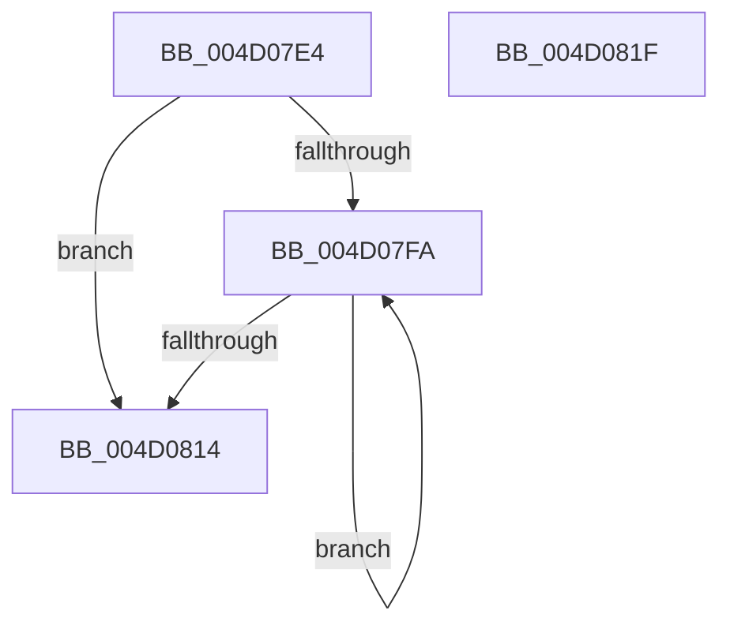

# CmpUnlockKcbStackFlusherLocksExclusive

- RVA: `0x004D07E4`–`0x004D0820` (길이 `60` bytes)
- VA: `0x00000001404D07E4`
- 실행 섹션: `.text`
- PDB 이름 있음: `예`; PDB Function 태그: `아니요`
- unwind 정보 RVA: `0x0005CAAC`
- 디코드: `19`개 명령, `60/60` bytes 표시
- 미해석 바이트: `0` (있으면 어셈블리에 `.byte`로 보존)

> 이 문서는 커널 이미지의 기계어와 PDB 기호를 분석해 생성했습니다. 4번과 5번은 함수 원형과 자료형을 바이너리 사용 방식에서 추정한 C 해석이며 원본 소스 복구 결과는 아닙니다.

## 1. Dependencies

- 직접 호출 지점: **2**; 고유 호출 대상: **2**
- 직접 호출자로 확인된 함수: **1**
- RIP 상대 이미지 참조: **0**

### Outgoing calls
- `0x004D0800` → [CmpGetKcbAtLayerHeight](../../page/94/CmpGetKcbAtLayerHeight_function_00949210.md) (function, `0x00949210`)
- `0x004D0809` → [HvUnlockHiveFlusherExclusive](../../pagecmrc/BC/HvUnlockHiveFlusherExclusive_function_00BC9C34.md) (function, `0x00BC9C34`)

### Direct callers
- [CmSaveKey](../../page/7D/CmSaveKey_function_007DDBDC.md) at `0x007DDDCB`
- [CmSaveKey](../../page/7D/CmSaveKey_function_007DDBDC.md) at `0x007DDDF4`
- [CmSaveKey](../../page/7D/CmSaveKey_function_007DDBDC.md) at `0x007DDF56`

### Static image references
- 디코드된 RIP-relative 메모리 참조가 없습니다.

## 2. Other-region calls and transfers

- 다른 실행 섹션으로 향하는 call: **2**
  - `0x004D0800` → [CmpGetKcbAtLayerHeight](../../page/94/CmpGetKcbAtLayerHeight_function_00949210.md) (`.text` → `PAGE`)
  - `0x004D0809` → [HvUnlockHiveFlusherExclusive](../../pagecmrc/BC/HvUnlockHiveFlusherExclusive_function_00BC9C34.md) (`.text` → `PAGECMRC`)
- 별도 외부 분기/꼬리 이동을 확인하지 못했습니다.

## 3. Assembly (complete function range)

```asm
004D07E4  48 89 5C 24 08                  mov qword ptr [rsp + 8], rbx
004D07E9  57                              push rdi
004D07EA  48 83 EC 20                     sub rsp, 0x20
004D07EE  0F B7 59 02                     movzx ebx, word ptr [rcx + 2]
004D07F2  48 8B F9                        mov rdi, rcx
004D07F5  66 85 DB                        test bx, bx
004D07F8  78 1A                           js 0x1404d0814
004D07FA  0F B7 D3                        movzx edx, bx
004D07FD  48 8B CF                        mov rcx, rdi
004D0800  E8 0B 8A 47 00                  call 0x140949210
004D0805  48 8B 48 20                     mov rcx, qword ptr [rax + 0x20]
004D0809  E8 26 94 6F 00                  call 0x140bc9c34
004D080E  66 83 EB 01                     sub bx, 1
004D0812  79 E6                           jns 0x1404d07fa
004D0814  48 8B 5C 24 30                  mov rbx, qword ptr [rsp + 0x30]
004D0819  48 83 C4 20                     add rsp, 0x20
004D081D  5F                              pop rdi
004D081E  C3                              ret
004D081F  CC                              int3
```

## 4. C-style interpretation (structured pseudocode)

```c
__int64 __fastcall CmpUnlockKcbStackFlusherLocksExclusive(__int64 a1)
{
    __int64 result;
    __int64 v_rbx;
    __int64 v_rsp;
    unsigned __int64 v_stack_p8;

    v_stack_p8 = v_rbx;
    v_rsp = (v_rsp) - (32);
    if (sign_flag) goto loc_004D0814;
loc_004D07FA:
    result = CmpGetKcbAtLayerHeight(a1, (unsigned __int16)(*(unsigned __int16 *)(a1 + 2)), a3, a4);
    result = HvUnlockHiveFlusherExclusive(*(unsigned __int64 *)(result + 32), (unsigned __int16)(*(unsigned __int16 *)(a1 + 2)), a3, a4);
    v_rbx = (unsigned __int16)((*(unsigned __int16 *)(a1 + 2)) - (1));
    if (!sign_flag) goto loc_004D07FA;
loc_004D0814:
    v_rsp = (v_rsp) + (32);
    return result;
}
```

## 5. (Beta) C Style

```c
int64_t CmpUnlockKcbStackFlusherLocksExclusive(void *Arg1)
{
    uint8_t *arg1 = (uint8_t *)Arg1;

    int64_t result;
    int64_t local_rbx;
    int64_t local_rsp;
    uint64_t v_stack_p8;

    v_stack_p8 = local_rbx;
    local_rsp = (local_rsp) - (32);
    if (sign_flag) goto loc_004D0814;
loc_004D07FA:
    result = CmpGetKcbAtLayerHeight(Arg1, (uint16_t)(*(uint16_t *)(arg1 + 0x2)), a3, a4);
    result = HvUnlockHiveFlusherExclusive(*(uint64_t *)(result + 0x20), (uint16_t)(*(uint16_t *)(arg1 + 0x2)), a3, a4);
    local_rbx = (uint16_t)((*(uint16_t *)(arg1 + 0x2)) - (1));
    if (!sign_flag) goto loc_004D07FA;
loc_004D0814:
    local_rsp = (local_rsp) + (32);
    return result;
}
```

### 관측된 메모리 오프셋

구조체 형식이 확인되지 않은 접근은 인자 기준의 오프셋으로만 기록했습니다.

| 기준 인자 | 오프셋 표현 | 폭 (bit) | 접근 |
|---|---:|---:|---|
| `Arg1` | `+ 0x2` | `16` | `R` |

## 6. Execution-region graph

[열기: 2D/3D 그래프와 함수 탐색 컨트롤 패널](../../../control-panel.html?section=text&rva=0x004D07E4&view=graph)

- 2D 그래프는 위에서 아래로 흐르고, 3D 그래프는 빈 공간을 드래그해 회전합니다. Shift+드래그는 이동, 휠은 확대·축소, 함수 노드 선택은 대상 보고서 이동입니다.

### Static fallback


