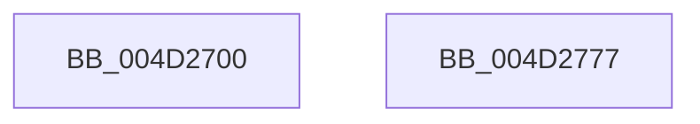

# EtwTraceDebuggerEvent

- RVA: `0x004D2700`–`0x004D2778` (길이 `120` bytes)
- VA: `0x00000001404D2700`
- 실행 섹션: `.text`
- PDB 이름 있음: `예`; PDB Function 태그: `아니요`
- unwind 정보 RVA: `0x00065FB8`
- 디코드: `26`개 명령, `120/120` bytes 표시
- 미해석 바이트: `0` (있으면 어셈블리에 `.byte`로 보존)

> 이 문서는 커널 이미지의 기계어와 PDB 기호를 분석해 생성했습니다. 4번과 5번은 함수 원형과 자료형을 바이너리 사용 방식에서 추정한 C 해석이며 원본 소스 복구 결과는 아닙니다.

## 1. Dependencies

- 직접 호출 지점: **2**; 고유 호출 대상: **2**
- 직접 호출자로 확인된 함수: **3**
- RIP 상대 이미지 참조: **1**

### Outgoing calls
- `0x004D2760` → [EtwTraceKernelEvent](../23/EtwTraceKernelEvent_function_00235350.md) (function, `0x00235350`)
- `0x004D276D` → [_security_check_cookie](../6A/_security_check_cookie_function_006AC640.md) (function, `0x006AC640`)

### Direct callers
- [DbgkForwardException](../../page/8A/DbgkForwardException_function_008A2D60.md) at `0x008A31AE`
- [NtDebugContinue](../../page/A1/NtDebugContinue_function_00A10280.md) at `0x00A10415`
- [DbgkpSendApiMessage](../../page/A7/DbgkpSendApiMessage_function_00A79458.md) at `0x00A7953B`

### Static image references
- `0x004D2707` → RVA `0x00E0A740` (`.data`; read)

## 2. Other-region calls and transfers

- 다른 실행 섹션으로 향하는 call: **0**
- 별도 외부 분기/꼬리 이동을 확인하지 못했습니다.

## 3. Assembly (complete function range)

```asm
004D2700  4C 8B DC                        mov r11, rsp
004D2703  48 83 EC 68                     sub rsp, 0x68
004D2707  48 8B 05 32 80 93 00            mov rax, qword ptr [rip + 0x938032]
004D270E  48 33 C4                        xor rax, rsp
004D2711  48 89 44 24 50                  mov qword ptr [rsp + 0x50], rax
004D2716  8B 81 D0 01 00 00               mov eax, dword ptr [rcx + 0x1d0]
004D271C  41 B9 70 03 00 00               mov r9d, 0x370
004D2722  89 44 24 30                     mov dword ptr [rsp + 0x30], eax
004D2726  49 8D 4B D8                     lea rcx, [r11 - 0x28]
004D272A  8B 82 10 05 00 00               mov eax, dword ptr [rdx + 0x510]
004D2730  BA 01 00 00 00                  mov edx, 1
004D2735  89 44 24 34                     mov dword ptr [rsp + 0x34], eax
004D2739  49 8D 43 C8                     lea rax, [r11 - 0x38]
004D273D  49 89 43 D8                     mov qword ptr [r11 - 0x28], rax
004D2741  83 64 24 4C 00                  and dword ptr [rsp + 0x4c], 0
004D2746  45 89 43 D0                     mov dword ptr [r11 - 0x30], r8d
004D274A  41 B8 00 00 40 00               mov r8d, 0x400000
004D2750  C7 44 24 48 0C 00 00 00         mov dword ptr [rsp + 0x48], 0xc
004D2758  C7 44 24 20 02 1A 50 00         mov dword ptr [rsp + 0x20], 0x501a02
004D2760  E8 EB 2B D6 FF                  call 0x140235350
004D2765  48 8B 4C 24 50                  mov rcx, qword ptr [rsp + 0x50]
004D276A  48 33 CC                        xor rcx, rsp
004D276D  E8 CE 9E 1D 00                  call 0x1406ac640
004D2772  48 83 C4 68                     add rsp, 0x68
004D2776  C3                              ret
004D2777  CC                              int3
```

## 4. C-style interpretation (structured pseudocode)

```c
__int64 __fastcall EtwTraceDebuggerEvent(__int64 a1, __int64 a2, int a3)
{
    __int64 result;
    __int64 v_rsp;
    unsigned __int64 v_stack_m18;
    unsigned int v_stack_m1C;
    unsigned int v_stack_m20;
    unsigned int v_stack_m34;
    unsigned int v_stack_m38;
    unsigned int v_stack_m48;

    v_rsp = (v_rsp) - (104);
    result = (*(unsigned __int64 *)(v_rip + 9666610)) ^ (v_rsp);
    v_stack_m18 = result;
    v_stack_m38 = (unsigned int)((unsigned int)(*(unsigned int *)(a1 + 464)));
    v_stack_m34 = (unsigned int)((unsigned int)(*(unsigned int *)(a2 + 1296)));
    *(unsigned __int64 *)(v_rsp - 40) = v_rsp - 56;
    *(unsigned int *)(v_rsp - 48) = a3;
    v_stack_m20 = 12;
    v_stack_m48 = 0x501A02ULL;
    result = EtwTraceKernelEvent(v_rsp - 40, 1, (unsigned int)(0x400000ULL), 880);
    a1 = (v_stack_m18) ^ (v_rsp);
    result = _security_check_cookie(a1, 1, (unsigned int)(0x400000ULL), 880);
    v_rsp = (v_rsp) + (104);
    return result;
}
```

## 5. (Beta) C Style

```c
int64_t EtwTraceDebuggerEvent(void *Arg1, void *Arg2, int32_t Arg3)
{
    uint8_t *arg1 = (uint8_t *)Arg1;
    uint8_t *arg2 = (uint8_t *)Arg2;

    int64_t result;
    int64_t local_rsp;
    uint64_t v_stack_m18;
    uint32_t v_stack_m1C;
    uint32_t v_stack_m20;
    uint32_t v_stack_m34;
    uint32_t v_stack_m38;
    uint32_t v_stack_m48;

    local_rsp = (local_rsp) - (104);
    result = (*(uint64_t *)(v_rip + 0x938032)) ^ (local_rsp);
    v_stack_m18 = result;
    v_stack_m38 = (uint32_t)((uint32_t)(*(uint32_t *)(arg1 + 0x1D0)));
    v_stack_m34 = (uint32_t)((uint32_t)(*(uint32_t *)(arg2 + 0x510)));
    *(uint64_t *)(local_rsp - 0x28) = local_rsp - 56;
    *(uint32_t *)(local_rsp - 0x30) = Arg3;
    v_stack_m20 = 12;
    v_stack_m48 = 0x501A02ULL;
    result = EtwTraceKernelEvent(local_rsp - 40, 1, (uint32_t)(0x400000ULL), 880);
    Arg1 = (v_stack_m18) ^ (local_rsp);
    result = _security_check_cookie(Arg1, 1, (uint32_t)(0x400000ULL), 880);
    local_rsp = (local_rsp) + (104);
    return result;
}
```

### 관측된 메모리 오프셋

구조체 형식이 확인되지 않은 접근은 인자 기준의 오프셋으로만 기록했습니다.

| 기준 인자 | 오프셋 표현 | 폭 (bit) | 접근 |
|---|---:|---:|---|
| `Arg1` | `+ 0x1D0` | `32` | `R` |
| `Arg2` | `+ 0x510` | `32` | `R` |

## 6. Execution-region graph

[열기: 2D/3D 그래프와 함수 탐색 컨트롤 패널](../../../control-panel.html?section=text&rva=0x004D2700&view=graph)

- 2D 그래프는 위에서 아래로 흐르고, 3D 그래프는 빈 공간을 드래그해 회전합니다. Shift+드래그는 이동, 휠은 확대·축소, 함수 노드 선택은 대상 보고서 이동입니다.

### Static fallback


