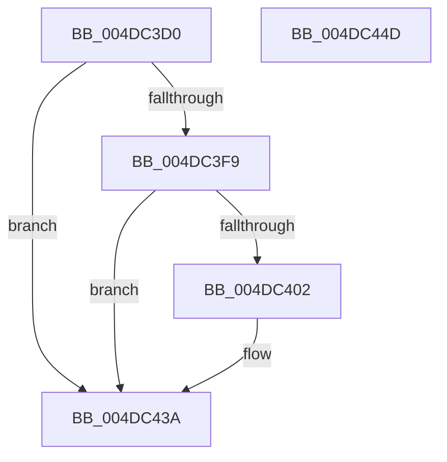

# EtwTraceThreadWorkItem

- RVA: `0x004DC3D0`–`0x004DC44E` (길이 `126` bytes)
- VA: `0x00000001404DC3D0`
- 실행 섹션: `.text`
- PDB 이름 있음: `예`; PDB Function 태그: `아니요`
- unwind 정보 RVA: `0x000A06A8`
- 디코드: `30`개 명령, `126/126` bytes 표시
- 미해석 바이트: `0` (있으면 어셈블리에 `.byte`로 보존)

> 이 문서는 커널 이미지의 기계어와 PDB 기호를 분석해 생성했습니다. 4번과 5번은 함수 원형과 자료형을 바이너리 사용 방식에서 추정한 C 해석이며 원본 소스 복구 결과는 아닙니다.

## 1. Dependencies

- 직접 호출 지점: **3**; 고유 호출 대상: **3**
- 직접 호출자로 확인된 함수: **2**
- RIP 상대 이미지 참조: **2**

### Outgoing calls
- `0x004DC3F9` → [ExIsSafeWorkItem](../50/ExIsSafeWorkItem_function_00509DA0.md) (function, `0x00509DA0`)
- `0x004DC435` → [EtwTraceKernelEvent](../23/EtwTraceKernelEvent_function_00235350.md) (function, `0x00235350`)
- `0x004DC442` → [_security_check_cookie](../6A/_security_check_cookie_function_006AC640.md) (function, `0x006AC640`)

### Direct callers
- [sub_003941F0](../39/Unknown_function_003941F0.md) at `0x003941F8`
- [sub_003941F0](../39/Unknown_function_003941F0.md) at `0x0039420A`
- [ExpWorkerThread](../4E/ExpWorkerThread_function_004ECAF0.md) at `0x004ECD65`
- [ExpWorkerThread](../4E/ExpWorkerThread_function_004ECAF0.md) at `0x004ECD7D`

### Static image references
- `0x004DC3D6` → RVA `0x00E0A740` (`.data`; read)
- `0x004DC3E5` → RVA `0x00393BB0` (`IopProcessWorkItem`; read)

## 2. Other-region calls and transfers

- 다른 실행 섹션으로 향하는 call: **0**
- 별도 외부 분기/꼬리 이동을 확인하지 못했습니다.

## 3. Assembly (complete function range)

```asm
004DC3D0  40 53                           push rbx
004DC3D2  48 83 EC 50                     sub rsp, 0x50
004DC3D6  48 8B 05 63 E3 92 00            mov rax, qword ptr [rip + 0x92e363]
004DC3DD  48 33 C4                        xor rax, rsp
004DC3E0  48 89 44 24 48                  mov qword ptr [rsp + 0x48], rax
004DC3E5  48 8D 05 C4 77 EB FF            lea rax, [rip - 0x14883c]
004DC3EC  48 89 4C 24 30                  mov qword ptr [rsp + 0x30], rcx
004DC3F1  0F B7 DA                        movzx ebx, dx
004DC3F4  48 3B C8                        cmp rcx, rax
004DC3F7  74 41                           je 0x1404dc43a
004DC3F9  E8 A2 D9 02 00                  call 0x140509da0
004DC3FE  85 C0                           test eax, eax
004DC400  75 38                           jne 0x1404dc43a
004DC402  83 64 24 44 00                  and dword ptr [rsp + 0x44], 0
004DC407  48 8D 44 24 30                  lea rax, [rsp + 0x30]
004DC40C  44 0F B7 CB                     movzx r9d, bx
004DC410  48 89 44 24 38                  mov qword ptr [rsp + 0x38], rax
004DC415  BA 01 00 00 00                  mov edx, 1
004DC41A  C7 44 24 40 08 00 00 00         mov dword ptr [rsp + 0x40], 8
004DC422  41 B8 00 00 00 48               mov r8d, 0x48000000
004DC428  C7 44 24 20 02 19 60 11         mov dword ptr [rsp + 0x20], 0x11601902
004DC430  48 8D 4C 24 38                  lea rcx, [rsp + 0x38]
004DC435  E8 16 8F D5 FF                  call 0x140235350
004DC43A  48 8B 4C 24 48                  mov rcx, qword ptr [rsp + 0x48]
004DC43F  48 33 CC                        xor rcx, rsp
004DC442  E8 F9 01 1D 00                  call 0x1406ac640
004DC447  48 83 C4 50                     add rsp, 0x50
004DC44B  5B                              pop rbx
004DC44C  C3                              ret
004DC44D  CC                              int3
```

## 4. C-style interpretation (structured pseudocode)

```c
__int64 __fastcall EtwTraceThreadWorkItem(__int64 a1, unsigned __int16 a2)
{
    __int64 result;
    __int64 v_rsp;
    unsigned __int64 v_stack_m10;
    unsigned int v_stack_m14;
    unsigned int v_stack_m18;
    unsigned __int64 v_stack_m20;
    unsigned __int64 v_stack_m28;
    unsigned int v_stack_m38;

    v_rsp = (v_rsp) - (80);
    result = (*(unsigned __int64 *)(v_rip + 9626467)) ^ (v_rsp);
    v_stack_m10 = result;
    v_stack_m28 = a1;
    if (a1 == (v_rip - 1345596)) goto loc_004DC43A;
    result = ExIsSafeWorkItem(a1, a2, a3, a4);
    if ((unsigned int)(result) == 0) {
        result = v_stack_m28;
        a4 = a2;
        v_stack_m20 = result;
        a2 = 1;
        v_stack_m18 = 8;
        a3 = 0x48000000ULL;
        v_stack_m38 = 0x11601902ULL;
        a1 = v_stack_m20;
        result = EtwTraceKernelEvent(a1, a2, a3, a4);
    }
    a1 = (v_stack_m10) ^ (v_rsp);
    result = _security_check_cookie(a1, a2, a3, a4);
    v_rsp = (v_rsp) + (80);
    return result;
}
```

## 5. (Beta) C Style

```c
int64_t EtwTraceThreadWorkItem(int64_t Arg1, uint16_t Arg2)
{
    int64_t result;
    int64_t local_rsp;
    uint64_t v_stack_m10;
    uint32_t v_stack_m14;
    uint32_t v_stack_m18;
    uint64_t v_stack_m20;
    uint64_t v_stack_m28;
    uint32_t v_stack_m38;

    local_rsp = (local_rsp) - (80);
    result = (*(uint64_t *)(v_rip + 0x92E363)) ^ (local_rsp);
    v_stack_m10 = result;
    v_stack_m28 = Arg1;
    if (Arg1 == (v_rip - 1345596)) goto loc_004DC43A;
    result = ExIsSafeWorkItem(Arg1, Arg2, a3, a4);
    if ((uint32_t)(result) == 0) {
        result = v_stack_m28;
        a4 = Arg2;
        v_stack_m20 = result;
        Arg2 = 1;
        v_stack_m18 = 8;
        a3 = 0x48000000ULL;
        v_stack_m38 = 0x11601902ULL;
        Arg1 = v_stack_m20;
        result = EtwTraceKernelEvent(Arg1, Arg2, a3, a4);
    }
    Arg1 = (v_stack_m10) ^ (local_rsp);
    result = _security_check_cookie(Arg1, Arg2, a3, a4);
    local_rsp = (local_rsp) + (80);
    return result;
}
```

## 6. Execution-region graph

[열기: 2D/3D 그래프와 함수 탐색 컨트롤 패널](../../../control-panel.html?section=text&rva=0x004DC3D0&view=graph)

- 2D 그래프는 위에서 아래로 흐르고, 3D 그래프는 빈 공간을 드래그해 회전합니다. Shift+드래그는 이동, 휠은 확대·축소, 함수 노드 선택은 대상 보고서 이동입니다.

### Static fallback


