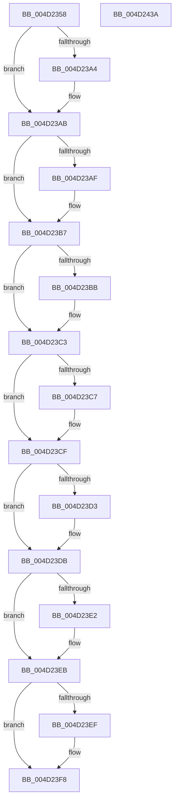

# EtwTraceXSchedulerPriorityUpdate

- RVA: `0x004D2358`–`0x004D243B` (길이 `227` bytes)
- VA: `0x00000001404D2358`
- 실행 섹션: `.text`
- PDB 이름 있음: `예`; PDB Function 태그: `아니요`
- unwind 정보 RVA: `0x000BDE20`
- 디코드: `65`개 명령, `227/227` bytes 표시
- 미해석 바이트: `0` (있으면 어셈블리에 `.byte`로 보존)

> 이 문서는 커널 이미지의 기계어와 PDB 기호를 분석해 생성했습니다. 4번과 5번은 함수 원형과 자료형을 바이너리 사용 방식에서 추정한 C 해석이며 원본 소스 복구 결과는 아닙니다.

## 1. Dependencies

- 직접 호출 지점: **2**; 고유 호출 대상: **2**
- 직접 호출자로 확인된 함수: **4**
- RIP 상대 이미지 참조: **1**

### Outgoing calls
- `0x004D2423` → [EtwTraceKernelEvent](../23/EtwTraceKernelEvent_function_00235350.md) (function, `0x00235350`)
- `0x004D242F` → [_security_check_cookie](../6A/_security_check_cookie_function_006AC640.md) (function, `0x006AC640`)

### Direct callers
- [sub_0021D7F8](../21/Unknown_function_0021D7F8.md) at `0x0021E955`
- [sub_002546EC](../25/Unknown_function_002546EC.md) at `0x00254DB6`
- [KiUpdateVpBackingThreadPriorityFromTopLevel](../30/KiUpdateVpBackingThreadPriorityFromTopLevel_function_00303BA0.md) at `0x00303E96`
- [KiUpdateVPBackingThreadPriority](../30/KiUpdateVPBackingThreadPriority_function_00306040.md) at `0x0030615E`

### Static image references
- `0x004D2361` → RVA `0x00E0A740` (`.data`; read)

## 2. Other-region calls and transfers

- 다른 실행 섹션으로 향하는 call: **0**
- 별도 외부 분기/꼬리 이동을 확인하지 못했습니다.

## 3. Assembly (complete function range)

```asm
004D2358  40 55                           push rbp
004D235A  48 8B EC                        mov rbp, rsp
004D235D  48 83 EC 60                     sub rsp, 0x60
004D2361  48 8B 05 D8 83 93 00            mov rax, qword ptr [rip + 0x9383d8]
004D2368  48 33 C4                        xor rax, rsp
004D236B  48 89 45 F0                     mov qword ptr [rbp - 0x10], rax
004D236F  8B 81 10 05 00 00               mov eax, dword ptr [rcx + 0x510]
004D2375  45 33 D2                        xor r10d, r10d
004D2378  48 8B 4D 30                     mov rcx, qword ptr [rbp + 0x30]
004D237C  89 45 D0                        mov dword ptr [rbp - 0x30], eax
004D237F  88 55 D4                        mov byte ptr [rbp - 0x2c], dl
004D2382  41 8D 52 01                     lea edx, [r10 + 1]
004D2386  44 89 55 DC                     mov dword ptr [rbp - 0x24], r10d
004D238A  8A 41 02                        mov al, byte ptr [rcx + 2]
004D238D  88 45 D6                        mov byte ptr [rbp - 0x2a], al
004D2390  8B 41 04                        mov eax, dword ptr [rcx + 4]
004D2393  89 45 D8                        mov dword ptr [rbp - 0x28], eax
004D2396  8A 01                           mov al, byte ptr [rcx]
004D2398  44 88 4D D5                     mov byte ptr [rbp - 0x2b], r9b
004D239C  44 88 45 D7                     mov byte ptr [rbp - 0x29], r8b
004D23A0  84 C2                           test dl, al
004D23A2  74 07                           je 0x1404d23ab
004D23A4  44 0B D2                        or r10d, edx
004D23A7  44 89 55 DC                     mov dword ptr [rbp - 0x24], r10d
004D23AB  A8 02                           test al, 2
004D23AD  74 08                           je 0x1404d23b7
004D23AF  41 83 CA 02                     or r10d, 2
004D23B3  44 89 55 DC                     mov dword ptr [rbp - 0x24], r10d
004D23B7  A8 04                           test al, 4
004D23B9  74 08                           je 0x1404d23c3
004D23BB  41 83 CA 08                     or r10d, 8
004D23BF  44 89 55 DC                     mov dword ptr [rbp - 0x24], r10d
004D23C3  A8 08                           test al, 8
004D23C5  74 08                           je 0x1404d23cf
004D23C7  41 83 CA 10                     or r10d, 0x10
004D23CB  44 89 55 DC                     mov dword ptr [rbp - 0x24], r10d
004D23CF  A8 10                           test al, 0x10
004D23D1  74 08                           je 0x1404d23db
004D23D3  41 83 CA 20                     or r10d, 0x20
004D23D7  44 89 55 DC                     mov dword ptr [rbp - 0x24], r10d
004D23DB  8A 41 01                        mov al, byte ptr [rcx + 1]
004D23DE  84 C2                           test dl, al
004D23E0  74 09                           je 0x1404d23eb
004D23E2  41 0F BA EA 08                  bts r10d, 8
004D23E7  44 89 55 DC                     mov dword ptr [rbp - 0x24], r10d
004D23EB  A8 02                           test al, 2
004D23ED  74 09                           je 0x1404d23f8
004D23EF  41 0F BA EA 09                  bts r10d, 9
004D23F4  44 89 55 DC                     mov dword ptr [rbp - 0x24], r10d
004D23F8  83 65 EC 00                     and dword ptr [rbp - 0x14], 0
004D23FC  48 8D 45 D0                     lea rax, [rbp - 0x30]
004D2400  41 B9 73 0F 00 00               mov r9d, 0xf73
004D2406  48 89 45 E0                     mov qword ptr [rbp - 0x20], rax
004D240A  41 B8 20 00 00 A0               mov r8d, 0xa0000020
004D2410  C7 45 E8 10 00 00 00            mov dword ptr [rbp - 0x18], 0x10
004D2417  48 8D 4D E0                     lea rcx, [rbp - 0x20]
004D241B  C7 44 24 20 02 0A 50 00         mov dword ptr [rsp + 0x20], 0x500a02
004D2423  E8 28 2F D6 FF                  call 0x140235350
004D2428  48 8B 4D F0                     mov rcx, qword ptr [rbp - 0x10]
004D242C  48 33 CC                        xor rcx, rsp
004D242F  E8 0C A2 1D 00                  call 0x1406ac640
004D2434  48 83 C4 60                     add rsp, 0x60
004D2438  5D                              pop rbp
004D2439  C3                              ret
004D243A  CC                              int3
```

## 4. C-style interpretation (structured pseudocode)

```c
__int64 __fastcall EtwTraceXSchedulerPriorityUpdate(__int64 a1, unsigned __int8 a2, unsigned __int8 a3, unsigned __int8 a4, __int64 a5)
{
    __int64 result;
    __int64 v_r10;
    __int64 v_rsp;
    unsigned __int64 v_stack_m18;
    unsigned int v_stack_m1C;
    unsigned int v_stack_m20;
    unsigned __int64 v_stack_m28;
    unsigned int v_stack_m2C;
    unsigned int v_stack_m30;
    unsigned __int8 v_stack_m31;
    unsigned __int8 v_stack_m32;
    unsigned __int8 v_stack_m33;
    unsigned __int8 v_stack_m34;
    unsigned int v_stack_m38;
    unsigned int v_stack_m48;

    v_rsp = (v_rsp) - (96);
    result = (*(unsigned __int64 *)(v_rip + 9667544)) ^ (v_rsp);
    v_stack_m18 = result;
    v_r10 = 0;
    v_stack_m38 = (unsigned int)((unsigned int)(*(unsigned int *)(a1 + 1296)));
    v_stack_m34 = a2;
    v_stack_m2C = 0;
    v_stack_m32 = (unsigned __int8)(*(unsigned __int8 *)(a5 + 2));
    v_stack_m30 = (unsigned int)((unsigned int)(*(unsigned int *)(a5 + 4)));
    v_stack_m33 = a4;
    v_stack_m31 = a3;
    if ((((unsigned __int8)(v_r10 + 1)) & ((unsigned __int8)(*(unsigned __int8 *)(a5)))) != 0) {
        v_r10 = (unsigned int)((v_r10) | ((unsigned int)(v_r10 + 1)));
        v_stack_m2C = (unsigned int)(v_r10);
    }
    if ((((unsigned __int8)(*(unsigned __int8 *)(a5))) & (2)) != 0) {
        v_r10 = (unsigned int)((v_r10) | (2));
        v_stack_m2C = (unsigned int)(v_r10);
    }
    if ((((unsigned __int8)(*(unsigned __int8 *)(a5))) & (4)) != 0) {
        v_r10 = (unsigned int)((v_r10) | (8));
        v_stack_m2C = (unsigned int)(v_r10);
    }
    if ((((unsigned __int8)(*(unsigned __int8 *)(a5))) & (8)) != 0) {
        v_r10 = (unsigned int)((v_r10) | (16));
        v_stack_m2C = (unsigned int)(v_r10);
    }
    if ((((unsigned __int8)(*(unsigned __int8 *)(a5))) & (16)) != 0) {
        v_r10 = (unsigned int)((v_r10) | (32));
        v_stack_m2C = (unsigned int)(v_r10);
    }
    if ((((unsigned __int8)(v_r10 + 1)) & ((unsigned __int8)(*(unsigned __int8 *)(a5 + 1)))) != 0) {
        v_stack_m2C = (unsigned int)(v_r10);
    }
    if ((((unsigned __int8)(*(unsigned __int8 *)(a5 + 1))) & (2)) != 0) {
        v_stack_m2C = (unsigned int)(v_r10);
    }
    v_stack_m28 = v_stack_m38;
    v_stack_m20 = 16;
    v_stack_m48 = 0x500A02ULL;
    result = EtwTraceKernelEvent(v_stack_m28, v_r10 + 1, (unsigned int)(0xA0000020ULL), (unsigned int)(0xF73ULL));
    a1 = (v_stack_m18) ^ (v_rsp);
    result = _security_check_cookie(a1, v_r10 + 1, (unsigned int)(0xA0000020ULL), (unsigned int)(0xF73ULL));
    v_rsp = (v_rsp) + (96);
    return result;
}
```

## 5. (Beta) C Style

```c
int64_t EtwTraceXSchedulerPriorityUpdate(void *Arg1, uint8_t Arg2, uint8_t Arg3, uint8_t Arg4, void *Arg5)
{
    uint8_t *arg1 = (uint8_t *)Arg1;
    uint8_t *arg5 = (uint8_t *)Arg5;

    int64_t result;
    int64_t local_r10;
    int64_t local_rsp;
    uint64_t v_stack_m18;
    uint32_t v_stack_m1C;
    uint32_t v_stack_m20;
    uint64_t v_stack_m28;
    uint32_t v_stack_m2C;
    uint32_t v_stack_m30;
    uint8_t v_stack_m31;
    uint8_t v_stack_m32;
    uint8_t v_stack_m33;
    uint8_t v_stack_m34;
    uint32_t v_stack_m38;
    uint32_t v_stack_m48;

    local_rsp = (local_rsp) - (96);
    result = (*(uint64_t *)(v_rip + 0x9383D8)) ^ (local_rsp);
    v_stack_m18 = result;
    local_r10 = 0;
    v_stack_m38 = (uint32_t)((uint32_t)(*(uint32_t *)(arg1 + 0x510)));
    v_stack_m34 = Arg2;
    v_stack_m2C = 0;
    v_stack_m32 = (uint8_t)(*(uint8_t *)(arg5 + 0x2));
    v_stack_m30 = (uint32_t)((uint32_t)(*(uint32_t *)(arg5 + 0x4)));
    v_stack_m33 = Arg4;
    v_stack_m31 = Arg3;
    if ((((uint8_t)(local_r10 + 1)) & ((uint8_t)(*(uint8_t *)(arg5)))) != 0) {
        local_r10 = (uint32_t)((local_r10) | ((uint32_t)(local_r10 + 1)));
        v_stack_m2C = (uint32_t)(local_r10);
    }
    if ((((uint8_t)(*(uint8_t *)(arg5))) & (2)) != 0) {
        local_r10 = (uint32_t)((local_r10) | (2));
        v_stack_m2C = (uint32_t)(local_r10);
    }
    if ((((uint8_t)(*(uint8_t *)(arg5))) & (4)) != 0) {
        local_r10 = (uint32_t)((local_r10) | (8));
        v_stack_m2C = (uint32_t)(local_r10);
    }
    if ((((uint8_t)(*(uint8_t *)(arg5))) & (8)) != 0) {
        local_r10 = (uint32_t)((local_r10) | (16));
        v_stack_m2C = (uint32_t)(local_r10);
    }
    if ((((uint8_t)(*(uint8_t *)(arg5))) & (16)) != 0) {
        local_r10 = (uint32_t)((local_r10) | (32));
        v_stack_m2C = (uint32_t)(local_r10);
    }
    if ((((uint8_t)(local_r10 + 1)) & ((uint8_t)(*(uint8_t *)(arg5 + 0x1)))) != 0) {
        v_stack_m2C = (uint32_t)(local_r10);
    }
    if ((((uint8_t)(*(uint8_t *)(arg5 + 0x1))) & (2)) != 0) {
        v_stack_m2C = (uint32_t)(local_r10);
    }
    v_stack_m28 = v_stack_m38;
    v_stack_m20 = 16;
    v_stack_m48 = 0x500A02ULL;
    result = EtwTraceKernelEvent(v_stack_m28, local_r10 + 1, (uint32_t)(0xA0000020ULL), (uint32_t)(0xF73ULL));
    Arg1 = (v_stack_m18) ^ (local_rsp);
    result = _security_check_cookie(Arg1, local_r10 + 1, (uint32_t)(0xA0000020ULL), (uint32_t)(0xF73ULL));
    local_rsp = (local_rsp) + (96);
    return result;
}
```

### 관측된 메모리 오프셋

구조체 형식이 확인되지 않은 접근은 인자 기준의 오프셋으로만 기록했습니다.

| 기준 인자 | 오프셋 표현 | 폭 (bit) | 접근 |
|---|---:|---:|---|
| `Arg1` | `+ 0x510` | `32` | `R` |
| `Arg5` | `+ 0x0` | `8` | `R` |
| `Arg5` | `+ 0x1` | `8` | `R` |
| `Arg5` | `+ 0x2` | `8` | `R` |
| `Arg5` | `+ 0x4` | `32` | `R` |

## 6. Execution-region graph

[열기: 2D/3D 그래프와 함수 탐색 컨트롤 패널](../../../control-panel.html?section=text&rva=0x004D2358&view=graph)

- 2D 그래프는 위에서 아래로 흐르고, 3D 그래프는 빈 공간을 드래그해 회전합니다. Shift+드래그는 이동, 휠은 확대·축소, 함수 노드 선택은 대상 보고서 이동입니다.

### Static fallback


