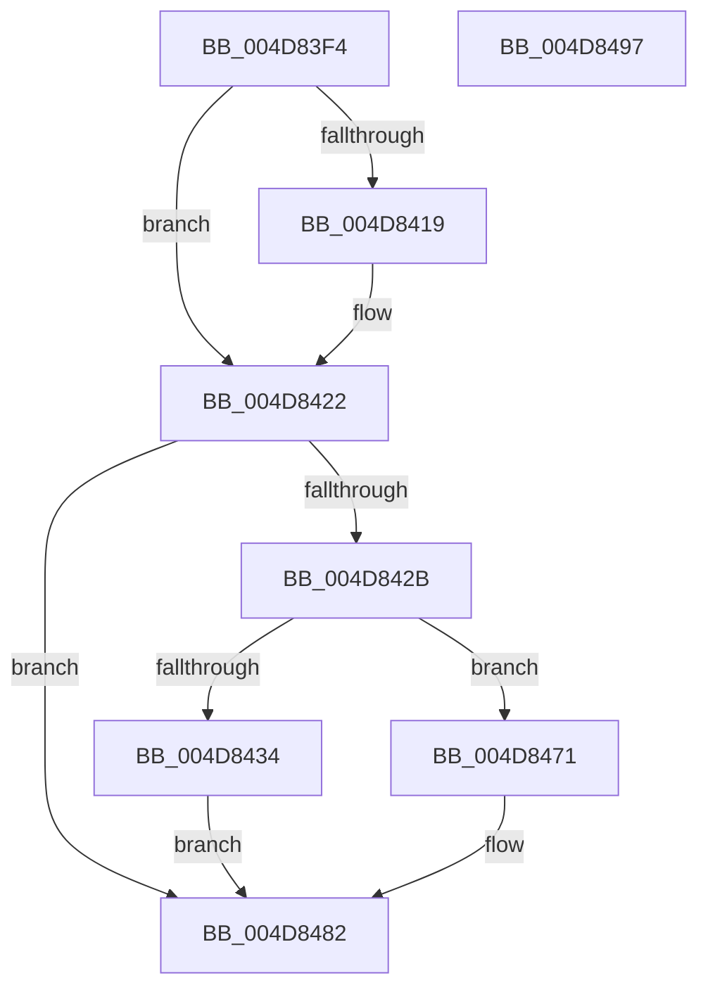

# EtwpContextRegisterTracingDispatcher

- RVA: `0x004D83F4`–`0x004D8498` (길이 `164` bytes)
- VA: `0x00000001404D83F4`
- 실행 섹션: `.text`
- PDB 이름 있음: `예`; PDB Function 태그: `아니요`
- unwind 정보 RVA: `0x0007D3C0`
- 디코드: `42`개 명령, `164/164` bytes 표시
- 미해석 바이트: `0` (있으면 어셈블리에 `.byte`로 보존)

> 이 문서는 커널 이미지의 기계어와 PDB 기호를 분석해 생성했습니다. 4번과 5번은 함수 원형과 자료형을 바이너리 사용 방식에서 추정한 C 해석이며 원본 소스 복구 결과는 아닙니다.

## 1. Dependencies

- 직접 호출 지점: **3**; 고유 호출 대상: **3**
- 직접 호출자로 확인된 함수: **3**
- RIP 상대 이미지 참조: **2**

### Outgoing calls
- `0x004D842B` → [KeGetEffectiveIrql](../2F/KeGetEffectiveIrql_function_002F8030.md) (function, `0x002F8030`)
- `0x004D846A` → [EtwpQueueApc](../20/EtwpQueueApc_function_00203B7C.md) (function, `0x00203B7C`)
- `0x004D847D` → [EtwpTraceContextRegisters](../64/EtwpTraceContextRegisters_function_0064F108.md) (function, `0x0064F108`)

### Direct callers
- [EtwpLogKernelEvent](../25/EtwpLogKernelEvent_function_0025CC00.md) at `0x0025D88E`
- [EtwpLogSystemEventUnsafe](../2F/EtwpLogSystemEventUnsafe_function_002FBF10.md) at `0x002FC894`
- [EtwpLogContextSwapEvent](../41/EtwpLogContextSwapEvent_function_004175F0.md) at `0x00417B70`

### Static image references
- `0x004D8443` → RVA `0x0064E810` (`EtwpContextRegisterTracingApc`; read)
- `0x004D8453` → RVA `0x0049E550` (`EmpCheckErrataList`; read)

## 2. Other-region calls and transfers

- 다른 실행 섹션으로 향하는 call: **0**
- 별도 외부 분기/꼬리 이동을 확인하지 못했습니다.

## 3. Assembly (complete function range)

```asm
004D83F4  48 89 5C 24 08                  mov qword ptr [rsp + 8], rbx
004D83F9  48 89 6C 24 10                  mov qword ptr [rsp + 0x10], rbp
004D83FE  48 89 74 24 18                  mov qword ptr [rsp + 0x18], rsi
004D8403  57                              push rdi
004D8404  48 83 EC 40                     sub rsp, 0x40
004D8408  41 8B E9                        mov ebp, r9d
004D840B  49 8B D8                        mov rbx, r8
004D840E  48 8B FA                        mov rdi, rdx
004D8411  48 8B F1                        mov rsi, rcx
004D8414  4D 85 C0                        test r8, r8
004D8417  75 09                           jne 0x1404d8422
004D8419  65 48 8B 1C 25 88 01 00 00      mov rbx, qword ptr gs:[0x188]
004D8422  F7 43 74 00 04 00 00            test dword ptr [rbx + 0x74], 0x400
004D8429  75 57                           jne 0x1404d8482
004D842B  E8 00 FC E1 FF                  call 0x1402f8030
004D8430  3C 02                           cmp al, 2
004D8432  72 3D                           jb 0x1404d8471
004D8434  48 83 64 24 38 00               and qword ptr [rsp + 0x38], 0
004D843A  48 8D 8E 40 04 00 00            lea rcx, [rsi + 0x440]
004D8441  8B 17                           mov edx, dword ptr [rdi]
004D8443  4C 8D 0D C6 63 17 00            lea r9, [rip + 0x1763c6]
004D844A  44 8B 47 04                     mov r8d, dword ptr [rdi + 4]
004D844E  48 89 54 24 30                  mov qword ptr [rsp + 0x30], rdx
004D8453  48 8D 15 F6 60 FC FF            lea rdx, [rip - 0x39f0a]
004D845A  4C 89 44 24 28                  mov qword ptr [rsp + 0x28], r8
004D845F  44 8A C0                        mov r8b, al
004D8462  48 89 54 24 20                  mov qword ptr [rsp + 0x20], rdx
004D8467  48 8B D3                        mov rdx, rbx
004D846A  E8 0D B7 D2 FF                  call 0x140203b7c
004D846F  EB 11                           jmp 0x1404d8482
004D8471  44 8B CD                        mov r9d, ebp
004D8474  4C 8B C3                        mov r8, rbx
004D8477  48 8B D7                        mov rdx, rdi
004D847A  48 8B CE                        mov rcx, rsi
004D847D  E8 86 6C 17 00                  call 0x14064f108
004D8482  48 8B 5C 24 50                  mov rbx, qword ptr [rsp + 0x50]
004D8487  48 8B 6C 24 58                  mov rbp, qword ptr [rsp + 0x58]
004D848C  48 8B 74 24 60                  mov rsi, qword ptr [rsp + 0x60]
004D8491  48 83 C4 40                     add rsp, 0x40
004D8495  5F                              pop rdi
004D8496  C3                              ret
004D8497  CC                              int3
```

## 4. C-style interpretation (structured pseudocode)

```c
__int64 __fastcall EtwpContextRegisterTracingDispatcher(__int64 a1, __int64 a2, __int64 a3, int a4)
{
    __int64 result;
    __int64 v_rbx;
    __int64 v_rsp;
    unsigned __int64 v_stack_m10;
    unsigned __int64 v_stack_m18;
    unsigned __int64 v_stack_m20;
    unsigned __int64 v_stack_m28;
    unsigned __int64 v_stack_p10;
    unsigned __int64 v_stack_p18;
    unsigned __int64 v_stack_p8;

    v_stack_p8 = v_rbx;
    v_stack_p10 = v_rbp;
    v_stack_p18 = v_rsi;
    v_rsp = (v_rsp) - (64);
    v_rbx = a3;
    if (a3 == 0) {
        v_rbx = *(unsigned __int64 *)(gs_base + (0 + 392));
    }
    if (((*(unsigned int *)(v_rbx + 116)) & (0x400ULL)) != 0) goto loc_004D8482;
    result = KeGetEffectiveIrql(a1, a2, a3, a4);
    if (((unsigned __int8)(result)) < 2) goto loc_004D8471;
    v_stack_m18 = (unsigned int)(*(unsigned int *)(a2));
    v_stack_m20 = (unsigned int)(*(unsigned int *)(a2 + 4));
    v_stack_m28 = v_rip - 237322;
    result = EtwpQueueApc(a1 + 1088, v_rbx, (unsigned __int8)(result), v_rip + 1532870);
    goto loc_004D8482;
loc_004D8471:
    result = EtwpTraceContextRegisters(a1, a2, v_rbx, (unsigned int)((unsigned int)((unsigned int)(a4))));
loc_004D8482:
    v_rsp = (v_rsp) + (64);
    return result;
}
```

## 5. (Beta) C Style

```c
int64_t EtwpContextRegisterTracingDispatcher(void *Arg1, void *Arg2, int64_t Arg3, int32_t Arg4)
{
    uint8_t *arg1 = (uint8_t *)Arg1;
    uint8_t *arg2 = (uint8_t *)Arg2;

    int64_t result;
    int64_t local_rbx;
    int64_t local_rsp;
    uint64_t v_stack_m10;
    uint64_t v_stack_m18;
    uint64_t v_stack_m20;
    uint64_t v_stack_m28;
    uint64_t v_stack_p10;
    uint64_t v_stack_p18;
    uint64_t v_stack_p8;

    v_stack_p8 = local_rbx;
    v_stack_p10 = local_rbp;
    v_stack_p18 = local_rsi;
    local_rsp = (local_rsp) - (64);
    local_rbx = Arg3;
    if (Arg3 == 0) {
        local_rbx = *(uint64_t *)(gs_base + (0 + 0x188));
    }
    if (((*(uint32_t *)(local_rbx + 0x74)) & (0x400ULL)) != 0) goto loc_004D8482;
    result = KeGetEffectiveIrql(Arg1, Arg2, Arg3, Arg4);
    if (((uint8_t)(result)) < 2) goto loc_004D8471;
    v_stack_m18 = (uint32_t)(*(uint32_t *)(arg2));
    v_stack_m20 = (uint32_t)(*(uint32_t *)(arg2 + 0x4));
    v_stack_m28 = v_rip - 237322;
    result = EtwpQueueApc(Arg1 + 1088, local_rbx, (uint8_t)(result), v_rip + 1532870);
    goto loc_004D8482;
loc_004D8471:
    result = EtwpTraceContextRegisters(Arg1, Arg2, local_rbx, (uint32_t)((uint32_t)((uint32_t)(Arg4))));
loc_004D8482:
    local_rsp = (local_rsp) + (64);
    return result;
}
```

### 관측된 메모리 오프셋

구조체 형식이 확인되지 않은 접근은 인자 기준의 오프셋으로만 기록했습니다.

| 기준 인자 | 오프셋 표현 | 폭 (bit) | 접근 |
|---|---:|---:|---|
| `Arg1` | `+ 0x440` | `64` | `R` |
| `Arg2` | `+ 0x0` | `32` | `R` |
| `Arg2` | `+ 0x4` | `32` | `R` |

## 6. Execution-region graph

[열기: 2D/3D 그래프와 함수 탐색 컨트롤 패널](../../../control-panel.html?section=text&rva=0x004D83F4&view=graph)

- 2D 그래프는 위에서 아래로 흐르고, 3D 그래프는 빈 공간을 드래그해 회전합니다. Shift+드래그는 이동, 휠은 확대·축소, 함수 노드 선택은 대상 보고서 이동입니다.

### Static fallback


