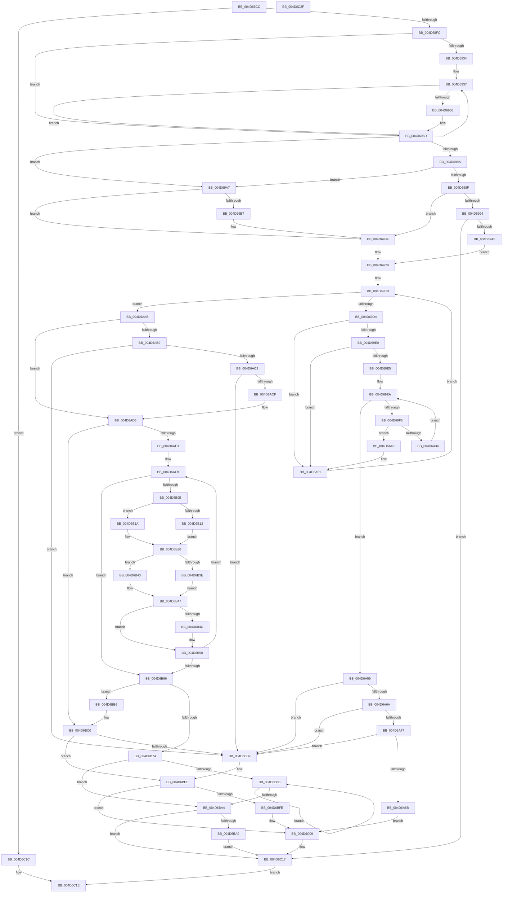

# EtwpGetCrimsonStackKey

- RVA: `0x004D68CC`–`0x004D6C30` (길이 `868` bytes)
- VA: `0x00000001404D68CC`
- 실행 섹션: `.text`
- PDB 이름 있음: `예`; PDB Function 태그: `아니요`
- unwind 정보 RVA: `0x000BE498`
- 디코드: `245`개 명령, `868/868` bytes 표시
- 미해석 바이트: `0` (있으면 어셈블리에 `.byte`로 보존)

> 이 문서는 커널 이미지의 기계어와 PDB 기호를 분석해 생성했습니다. 4번과 5번은 함수 원형과 자료형을 바이너리 사용 방식에서 추정한 C 해석이며 원본 소스 복구 결과는 아닙니다.

## 1. Dependencies

- 직접 호출 지점: **12**; 고유 호출 대상: **9**
- 직접 호출자로 확인된 함수: **2**
- RIP 상대 이미지 참조: **1**

### Outgoing calls
- `0x004D6998` → [KxTryToAcquireSpinLock](../46/KxTryToAcquireSpinLock_function_0046BE18.md) (function, `0x0046BE18`)
- `0x004D69BA` → [KiRaiseIrqlProcessIrqlFlags](../4F/KiRaiseIrqlProcessIrqlFlags_function_004F56FC.md) (function, `0x004F56FC`)
- `0x004D69C3` → [KeAcquireSpinLockAtDpcLevel](../20/KeAcquireSpinLockAtDpcLevel_function_00208430.md) (function, `0x00208430`)
- `0x004D6A2A` → [RtlCompareMemory](../6B/RtlCompareMemory_function_006BA670.md) (function, `0x006BA670`)
- `0x004D6AA1` → [KeReleaseSpinLock](../39/KeReleaseSpinLock_function_00392BA0.md) (function, `0x00392BA0`)
- `0x004D6AFE` → [ExpInterlockedPopEntrySList](../6B/ExpInterlockedPopEntrySList_function_006BA570.md) (function, `0x006BA570`)
- `0x004D6B35` → [memcpy](../6C/memcpy_function_006C6840.md) (function, `0x006C6840`)
- `0x004D6B7C` → [KeReleaseSpinLock](../39/KeReleaseSpinLock_function_00392BA0.md) (function, `0x00392BA0`)
- `0x004D6B97` → [ExpInterlockedPushEntrySList](../6B/ExpInterlockedPushEntrySList_function_006BA5B0.md) (function, `0x006BA5B0`)
- `0x004D6BAF` → [EtwpDereferenceStackEntry](../3F/EtwpDereferenceStackEntry_function_003FC9D0.md) (function, `0x003FC9D0`)
- `0x004D6BF4` → [KeReleaseSpinLock](../39/KeReleaseSpinLock_function_00392BA0.md) (function, `0x00392BA0`)
- `0x004D6C04` → [EtwpDereferenceStackEntry](../3F/EtwpDereferenceStackEntry_function_003FC9D0.md) (function, `0x003FC9D0`)

### Direct callers
- [EtwpEventWriteFull](../22/EtwpEventWriteFull_function_00225C10.md) at `0x0022667F`
- [EtwpWriteUserEvent](../../page/AF/EtwpWriteUserEvent_function_00AF2FEC.md) at `0x00AF36BA`

### Static image references
- `0x004D69AF` → RVA `0x00FC6D20` (`ALMOSTRO`; read)

## 2. Other-region calls and transfers

- 다른 실행 섹션으로 향하는 call: **0**
- 별도 외부 분기/꼬리 이동을 확인하지 못했습니다.

## 3. Assembly (complete function range)

```asm
004D68CC  4C 89 44 24 18                  mov qword ptr [rsp + 0x18], r8
004D68D1  48 89 54 24 10                  mov qword ptr [rsp + 0x10], rdx
004D68D6  53                              push rbx
004D68D7  55                              push rbp
004D68D8  56                              push rsi
004D68D9  57                              push rdi
004D68DA  41 54                           push r12
004D68DC  41 55                           push r13
004D68DE  41 56                           push r14
004D68E0  41 57                           push r15
004D68E2  48 83 EC 58                     sub rsp, 0x58
004D68E6  33 FF                           xor edi, edi
004D68E8  4C 8B DA                        mov r11, rdx
004D68EB  49 89 38                        mov qword ptr [r8], rdi
004D68EE  8B 81 34 03 00 00               mov eax, dword ptr [rcx + 0x334]
004D68F4  A8 01                           test al, 1
004D68F6  0F 84 20 03 00 00               je 0x1404d6c1c
004D68FC  0F B7 6A 06                     movzx ebp, word ptr [rdx + 6]
004D6900  8D 77 02                        lea esi, [rdi + 2]
004D6903  4C 8B A1 20 04 00 00            mov r12, qword ptr [rcx + 0x420]
004D690A  83 ED 08                        sub ebp, 8
004D690D  C1 ED 03                        shr ebp, 3
004D6910  44 8B FF                        mov r15d, edi
004D6913  44 8B C5                        mov r8d, ebp
004D6916  44 8B EF                        mov r13d, edi
004D6919  49 C1 E0 02                     shl r8, 2
004D691D  44 8B CF                        mov r9d, edi
004D6920  4C 89 64 24 28                  mov qword ptr [rsp + 0x28], r12
004D6925  48 89 7C 24 40                  mov qword ptr [rsp + 0x40], rdi
004D692A  48 89 7C 24 30                  mov qword ptr [rsp + 0x30], rdi
004D692F  4D 85 C0                        test r8, r8
004D6932  74 29                           je 0x1404d695d
004D6934  44 8B D7                        mov r10d, edi
004D6937  41 8D 41 01                     lea eax, [r9 + 1]
004D693B  44 03 CE                        add r9d, esi
004D693E  41 0F B7 54 43 10               movzx edx, word ptr [r11 + rax*2 + 0x10]
004D6944  43 0F B7 44 53 10               movzx eax, word ptr [r11 + r10*2 + 0x10]
004D694A  48 33 D0                        xor rdx, rax
004D694D  45 8B D1                        mov r10d, r9d
004D6950  4C 03 EA                        add r13, rdx
004D6953  4D 3B D0                        cmp r10, r8
004D6956  72 DF                           jb 0x1404d6937
004D6958  4C 89 6C 24 30                  mov qword ptr [rsp + 0x30], r13
004D695D  33 D2                           xor edx, edx
004D695F  41 8B C5                        mov eax, r13d
004D6962  41 F7 74 24 08                  div dword ptr [r12 + 8]
004D6967  8B DF                           mov ebx, edi
004D6969  48 8D 42 02                     lea rax, [rdx + 2]
004D696D  48 8D 04 42                     lea rax, [rdx + rax*2]
004D6971  4D 8D 34 C4                     lea r14, [r12 + rax*8]
004D6975  4C 89 74 24 48                  mov qword ptr [rsp + 0x48], r14
004D697A  44 0F 20 C0                     mov rax, cr8
004D697E  48 89 44 24 38                  mov qword ptr [rsp + 0x38], rax
004D6983  0F B6 C8                        movzx ecx, al
004D6986  84 C0                           test al, al
004D6988  74 1D                           je 0x1404d69a7
004D698A  83 E9 01                        sub ecx, 1
004D698D  74 18                           je 0x1404d69a7
004D698F  83 F9 01                        cmp ecx, 1
004D6992  74 2B                           je 0x1404d69bf
004D6994  49 8D 4E 10                     lea rcx, [r14 + 0x10]
004D6998  E8 7B 54 F9 FF                  call 0x14046be18
004D699D  84 C0                           test al, al
004D699F  0F 84 72 02 00 00               je 0x1404d6c17
004D69A5  EB 21                           jmp 0x1404d69c8
004D69A7  44 0F 20 C1                     mov rcx, cr8
004D69AB  44 0F 22 C6                     mov cr8, rsi
004D69AF  39 3D 6B 03 AF 00               cmp dword ptr [rip + 0xaf036b], edi
004D69B5  74 08                           je 0x1404d69bf
004D69B7  40 8A D6                        mov dl, sil
004D69BA  E8 3D ED 01 00                  call 0x1404f56fc
004D69BF  49 8D 4E 10                     lea rcx, [r14 + 0x10]
004D69C3  E8 68 1A D3 FF                  call 0x140208430
004D69C8  49 8B 36                        mov rsi, qword ptr [r14]
004D69CB  49 3B F6                        cmp rsi, r14
004D69CE  0F 84 D7 00 00 00               je 0x1404d6aab
004D69D4  FF C3                           inc ebx
004D69D6  89 5C 24 20                     mov dword ptr [rsp + 0x20], ebx
004D69DA  44 39 6E 1C                     cmp dword ptr [rsi + 0x1c], r13d
004D69DE  75 71                           jne 0x1404d6a51
004D69E0  39 6E 20                        cmp dword ptr [rsi + 0x20], ebp
004D69E3  75 6C                           jne 0x1404d6a51
004D69E5  8B CF                           mov ecx, edi
004D69E7  4C 8B EE                        mov r13, rsi
004D69EA  89 8C 24 A0 00 00 00            mov dword ptr [rsp + 0xa0], ecx
004D69F1  4D 85 ED                        test r13, r13
004D69F4  74 63                           je 0x1404d6a59
004D69F6  41 8B 45 20                     mov eax, dword ptr [r13 + 0x20]
004D69FA  BA 20 00 00 00                  mov edx, 0x20
004D69FF  3B C2                           cmp eax, edx
004D6A01  0F 42 D0                        cmovb edx, eax
004D6A04  8B C1                           mov eax, ecx
004D6A06  48 8B 8C 24 A8 00 00 00         mov rcx, qword ptr [rsp + 0xa8]
004D6A0E  48 83 C1 10                     add rcx, 0x10
004D6A12  8B DA                           mov ebx, edx
004D6A14  89 94 24 B8 00 00 00            mov dword ptr [rsp + 0xb8], edx
004D6A1B  48 C1 E3 03                     shl rbx, 3
004D6A1F  4C 8B C3                        mov r8, rbx
004D6A22  48 8D 14 C1                     lea rdx, [rcx + rax*8]
004D6A26  49 8D 4D 28                     lea rcx, [r13 + 0x28]
004D6A2A  E8 41 3C 1E 00                  call 0x1406ba670
004D6A2F  48 3B C3                        cmp rax, rbx
004D6A32  75 14                           jne 0x1404d6a48
004D6A34  8B 8C 24 A0 00 00 00            mov ecx, dword ptr [rsp + 0xa0]
004D6A3B  03 8C 24 B8 00 00 00            add ecx, dword ptr [rsp + 0xb8]
004D6A42  4D 8B 6D 10                     mov r13, qword ptr [r13 + 0x10]
004D6A46  EB A2                           jmp 0x1404d69ea
004D6A48  8B 5C 24 20                     mov ebx, dword ptr [rsp + 0x20]
004D6A4C  4C 8B 6C 24 30                  mov r13, qword ptr [rsp + 0x30]
004D6A51  48 8B 36                        mov rsi, qword ptr [rsi]
004D6A54  E9 72 FF FF FF                  jmp 0x1404d69cb
004D6A59  F0 FF 46 18                     lock inc dword ptr [rsi + 0x18]
004D6A5D  48 8B 06                        mov rax, qword ptr [rsi]
004D6A60  48 39 70 08                     cmp qword ptr [rax + 8], rsi
004D6A64  0F 85 6D 01 00 00               jne 0x1404d6bd7
004D6A6A  48 8B 4E 08                     mov rcx, qword ptr [rsi + 8]
004D6A6E  48 39 31                        cmp qword ptr [rcx], rsi
004D6A71  0F 85 60 01 00 00               jne 0x1404d6bd7
004D6A77  48 89 01                        mov qword ptr [rcx], rax
004D6A7A  48 89 48 08                     mov qword ptr [rax + 8], rcx
004D6A7E  49 8B 06                        mov rax, qword ptr [r14]
004D6A81  4C 39 70 08                     cmp qword ptr [rax + 8], r14
004D6A85  0F 85 4C 01 00 00               jne 0x1404d6bd7
004D6A8B  8A 54 24 38                     mov dl, byte ptr [rsp + 0x38]
004D6A8F  49 8D 4E 10                     lea rcx, [r14 + 0x10]
004D6A93  48 89 06                        mov qword ptr [rsi], rax
004D6A96  4C 89 76 08                     mov qword ptr [rsi + 8], r14
004D6A9A  48 89 70 08                     mov qword ptr [rax + 8], rsi
004D6A9E  49 89 36                        mov qword ptr [r14], rsi
004D6AA1  E8 FA C0 EB FF                  call 0x140392ba0
004D6AA6  E9 5E 01 00 00                  jmp 0x1404d6c09
004D6AAB  83 FB 04                        cmp ebx, 4
004D6AAE  75 26                           jne 0x1404d6ad6
004D6AB0  4D 8B 7E 08                     mov r15, qword ptr [r14 + 8]
004D6AB4  4C 89 7C 24 40                  mov qword ptr [rsp + 0x40], r15
004D6AB9  4D 39 37                        cmp qword ptr [r15], r14
004D6ABC  0F 85 15 01 00 00               jne 0x1404d6bd7
004D6AC2  49 8B 47 08                     mov rax, qword ptr [r15 + 8]
004D6AC6  4C 39 38                        cmp qword ptr [rax], r15
004D6AC9  0F 85 08 01 00 00               jne 0x1404d6bd7
004D6ACF  49 89 46 08                     mov qword ptr [r14 + 8], rax
004D6AD3  4C 89 30                        mov qword ptr [rax], r14
004D6AD6  48 8B F7                        mov rsi, rdi
004D6AD9  8B DF                           mov ebx, edi
004D6ADB  85 ED                           test ebp, ebp
004D6ADD  0F 84 DD 00 00 00               je 0x1404d6bc0
004D6AE3  4C 8B BC 24 A8 00 00 00         mov r15, qword ptr [rsp + 0xa8]
004D6AEB  49 8D 44 24 10                  lea rax, [r12 + 0x10]
004D6AF0  48 89 84 24 A0 00 00 00         mov qword ptr [rsp + 0xa0], rax
004D6AF8  4C 8B F7                        mov r14, rdi
004D6AFB  48 8B C8                        mov rcx, rax
004D6AFE  E8 6D 3A 1E 00                  call 0x1406ba570
004D6B03  4C 8B E8                        mov r13, rax
004D6B06  48 85 C0                        test rax, rax
004D6B09  74 5B                           je 0x1404d6b66
004D6B0B  8D 4B 20                        lea ecx, [rbx + 0x20]
004D6B0E  3B CD                           cmp ecx, ebp
004D6B10  73 08                           jae 0x1404d6b1a
004D6B12  41 BC 20 00 00 00               mov r12d, 0x20
004D6B18  EB 06                           jmp 0x1404d6b20
004D6B1A  44 8B E5                        mov r12d, ebp
004D6B1D  44 2B E3                        sub r12d, ebx
004D6B20  8B C3                           mov eax, ebx
004D6B22  49 8D 4D 28                     lea rcx, [r13 + 0x28]
004D6B26  48 83 C0 02                     add rax, 2
004D6B2A  45 8B C4                        mov r8d, r12d
004D6B2D  49 C1 E0 03                     shl r8, 3
004D6B31  49 8D 14 C7                     lea rdx, [r15 + rax*8]
004D6B35  E8 06 FD 1E 00                  call 0x1406c6840
004D6B3A  85 DB                           test ebx, ebx
004D6B3C  75 05                           jne 0x1404d6b43
004D6B3E  49 8B F5                        mov rsi, r13
004D6B41  EB 04                           jmp 0x1404d6b47
004D6B43  45 89 65 20                     mov dword ptr [r13 + 0x20], r12d
004D6B47  4D 85 F6                        test r14, r14
004D6B4A  74 04                           je 0x1404d6b50
004D6B4C  4D 89 6E 10                     mov qword ptr [r14 + 0x10], r13
004D6B50  48 8B 84 24 A0 00 00 00         mov rax, qword ptr [rsp + 0xa0]
004D6B58  41 03 DC                        add ebx, r12d
004D6B5B  49 89 7D 10                     mov qword ptr [r13 + 0x10], rdi
004D6B5F  4D 8B F5                        mov r14, r13
004D6B62  3B DD                           cmp ebx, ebp
004D6B64  72 95                           jb 0x1404d6afb
004D6B66  4C 8B 74 24 48                  mov r14, qword ptr [rsp + 0x48]
004D6B6B  4C 8B 7C 24 40                  mov r15, qword ptr [rsp + 0x40]
004D6B70  3B DD                           cmp ebx, ebp
004D6B72  73 42                           jae 0x1404d6bb6
004D6B74  8A 54 24 38                     mov dl, byte ptr [rsp + 0x38]
004D6B78  49 8D 4E 10                     lea rcx, [r14 + 0x10]
004D6B7C  E8 1F C0 EB FF                  call 0x140392ba0
004D6B81  4C 8B 64 24 28                  mov r12, qword ptr [rsp + 0x28]
004D6B86  48 85 F6                        test rsi, rsi
004D6B89  74 19                           je 0x1404d6ba4
004D6B8B  48 8B 5E 10                     mov rbx, qword ptr [rsi + 0x10]
004D6B8F  49 8D 4C 24 10                  lea rcx, [r12 + 0x10]
004D6B94  48 8B D6                        mov rdx, rsi
004D6B97  E8 14 3A 1E 00                  call 0x1406ba5b0
004D6B9C  48 8B F3                        mov rsi, rbx
004D6B9F  48 85 DB                        test rbx, rbx
004D6BA2  75 E7                           jne 0x1404d6b8b
004D6BA4  4D 85 FF                        test r15, r15
004D6BA7  74 6E                           je 0x1404d6c17
004D6BA9  49 8B D4                        mov rdx, r12
004D6BAC  49 8B CF                        mov rcx, r15
004D6BAF  E8 1C 5E F2 FF                  call 0x1403fc9d0
004D6BB4  EB 61                           jmp 0x1404d6c17
004D6BB6  4C 8B 64 24 28                  mov r12, qword ptr [rsp + 0x28]
004D6BBB  4C 8B 6C 24 30                  mov r13, qword ptr [rsp + 0x30]
004D6BC0  44 89 6E 1C                     mov dword ptr [rsi + 0x1c], r13d
004D6BC4  89 6E 20                        mov dword ptr [rsi + 0x20], ebp
004D6BC7  C7 46 18 02 00 00 00            mov dword ptr [rsi + 0x18], 2
004D6BCE  49 8B 46 08                     mov rax, qword ptr [r14 + 8]
004D6BD2  4C 39 30                        cmp qword ptr [rax], r14
004D6BD5  74 07                           je 0x1404d6bde
004D6BD7  B9 03 00 00 00                  mov ecx, 3
004D6BDC  CD 29                           int 0x29
004D6BDE  8A 54 24 38                     mov dl, byte ptr [rsp + 0x38]
004D6BE2  49 8D 4E 10                     lea rcx, [r14 + 0x10]
004D6BE6  4C 89 36                        mov qword ptr [rsi], r14
004D6BE9  48 89 46 08                     mov qword ptr [rsi + 8], rax
004D6BED  48 89 30                        mov qword ptr [rax], rsi
004D6BF0  49 89 76 08                     mov qword ptr [r14 + 8], rsi
004D6BF4  E8 A7 BF EB FF                  call 0x140392ba0
004D6BF9  4D 85 FF                        test r15, r15
004D6BFC  74 0B                           je 0x1404d6c09
004D6BFE  49 8B D4                        mov rdx, r12
004D6C01  49 8B CF                        mov rcx, r15
004D6C04  E8 C7 5D F2 FF                  call 0x1403fc9d0
004D6C09  48 8B 84 24 B0 00 00 00         mov rax, qword ptr [rsp + 0xb0]
004D6C11  40 B7 01                        mov dil, 1
004D6C14  48 89 30                        mov qword ptr [rax], rsi
004D6C17  40 8A C7                        mov al, dil
004D6C1A  EB 02                           jmp 0x1404d6c1e
004D6C1C  32 C0                           xor al, al
004D6C1E  48 83 C4 58                     add rsp, 0x58
004D6C22  41 5F                           pop r15
004D6C24  41 5E                           pop r14
004D6C26  41 5D                           pop r13
004D6C28  41 5C                           pop r12
004D6C2A  5F                              pop rdi
004D6C2B  5E                              pop rsi
004D6C2C  5D                              pop rbp
004D6C2D  5B                              pop rbx
004D6C2E  C3                              ret
004D6C2F  CC                              int3
```

## 4. C-style interpretation (structured pseudocode)

```c
__int64 __fastcall EtwpGetCrimsonStackKey(__int64 a1, __int64 a2, __int64 a3)
{
    __int64 result;
    __int64 v_r12;
    __int64 v_r13;
    __int64 v_rbp;
    __int64 v_rbx;
    __int64 v_rdi;
    __int64 v_rsp;
    unsigned __int64 v_stack_m50;
    unsigned __int64 v_stack_m58;
    unsigned __int64 v_stack_m60;
    unsigned __int64 v_stack_m68;
    unsigned __int64 v_stack_m70;
    unsigned int v_stack_m78;
    unsigned __int64 v_stack_p10;
    unsigned __int64 v_stack_p18;
    unsigned int v_stack_p20;
    unsigned int v_stack_p8;

    v_stack_p18 = a3;
    v_stack_p10 = a2;
    v_rsp = (v_rsp) - (88);
    v_rdi = 0;
    *(unsigned __int64 *)(a3) = 0;
    if ((((unsigned __int8)((unsigned int)(*(unsigned int *)(a1 + 820)))) & (1)) == 0) goto loc_004D6C1C;
    v_rbp = (unsigned int)((*(unsigned __int16 *)(a2 + 6)) - (8));
    v_rbp = (unsigned int)((v_rbp) >> (3));
    a3 = ((unsigned int)((unsigned int)(v_rbp))) << (2);
    v_stack_m70 = *(unsigned __int64 *)(a1 + 1056);
    v_stack_m58 = 0;
    v_stack_m68 = 0;
    if (a3 == 0) goto loc_004D695D;
loc_004D6937:
    a4 = (unsigned int)((0) + ((unsigned int)(v_rdi + 2)));
    a2 = (*(unsigned __int16 *)(a2 + 0 + 1 * 2 + 16)) ^ (*(unsigned __int16 *)(a2 + 0 * 2 + 16));
    v_r13 = (0) + (a2);
    if (((unsigned int)((unsigned int)(a4))) < a3) goto loc_004D6937;
    v_stack_m68 = v_r13;
loc_004D695D:
    a2 = 0;
    v_stack_m50 = *(unsigned __int64 *)(a1 + 1056) + a2 + a2 + 2 * 2 * 8;
    v_stack_m60 = v_cr8;
    if ((unsigned __int8)(v_cr8) == 0) goto loc_004D69A7;
    a1 = (unsigned int)(((unsigned __int8)(v_cr8)) - (1));
    if (condition_is_equal) goto loc_004D69A7;
    if (((unsigned int)(a1)) == 1) goto loc_004D69BF;
    result = KxTryToAcquireSpinLock(*(unsigned __int64 *)(a1 + 1056) + a2 + a2 + 2 * 2 * 8 + 16, a2, a3, a4);
    if ((unsigned __int8)(result) == 0) goto loc_004D6C17;
    goto loc_004D69C8;
loc_004D69A7:
    if ((*(unsigned int *)(v_rip + 11469675)) != 0) {
        a2 = (unsigned __int8)(v_rdi + 2);
        result = KiRaiseIrqlProcessIrqlFlags(v_cr8, a2, a3, a4);
    }
    result = KeAcquireSpinLockAtDpcLevel(*(unsigned __int64 *)(a1 + 1056) + a2 + a2 + 2 * 2 * 8 + 16, a2, a3, a4);
loc_004D69C8:
loc_004D69CB:
    if ((*(unsigned __int64 *)(*(unsigned __int64 *)(a1 + 1056) + a2 + a2 + 2 * 2 * 8)) == (*(unsigned __int64 *)(a1 + 1056) + a2 + a2 + 2 * 2 * 8)) goto loc_004D6AAB;
    v_rbx = (unsigned int)((0) + 1);
    v_stack_m78 = (unsigned int)(v_rbx);
    if ((*(unsigned int *)(*(unsigned __int64 *)(*(unsigned __int64 *)(a1 + 1056) + a2 + a2 + 2 * 2 * 8) + 28)) != ((unsigned int)(v_r13))) goto loc_004D6A51;
    if ((*(unsigned int *)(*(unsigned __int64 *)(*(unsigned __int64 *)(a1 + 1056) + a2 + a2 + 2 * 2 * 8) + 32)) != ((unsigned int)(v_rbp))) goto loc_004D6A51;
loc_004D69EA:
    v_stack_p8 = 0;
    if (*(unsigned __int64 *)(*(unsigned __int64 *)(a1 + 1056) + a2 + a2 + 2 * 2 * 8) == 0) goto loc_004D6A59;
    a2 = 32;
    if (((unsigned int)((unsigned int)(*(unsigned int *)(*(unsigned __int64 *)(*(unsigned __int64 *)(a1 + 1056) + a2 + a2 + 2 * 2 * 8) + 32)))) < 32) { a2 = (unsigned int)((unsigned int)(*(unsigned int *)(*(unsigned __int64 *)(*(unsigned __int64 *)(a1 + 1056) + a2 + a2 + 2 * 2 * 8) + 32))); }
    a1 = (v_stack_p10) + (16);
    v_stack_p20 = (unsigned int)(a2);
    v_rbx = ((unsigned int)((unsigned int)(a2))) << (3);
    result = RtlCompareMemory(*(unsigned __int64 *)(*(unsigned __int64 *)(a1 + 1056) + a2 + a2 + 2 * 2 * 8) + 40, a1 + 0 * 8, v_rbx, a4);
    if (result != v_rbx) goto loc_004D6A48;
    a1 = (unsigned int)(((unsigned int)(v_stack_p8)) + (v_stack_p20));
    goto loc_004D69EA;
loc_004D6A48:
loc_004D6A51:
    goto loc_004D69CB;
loc_004D6A59:
    if ((*(unsigned __int64 *)(*(unsigned __int64 *)(*(unsigned __int64 *)(*(unsigned __int64 *)(*(unsigned __int64 *)(a1 + 1056) + a2 + a2 + 2 * 2 * 8))) + 8)) != (*(unsigned __int64 *)(*(unsigned __int64 *)(*(unsigned __int64 *)(a1 + 1056) + a2 + a2 + 2 * 2 * 8)))) goto loc_004D6BD7;
    if ((*(unsigned __int64 *)(*(unsigned __int64 *)(*(unsigned __int64 *)(*(unsigned __int64 *)(*(unsigned __int64 *)(a1 + 1056) + a2 + a2 + 2 * 2 * 8)) + 8))) != (*(unsigned __int64 *)(*(unsigned __int64 *)(*(unsigned __int64 *)(a1 + 1056) + a2 + a2 + 2 * 2 * 8)))) goto loc_004D6BD7;
    *(unsigned __int64 *)(*(unsigned __int64 *)(*(unsigned __int64 *)(*(unsigned __int64 *)(*(unsigned __int64 *)(a1 + 1056) + a2 + a2 + 2 * 2 * 8)) + 8)) = *(unsigned __int64 *)(*(unsigned __int64 *)(*(unsigned __int64 *)(*(unsigned __int64 *)(a1 + 1056) + a2 + a2 + 2 * 2 * 8)));
    *(unsigned __int64 *)(*(unsigned __int64 *)(*(unsigned __int64 *)(*(unsigned __int64 *)(*(unsigned __int64 *)(a1 + 1056) + a2 + a2 + 2 * 2 * 8))) + 8) = *(unsigned __int64 *)(*(unsigned __int64 *)(*(unsigned __int64 *)(*(unsigned __int64 *)(a1 + 1056) + a2 + a2 + 2 * 2 * 8)) + 8);
    if ((*(unsigned __int64 *)(*(unsigned __int64 *)(*(unsigned __int64 *)(a1 + 1056) + a2 + a2 + 2 * 2 * 8) + 8)) != (*(unsigned __int64 *)(a1 + 1056) + a2 + a2 + 2 * 2 * 8)) goto loc_004D6BD7;
    *(unsigned __int64 *)(*(unsigned __int64 *)(*(unsigned __int64 *)(*(unsigned __int64 *)(a1 + 1056) + a2 + a2 + 2 * 2 * 8))) = *(unsigned __int64 *)(*(unsigned __int64 *)(a1 + 1056) + a2 + a2 + 2 * 2 * 8);
    *(unsigned __int64 *)(*(unsigned __int64 *)(*(unsigned __int64 *)(*(unsigned __int64 *)(a1 + 1056) + a2 + a2 + 2 * 2 * 8)) + 8) = *(unsigned __int64 *)(a1 + 1056) + a2 + a2 + 2 * 2 * 8;
    *(unsigned __int64 *)(*(unsigned __int64 *)(*(unsigned __int64 *)(a1 + 1056) + a2 + a2 + 2 * 2 * 8) + 8) = *(unsigned __int64 *)(*(unsigned __int64 *)(*(unsigned __int64 *)(a1 + 1056) + a2 + a2 + 2 * 2 * 8));
    *(unsigned __int64 *)(*(unsigned __int64 *)(a1 + 1056) + a2 + a2 + 2 * 2 * 8) = *(unsigned __int64 *)(*(unsigned __int64 *)(*(unsigned __int64 *)(a1 + 1056) + a2 + a2 + 2 * 2 * 8));
    result = KeReleaseSpinLock(*(unsigned __int64 *)(a1 + 1056) + a2 + a2 + 2 * 2 * 8 + 16, v_stack_m60, v_rbx, a4);
    goto loc_004D6C09;
loc_004D6AAB:
    if (((unsigned int)((unsigned int)(v_stack_m78))) != 4) goto loc_004D6AD6;
    v_stack_m58 = *(unsigned __int64 *)(*(unsigned __int64 *)(a1 + 1056) + a2 + a2 + 2 * 2 * 8 + 8);
    if ((*(unsigned __int64 *)(*(unsigned __int64 *)(*(unsigned __int64 *)(a1 + 1056) + a2 + a2 + 2 * 2 * 8 + 8))) != (*(unsigned __int64 *)(a1 + 1056) + a2 + a2 + 2 * 2 * 8)) goto loc_004D6BD7;
    if ((*(unsigned __int64 *)(*(unsigned __int64 *)(*(unsigned __int64 *)(*(unsigned __int64 *)(a1 + 1056) + a2 + a2 + 2 * 2 * 8 + 8) + 8))) != (*(unsigned __int64 *)(*(unsigned __int64 *)(a1 + 1056) + a2 + a2 + 2 * 2 * 8 + 8))) goto loc_004D6BD7;
    *(unsigned __int64 *)(*(unsigned __int64 *)(a1 + 1056) + a2 + a2 + 2 * 2 * 8 + 8) = *(unsigned __int64 *)(*(unsigned __int64 *)(*(unsigned __int64 *)(a1 + 1056) + a2 + a2 + 2 * 2 * 8 + 8) + 8);
    *(unsigned __int64 *)(*(unsigned __int64 *)(*(unsigned __int64 *)(*(unsigned __int64 *)(a1 + 1056) + a2 + a2 + 2 * 2 * 8 + 8) + 8)) = *(unsigned __int64 *)(a1 + 1056) + a2 + a2 + 2 * 2 * 8;
loc_004D6AD6:
    if ((unsigned int)(v_rbp) == 0) goto loc_004D6BC0;
    v_stack_p8 = *(unsigned __int64 *)(a1 + 1056) + 16;
loc_004D6AFB:
    result = ExpInterlockedPopEntrySList(*(unsigned __int64 *)(a1 + 1056) + 16, v_stack_m60, v_rbx, a4);
    if (result == 0) goto loc_004D6B66;
    if (((unsigned int)(0 + 32)) >= ((unsigned int)(v_rbp))) goto loc_004D6B1A;
    goto loc_004D6B20;
loc_004D6B1A:
    v_r12 = (unsigned int)(((unsigned int)((unsigned int)(v_rbp))) - (0));
loc_004D6B20:
    result = (0) + (2);
    a3 = ((unsigned int)((unsigned int)(v_r12))) << (3);
    result = memcpy(result + 40, v_stack_p10 + result * 8, a3, a4);
    if (0 != 0) goto loc_004D6B43;
    goto loc_004D6B47;
loc_004D6B43:
    *(unsigned int *)(result + 32) = (unsigned int)(v_r12);
loc_004D6B47:
    if (0 != 0) {
        *(unsigned __int64 *)(0 + 16) = result;
    }
    v_rbx = (unsigned int)((0) + ((unsigned int)(v_r12)));
    *(unsigned __int64 *)(result + 16) = 0;
    if (((unsigned int)(v_rbx)) < ((unsigned int)(v_rbp))) goto loc_004D6AFB;
loc_004D6B66:
    if (((unsigned int)(v_rbx)) >= ((unsigned int)(v_rbp))) goto loc_004D6BB6;
    result = KeReleaseSpinLock(v_stack_m50 + 16, v_stack_m60, a3, a4);
    if (result == 0) goto loc_004D6BA4;
loc_004D6B8B:
    result = ExpInterlockedPushEntrySList(v_stack_m70 + 16, result, a3, a4);
    if (*(unsigned __int64 *)(result + 16) != 0) goto loc_004D6B8B;
loc_004D6BA4:
    if (v_stack_m58 == 0) goto loc_004D6C17;
    result = EtwpDereferenceStackEntry(v_stack_m58, v_stack_m70, a3, a4);
    goto loc_004D6C17;
loc_004D6BB6:
loc_004D6BC0:
    *(unsigned int *)(*(unsigned __int64 *)(result + 16) + 28) = (unsigned int)(v_stack_m68);
    *(unsigned int *)(*(unsigned __int64 *)(result + 16) + 32) = (unsigned int)(v_rbp);
    *(unsigned int *)(*(unsigned __int64 *)(result + 16) + 24) = 2;
    if ((*(unsigned __int64 *)(*(unsigned __int64 *)(v_stack_m50 + 8))) != v_stack_m50) {
        a1 = 3;
    }
    *(unsigned __int64 *)(*(unsigned __int64 *)(result + 16)) = v_stack_m50;
    *(unsigned __int64 *)(*(unsigned __int64 *)(result + 16) + 8) = *(unsigned __int64 *)(v_stack_m50 + 8);
    *(unsigned __int64 *)(*(unsigned __int64 *)(v_stack_m50 + 8)) = *(unsigned __int64 *)(result + 16);
    *(unsigned __int64 *)(v_stack_m50 + 8) = *(unsigned __int64 *)(result + 16);
    result = KeReleaseSpinLock(v_stack_m50 + 16, v_stack_m60, a3, a4);
    if (v_stack_m58 != 0) {
        a2 = v_stack_m70;
        a1 = v_stack_m58;
        result = EtwpDereferenceStackEntry(a1, a2, a3, a4);
    }
    *(unsigned __int64 *)(v_stack_p18) = *(unsigned __int64 *)(result + 16);
loc_004D6C17:
    goto loc_004D6C1E;
loc_004D6C1C:
    result = 0;
loc_004D6C1E:
    v_rsp = (v_rsp) + (88);
    return result;
}
```

## 5. (Beta) C Style

```c
int64_t EtwpGetCrimsonStackKey(void *Arg1, void *Arg2, void *Arg3)
{
    uint8_t *arg1 = (uint8_t *)Arg1;
    uint8_t *arg2 = (uint8_t *)Arg2;
    uint8_t *arg3 = (uint8_t *)Arg3;

    int64_t result;
    int64_t local_r12;
    int64_t local_r13;
    int64_t local_rbp;
    int64_t local_rbx;
    int64_t local_rdi;
    int64_t local_rsp;
    uint64_t v_stack_m50;
    uint64_t v_stack_m58;
    uint64_t v_stack_m60;
    uint64_t v_stack_m68;
    uint64_t v_stack_m70;
    uint32_t v_stack_m78;
    uint64_t v_stack_p10;
    uint64_t v_stack_p18;
    uint32_t v_stack_p20;
    uint32_t v_stack_p8;

    v_stack_p18 = Arg3;
    v_stack_p10 = Arg2;
    local_rsp = (local_rsp) - (88);
    local_rdi = 0;
    *(uint64_t *)(arg3) = 0;
    if ((((uint8_t)((uint32_t)(*(uint32_t *)(arg1 + 0x334)))) & (1)) == 0) goto loc_004D6C1C;
    local_rbp = (uint32_t)((*(uint16_t *)(arg2 + 0x6)) - (8));
    local_rbp = (uint32_t)((local_rbp) >> (3));
    Arg3 = ((uint32_t)((uint32_t)(local_rbp))) << (2);
    v_stack_m70 = *(uint64_t *)(arg1 + 0x420);
    v_stack_m58 = 0;
    v_stack_m68 = 0;
    if (Arg3 == NULL) goto loc_004D695D;
loc_004D6937:
    a4 = (uint32_t)((0) + ((uint32_t)(local_rdi + 2)));
    Arg2 = (*(uint16_t *)(arg2 + 0x0 + 0x1 * 2 + 0x10)) ^ (*(uint16_t *)(arg2 + 0x0 * 2 + 0x10));
    local_r13 = (0) + (Arg2);
    if (((uint32_t)((uint32_t)(a4))) < Arg3) goto loc_004D6937;
    v_stack_m68 = local_r13;
loc_004D695D:
    Arg2 = 0;
    v_stack_m50 = *(uint64_t *)(arg1 + 0x420) + Arg2 + Arg2 + 2 * 2 * 8;
    v_stack_m60 = v_cr8;
    if ((uint8_t)(v_cr8) == 0) goto loc_004D69A7;
    Arg1 = (uint32_t)(((uint8_t)(v_cr8)) - (1));
    if (condition_is_equal) goto loc_004D69A7;
    if (((uint32_t)(Arg1)) == 1) goto loc_004D69BF;
    result = KxTryToAcquireSpinLock(*(uint64_t *)(arg1 + 0x420) + Arg2 + Arg2 + 2 * 2 * 8 + 16, Arg2, Arg3, a4);
    if ((uint8_t)(result) == 0) goto loc_004D6C17;
    goto loc_004D69C8;
loc_004D69A7:
    if ((*(uint32_t *)(v_rip + 0xAF036B)) != 0) {
        Arg2 = (uint8_t)(local_rdi + 2);
        result = KiRaiseIrqlProcessIrqlFlags(v_cr8, Arg2, Arg3, a4);
    }
    result = KeAcquireSpinLockAtDpcLevel(*(uint64_t *)(arg1 + 0x420) + Arg2 + Arg2 + 2 * 2 * 8 + 16, Arg2, Arg3, a4);
loc_004D69C8:
loc_004D69CB:
    if ((*(uint64_t *)(*(uint64_t *)(arg1 + 0x420) + arg2 + arg2 + 0x2 * 2 * 8)) == (*(uint64_t *)(arg1 + 0x420) + Arg2 + Arg2 + 2 * 2 * 8)) goto loc_004D6AAB;
    local_rbx = (uint32_t)((0) + 1);
    v_stack_m78 = (uint32_t)(local_rbx);
    if ((*(uint32_t *)(*(uint64_t *)(*(uint64_t *)(arg1 + 0x420) + arg2 + arg2 + 0x2 * 2 * 8) + 0x1C)) != ((uint32_t)(local_r13))) goto loc_004D6A51;
    if ((*(uint32_t *)(*(uint64_t *)(*(uint64_t *)(arg1 + 0x420) + arg2 + arg2 + 0x2 * 2 * 8) + 0x20)) != ((uint32_t)(local_rbp))) goto loc_004D6A51;
loc_004D69EA:
    v_stack_p8 = 0;
    if (*(uint64_t *)(*(uint64_t *)(arg1 + 0x420) + arg2 + arg2 + 0x2 * 2 * 8) == 0) goto loc_004D6A59;
    Arg2 = 32;
    if (((uint32_t)((uint32_t)(*(uint32_t *)(*(uint64_t *)(*(uint64_t *)(arg1 + 0x420) + arg2 + arg2 + 0x2 * 2 * 8) + 0x20)))) < 32) { Arg2 = (uint32_t)((uint32_t)(*(uint32_t *)(*(uint64_t *)(*(uint64_t *)(arg1 + 0x420) + arg2 + arg2 + 0x2 * 2 * 8) + 0x20))); }
    Arg1 = (v_stack_p10) + (16);
    v_stack_p20 = (uint32_t)(Arg2);
    local_rbx = ((uint32_t)((uint32_t)(Arg2))) << (3);
    result = RtlCompareMemory(*(uint64_t *)(*(uint64_t *)(arg1 + 0x420) + arg2 + arg2 + 0x2 * 2 * 8) + 40, Arg1 + 0 * 8, local_rbx, a4);
    if (result != local_rbx) goto loc_004D6A48;
    Arg1 = (uint32_t)(((uint32_t)(v_stack_p8)) + (v_stack_p20));
    goto loc_004D69EA;
loc_004D6A48:
loc_004D6A51:
    goto loc_004D69CB;
loc_004D6A59:
    if ((*(uint64_t *)(*(uint64_t *)(*(uint64_t *)(*(uint64_t *)(*(uint64_t *)(arg1 + 0x420) + arg2 + arg2 + 0x2 * 2 * 8))) + 0x8)) != (*(uint64_t *)(*(uint64_t *)(*(uint64_t *)(arg1 + 0x420) + arg2 + arg2 + 0x2 * 2 * 8)))) goto loc_004D6BD7;
    if ((*(uint64_t *)(*(uint64_t *)(*(uint64_t *)(*(uint64_t *)(*(uint64_t *)(arg1 + 0x420) + arg2 + arg2 + 0x2 * 2 * 8)) + 0x8))) != (*(uint64_t *)(*(uint64_t *)(*(uint64_t *)(arg1 + 0x420) + arg2 + arg2 + 0x2 * 2 * 8)))) goto loc_004D6BD7;
    *(uint64_t *)(*(uint64_t *)(*(uint64_t *)(*(uint64_t *)(*(uint64_t *)(arg1 + 0x420) + arg2 + arg2 + 0x2 * 2 * 8)) + 0x8)) = *(uint64_t *)(*(uint64_t *)(*(uint64_t *)(*(uint64_t *)(arg1 + 0x420) + arg2 + arg2 + 0x2 * 2 * 8)));
    *(uint64_t *)(*(uint64_t *)(*(uint64_t *)(*(uint64_t *)(*(uint64_t *)(arg1 + 0x420) + arg2 + arg2 + 0x2 * 2 * 8))) + 0x8) = *(uint64_t *)(*(uint64_t *)(*(uint64_t *)(*(uint64_t *)(arg1 + 0x420) + arg2 + arg2 + 0x2 * 2 * 8)) + 0x8);
    if ((*(uint64_t *)(*(uint64_t *)(*(uint64_t *)(arg1 + 0x420) + arg2 + arg2 + 0x2 * 2 * 8) + 0x8)) != (*(uint64_t *)(arg1 + 0x420) + Arg2 + Arg2 + 2 * 2 * 8)) goto loc_004D6BD7;
    *(uint64_t *)(*(uint64_t *)(*(uint64_t *)(*(uint64_t *)(arg1 + 0x420) + arg2 + arg2 + 0x2 * 2 * 8))) = *(uint64_t *)(*(uint64_t *)(arg1 + 0x420) + arg2 + arg2 + 0x2 * 2 * 8);
    *(uint64_t *)(*(uint64_t *)(*(uint64_t *)(*(uint64_t *)(arg1 + 0x420) + arg2 + arg2 + 0x2 * 2 * 8)) + 0x8) = *(uint64_t *)(arg1 + 0x420) + Arg2 + Arg2 + 2 * 2 * 8;
    *(uint64_t *)(*(uint64_t *)(*(uint64_t *)(arg1 + 0x420) + arg2 + arg2 + 0x2 * 2 * 8) + 0x8) = *(uint64_t *)(*(uint64_t *)(*(uint64_t *)(arg1 + 0x420) + arg2 + arg2 + 0x2 * 2 * 8));
    *(uint64_t *)(*(uint64_t *)(arg1 + 0x420) + arg2 + arg2 + 0x2 * 2 * 8) = *(uint64_t *)(*(uint64_t *)(*(uint64_t *)(arg1 + 0x420) + arg2 + arg2 + 0x2 * 2 * 8));
    result = KeReleaseSpinLock(*(uint64_t *)(arg1 + 0x420) + Arg2 + Arg2 + 2 * 2 * 8 + 16, v_stack_m60, local_rbx, a4);
    goto loc_004D6C09;
loc_004D6AAB:
    if (((uint32_t)((uint32_t)(v_stack_m78))) != 4) goto loc_004D6AD6;
    v_stack_m58 = *(uint64_t *)(*(uint64_t *)(arg1 + 0x420) + arg2 + arg2 + 0x2 * 2 * 8 + 0x8);
    if ((*(uint64_t *)(*(uint64_t *)(*(uint64_t *)(arg1 + 0x420) + arg2 + arg2 + 0x2 * 2 * 8 + 0x8))) != (*(uint64_t *)(arg1 + 0x420) + Arg2 + Arg2 + 2 * 2 * 8)) goto loc_004D6BD7;
    if ((*(uint64_t *)(*(uint64_t *)(*(uint64_t *)(*(uint64_t *)(arg1 + 0x420) + arg2 + arg2 + 0x2 * 2 * 8 + 0x8) + 0x8))) != (*(uint64_t *)(*(uint64_t *)(arg1 + 0x420) + arg2 + arg2 + 0x2 * 2 * 8 + 0x8))) goto loc_004D6BD7;
    *(uint64_t *)(*(uint64_t *)(arg1 + 0x420) + arg2 + arg2 + 0x2 * 2 * 8 + 0x8) = *(uint64_t *)(*(uint64_t *)(*(uint64_t *)(arg1 + 0x420) + arg2 + arg2 + 0x2 * 2 * 8 + 0x8) + 0x8);
    *(uint64_t *)(*(uint64_t *)(*(uint64_t *)(*(uint64_t *)(arg1 + 0x420) + arg2 + arg2 + 0x2 * 2 * 8 + 0x8) + 0x8)) = *(uint64_t *)(arg1 + 0x420) + Arg2 + Arg2 + 2 * 2 * 8;
loc_004D6AD6:
    if ((uint32_t)(local_rbp) == 0) goto loc_004D6BC0;
    v_stack_p8 = *(uint64_t *)(arg1 + 0x420) + 16;
loc_004D6AFB:
    result = ExpInterlockedPopEntrySList(*(uint64_t *)(arg1 + 0x420) + 16, v_stack_m60, local_rbx, a4);
    if (result == 0) goto loc_004D6B66;
    if (((uint32_t)(0 + 32)) >= ((uint32_t)(local_rbp))) goto loc_004D6B1A;
    goto loc_004D6B20;
loc_004D6B1A:
    local_r12 = (uint32_t)(((uint32_t)((uint32_t)(local_rbp))) - (0));
loc_004D6B20:
    result = (0) + (2);
    Arg3 = ((uint32_t)((uint32_t)(local_r12))) << (3);
    result = memcpy(result + 40, v_stack_p10 + result * 8, Arg3, a4);
    if (0 != 0) goto loc_004D6B43;
    goto loc_004D6B47;
loc_004D6B43:
    *(uint32_t *)(result + 0x20) = (uint32_t)(local_r12);
loc_004D6B47:
    if (0 != 0) {
        *(uint64_t *)(0 + 0x10) = result;
    }
    local_rbx = (uint32_t)((0) + ((uint32_t)(local_r12)));
    *(uint64_t *)(result + 0x10) = 0;
    if (((uint32_t)(local_rbx)) < ((uint32_t)(local_rbp))) goto loc_004D6AFB;
loc_004D6B66:
    if (((uint32_t)(local_rbx)) >= ((uint32_t)(local_rbp))) goto loc_004D6BB6;
    result = KeReleaseSpinLock(v_stack_m50 + 16, v_stack_m60, Arg3, a4);
    if (result == 0) goto loc_004D6BA4;
loc_004D6B8B:
    result = ExpInterlockedPushEntrySList(v_stack_m70 + 16, result, Arg3, a4);
    if (*(uint64_t *)(result + 0x10) != 0) goto loc_004D6B8B;
loc_004D6BA4:
    if (v_stack_m58 == 0) goto loc_004D6C17;
    result = EtwpDereferenceStackEntry(v_stack_m58, v_stack_m70, Arg3, a4);
    goto loc_004D6C17;
loc_004D6BB6:
loc_004D6BC0:
    *(uint32_t *)(*(uint64_t *)(result + 0x10) + 0x1C) = (uint32_t)(v_stack_m68);
    *(uint32_t *)(*(uint64_t *)(result + 0x10) + 0x20) = (uint32_t)(local_rbp);
    *(uint32_t *)(*(uint64_t *)(result + 0x10) + 0x18) = 2;
    if ((*(uint64_t *)(*(uint64_t *)(v_stack_m50 + 0x8))) != v_stack_m50) {
        Arg1 = 3;
    }
    *(uint64_t *)(*(uint64_t *)(result + 0x10)) = v_stack_m50;
    *(uint64_t *)(*(uint64_t *)(result + 0x10) + 0x8) = *(uint64_t *)(v_stack_m50 + 0x8);
    *(uint64_t *)(*(uint64_t *)(v_stack_m50 + 0x8)) = *(uint64_t *)(result + 0x10);
    *(uint64_t *)(v_stack_m50 + 0x8) = *(uint64_t *)(result + 0x10);
    result = KeReleaseSpinLock(v_stack_m50 + 16, v_stack_m60, Arg3, a4);
    if (v_stack_m58 != 0) {
        Arg2 = v_stack_m70;
        Arg1 = v_stack_m58;
        result = EtwpDereferenceStackEntry(Arg1, Arg2, Arg3, a4);
    }
    *(uint64_t *)(v_stack_p18) = *(uint64_t *)(result + 0x10);
loc_004D6C17:
    goto loc_004D6C1E;
loc_004D6C1C:
    result = 0;
loc_004D6C1E:
    local_rsp = (local_rsp) + (88);
    return result;
}
```

### 관측된 메모리 오프셋

구조체 형식이 확인되지 않은 접근은 인자 기준의 오프셋으로만 기록했습니다.

| 기준 인자 | 오프셋 표현 | 폭 (bit) | 접근 |
|---|---:|---:|---|
| `Arg1` | `+ 0x334` | `32` | `R` |
| `Arg1` | `+ 0x420` | `64` | `R` |
| `Arg2` | `+ 0x6` | `16` | `R` |
| `Arg2` | `+ 0x10 + r10*2` | `16` | `R` |
| `Arg2` | `+ 0x10 + rax*2` | `16` | `R` |
| `Arg3` | `+ 0x0` | `64` | `W` |

## 6. Execution-region graph

[열기: 2D/3D 그래프와 함수 탐색 컨트롤 패널](../../../control-panel.html?section=text&rva=0x004D68CC&view=graph)

- 2D 그래프는 위에서 아래로 흐르고, 3D 그래프는 빈 공간을 드래그해 회전합니다. Shift+드래그는 이동, 휠은 확대·축소, 함수 노드 선택은 대상 보고서 이동입니다.

### Static fallback


