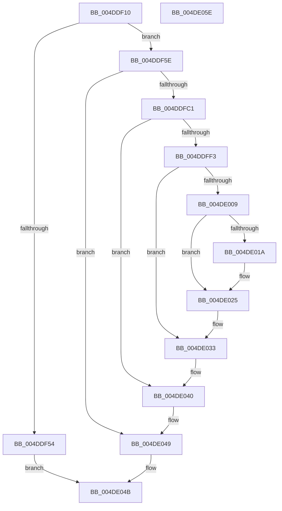

# EtwpGetDriverDataDosPath

- RVA: `0x004DDF10`–`0x004DE05F` (길이 `335` bytes)
- VA: `0x00000001404DDF10`
- 실행 섹션: `.text`
- PDB 이름 있음: `예`; PDB Function 태그: `아니요`
- unwind 정보 RVA: `0x000BEC00`
- 디코드: `85`개 명령, `335/335` bytes 표시
- 미해석 바이트: `0` (있으면 어셈블리에 `.byte`로 보존)

> 이 문서는 커널 이미지의 기계어와 PDB 기호를 분석해 생성했습니다. 4번과 5번은 함수 원형과 자료형을 바이너리 사용 방식에서 추정한 C 해석이며 원본 소스 복구 결과는 아닙니다.

## 1. Dependencies

- 직접 호출 지점: **7**; 고유 호출 대상: **7**
- 직접 호출자로 확인된 함수: **1**
- RIP 상대 이미지 참조: **3**

### Outgoing calls
- `0x004DDF69` → [RtlInitUnicodeString](../42/RtlInitUnicodeString_function_0042A780.md) (function, `0x0042A780`)
- `0x004DDFB2` → [ZwOpenFile](../6A/ZwOpenFile_function_006AD730.md) (function, `0x006AD730`)
- `0x004DDFE8` → [ObReferenceObjectByHandle](../../page/86/ObReferenceObjectByHandle_function_00868DB0.md) (function, `0x00868DB0`)
- `0x004DDFFE` → [IoQueryFileDosDeviceName](../../page/8A/IoQueryFileDosDeviceName_function_008A6340.md) (function, `0x008A6340`)
- `0x004DE020` → [ExFreePoolWithTag](../../poolcode/B8/ExFreePoolWithTag_function_00B82870.md) (function, `0x00B82870`)
- `0x004DE03B` → [ObfDereferenceObjectWithTag](../2F/ObfDereferenceObjectWithTag_function_002F78E0.md) (function, `0x002F78E0`)
- `0x004DE044` → [ZwClose](../6A/ZwClose_function_006AD2B0.md) (function, `0x006AD2B0`)

### Direct callers
- [EtwpExpandFileName](../../page/9C/EtwpExpandFileName_function_009C147C.md) at `0x009C151B`

### Static image references
- `0x004DDF40` → RVA `0x00E68470` (`.data`; read)
- `0x004DDF5E` → RVA `0x006CFDE0` (` ?? ::FNODOBFM::`string'`; read)
- `0x004DDFC1` → RVA `0x00FC6AE0` (`ALMOSTRO`; read)

## 2. Other-region calls and transfers

- 다른 실행 섹션으로 향하는 call: **3**
  - `0x004DDFE8` → [ObReferenceObjectByHandle](../../page/86/ObReferenceObjectByHandle_function_00868DB0.md) (`.text` → `PAGE`)
  - `0x004DDFFE` → [IoQueryFileDosDeviceName](../../page/8A/IoQueryFileDosDeviceName_function_008A6340.md) (`.text` → `PAGE`)
  - `0x004DE020` → [ExFreePoolWithTag](../../poolcode/B8/ExFreePoolWithTag_function_00B82870.md) (`.text` → `POOLCODE`)
- 별도 외부 분기/꼬리 이동을 확인하지 못했습니다.

## 3. Assembly (complete function range)

```asm
004DDF10  48 89 5C 24 08                  mov qword ptr [rsp + 8], rbx
004DDF15  55                              push rbp
004DDF16  56                              push rsi
004DDF17  57                              push rdi
004DDF18  48 8B EC                        mov rbp, rsp
004DDF1B  48 81 EC 80 00 00 00            sub rsp, 0x80
004DDF22  48 83 65 28 00                  and qword ptr [rbp + 0x28], 0
004DDF27  33 C0                           xor eax, eax
004DDF29  21 45 EC                        and dword ptr [rbp - 0x14], eax
004DDF2C  0F 57 C0                        xorps xmm0, xmm0
004DDF2F  48 83 65 38 00                  and qword ptr [rbp + 0x38], 0
004DDF34  0F 57 C9                        xorps xmm1, xmm1
004DDF37  89 45 D4                        mov dword ptr [rbp - 0x2c], eax
004DDF3A  48 8B F1                        mov rsi, rcx
004DDF3D  21 45 D4                        and dword ptr [rbp - 0x2c], eax
004DDF40  48 8B 05 29 A5 98 00            mov rax, qword ptr [rip + 0x98a529]
004DDF47  0F 11 45 B0                     movups xmmword ptr [rbp - 0x50], xmm0
004DDF4B  0F 11 4D C0                     movups xmmword ptr [rbp - 0x40], xmm1
004DDF4F  48 85 C0                        test rax, rax
004DDF52  74 0A                           je 0x1404ddf5e
004DDF54  48 89 01                        mov qword ptr [rcx], rax
004DDF57  33 C0                           xor eax, eax
004DDF59  E9 ED 00 00 00                  jmp 0x1404de04b
004DDF5E  48 8D 15 7B 1E 1F 00            lea rdx, [rip + 0x1f1e7b]
004DDF65  48 8D 4D B0                     lea rcx, [rbp - 0x50]
004DDF69  E8 12 C8 F4 FF                  call 0x14042a780
004DDF6E  48 83 65 D8 00                  and qword ptr [rbp - 0x28], 0
004DDF73  48 8D 45 B0                     lea rax, [rbp - 0x50]
004DDF77  0F 57 C0                        xorps xmm0, xmm0
004DDF7A  C7 44 24 28 21 00 00 00         mov dword ptr [rsp + 0x28], 0x21
004DDF82  4C 8D 4D C0                     lea r9, [rbp - 0x40]
004DDF86  48 89 45 E0                     mov qword ptr [rbp - 0x20], rax
004DDF8A  4C 8D 45 D0                     lea r8, [rbp - 0x30]
004DDF8E  C7 45 D0 30 00 00 00            mov dword ptr [rbp - 0x30], 0x30
004DDF95  BA 80 00 10 00                  mov edx, 0x100080
004DDF9A  C7 45 E8 40 02 00 00            mov dword ptr [rbp - 0x18], 0x240
004DDFA1  48 8D 4D 38                     lea rcx, [rbp + 0x38]
004DDFA5  C7 44 24 20 03 00 00 00         mov dword ptr [rsp + 0x20], 3
004DDFAD  F3 0F 7F 45 F0                  movdqu xmmword ptr [rbp - 0x10], xmm0
004DDFB2  E8 79 F7 1C 00                  call 0x1406ad730
004DDFB7  8B D8                           mov ebx, eax
004DDFB9  85 C0                           test eax, eax
004DDFBB  0F 88 88 00 00 00               js 0x1404de049
004DDFC1  4C 8B 05 18 8B AE 00            mov r8, qword ptr [rip + 0xae8b18]
004DDFC8  48 8D 45 30                     lea rax, [rbp + 0x30]
004DDFCC  48 83 64 24 28 00               and qword ptr [rsp + 0x28], 0
004DDFD2  45 33 C9                        xor r9d, r9d
004DDFD5  48 8B 4D 38                     mov rcx, qword ptr [rbp + 0x38]
004DDFD9  BA 80 00 00 00                  mov edx, 0x80
004DDFDE  48 83 65 30 00                  and qword ptr [rbp + 0x30], 0
004DDFE3  48 89 44 24 20                  mov qword ptr [rsp + 0x20], rax
004DDFE8  E8 C3 AD 38 00                  call 0x140868db0
004DDFED  8B D8                           mov ebx, eax
004DDFEF  85 C0                           test eax, eax
004DDFF1  78 4D                           js 0x1404de040
004DDFF3  48 8B 7D 30                     mov rdi, qword ptr [rbp + 0x30]
004DDFF7  48 8D 55 28                     lea rdx, [rbp + 0x28]
004DDFFB  48 8B CF                        mov rcx, rdi
004DDFFE  E8 3D 83 3C 00                  call 0x1408a6340
004DE003  8B D8                           mov ebx, eax
004DE005  85 C0                           test eax, eax
004DE007  78 2A                           js 0x1404de033
004DE009  48 8B 4D 28                     mov rcx, qword ptr [rbp + 0x28]
004DE00D  33 C0                           xor eax, eax
004DE00F  F0 48 0F B1 0D 58 A4 98 00      lock cmpxchg qword ptr [rip + 0x98a458], rcx
004DE018  74 0B                           je 0x1404de025
004DE01A  48 8B 4D 28                     mov rcx, qword ptr [rbp + 0x28]
004DE01E  33 D2                           xor edx, edx
004DE020  E8 4B 48 6A 00                  call 0x140b82870
004DE025  48 8B 05 44 A4 98 00            mov rax, qword ptr [rip + 0x98a444]
004DE02C  48 8B 7D 30                     mov rdi, qword ptr [rbp + 0x30]
004DE030  48 89 06                        mov qword ptr [rsi], rax
004DE033  BA 44 66 6C 74                  mov edx, 0x746c6644
004DE038  48 8B CF                        mov rcx, rdi
004DE03B  E8 A0 98 E1 FF                  call 0x1402f78e0
004DE040  48 8B 4D 38                     mov rcx, qword ptr [rbp + 0x38]
004DE044  E8 67 F2 1C 00                  call 0x1406ad2b0
004DE049  8B C3                           mov eax, ebx
004DE04B  48 8B 9C 24 A0 00 00 00         mov rbx, qword ptr [rsp + 0xa0]
004DE053  48 81 C4 80 00 00 00            add rsp, 0x80
004DE05A  5F                              pop rdi
004DE05B  5E                              pop rsi
004DE05C  5D                              pop rbp
004DE05D  C3                              ret
004DE05E  CC                              int3
```

## 4. C-style interpretation (structured pseudocode)

```c
__int64 __fastcall EtwpGetDriverDataDosPath(__int64 a1)
{
    __int64 result;
    __int64 v_rsp;
    unsigned __int64 v_stack_m28;
    unsigned int v_stack_m2C;
    unsigned int v_stack_m30;
    unsigned __int64 v_stack_m38;
    unsigned __int64 v_stack_m40;
    unsigned int v_stack_m44;
    unsigned __int64 v_stack_m48;
    unsigned __int64 v_stack_m58;
    unsigned __int64 v_stack_m68;
    unsigned int v_stack_m70;
    unsigned int v_stack_m78;
    unsigned __int64 v_stack_p10;
    unsigned __int64 v_stack_p18;
    unsigned __int64 v_stack_p20;
    unsigned __int64 v_stack_p8;

    v_stack_p8 = v_rbx;
    v_rsp = (v_rsp) - (128);
    result = 0;
    v_stack_m44 = 0;
    v_stack_m68 = v_xmm0;
    v_stack_m58 = v_xmm1;
    if (*(unsigned __int64 *)(v_rip + 10003753) == 0) goto loc_004DDF5E;
    *(unsigned __int64 *)(a1) = *(unsigned __int64 *)(v_rip + 10003753);
    result = 0;
    goto loc_004DE04B;
loc_004DDF5E:
    result = RtlInitUnicodeString(v_stack_m68, v_rip + 2039419, a3, a4);
    v_stack_m70 = 33;
    v_stack_m38 = v_stack_m68;
    v_stack_m48 = 48;
    v_stack_m30 = 576;
    v_stack_m78 = 3;
    v_stack_m28 = v_xmm0;
    result = ZwOpenFile(v_stack_p20, (unsigned int)(0x100080ULL), v_stack_m48, v_stack_m58);
    if (sign_flag) goto loc_004DE049;
    a4 = 0;
    v_stack_m78 = v_stack_p18;
    result = ObReferenceObjectByHandle(v_stack_p20, 128, *(unsigned __int64 *)(v_rip + 11438872), a4);
    if (sign_flag) goto loc_004DE040;
    result = IoQueryFileDosDeviceName(v_stack_p18, v_stack_p10, *(unsigned __int64 *)(v_rip + 11438872), a4);
    if (sign_flag) goto loc_004DE033;
    result = 0;
    if (!(condition_is_equal)) {
        a1 = v_stack_p10;
        a2 = 0;
        result = ExFreePoolWithTag(a1, a2, *(unsigned __int64 *)(v_rip + 11438872), a4);
    }
    *(unsigned __int64 *)(a1) = *(unsigned __int64 *)(v_rip + 10003524);
loc_004DE033:
    result = ObfDereferenceObjectWithTag(v_stack_p18, (unsigned int)(0x746C6644ULL), *(unsigned __int64 *)(v_rip + 11438872), a4);
loc_004DE040:
    result = ZwClose(v_stack_p20, (unsigned int)(0x746C6644ULL), *(unsigned __int64 *)(v_rip + 11438872), a4);
loc_004DE049:
loc_004DE04B:
    v_rsp = (v_rsp) + (128);
    return (unsigned int)((unsigned int)((unsigned int)((unsigned int)(result))));
}
```

## 5. (Beta) C Style

```c
int64_t EtwpGetDriverDataDosPath(void *Arg1)
{
    uint8_t *arg1 = (uint8_t *)Arg1;

    int64_t result;
    int64_t local_rsp;
    uint64_t v_stack_m28;
    uint32_t v_stack_m2C;
    uint32_t v_stack_m30;
    uint64_t v_stack_m38;
    uint64_t v_stack_m40;
    uint32_t v_stack_m44;
    uint64_t v_stack_m48;
    uint64_t v_stack_m58;
    uint64_t v_stack_m68;
    uint32_t v_stack_m70;
    uint32_t v_stack_m78;
    uint64_t v_stack_p10;
    uint64_t v_stack_p18;
    uint64_t v_stack_p20;
    uint64_t v_stack_p8;

    v_stack_p8 = local_rbx;
    local_rsp = (local_rsp) - (128);
    result = 0;
    v_stack_m44 = 0;
    v_stack_m68 = v_xmm0;
    v_stack_m58 = v_xmm1;
    if (*(uint64_t *)(v_rip + 0x98A529) == 0) goto loc_004DDF5E;
    *(uint64_t *)(arg1) = *(uint64_t *)(v_rip + 0x98A529);
    result = 0;
    goto loc_004DE04B;
loc_004DDF5E:
    result = RtlInitUnicodeString(v_stack_m68, v_rip + 2039419, a3, a4);
    v_stack_m70 = 33;
    v_stack_m38 = v_stack_m68;
    v_stack_m48 = 48;
    v_stack_m30 = 576;
    v_stack_m78 = 3;
    v_stack_m28 = v_xmm0;
    result = ZwOpenFile(v_stack_p20, (uint32_t)(0x100080ULL), v_stack_m48, v_stack_m58);
    if (sign_flag) goto loc_004DE049;
    a4 = 0;
    v_stack_m78 = v_stack_p18;
    result = ObReferenceObjectByHandle(v_stack_p20, 128, *(uint64_t *)(v_rip + 0xAE8B18), a4);
    if (sign_flag) goto loc_004DE040;
    result = IoQueryFileDosDeviceName(v_stack_p18, v_stack_p10, *(uint64_t *)(v_rip + 0xAE8B18), a4);
    if (sign_flag) goto loc_004DE033;
    result = 0;
    if (!(condition_is_equal)) {
        Arg1 = v_stack_p10;
        a2 = 0;
        result = ExFreePoolWithTag(Arg1, a2, *(uint64_t *)(v_rip + 0xAE8B18), a4);
    }
    *(uint64_t *)(arg1) = *(uint64_t *)(v_rip + 0x98A444);
loc_004DE033:
    result = ObfDereferenceObjectWithTag(v_stack_p18, (uint32_t)(0x746C6644ULL), *(uint64_t *)(v_rip + 0xAE8B18), a4);
loc_004DE040:
    result = ZwClose(v_stack_p20, (uint32_t)(0x746C6644ULL), *(uint64_t *)(v_rip + 0xAE8B18), a4);
loc_004DE049:
loc_004DE04B:
    local_rsp = (local_rsp) + (128);
    return (uint32_t)((uint32_t)((uint32_t)((uint32_t)(result))));
}
```

### 관측된 메모리 오프셋

구조체 형식이 확인되지 않은 접근은 인자 기준의 오프셋으로만 기록했습니다.

| 기준 인자 | 오프셋 표현 | 폭 (bit) | 접근 |
|---|---:|---:|---|
| `Arg1` | `+ 0x0` | `64` | `W` |

## 6. Execution-region graph

[열기: 2D/3D 그래프와 함수 탐색 컨트롤 패널](../../../control-panel.html?section=text&rva=0x004DDF10&view=graph)

- 2D 그래프는 위에서 아래로 흐르고, 3D 그래프는 빈 공간을 드래그해 회전합니다. Shift+드래그는 이동, 휠은 확대·축소, 함수 노드 선택은 대상 보고서 이동입니다.

### Static fallback


