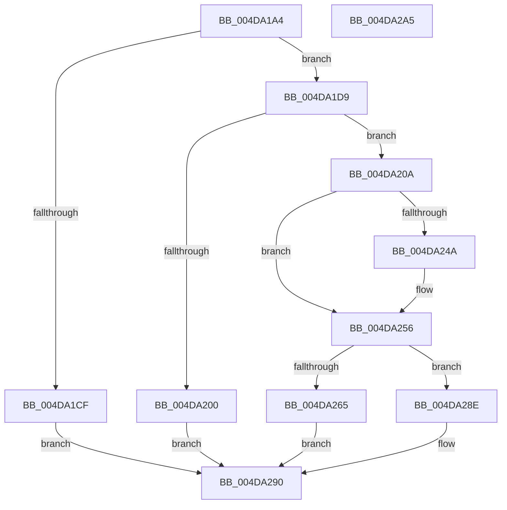

# EtwpQueueApcPoolDpc

- RVA: `0x004DA1A4`–`0x004DA2A6` (길이 `258` bytes)
- VA: `0x00000001404DA1A4`
- 실행 섹션: `.text`
- PDB 이름 있음: `예`; PDB Function 태그: `아니요`
- unwind 정보 RVA: `0x0005C954`
- 디코드: `65`개 명령, `258/258` bytes 표시
- 미해석 바이트: `0` (있으면 어셈블리에 `.byte`로 보존)

> 이 문서는 커널 이미지의 기계어와 PDB 기호를 분석해 생성했습니다. 4번과 5번은 함수 원형과 자료형을 바이너리 사용 방식에서 추정한 C 해석이며 원본 소스 복구 결과는 아닙니다.

## 1. Dependencies

- 직접 호출 지점: **3**; 고유 호출 대상: **3**
- 직접 호출자로 확인된 함수: **1**
- RIP 상대 이미지 참조: **0**

### Outgoing calls
- `0x004DA1F7` → [ExAcquireRundownProtectionCacheAwareEx](../41/ExAcquireRundownProtectionCacheAwareEx_function_00411F50.md) (function, `0x00411F50`)
- `0x004DA25C` → [KeInsertQueueDpc](../20/KeInsertQueueDpc_function_00207C50.md) (function, `0x00207C50`)
- `0x004DA282` → [ExReleaseRundownProtectionCacheAwareEx](../25/ExReleaseRundownProtectionCacheAwareEx_function_0025F050.md) (function, `0x0025F050`)

### Direct callers
- [EtwpQueueApc](../20/EtwpQueueApc_function_00203B7C.md) at `0x00203DAB`

### Static image references
- 디코드된 RIP-relative 메모리 참조가 없습니다.

## 2. Other-region calls and transfers

- 다른 실행 섹션으로 향하는 call: **0**
- 별도 외부 분기/꼬리 이동을 확인하지 못했습니다.

## 3. Assembly (complete function range)

```asm
004DA1A4  48 89 5C 24 08                  mov qword ptr [rsp + 8], rbx
004DA1A9  48 89 6C 24 10                  mov qword ptr [rsp + 0x10], rbp
004DA1AE  48 89 74 24 18                  mov qword ptr [rsp + 0x18], rsi
004DA1B3  57                              push rdi
004DA1B4  48 83 EC 20                     sub rsp, 0x20
004DA1B8  F0 0F BA A9 A0 00 00 00 01      lock bts dword ptr [rcx + 0xa0], 1
004DA1C1  49 8B F9                        mov rdi, r9
004DA1C4  49 8B F0                        mov rsi, r8
004DA1C7  48 8B EA                        mov rbp, rdx
004DA1CA  48 8B D9                        mov rbx, rcx
004DA1CD  73 0A                           jae 0x1404da1d9
004DA1CF  B8 08 07 00 C0                  mov eax, 0xc0000708
004DA1D4  E9 B7 00 00 00                  jmp 0x1404da290
004DA1D9  48 8B 01                        mov rax, qword ptr [rcx]
004DA1DC  48 8B 90 50 05 00 00            mov rdx, qword ptr [rax + 0x550]
004DA1E3  8B 08                           mov ecx, dword ptr [rax]
004DA1E5  8B C1                           mov eax, ecx
004DA1E7  48 8B 8A C0 02 00 00            mov rcx, qword ptr [rdx + 0x2c0]
004DA1EE  BA 01 00 00 00                  mov edx, 1
004DA1F3  48 8B 0C C1                     mov rcx, qword ptr [rcx + rax*8]
004DA1F7  E8 54 7D F3 FF                  call 0x140411f50
004DA1FC  84 C0                           test al, al
004DA1FE  75 0A                           jne 0x1404da20a
004DA200  B8 01 00 00 C0                  mov eax, 0xc0000001
004DA205  E9 86 00 00 00                  jmp 0x1404da290
004DA20A  48 8B 44 24 50                  mov rax, qword ptr [rsp + 0x50]
004DA20F  48 8D 4B 60                     lea rcx, [rbx + 0x60]
004DA213  48 89 43 30                     mov qword ptr [rbx + 0x30], rax
004DA217  48 8B 44 24 58                  mov rax, qword ptr [rsp + 0x58]
004DA21C  48 89 43 38                     mov qword ptr [rbx + 0x38], rax
004DA220  48 8B 44 24 60                  mov rax, qword ptr [rsp + 0x60]
004DA225  48 89 43 40                     mov qword ptr [rbx + 0x40], rax
004DA229  48 89 6B 58                     mov qword ptr [rbx + 0x58], rbp
004DA22D  48 89 73 48                     mov qword ptr [rbx + 0x48], rsi
004DA231  48 89 7B 50                     mov qword ptr [rbx + 0x50], rdi
004DA235  65 48 8B 04 25 20 00 00 00      mov rax, qword ptr gs:[0x20]
004DA23E  8B 50 24                        mov edx, dword ptr [rax + 0x24]
004DA241  48 8B 41 38                     mov rax, qword ptr [rcx + 0x38]
004DA245  48 85 C0                        test rax, rax
004DA248  75 0C                           jne 0x1404da256
004DA24A  B8 00 08 00 00                  mov eax, 0x800
004DA24F  66 03 D0                        add dx, ax
004DA252  66 89 51 02                     mov word ptr [rcx + 2], dx
004DA256  45 33 C0                        xor r8d, r8d
004DA259  48 8B D3                        mov rdx, rbx
004DA25C  E8 EF D9 D2 FF                  call 0x140207c50
004DA261  84 C0                           test al, al
004DA263  75 29                           jne 0x1404da28e
004DA265  48 8B 03                        mov rax, qword ptr [rbx]
004DA268  BA 01 00 00 00                  mov edx, 1
004DA26D  44 8B 00                        mov r8d, dword ptr [rax]
004DA270  48 8B 80 50 05 00 00            mov rax, qword ptr [rax + 0x550]
004DA277  48 8B 88 C0 02 00 00            mov rcx, qword ptr [rax + 0x2c0]
004DA27E  4A 8B 0C C1                     mov rcx, qword ptr [rcx + r8*8]
004DA282  E8 C9 4D D8 FF                  call 0x14025f050
004DA287  B8 9A 00 00 C0                  mov eax, 0xc000009a
004DA28C  EB 02                           jmp 0x1404da290
004DA28E  33 C0                           xor eax, eax
004DA290  48 8B 5C 24 30                  mov rbx, qword ptr [rsp + 0x30]
004DA295  48 8B 6C 24 38                  mov rbp, qword ptr [rsp + 0x38]
004DA29A  48 8B 74 24 40                  mov rsi, qword ptr [rsp + 0x40]
004DA29F  48 83 C4 20                     add rsp, 0x20
004DA2A3  5F                              pop rdi
004DA2A4  C3                              ret
004DA2A5  CC                              int3
```

## 4. C-style interpretation (structured pseudocode)

```c
__int64 __fastcall EtwpQueueApcPoolDpc(__int64 a1, __int64 a2, __int64 a3, __int64 a4, __int64 a5, __int64 a6, __int64 a7)
{
    __int64 result;
    __int64 v_rsp;
    unsigned __int64 v_stack_p10;
    unsigned __int64 v_stack_p18;
    unsigned __int64 v_stack_p8;

    v_stack_p8 = v_rbx;
    v_stack_p10 = v_rbp;
    v_stack_p18 = v_rsi;
    v_rsp = (v_rsp) - (32);
    if (condition_is_above_or_equal) goto loc_004DA1D9;
    goto loc_004DA290;
loc_004DA1D9:
    result = ExAcquireRundownProtectionCacheAwareEx(*(unsigned __int64 *)(*(unsigned __int64 *)(*(unsigned __int64 *)(*(unsigned __int64 *)(a1) + 1360) + 704) + (unsigned int)((unsigned int)((unsigned int)(*(unsigned int *)(*(unsigned __int64 *)(a1))))) * 8), 1, a3, a4);
    if ((unsigned __int8)(result) != 0) goto loc_004DA20A;
    goto loc_004DA290;
loc_004DA20A:
    *(unsigned __int64 *)(a1 + 48) = a5;
    *(unsigned __int64 *)(a1 + 56) = a6;
    *(unsigned __int64 *)(a1 + 64) = a7;
    *(unsigned __int64 *)(a1 + 88) = a2;
    *(unsigned __int64 *)(a1 + 72) = a3;
    *(unsigned __int64 *)(a1 + 80) = a4;
    result = *(unsigned __int64 *)(a1 + 96 + 56);
    if (*(unsigned __int64 *)(a1 + 96 + 56) == 0) {
        result = 0x800ULL;
        a2 = (unsigned __int16)(((unsigned int)(*(unsigned int *)(*(unsigned __int64 *)(gs_base + (0 + 32)) + 36))) + ((unsigned __int16)(result)));
        *(unsigned __int16 *)(a1 + 96 + 2) = (unsigned __int16)(a2);
    }
    a3 = 0;
    result = KeInsertQueueDpc(a1 + 96, a1, a3, a4);
    if ((unsigned __int8)(result) != 0) goto loc_004DA28E;
    result = ExReleaseRundownProtectionCacheAwareEx(*(unsigned __int64 *)(*(unsigned __int64 *)(*(unsigned __int64 *)(*(unsigned __int64 *)(a1) + 1360) + 704) + (unsigned int)(*(unsigned int *)(*(unsigned __int64 *)(a1))) * 8), 1, (unsigned int)(*(unsigned int *)(*(unsigned __int64 *)(a1))), a4);
    goto loc_004DA290;
loc_004DA28E:
    result = 0;
loc_004DA290:
    v_rsp = (v_rsp) + (32);
    return result;
}
```

## 5. (Beta) C Style

```c
int64_t EtwpQueueApcPoolDpc(void *Arg1, int64_t Arg2, int64_t Arg3, int64_t Arg4, int64_t Arg5, int64_t Arg6, int64_t Arg7)
{
    uint8_t *arg1 = (uint8_t *)Arg1;

    int64_t result;
    int64_t local_rsp;
    uint64_t v_stack_p10;
    uint64_t v_stack_p18;
    uint64_t v_stack_p8;

    v_stack_p8 = local_rbx;
    v_stack_p10 = local_rbp;
    v_stack_p18 = local_rsi;
    local_rsp = (local_rsp) - (32);
    if (condition_is_above_or_equal) goto loc_004DA1D9;
    goto loc_004DA290;
loc_004DA1D9:
    result = ExAcquireRundownProtectionCacheAwareEx(*(uint64_t *)(*(uint64_t *)(*(uint64_t *)(*(uint64_t *)(arg1) + 0x550) + 0x2C0) + (uint32_t)((uint32_t)((uint32_t)(*(uint32_t *)(*(uint64_t *)(arg1))))) * 8), 1, Arg3, Arg4);
    if ((uint8_t)(result) != 0) goto loc_004DA20A;
    goto loc_004DA290;
loc_004DA20A:
    *(uint64_t *)(arg1 + 0x30) = Arg5;
    *(uint64_t *)(arg1 + 0x38) = Arg6;
    *(uint64_t *)(arg1 + 0x40) = Arg7;
    *(uint64_t *)(arg1 + 0x58) = Arg2;
    *(uint64_t *)(arg1 + 0x48) = Arg3;
    *(uint64_t *)(arg1 + 0x50) = Arg4;
    result = *(uint64_t *)(arg1 + 0x60 + 0x38);
    if (*(uint64_t *)(arg1 + 0x60 + 0x38) == 0) {
        result = 0x800ULL;
        Arg2 = (uint16_t)(((uint32_t)(*(uint32_t *)(*(uint64_t *)(gs_base + (0 + 0x20)) + 0x24))) + ((uint16_t)(result)));
        *(uint16_t *)(arg1 + 0x60 + 0x2) = (uint16_t)(Arg2);
    }
    Arg3 = 0;
    result = KeInsertQueueDpc(Arg1 + 96, Arg1, Arg3, Arg4);
    if ((uint8_t)(result) != 0) goto loc_004DA28E;
    result = ExReleaseRundownProtectionCacheAwareEx(*(uint64_t *)(*(uint64_t *)(*(uint64_t *)(*(uint64_t *)(arg1) + 0x550) + 0x2C0) + (uint32_t)(*(uint32_t *)(*(uint64_t *)(arg1))) * 8), 1, (uint32_t)(*(uint32_t *)(*(uint64_t *)(arg1))), Arg4);
    goto loc_004DA290;
loc_004DA28E:
    result = 0;
loc_004DA290:
    local_rsp = (local_rsp) + (32);
    return result;
}
```

### 관측된 메모리 오프셋

구조체 형식이 확인되지 않은 접근은 인자 기준의 오프셋으로만 기록했습니다.

| 기준 인자 | 오프셋 표현 | 폭 (bit) | 접근 |
|---|---:|---:|---|
| `Arg1` | `+ 0x0` | `64` | `R` |
| `Arg1` | `+ 0x2` | `16` | `W` |
| `Arg1` | `+ 0x30` | `64` | `W` |
| `Arg1` | `+ 0x38` | `64` | `R` |
| `Arg1` | `+ 0x38` | `64` | `W` |
| `Arg1` | `+ 0x40` | `64` | `W` |
| `Arg1` | `+ 0x48` | `64` | `W` |
| `Arg1` | `+ 0x50` | `64` | `W` |
| `Arg1` | `+ 0x58` | `64` | `W` |
| `Arg1` | `+ 0x60` | `64` | `R` |
| `Arg1` | `+ 0xA0` | `32` | `R/W` |

## 6. Execution-region graph

[열기: 2D/3D 그래프와 함수 탐색 컨트롤 패널](../../../control-panel.html?section=text&rva=0x004DA1A4&view=graph)

- 2D 그래프는 위에서 아래로 흐르고, 3D 그래프는 빈 공간을 드래그해 회전합니다. Shift+드래그는 이동, 휠은 확대·축소, 함수 노드 선택은 대상 보고서 이동입니다.

### Static fallback


