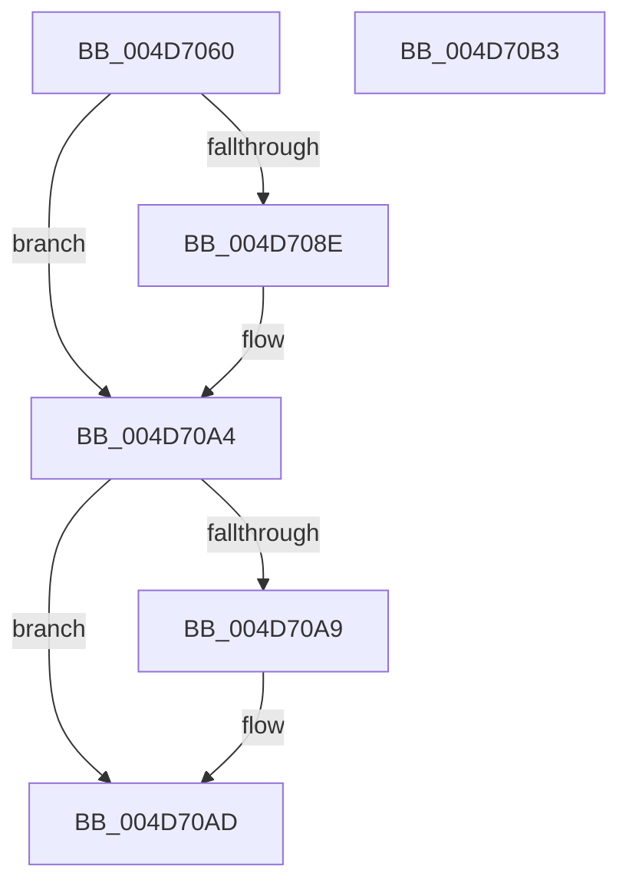

# ExpLockCallbackListExclusive

- RVA: `0x004D7060`–`0x004D70B4` (길이 `84` bytes)
- VA: `0x00000001404D7060`
- 실행 섹션: `.text`
- PDB 이름 있음: `예`; PDB Function 태그: `아니요`
- unwind 정보 RVA: `0x0005CF00`
- 디코드: `22`개 명령, `84/84` bytes 표시
- 미해석 바이트: `0` (있으면 어셈블리에 `.byte`로 보존)

> 이 문서는 커널 이미지의 기계어와 PDB 기호를 분석해 생성했습니다. 4번과 5번은 함수 원형과 자료형을 바이너리 사용 방식에서 추정한 C 해석이며 원본 소스 복구 결과는 아닙니다.

## 1. Dependencies

- 직접 호출 지점: **2**; 고유 호출 대상: **2**
- 직접 호출자로 확인된 함수: **2**
- RIP 상대 이미지 참조: **2**

### Outgoing calls
- `0x004D707A` → [KeAbPreAcquire](../21/KeAbPreAcquire_function_00210230.md) (function, `0x00210230`)
- `0x004D709F` → [ExfAcquirePushLockExclusiveEx](../20/ExfAcquirePushLockExclusiveEx_function_0020FC90.md) (function, `0x0020FC90`)

### Direct callers
- [ExpDeleteCallback](../../page/7C/ExpDeleteCallback_function_007CAC80.md) at `0x007CAC99`
- [ExCreateCallback](../../page/A7/ExCreateCallback_function_00A7B9D0.md) at `0x00A7BB80`

### Static image references
- `0x004D7070` → RVA `0x00EFACC0` (`.data`; read)
- `0x004D707F` → RVA `0x00EFACC0` (`.data`; read/write)

## 2. Other-region calls and transfers

- 다른 실행 섹션으로 향하는 call: **0**
- 별도 외부 분기/꼬리 이동을 확인하지 못했습니다.

## 3. Assembly (complete function range)

```asm
004D7060  40 53                           push rbx
004D7062  48 83 EC 20                     sub rsp, 0x20
004D7066  66 FF 89 E6 01 00 00            dec word ptr [rcx + 0x1e6]
004D706D  45 33 C0                        xor r8d, r8d
004D7070  48 8D 0D 49 3C A2 00            lea rcx, [rip + 0xa23c49]
004D7077  33 D2                           xor edx, edx
004D7079  90                              nop
004D707A  E8 B1 91 D3 FF                  call 0x140210230
004D707F  F0 48 0F BA 2D 37 3C A2 00 00   lock bts qword ptr [rip + 0xa23c37], 0
004D7089  48 8B D8                        mov rbx, rax
004D708C  73 16                           jae 0x1404d70a4
004D708E  4C 8D 05 2B 3C A2 00            lea r8, [rip + 0xa23c2b]
004D7095  48 8B D0                        mov rdx, rax
004D7098  48 8D 0D 21 3C A2 00            lea rcx, [rip + 0xa23c21]
004D709F  E8 EC 8B D3 FF                  call 0x14020fc90
004D70A4  48 85 DB                        test rbx, rbx
004D70A7  74 04                           je 0x1404d70ad
004D70A9  C6 43 0A 01                     mov byte ptr [rbx + 0xa], 1
004D70AD  48 83 C4 20                     add rsp, 0x20
004D70B1  5B                              pop rbx
004D70B2  C3                              ret
004D70B3  CC                              int3
```

## 4. C-style interpretation (structured pseudocode)

```c
__int64 __fastcall ExpLockCallbackListExclusive(__int64 a1, int a2, int a3)
{
    __int64 result;
    __int64 v_rsp;

    v_rsp = (v_rsp) - (32);
    a3 = 0;
    a2 = 0;
    result = KeAbPreAcquire(v_rip + 10632265, a2, a3, a4);
    if (!(condition_is_above_or_equal)) {
        a3 = v_rip + 10632235;
        a2 = result;
        a1 = v_rip + 10632225;
        result = ExfAcquirePushLockExclusiveEx(a1, a2, a3, a4);
    }
    if (result != 0) {
        *(unsigned __int8 *)(result + 10) = 1;
    }
    v_rsp = (v_rsp) + (32);
    return result;
}
```

## 5. (Beta) C Style

```c
int64_t ExpLockCallbackListExclusive(void *Arg1, int32_t Arg2, int32_t Arg3)
{
    uint8_t *arg1 = (uint8_t *)Arg1;

    int64_t result;
    int64_t local_rsp;

    local_rsp = (local_rsp) - (32);
    Arg3 = 0;
    Arg2 = 0;
    result = KeAbPreAcquire(v_rip + 10632265, Arg2, Arg3, a4);
    if (!(condition_is_above_or_equal)) {
        Arg3 = v_rip + 10632235;
        Arg2 = result;
        Arg1 = v_rip + 10632225;
        result = ExfAcquirePushLockExclusiveEx(Arg1, Arg2, Arg3, a4);
    }
    if (result != 0) {
        *(uint8_t *)(result + 0xA) = 1;
    }
    local_rsp = (local_rsp) + (32);
    return result;
}
```

### 관측된 메모리 오프셋

구조체 형식이 확인되지 않은 접근은 인자 기준의 오프셋으로만 기록했습니다.

| 기준 인자 | 오프셋 표현 | 폭 (bit) | 접근 |
|---|---:|---:|---|
| `Arg1` | `+ 0x1E6` | `16` | `R/W` |

## 6. Execution-region graph

[열기: 2D/3D 그래프와 함수 탐색 컨트롤 패널](../../../control-panel.html?section=text&rva=0x004D7060&view=graph)

- 2D 그래프는 위에서 아래로 흐르고, 3D 그래프는 빈 공간을 드래그해 회전합니다. Shift+드래그는 이동, 휠은 확대·축소, 함수 노드 선택은 대상 보고서 이동입니다.

### Static fallback


