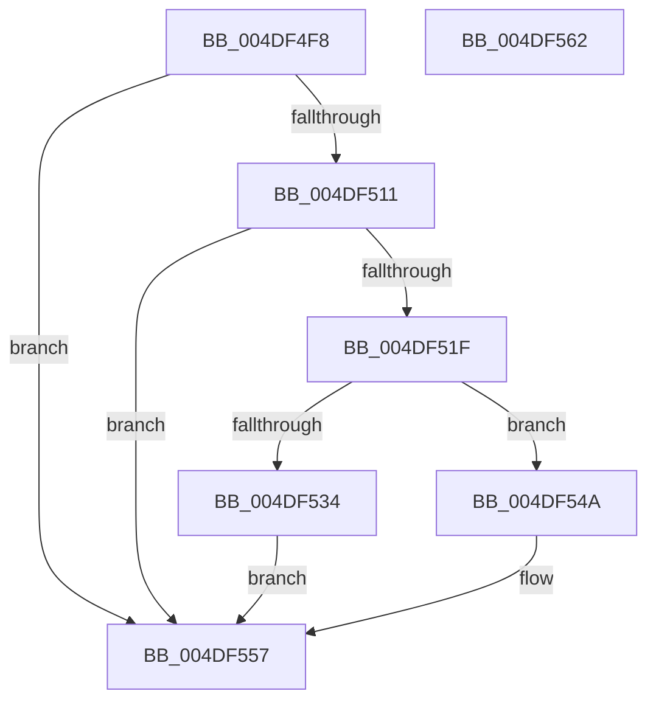

# ExpTryExpandAutoExpandPushLock

- RVA: `0x004DF4F8`–`0x004DF563` (길이 `107` bytes)
- VA: `0x00000001404DF4F8`
- 실행 섹션: `.text`
- PDB 이름 있음: `예`; PDB Function 태그: `아니요`
- unwind 정보 RVA: `0x00068D5C`
- 디코드: `37`개 명령, `107/107` bytes 표시
- 미해석 바이트: `0` (있으면 어셈블리에 `.byte`로 보존)

> 이 문서는 커널 이미지의 기계어와 PDB 기호를 분석해 생성했습니다. 4번과 5번은 함수 원형과 자료형을 바이너리 사용 방식에서 추정한 C 해석이며 원본 소스 복구 결과는 아닙니다.

## 1. Dependencies

- 직접 호출 지점: **1**; 고유 호출 대상: **1**
- 직접 호출자로 확인된 함수: **1**
- RIP 상대 이미지 참조: **0**

### Outgoing calls
- `0x004DF529` → [ExpAllocateFannedOutPushLock](../3B/ExpAllocateFannedOutPushLock_function_003B2B48.md) (function, `0x003B2B48`)

### Direct callers
- [sub_0026379F](../26/Unknown_function_0026379F.md) at `0x002638B4`

### Static image references
- 디코드된 RIP-relative 메모리 참조가 없습니다.

## 2. Other-region calls and transfers

- 다른 실행 섹션으로 향하는 call: **0**
- 별도 외부 분기/꼬리 이동을 확인하지 못했습니다.

## 3. Assembly (complete function range)

```asm
004DF4F8  48 89 5C 24 10                  mov qword ptr [rsp + 0x10], rbx
004DF4FD  57                              push rdi
004DF4FE  48 83 EC 20                     sub rsp, 0x20
004DF502  48 8B F9                        mov rdi, rcx
004DF505  0F 0D 49 08                     prefetchw byte ptr [rcx + 8]
004DF509  8B 59 08                        mov ebx, dword ptr [rcx + 8]
004DF50C  F6 C3 03                        test bl, 3
004DF50F  75 46                           jne 0x1404df557
004DF511  8B D3                           mov edx, ebx
004DF513  8B C3                           mov eax, ebx
004DF515  83 CA 02                        or edx, 2
004DF518  F0 0F B1 51 08                  lock cmpxchg dword ptr [rcx + 8], edx
004DF51D  75 38                           jne 0x1404df557
004DF51F  8B D3                           mov edx, ebx
004DF521  C1 EA 02                        shr edx, 2
004DF524  F7 D2                           not edx
004DF526  83 E2 01                        and edx, 1
004DF529  E8 1A 36 ED FF                  call 0x1403b2b48
004DF52E  48 83 F8 FF                     cmp rax, -1
004DF532  75 16                           jne 0x1404df54a
004DF534  8B 47 0C                        mov eax, dword ptr [rdi + 0xc]
004DF537  C1 E8 02                        shr eax, 2
004DF53A  25 FF 3F F3 3F                  and eax, 0x3ff33fff
004DF53F  83 E3 FD                        and ebx, 0xfffffffd
004DF542  89 47 0C                        mov dword ptr [rdi + 0xc], eax
004DF545  89 5F 08                        mov dword ptr [rdi + 8], ebx
004DF548  EB 0D                           jmp 0x1404df557
004DF54A  33 C3                           xor eax, ebx
004DF54C  83 E0 FB                        and eax, 0xfffffffb
004DF54F  33 C3                           xor eax, ebx
004DF551  83 C8 01                        or eax, 1
004DF554  89 47 08                        mov dword ptr [rdi + 8], eax
004DF557  48 8B 5C 24 38                  mov rbx, qword ptr [rsp + 0x38]
004DF55C  48 83 C4 20                     add rsp, 0x20
004DF560  5F                              pop rdi
004DF561  C3                              ret
004DF562  CC                              int3
```

## 4. C-style interpretation (structured pseudocode)

```c
__int64 __fastcall ExpTryExpandAutoExpandPushLock(__int64 a1)
{
    __int64 result;
    __int64 v_rbx;
    __int64 v_rsp;
    unsigned __int64 v_stack_p10;

    v_stack_p10 = v_rbx;
    v_rsp = (v_rsp) - (32);
    if ((((unsigned __int8)((unsigned int)(*(unsigned int *)(a1 + 8)))) & (3)) != 0) goto loc_004DF557;
    a2 = (unsigned int)(((unsigned int)((unsigned int)((unsigned int)(*(unsigned int *)(a1 + 8))))) | (2));
    if (condition_is_not_equal) goto loc_004DF557;
    a2 = (unsigned int)(((unsigned int)((unsigned int)((unsigned int)(*(unsigned int *)(a1 + 8))))) >> (2));
    a2 = (unsigned int)(~(a2));
    a2 = (unsigned int)((a2) & (1));
    result = ExpAllocateFannedOutPushLock(a1, a2, a3, a4);
    if (result != -1) goto loc_004DF54A;
    result = (unsigned int)(((unsigned int)(*(unsigned int *)(a1 + 12))) >> (2));
    result = (unsigned int)((result) & (0x3FF33FFFULL));
    v_rbx = (unsigned int)(((unsigned int)(*(unsigned int *)(a1 + 8))) & (0xFFFFFFFDULL));
    *(unsigned int *)(a1 + 12) = (unsigned int)(result);
    *(unsigned int *)(a1 + 8) = (unsigned int)(v_rbx);
    goto loc_004DF557;
loc_004DF54A:
    result = (unsigned int)((result) ^ ((unsigned int)(v_rbx)));
    result = (unsigned int)((result) & (0xFFFFFFFBULL));
    result = (unsigned int)((result) ^ ((unsigned int)(v_rbx)));
    result = (unsigned int)((result) | (1));
    *(unsigned int *)(a1 + 8) = (unsigned int)(result);
loc_004DF557:
    v_rsp = (v_rsp) + (32);
    return result;
}
```

## 5. (Beta) C Style

```c
int64_t ExpTryExpandAutoExpandPushLock(void *Arg1)
{
    uint8_t *arg1 = (uint8_t *)Arg1;

    int64_t result;
    int64_t local_rbx;
    int64_t local_rsp;
    uint64_t v_stack_p10;

    v_stack_p10 = local_rbx;
    local_rsp = (local_rsp) - (32);
    if ((((uint8_t)((uint32_t)(*(uint32_t *)(arg1 + 0x8)))) & (3)) != 0) goto loc_004DF557;
    a2 = (uint32_t)(((uint32_t)((uint32_t)((uint32_t)(*(uint32_t *)(arg1 + 0x8))))) | (2));
    if (condition_is_not_equal) goto loc_004DF557;
    a2 = (uint32_t)(((uint32_t)((uint32_t)((uint32_t)(*(uint32_t *)(arg1 + 0x8))))) >> (2));
    a2 = (uint32_t)(~(a2));
    a2 = (uint32_t)((a2) & (1));
    result = ExpAllocateFannedOutPushLock(Arg1, a2, a3, a4);
    if (result != -1) goto loc_004DF54A;
    result = (uint32_t)(((uint32_t)(*(uint32_t *)(arg1 + 0xC))) >> (2));
    result = (uint32_t)((result) & (0x3FF33FFFULL));
    local_rbx = (uint32_t)(((uint32_t)(*(uint32_t *)(arg1 + 0x8))) & (0xFFFFFFFDULL));
    *(uint32_t *)(arg1 + 0xC) = (uint32_t)(result);
    *(uint32_t *)(arg1 + 0x8) = (uint32_t)(local_rbx);
    goto loc_004DF557;
loc_004DF54A:
    result = (uint32_t)((result) ^ ((uint32_t)(local_rbx)));
    result = (uint32_t)((result) & (0xFFFFFFFBULL));
    result = (uint32_t)((result) ^ ((uint32_t)(local_rbx)));
    result = (uint32_t)((result) | (1));
    *(uint32_t *)(arg1 + 0x8) = (uint32_t)(result);
loc_004DF557:
    local_rsp = (local_rsp) + (32);
    return result;
}
```

### 관측된 메모리 오프셋

구조체 형식이 확인되지 않은 접근은 인자 기준의 오프셋으로만 기록했습니다.

| 기준 인자 | 오프셋 표현 | 폭 (bit) | 접근 |
|---|---:|---:|---|
| `Arg1` | `+ 0x8` | `8` | `R` |
| `Arg1` | `+ 0x8` | `32` | `R` |
| `Arg1` | `+ 0x8` | `32` | `W` |
| `Arg1` | `+ 0xC` | `32` | `R` |
| `Arg1` | `+ 0xC` | `32` | `W` |

## 6. Execution-region graph

[열기: 2D/3D 그래프와 함수 탐색 컨트롤 패널](../../../control-panel.html?section=text&rva=0x004DF4F8&view=graph)

- 2D 그래프는 위에서 아래로 흐르고, 3D 그래프는 빈 공간을 드래그해 회전합니다. Shift+드래그는 이동, 휠은 확대·축소, 함수 노드 선택은 대상 보고서 이동입니다.

### Static fallback


