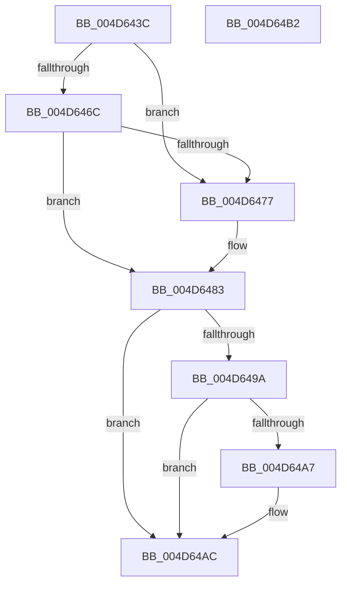

# ExpUnlockCallbackListExclusive

- RVA: `0x004D643C`–`0x004D64B3` (길이 `119` bytes)
- VA: `0x00000001404D643C`
- 실행 섹션: `.text`
- PDB 이름 있음: `예`; PDB Function 태그: `아니요`
- unwind 정보 RVA: `0x0005CF00`
- 디코드: `31`개 명령, `119/119` bytes 표시
- 미해석 바이트: `0` (있으면 어셈블리에 `.byte`로 보존)

> 이 문서는 커널 이미지의 기계어와 PDB 기호를 분석해 생성했습니다. 4번과 5번은 함수 원형과 자료형을 바이너리 사용 방식에서 추정한 C 해석이며 원본 소스 복구 결과는 아닙니다.

## 1. Dependencies

- 직접 호출 지점: **3**; 고유 호출 대상: **3**
- 직접 호출자로 확인된 함수: **2**
- RIP 상대 이미지 참조: **1**

### Outgoing calls
- `0x004D647E` → [ExfReleasePushLock](../26/ExfReleasePushLock_function_002638D0.md) (function, `0x002638D0`)
- `0x004D648A` → [KeAbPostRelease](../2E/KeAbPostRelease_function_002E1600.md) (function, `0x002E1600`)
- `0x004D64A7` → [KiCheckForKernelApcDelivery](../2E/KiCheckForKernelApcDelivery_function_002E2C80.md) (function, `0x002E2C80`)

### Direct callers
- [ExpDeleteCallback](../../page/7C/ExpDeleteCallback_function_007CAC80.md) at `0x007CACBE`
- [ExCreateCallback](../../page/A7/ExCreateCallback_function_00A7B9D0.md) at `0x00A7BAC9`

### Static image references
- `0x004D6445` → RVA `0x00EFACC0` (`.data`; read)

## 2. Other-region calls and transfers

- 다른 실행 섹션으로 향하는 call: **0**
- 별도 외부 분기/꼬리 이동을 확인하지 못했습니다.

## 3. Assembly (complete function range)

```asm
004D643C  40 53                           push rbx
004D643E  48 83 EC 20                     sub rsp, 0x20
004D6442  48 8B D9                        mov rbx, rcx
004D6445  0F 0D 0D 74 48 A2 00            prefetchw byte ptr [rip + 0xa24874]
004D644C  48 8B 05 6D 48 A2 00            mov rax, qword ptr [rip + 0xa2486d]
004D6453  33 C9                           xor ecx, ecx
004D6455  48 8B D0                        mov rdx, rax
004D6458  48 83 E2 F0                     and rdx, 0xfffffffffffffff0
004D645C  48 83 FA 10                     cmp rdx, 0x10
004D6460  4C 8D 40 F0                     lea r8, [rax - 0x10]
004D6464  4C 0F 46 C1                     cmovbe r8, rcx
004D6468  A8 02                           test al, 2
004D646A  75 0B                           jne 0x1404d6477
004D646C  F0 4C 0F B1 05 4B 48 A2 00      lock cmpxchg qword ptr [rip + 0xa2484b], r8
004D6475  74 0C                           je 0x1404d6483
004D6477  48 8D 0D 42 48 A2 00            lea rcx, [rip + 0xa24842]
004D647E  E8 4D D4 D8 FF                  call 0x1402638d0
004D6483  48 8D 0D 36 48 A2 00            lea rcx, [rip + 0xa24836]
004D648A  E8 71 B1 E0 FF                  call 0x1402e1600
004D648F  90                              nop
004D6490  66 83 83 E6 01 00 00 01         add word ptr [rbx + 0x1e6], 1
004D6498  75 12                           jne 0x1404d64ac
004D649A  48 8D 83 98 00 00 00            lea rax, [rbx + 0x98]
004D64A1  90                              nop
004D64A2  48 39 00                        cmp qword ptr [rax], rax
004D64A5  74 05                           je 0x1404d64ac
004D64A7  E8 D4 C7 E0 FF                  call 0x1402e2c80
004D64AC  48 83 C4 20                     add rsp, 0x20
004D64B0  5B                              pop rbx
004D64B1  C3                              ret
004D64B2  CC                              int3
```

## 4. C-style interpretation (structured pseudocode)

```c
__int64 __fastcall ExpUnlockCallbackListExclusive(__int64 a1)
{
    __int64 result;
    __int64 v_rsp;

    v_rsp = (v_rsp) - (32);
    a1 = 0;
    a2 = (*(unsigned __int64 *)(v_rip + 10635373)) & (-16);
    a3 = *(unsigned __int64 *)(v_rip + 10635373) - 16;
    if (a2 <= 16) { a3 = 0; }
    if ((((unsigned __int8)(*(unsigned __int64 *)(v_rip + 10635373))) & (2)) != 0) goto loc_004D6477;
    result = *(unsigned __int64 *)(v_rip + 10635373);
    if ((((unsigned __int8)(*(unsigned __int64 *)(v_rip + 10635373))) & (2)) != 0) {
        a1 = v_rip + 10635330;
        result = ExfReleasePushLock(a1, a2, a3, a4);
    }
    result = KeAbPostRelease(v_rip + 10635318, a2, a3, a4);
    if ((((unsigned __int8)(*(unsigned __int64 *)(v_rip + 10635373))) & (2)) != 0) goto loc_004D64AC;
    result = a1 + 152;
    if ((*(unsigned __int64 *)(a1 + 152)) != (a1 + 152)) {
        result = KiCheckForKernelApcDelivery(v_rip + 10635318, a2, a3, a4);
    }
    v_rsp = (v_rsp) + (32);
    return result;
}
```

## 5. (Beta) C Style

```c
int64_t ExpUnlockCallbackListExclusive(void *Arg1)
{
    uint8_t *arg1 = (uint8_t *)Arg1;

    int64_t result;
    int64_t local_rsp;

    local_rsp = (local_rsp) - (32);
    Arg1 = 0;
    a2 = (*(uint64_t *)(v_rip + 0xA2486D)) & (-16);
    a3 = *(uint64_t *)(v_rip + 0xA2486D) - 16;
    if (a2 <= 16) { a3 = 0; }
    if ((((uint8_t)(*(uint64_t *)(v_rip + 0xA2486D))) & (2)) != 0) goto loc_004D6477;
    result = *(uint64_t *)(v_rip + 0xA2486D);
    if ((((uint8_t)(*(uint64_t *)(v_rip + 0xA2486D))) & (2)) != 0) {
        Arg1 = v_rip + 10635330;
        result = ExfReleasePushLock(Arg1, a2, a3, a4);
    }
    result = KeAbPostRelease(v_rip + 10635318, a2, a3, a4);
    if ((((uint8_t)(*(uint64_t *)(v_rip + 0xA2486D))) & (2)) != 0) goto loc_004D64AC;
    result = Arg1 + 152;
    if ((*(uint64_t *)(arg1 + 0x98)) != (Arg1 + 152)) {
        result = KiCheckForKernelApcDelivery(v_rip + 10635318, a2, a3, a4);
    }
    local_rsp = (local_rsp) + (32);
    return result;
}
```

### 관측된 메모리 오프셋

구조체 형식이 확인되지 않은 접근은 인자 기준의 오프셋으로만 기록했습니다.

| 기준 인자 | 오프셋 표현 | 폭 (bit) | 접근 |
|---|---:|---:|---|
| `Arg1` | `+ 0x0` | `64` | `R` |
| `Arg1` | `+ 0x98` | `64` | `R` |
| `Arg1` | `+ 0x1E6` | `16` | `R/W` |

## 6. Execution-region graph

[열기: 2D/3D 그래프와 함수 탐색 컨트롤 패널](../../../control-panel.html?section=text&rva=0x004D643C&view=graph)

- 2D 그래프는 위에서 아래로 흐르고, 3D 그래프는 빈 공간을 드래그해 회전합니다. Shift+드래그는 이동, 휠은 확대·축소, 함수 노드 선택은 대상 보고서 이동입니다.

### Static fallback


