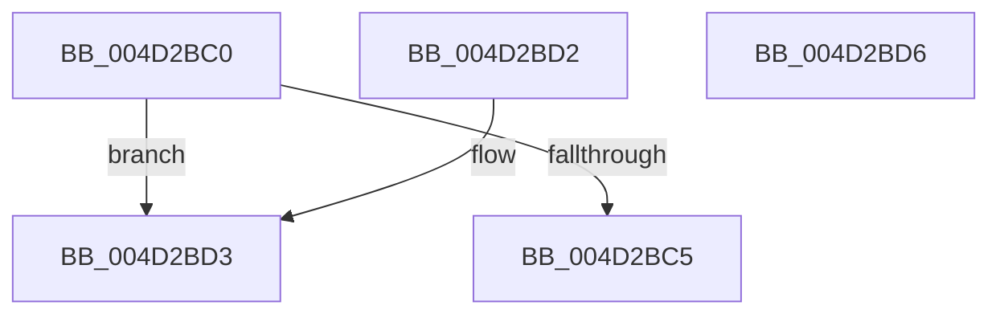

# FsRtlCheckFileSystemFilterCallbacksRegistered

- RVA: `0x004D2BC0`–`0x004D2BD7` (길이 `23` bytes)
- VA: `0x00000001404D2BC0`
- 실행 섹션: `.text`
- PDB 이름 있음: `예`; PDB Function 태그: `아니요`
- unwind 정보 RVA: `0x000DB714`
- 디코드: `10`개 명령, `23/23` bytes 표시
- 미해석 바이트: `0` (있으면 어셈블리에 `.byte`로 보존)

> 이 문서는 커널 이미지의 기계어와 PDB 기호를 분석해 생성했습니다. 4번과 5번은 함수 원형과 자료형을 바이너리 사용 방식에서 추정한 C 해석이며 원본 소스 복구 결과는 아닙니다.

## 1. Dependencies

- 직접 호출 지점: **0**; 고유 호출 대상: **0**
- 직접 호출자로 확인된 함수: **0**
- RIP 상대 이미지 참조: **0**

### Outgoing calls
- 직접 디코드된 call 명령이 없습니다.

### Direct callers
- 이 함수 시작 RVA로 연결되는 직접 call은 확인되지 않았습니다. 간접 호출은 완전히 역산할 수 없습니다.

### Static image references
- 디코드된 RIP-relative 메모리 참조가 없습니다.

## 2. Other-region calls and transfers

- 다른 실행 섹션으로 향하는 call: **0**
- 별도 외부 분기/꼬리 이동을 확인하지 못했습니다.

## 3. Assembly (complete function range)

```asm
004D2BC0  48 85 C9                        test rcx, rcx
004D2BC3  74 0E                           je 0x1404d2bd3
004D2BC5  48 8B 41 30                     mov rax, qword ptr [rcx + 0x30]
004D2BC9  48 83 78 30 00                  cmp qword ptr [rax + 0x30], 0
004D2BCE  0F 95 C0                        setne al
004D2BD1  C3                              ret
004D2BD2  CC                              int3
004D2BD3  32 C0                           xor al, al
004D2BD5  C3                              ret
004D2BD6  CC                              int3
```

## 4. C-style interpretation (structured pseudocode)

```c
__int64 __fastcall FsRtlCheckFileSystemFilterCallbacksRegistered(__int64 a1)
{
    __int64 result;

    if (a1 == 0) goto loc_004D2BD3;
    result = ((*(unsigned __int64 *)(*(unsigned __int64 *)(a1 + 48) + 48)) != 0) ? 1 : 0;
    return result;
loc_004D2BD3:
    result = 0;
    return result;
}
```

## 5. (Beta) C Style

```c
int64_t FsRtlCheckFileSystemFilterCallbacksRegistered(int64_t Arg1)
{
    int64_t result;

    if (Arg1 == 0) goto loc_004D2BD3;
    result = ((*(uint64_t *)(*(uint64_t *)(Arg1 + 0x30) + 0x30)) != 0) ? 1 : 0;
    return result;
loc_004D2BD3:
    result = 0;
    return result;
}
```

## 6. Execution-region graph

[열기: 2D/3D 그래프와 함수 탐색 컨트롤 패널](../../../control-panel.html?section=text&rva=0x004D2BC0&view=graph)

- 2D 그래프는 위에서 아래로 흐르고, 3D 그래프는 빈 공간을 드래그해 회전합니다. Shift+드래그는 이동, 휠은 확대·축소, 함수 노드 선택은 대상 보고서 이동입니다.

### Static fallback


