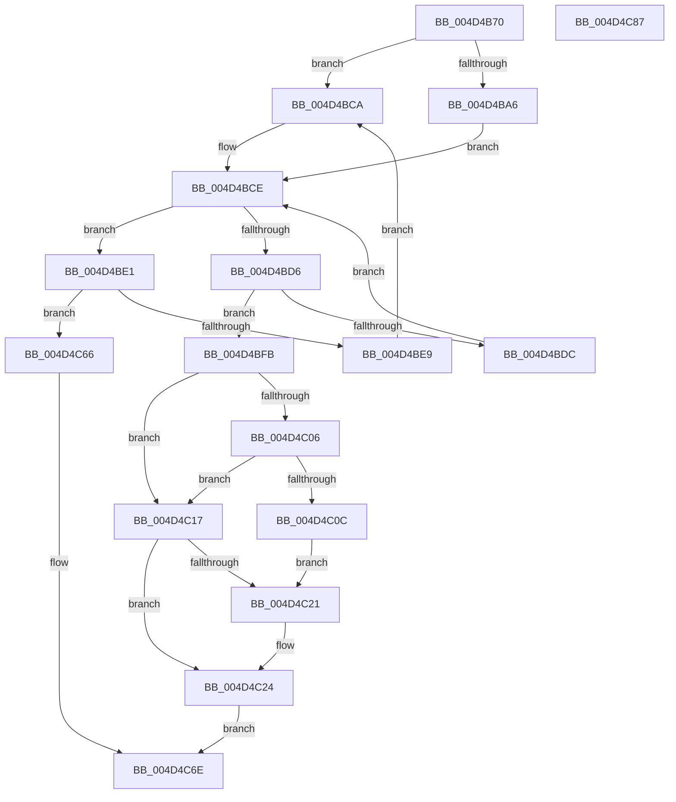

# FsRtlPrivateCancelFileLockIrp

- RVA: `0x004D4B70`–`0x004D4C88` (길이 `280` bytes)
- VA: `0x00000001404D4B70`
- 실행 섹션: `.text`
- PDB 이름 있음: `예`; PDB Function 태그: `아니요`
- unwind 정보 RVA: `0x0009F048`
- 디코드: `79`개 명령, `280/280` bytes 표시
- 미해석 바이트: `0` (있으면 어셈블리에 `.byte`로 보존)

> 이 문서는 커널 이미지의 기계어와 PDB 기호를 분석해 생성했습니다. 4번과 5번은 함수 원형과 자료형을 바이너리 사용 방식에서 추정한 C 해석이며 원본 소스 복구 결과는 아닙니다.

## 1. Dependencies

- 직접 호출 지점: **8**; 고유 호출 대상: **7**
- 직접 호출자로 확인된 함수: **1**
- RIP 상대 이미지 참조: **3**

### Outgoing calls
- `0x004D4BAE` → [KeReleaseQueuedSpinLock](../27/KeReleaseQueuedSpinLock_function_00272540.md) (function, `0x00272540`)
- `0x004D4BB6` → [KeAcquireSpinLockRaiseToDpc](../20/KeAcquireSpinLockRaiseToDpc_function_00208470.md) (function, `0x00208470`)
- `0x004D4BEC` → [KeAcquireSpinLockAtDpcLevel](../20/KeAcquireSpinLockAtDpcLevel_function_00208430.md) (function, `0x00208430`)
- `0x004D4BF4` → [KxReleaseSpinLock](../20/KxReleaseSpinLock_function_00206670.md) (function, `0x00206670`)
- `0x004D4C2A` → [KeReleaseSpinLock](../39/KeReleaseSpinLock_function_00392BA0.md) (function, `0x00392BA0`)
- `0x004D4C50` → [FsRtlCompleteLockIrpReal](../49/FsRtlCompleteLockIrpReal_function_004973AC.md) (function, `0x004973AC`)
- `0x004D4C5F` → [ExFreeToNPagedLookasideList](../38/ExFreeToNPagedLookasideList_function_0038D9D0.md) (function, `0x0038D9D0`)
- `0x004D4C69` → [KeReleaseSpinLock](../39/KeReleaseSpinLock_function_00392BA0.md) (function, `0x00392BA0`)

### Direct callers
- [FsRtlPrivateLock](../38/FsRtlPrivateLock_function_0038DF90.md) at `0x0038E493`

### Static image references
- `0x004D4B8C` → RVA `0x00F8F0D8` (`.data`; read)
- `0x004D4BBE` → RVA `0x00F8F0E0` (`.data`; read)
- `0x004D4C58` → RVA `0x00E12000` (`.data`; read)

## 2. Other-region calls and transfers

- 다른 실행 섹션으로 향하는 call: **0**
- 별도 외부 분기/꼬리 이동을 확인하지 못했습니다.

## 3. Assembly (complete function range)

```asm
004D4B70  48 89 5C 24 10                  mov qword ptr [rsp + 0x10], rbx
004D4B75  48 89 6C 24 18                  mov qword ptr [rsp + 0x18], rbp
004D4B7A  48 89 74 24 20                  mov qword ptr [rsp + 0x20], rsi
004D4B7F  57                              push rdi
004D4B80  41 56                           push r14
004D4B82  41 57                           push r15
004D4B84  48 83 EC 30                     sub rsp, 0x30
004D4B88  48 8B 5A 38                     mov rbx, qword ptr [rdx + 0x38]
004D4B8C  4C 8D 35 45 A5 AB 00            lea r14, [rip + 0xaba545]
004D4B93  44 8A 7A 45                     mov r15b, byte ptr [rdx + 0x45]
004D4B97  48 83 C3 18                     add rbx, 0x18
004D4B9B  40 32 F6                        xor sil, sil
004D4B9E  48 8B EA                        mov rbp, rdx
004D4BA1  48 85 C9                        test rcx, rcx
004D4BA4  74 24                           je 0x1404d4bca
004D4BA6  41 8A D7                        mov dl, r15b
004D4BA9  B9 07 00 00 00                  mov ecx, 7
004D4BAE  E8 8D D9 D9 FF                  call 0x140272540
004D4BB3  49 8B CE                        mov rcx, r14
004D4BB6  E8 B5 38 D3 FF                  call 0x140208470
004D4BBB  44 8A F8                        mov r15b, al
004D4BBE  48 8D 0D 1B A5 AB 00            lea rcx, [rip + 0xaba51b]
004D4BC5  40 B6 01                        mov sil, 1
004D4BC8  EB 04                           jmp 0x1404d4bce
004D4BCA  48 8D 4B 18                     lea rcx, [rbx + 0x18]
004D4BCE  48 8B 39                        mov rdi, qword ptr [rcx]
004D4BD1  48 85 FF                        test rdi, rdi
004D4BD4  74 0B                           je 0x1404d4be1
004D4BD6  48 39 6F 18                     cmp qword ptr [rdi + 0x18], rbp
004D4BDA  74 1F                           je 0x1404d4bfb
004D4BDC  48 8B CF                        mov rcx, rdi
004D4BDF  EB ED                           jmp 0x1404d4bce
004D4BE1  48 8B CB                        mov rcx, rbx
004D4BE4  40 84 F6                        test sil, sil
004D4BE7  74 7D                           je 0x1404d4c66
004D4BE9  40 32 F6                        xor sil, sil
004D4BEC  E8 3F 38 D3 FF                  call 0x140208430
004D4BF1  49 8B CE                        mov rcx, r14
004D4BF4  E8 77 1A D3 FF                  call 0x140206670
004D4BF9  EB CF                           jmp 0x1404d4bca
004D4BFB  48 8B 07                        mov rax, qword ptr [rdi]
004D4BFE  48 89 01                        mov qword ptr [rcx], rax
004D4C01  40 84 F6                        test sil, sil
004D4C04  75 11                           jne 0x1404d4c17
004D4C06  48 3B 7B 20                     cmp rdi, qword ptr [rbx + 0x20]
004D4C0A  75 0B                           jne 0x1404d4c17
004D4C0C  48 89 4B 20                     mov qword ptr [rbx + 0x20], rcx
004D4C10  48 83 65 38 00                  and qword ptr [rbp + 0x38], 0
004D4C15  EB 0A                           jmp 0x1404d4c21
004D4C17  48 83 65 38 00                  and qword ptr [rbp + 0x38], 0
004D4C1C  40 84 F6                        test sil, sil
004D4C1F  75 03                           jne 0x1404d4c24
004D4C21  4C 8B F3                        mov r14, rbx
004D4C24  41 8A D7                        mov dl, r15b
004D4C27  49 8B CE                        mov rcx, r14
004D4C2A  E8 71 DF EB FF                  call 0x140392ba0
004D4C2F  48 83 64 24 28 00               and qword ptr [rsp + 0x28], 0
004D4C35  48 8D 44 24 50                  lea rax, [rsp + 0x50]
004D4C3A  48 8B 57 10                     mov rdx, qword ptr [rdi + 0x10]
004D4C3E  41 B9 20 01 00 C0               mov r9d, 0xc0000120
004D4C44  48 8B 4F 08                     mov rcx, qword ptr [rdi + 8]
004D4C48  4C 8B C5                        mov r8, rbp
004D4C4B  48 89 44 24 20                  mov qword ptr [rsp + 0x20], rax
004D4C50  E8 57 27 FC FF                  call 0x1404973ac
004D4C55  48 8B D7                        mov rdx, rdi
004D4C58  48 8D 0D A1 D3 93 00            lea rcx, [rip + 0x93d3a1]
004D4C5F  E8 6C 8D EB FF                  call 0x14038d9d0
004D4C64  EB 08                           jmp 0x1404d4c6e
004D4C66  41 8A D7                        mov dl, r15b
004D4C69  E8 32 DF EB FF                  call 0x140392ba0
004D4C6E  48 8B 5C 24 58                  mov rbx, qword ptr [rsp + 0x58]
004D4C73  48 8B 6C 24 60                  mov rbp, qword ptr [rsp + 0x60]
004D4C78  48 8B 74 24 68                  mov rsi, qword ptr [rsp + 0x68]
004D4C7D  48 83 C4 30                     add rsp, 0x30
004D4C81  41 5F                           pop r15
004D4C83  41 5E                           pop r14
004D4C85  5F                              pop rdi
004D4C86  C3                              ret
004D4C87  CC                              int3
```

## 4. C-style interpretation (structured pseudocode)

```c
__int64 __fastcall FsRtlPrivateCancelFileLockIrp(__int64 a1, __int64 a2)
{
    __int64 result;
    __int64 v_r14;
    __int64 v_rbx;
    __int64 v_rsi;
    __int64 v_rsp;
    unsigned __int64 v_stack_m20;
    unsigned __int64 v_stack_m28;
    unsigned __int64 v_stack_p10;
    unsigned __int64 v_stack_p18;
    unsigned __int64 v_stack_p20;
    unsigned __int64 v_stack_p8;

    v_stack_p10 = v_rbx;
    v_stack_p18 = v_rbp;
    v_stack_p20 = v_rsi;
    v_rsp = (v_rsp) - (48);
    v_rbx = (*(unsigned __int64 *)(a2 + 56)) + (24);
    v_rsi = 0;
    if (a1 == 0) goto loc_004D4BCA;
    result = KeReleaseQueuedSpinLock(7, (unsigned __int8)(*(unsigned __int8 *)(a2 + 69)), a3, a4);
    result = KeAcquireSpinLockRaiseToDpc(v_rip + 11248965, (unsigned __int8)(*(unsigned __int8 *)(a2 + 69)), a3, a4);
    goto loc_004D4BCE;
loc_004D4BCA:
loc_004D4BCE:
    if (*(unsigned __int64 *)(v_rbx + 24) == 0) goto loc_004D4BE1;
    if ((*(unsigned __int64 *)(*(unsigned __int64 *)(v_rbx + 24) + 24)) == a2) goto loc_004D4BFB;
    goto loc_004D4BCE;
loc_004D4BE1:
    if (1 == 0) goto loc_004D4C66;
    v_rsi = 0;
    result = KeAcquireSpinLockAtDpcLevel(v_rbx, (unsigned __int8)(*(unsigned __int8 *)(a2 + 69)), a3, a4);
    result = KxReleaseSpinLock(v_rip + 11248965, (unsigned __int8)(*(unsigned __int8 *)(a2 + 69)), a3, a4);
    goto loc_004D4BCA;
loc_004D4BFB:
    *(unsigned __int64 *)(v_rip + 11248965) = *(unsigned __int64 *)(*(unsigned __int64 *)(v_rbx + 24));
    if (0 != 0) goto loc_004D4C17;
    if ((*(unsigned __int64 *)(v_rbx + 24)) != (*(unsigned __int64 *)(v_rbx + 32))) goto loc_004D4C17;
    *(unsigned __int64 *)(v_rbx + 32) = v_rip + 11248965;
    goto loc_004D4C21;
loc_004D4C17:
    v_r14 = v_rip + 11248965;
    if (0 == 0) {
        v_r14 = v_rbx;
    }
    result = KeReleaseSpinLock(v_r14, (unsigned __int8)((unsigned __int8)(result)), a3, a4);
    v_stack_m28 = v_stack_p8;
    result = FsRtlCompleteLockIrpReal(*(unsigned __int64 *)(*(unsigned __int64 *)(v_rbx + 24) + 8), *(unsigned __int64 *)(*(unsigned __int64 *)(v_rbx + 24) + 16), a2, (unsigned int)(0xC0000120ULL));
    result = ExFreeToNPagedLookasideList(v_rip + 9687969, *(unsigned __int64 *)(v_rbx + 24), a2, (unsigned int)(0xC0000120ULL));
    goto loc_004D4C6E;
loc_004D4C66:
    result = KeReleaseSpinLock(v_rip + 9687969, (unsigned __int8)((unsigned __int8)(result)), a2, (unsigned int)(0xC0000120ULL));
loc_004D4C6E:
    v_rsp = (v_rsp) + (48);
    return result;
}
```

## 5. (Beta) C Style

```c
int64_t FsRtlPrivateCancelFileLockIrp(int64_t Arg1, void *Arg2)
{
    uint8_t *arg2 = (uint8_t *)Arg2;

    int64_t result;
    int64_t local_r14;
    int64_t local_rbx;
    int64_t local_rsi;
    int64_t local_rsp;
    uint64_t v_stack_m20;
    uint64_t v_stack_m28;
    uint64_t v_stack_p10;
    uint64_t v_stack_p18;
    uint64_t v_stack_p20;
    uint64_t v_stack_p8;

    v_stack_p10 = local_rbx;
    v_stack_p18 = local_rbp;
    v_stack_p20 = local_rsi;
    local_rsp = (local_rsp) - (48);
    local_rbx = (*(uint64_t *)(arg2 + 0x38)) + (24);
    local_rsi = 0;
    if (Arg1 == 0) goto loc_004D4BCA;
    result = KeReleaseQueuedSpinLock(7, (uint8_t)(*(uint8_t *)(arg2 + 0x45)), a3, a4);
    result = KeAcquireSpinLockRaiseToDpc(v_rip + 11248965, (uint8_t)(*(uint8_t *)(arg2 + 0x45)), a3, a4);
    goto loc_004D4BCE;
loc_004D4BCA:
loc_004D4BCE:
    if (*(uint64_t *)(local_rbx + 0x18) == 0) goto loc_004D4BE1;
    if ((*(uint64_t *)(*(uint64_t *)(local_rbx + 0x18) + 0x18)) == Arg2) goto loc_004D4BFB;
    goto loc_004D4BCE;
loc_004D4BE1:
    if (1 == 0) goto loc_004D4C66;
    local_rsi = 0;
    result = KeAcquireSpinLockAtDpcLevel(local_rbx, (uint8_t)(*(uint8_t *)(arg2 + 0x45)), a3, a4);
    result = KxReleaseSpinLock(v_rip + 11248965, (uint8_t)(*(uint8_t *)(arg2 + 0x45)), a3, a4);
    goto loc_004D4BCA;
loc_004D4BFB:
    *(uint64_t *)(v_rip + 0xABA545) = *(uint64_t *)(*(uint64_t *)(local_rbx + 0x18));
    if (0 != 0) goto loc_004D4C17;
    if ((*(uint64_t *)(local_rbx + 0x18)) != (*(uint64_t *)(local_rbx + 0x20))) goto loc_004D4C17;
    *(uint64_t *)(local_rbx + 0x20) = v_rip + 11248965;
    goto loc_004D4C21;
loc_004D4C17:
    local_r14 = v_rip + 11248965;
    if (0 == 0) {
        local_r14 = local_rbx;
    }
    result = KeReleaseSpinLock(local_r14, (uint8_t)((uint8_t)(result)), a3, a4);
    v_stack_m28 = v_stack_p8;
    result = FsRtlCompleteLockIrpReal(*(uint64_t *)(*(uint64_t *)(local_rbx + 0x18) + 0x8), *(uint64_t *)(*(uint64_t *)(local_rbx + 0x18) + 0x10), Arg2, (uint32_t)(0xC0000120ULL));
    result = ExFreeToNPagedLookasideList(v_rip + 9687969, *(uint64_t *)(local_rbx + 0x18), Arg2, (uint32_t)(0xC0000120ULL));
    goto loc_004D4C6E;
loc_004D4C66:
    result = KeReleaseSpinLock(v_rip + 9687969, (uint8_t)((uint8_t)(result)), Arg2, (uint32_t)(0xC0000120ULL));
loc_004D4C6E:
    local_rsp = (local_rsp) + (48);
    return result;
}
```

### 관측된 메모리 오프셋

구조체 형식이 확인되지 않은 접근은 인자 기준의 오프셋으로만 기록했습니다.

| 기준 인자 | 오프셋 표현 | 폭 (bit) | 접근 |
|---|---:|---:|---|
| `Arg2` | `+ 0x38` | `64` | `R` |
| `Arg2` | `+ 0x38` | `64` | `R/W` |
| `Arg2` | `+ 0x45` | `8` | `R` |

## 6. Execution-region graph

[열기: 2D/3D 그래프와 함수 탐색 컨트롤 패널](../../../control-panel.html?section=text&rva=0x004D4B70&view=graph)

- 2D 그래프는 위에서 아래로 흐르고, 3D 그래프는 빈 공간을 드래그해 회전합니다. Shift+드래그는 이동, 휠은 확대·축소, 함수 노드 선택은 대상 보고서 이동입니다.

### Static fallback


