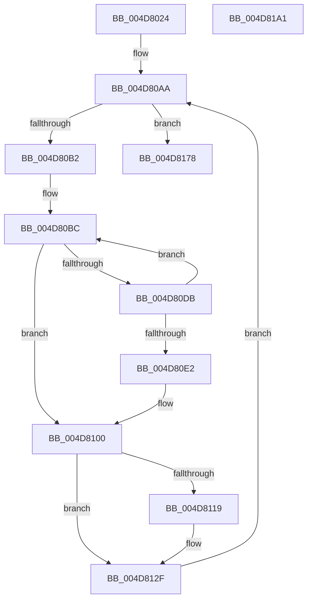

# HalpDmaFlushBufferWithEmergencyResources

- RVA: `0x004D8024`–`0x004D81A2` (길이 `382` bytes)
- VA: `0x00000001404D8024`
- 실행 섹션: `.text`
- PDB 이름 있음: `예`; PDB Function 태그: `아니요`
- unwind 정보 RVA: `0x0007FF48`
- 디코드: `104`개 명령, `382/382` bytes 표시
- 미해석 바이트: `0` (있으면 어셈블리에 `.byte`로 보존)

> 이 문서는 커널 이미지의 기계어와 PDB 기호를 분석해 생성했습니다. 4번과 5번은 함수 원형과 자료형을 바이너리 사용 방식에서 추정한 C 해석이며 원본 소스 복구 결과는 아닙니다.

## 1. Dependencies

- 직접 호출 지점: **6**; 고유 호출 대상: **6**
- 직접 호출자로 확인된 함수: **1**
- RIP 상대 이미지 참조: **3**

### Outgoing calls
- `0x004D8063` → [KeAcquireInStackQueuedSpinLock](../27/KeAcquireInStackQueuedSpinLock_function_002757A0.md) (function, `0x002757A0`)
- `0x004D80CE` → [MmMapLockedPagesWithReservedMapping](../3E/MmMapLockedPagesWithReservedMapping_function_003E8910.md) (function, `0x003E8910`)
- `0x004D80FA` → [KeBugCheckEx](../4F/KeBugCheckEx_function_004FD660.md) (function, `0x004FD660`)
- `0x004D812A` → [KeFlushIoBuffers](../3D/KeFlushIoBuffers_function_003DA340.md) (function, `0x003DA340`)
- `0x004D813A` → [MmUnmapReservedMapping](../3E/MmUnmapReservedMapping_function_003E7BE0.md) (function, `0x003E7BE0`)
- `0x004D817D` → [KeReleaseInStackQueuedSpinLock](../34/KeReleaseInStackQueuedSpinLock_function_00342CE0.md) (function, `0x00342CE0`)

### Direct callers
- [HalpDmaFlushBuffer](../3D/HalpDmaFlushBuffer_function_003DC1DC.md) at `0x003DC350`

### Static image references
- `0x004D8044` → RVA `0x00E3EC80` (`.data`; read)
- `0x004D808C` → RVA `0x00E3EC58` (`.data`; read)
- `0x004D80BC` → RVA `0x00E3EC30` (`.data`; read)

## 2. Other-region calls and transfers

- 다른 실행 섹션으로 향하는 call: **0**
- 별도 외부 분기/꼬리 이동을 확인하지 못했습니다.

## 3. Assembly (complete function range)

```asm
004D8024  4C 8B DC                        mov r11, rsp
004D8027  49 89 5B 08                     mov qword ptr [r11 + 8], rbx
004D802B  49 89 6B 10                     mov qword ptr [r11 + 0x10], rbp
004D802F  49 89 73 18                     mov qword ptr [r11 + 0x18], rsi
004D8033  49 89 7B 20                     mov qword ptr [r11 + 0x20], rdi
004D8037  41 54                           push r12
004D8039  41 56                           push r14
004D803B  41 57                           push r15
004D803D  48 83 EC 50                     sub rsp, 0x50
004D8041  0F 57 C0                        xorps xmm0, xmm0
004D8044  48 8D 0D 35 6C 96 00            lea rcx, [rip + 0x966c35]
004D804B  48 8B DA                        mov rbx, rdx
004D804E  33 C0                           xor eax, eax
004D8050  0F 11 44 24 30                  movups xmmword ptr [rsp + 0x30], xmm0
004D8055  49 8D 53 C8                     lea rdx, [r11 - 0x38]
004D8059  49 89 43 D8                     mov qword ptr [r11 - 0x28], rax
004D805D  41 8B F1                        mov esi, r9d
004D8060  49 8B E8                        mov rbp, r8
004D8063  E8 38 D7 D9 FF                  call 0x1402757a0
004D8068  48 8B C5                        mov rax, rbp
004D806B  44 8B FD                        mov r15d, ebp
004D806E  48 2B 43 20                     sub rax, qword ptr [rbx + 0x20]
004D8072  41 81 E7 FF 0F 00 00            and r15d, 0xfff
004D8079  48 C1 E8 0C                     shr rax, 0xc
004D807D  48 83 C3 30                     add rbx, 0x30
004D8081  8B C0                           mov eax, eax
004D8083  BA 00 10 00 00                  mov edx, 0x1000
004D8088  4C 8D 24 C3                     lea r12, [rbx + rax*8]
004D808C  48 8B 1D C5 6B 96 00            mov rbx, qword ptr [rip + 0x966bc5]
004D8093  48 8B C5                        mov rax, rbp
004D8096  48 25 00 F0 FF FF               and rax, 0xfffffffffffff000
004D809C  41 2B D7                        sub edx, r15d
004D809F  89 53 28                        mov dword ptr [rbx + 0x28], edx
004D80A2  48 89 43 20                     mov qword ptr [rbx + 0x20], rax
004D80A6  44 89 7B 2C                     mov dword ptr [rbx + 0x2c], r15d
004D80AA  85 F6                           test esi, esi
004D80AC  0F 84 C6 00 00 00               je 0x1404d8178
004D80B2  49 8B 04 24                     mov rax, qword ptr [r12]
004D80B6  33 FF                           xor edi, edi
004D80B8  48 89 43 30                     mov qword ptr [rbx + 0x30], rax
004D80BC  48 8B 0D 6D 6B 96 00            mov rcx, qword ptr [rip + 0x966b6d]
004D80C3  44 8B CF                        mov r9d, edi
004D80C6  4C 8B C3                        mov r8, rbx
004D80C9  BA 48 61 6C 44                  mov edx, 0x446c6148
004D80CE  E8 3D 08 F1 FF                  call 0x1403e8910
004D80D3  4C 8B F0                        mov r14, rax
004D80D6  48 85 C0                        test rax, rax
004D80D9  75 25                           jne 0x1404d8100
004D80DB  FF C7                           inc edi
004D80DD  83 FF 06                        cmp edi, 6
004D80E0  7C DA                           jl 0x1404d80bc
004D80E2  48 21 44 24 20                  and qword ptr [rsp + 0x20], rax
004D80E7  45 33 C9                        xor r9d, r9d
004D80EA  BA 00 10 00 00                  mov edx, 0x1000
004D80EF  B9 AC 00 00 00                  mov ecx, 0xac
004D80F4  41 B8 01 EF 00 00               mov r8d, 0xef01
004D80FA  E8 61 55 02 00                  call 0x1404fd660
004D80FF  CC                              int3
004D8100  B8 00 10 00 00                  mov eax, 0x1000
004D8105  8B FE                           mov edi, esi
004D8107  41 2B C7                        sub eax, r15d
004D810A  3B F0                           cmp esi, eax
004D810C  0F 43 F8                        cmovae edi, eax
004D810F  80 BC 24 98 00 00 00 00         cmp byte ptr [rsp + 0x98], 0
004D8117  75 16                           jne 0x1404d812f
004D8119  80 BC 24 90 00 00 00 00         cmp byte ptr [rsp + 0x90], 0
004D8121  41 B0 01                        mov r8b, 1
004D8124  48 8B CB                        mov rcx, rbx
004D8127  0F 94 C2                        sete dl
004D812A  E8 11 22 F0 FF                  call 0x1403da340
004D812F  4C 8B C3                        mov r8, rbx
004D8132  BA 48 61 6C 44                  mov edx, 0x446c6148
004D8137  49 8B CE                        mov rcx, r14
004D813A  E8 A1 FA F0 FF                  call 0x1403e7be0
004D813F  2B F7                           sub esi, edi
004D8141  8B C7                           mov eax, edi
004D8143  48 03 E8                        add rbp, rax
004D8146  49 83 C4 08                     add r12, 8
004D814A  B8 00 10 00 00                  mov eax, 0x1000
004D814F  45 33 FF                        xor r15d, r15d
004D8152  3B F0                           cmp esi, eax
004D8154  8B CE                           mov ecx, esi
004D8156  0F 47 C8                        cmova ecx, eax
004D8159  48 8B C5                        mov rax, rbp
004D815C  48 25 00 F0 FF FF               and rax, 0xfffffffffffff000
004D8162  89 4B 28                        mov dword ptr [rbx + 0x28], ecx
004D8165  48 89 43 20                     mov qword ptr [rbx + 0x20], rax
004D8169  8B C5                           mov eax, ebp
004D816B  25 FF 0F 00 00                  and eax, 0xfff
004D8170  89 43 2C                        mov dword ptr [rbx + 0x2c], eax
004D8173  E9 32 FF FF FF                  jmp 0x1404d80aa
004D8178  48 8D 4C 24 30                  lea rcx, [rsp + 0x30]
004D817D  E8 5E AB E6 FF                  call 0x140342ce0
004D8182  4C 8D 5C 24 50                  lea r11, [rsp + 0x50]
004D8187  49 8B 5B 20                     mov rbx, qword ptr [r11 + 0x20]
004D818B  49 8B 6B 28                     mov rbp, qword ptr [r11 + 0x28]
004D818F  49 8B 73 30                     mov rsi, qword ptr [r11 + 0x30]
004D8193  49 8B 7B 38                     mov rdi, qword ptr [r11 + 0x38]
004D8197  49 8B E3                        mov rsp, r11
004D819A  41 5F                           pop r15
004D819C  41 5E                           pop r14
004D819E  41 5C                           pop r12
004D81A0  C3                              ret
004D81A1  CC                              int3
```

## 4. C-style interpretation (structured pseudocode)

```c
__int64 __fastcall HalpDmaFlushBufferWithEmergencyResources(__int64 a1, __int64 a2, __int64 a3, int a4, unsigned __int8 a5, unsigned __int8 a6)
{
    __int64 result;
    __int64 v_r12;
    __int64 v_r15;
    __int64 v_rbp;
    __int64 v_rbx;
    __int64 v_rdi;
    __int64 v_rsi;
    __int64 v_rsp;
    unsigned __int64 v_stack_m18;
    unsigned __int64 v_stack_m38;
    unsigned __int64 v_stack_m48;

    *(unsigned __int64 *)(v_rsp + 8) = v_rbx;
    *(unsigned __int64 *)(v_rsp + 16) = v_rbp;
    *(unsigned __int64 *)(v_rsp + 24) = v_rsi;
    *(unsigned __int64 *)(v_rsp + 32) = v_rdi;
    v_rsp = (v_rsp) - (80);
    result = 0;
    v_stack_m38 = v_xmm0;
    *(unsigned __int64 *)(v_rsp - 40) = 0;
    result = KeAcquireInStackQueuedSpinLock(v_rip + 9858101, v_rsp - 56, a3, a4);
    result = (a3) - (*(unsigned __int64 *)(a2 + 32));
    v_r15 = (unsigned int)(((unsigned int)((unsigned int)(a3))) & (0xFFFULL));
    result = (result) >> (12);
    v_rbx = (a2) + (48);
    result = (a3) & (0xFFFFFFFFFFFFF000ULL);
    a2 = (unsigned int)(((unsigned int)(0x1000ULL)) - ((unsigned int)(v_r15)));
    *(unsigned int *)(*(unsigned __int64 *)(v_rip + 9857989) + 40) = (unsigned int)(a2);
    *(unsigned __int64 *)(*(unsigned __int64 *)(v_rip + 9857989) + 32) = result;
    *(unsigned int *)(*(unsigned __int64 *)(v_rip + 9857989) + 44) = (unsigned int)(v_r15);
loc_004D80AA:
    if ((unsigned int)((unsigned int)(a4)) == 0) goto loc_004D8178;
    v_rdi = 0;
    *(unsigned __int64 *)(*(unsigned __int64 *)(v_rip + 9857989) + 48) = *(unsigned __int64 *)(v_rbx + (unsigned int)((unsigned int)(result)) * 8);
loc_004D80BC:
    result = MmMapLockedPagesWithReservedMapping(*(unsigned __int64 *)(v_rip + 9857901), (unsigned int)(0x446C6148ULL), *(unsigned __int64 *)(v_rip + 9857989), 0);
    if (result != 0) goto loc_004D8100;
    v_rdi = (unsigned int)((v_rdi) + 1);
    if (((unsigned int)(v_rdi)) < 6) goto loc_004D80BC;
    a4 = 0;
    result = KeBugCheckEx(172, (unsigned int)(0x1000ULL), (unsigned int)(0xEF01ULL), a4);
loc_004D8100:
    result = (unsigned int)(((unsigned int)(0x1000ULL)) - ((unsigned int)(v_r15)));
    v_rdi = (unsigned int)((unsigned int)((unsigned int)(a4)));
    if (((unsigned int)((unsigned int)(a4))) >= ((unsigned int)(result))) { v_rdi = (unsigned int)(result); }
    if (a6 == 0) {
        a3 = 1;
        a1 = *(unsigned __int64 *)(v_rip + 9857989);
        a2 = (a5 == 0) ? 1 : 0;
        result = KeFlushIoBuffers(a1, a2, a3, a4);
    }
    result = MmUnmapReservedMapping(result, (unsigned int)(0x446C6148ULL), *(unsigned __int64 *)(v_rip + 9857989), a4);
    v_rsi = (unsigned int)(((unsigned int)(a4)) - ((unsigned int)(v_rdi)));
    v_rbp = (a3) + ((unsigned int)((unsigned int)(v_rdi)));
    v_r12 = (v_rbx + (unsigned int)((unsigned int)(result)) * 8) + (8);
    v_r15 = 0;
    a1 = (unsigned int)((unsigned int)(v_rsi));
    if (((unsigned int)(v_rsi)) > ((unsigned int)((unsigned int)(0x1000ULL)))) { a1 = (unsigned int)((unsigned int)(0x1000ULL)); }
    result = (v_rbp) & (0xFFFFFFFFFFFFF000ULL);
    *(unsigned int *)(*(unsigned __int64 *)(v_rip + 9857989) + 40) = (unsigned int)(a1);
    *(unsigned __int64 *)(*(unsigned __int64 *)(v_rip + 9857989) + 32) = result;
    result = (unsigned int)(((unsigned int)((unsigned int)(v_rbp))) & (0xFFFULL));
    *(unsigned int *)(*(unsigned __int64 *)(v_rip + 9857989) + 44) = (unsigned int)(result);
    goto loc_004D80AA;
loc_004D8178:
    result = KeReleaseInStackQueuedSpinLock(v_stack_m38, (unsigned int)(0x446C6148ULL), *(unsigned __int64 *)(v_rip + 9857989), a4);
    return result;
}
```

## 5. (Beta) C Style

```c
int64_t HalpDmaFlushBufferWithEmergencyResources(int64_t Arg1, void *Arg2, int64_t Arg3, int32_t Arg4, uint8_t Arg5, uint8_t Arg6)
{
    uint8_t *arg2 = (uint8_t *)Arg2;

    int64_t result;
    int64_t local_r12;
    int64_t local_r15;
    int64_t local_rbp;
    int64_t local_rbx;
    int64_t local_rdi;
    int64_t local_rsi;
    int64_t local_rsp;
    uint64_t v_stack_m18;
    uint64_t v_stack_m38;
    uint64_t v_stack_m48;

    *(uint64_t *)(local_rsp + 0x8) = local_rbx;
    *(uint64_t *)(local_rsp + 0x10) = local_rbp;
    *(uint64_t *)(local_rsp + 0x18) = local_rsi;
    *(uint64_t *)(local_rsp + 0x20) = local_rdi;
    local_rsp = (local_rsp) - (80);
    result = 0;
    v_stack_m38 = v_xmm0;
    *(uint64_t *)(local_rsp - 0x28) = 0;
    result = KeAcquireInStackQueuedSpinLock(v_rip + 9858101, local_rsp - 56, Arg3, Arg4);
    result = (Arg3) - (*(uint64_t *)(arg2 + 0x20));
    local_r15 = (uint32_t)(((uint32_t)((uint32_t)(Arg3))) & (0xFFFULL));
    result = (result) >> (12);
    local_rbx = (Arg2) + (48);
    result = (Arg3) & (0xFFFFFFFFFFFFF000ULL);
    Arg2 = (uint32_t)(((uint32_t)(0x1000ULL)) - ((uint32_t)(local_r15)));
    *(uint32_t *)(*(uint64_t *)(v_rip + 0x966BC5) + 0x28) = (uint32_t)(Arg2);
    *(uint64_t *)(*(uint64_t *)(v_rip + 0x966BC5) + 0x20) = result;
    *(uint32_t *)(*(uint64_t *)(v_rip + 0x966BC5) + 0x2C) = (uint32_t)(local_r15);
loc_004D80AA:
    if ((uint32_t)((uint32_t)(Arg4)) == 0) goto loc_004D8178;
    local_rdi = 0;
    *(uint64_t *)(*(uint64_t *)(v_rip + 0x966BC5) + 0x30) = *(uint64_t *)(local_rbx + (uint32_t)((uint32_t)(result)) * 8);
loc_004D80BC:
    result = MmMapLockedPagesWithReservedMapping(*(uint64_t *)(v_rip + 0x966B6D), (uint32_t)(0x446C6148ULL), *(uint64_t *)(v_rip + 0x966BC5), 0);
    if (result != 0) goto loc_004D8100;
    local_rdi = (uint32_t)((local_rdi) + 1);
    if (((uint32_t)(local_rdi)) < 6) goto loc_004D80BC;
    Arg4 = 0;
    result = KeBugCheckEx(172, (uint32_t)(0x1000ULL), (uint32_t)(0xEF01ULL), Arg4);
loc_004D8100:
    result = (uint32_t)(((uint32_t)(0x1000ULL)) - ((uint32_t)(local_r15)));
    local_rdi = (uint32_t)((uint32_t)((uint32_t)(Arg4)));
    if (((uint32_t)((uint32_t)(Arg4))) >= ((uint32_t)(result))) { local_rdi = (uint32_t)(result); }
    if (Arg6 == 0) {
        Arg3 = 1;
        Arg1 = *(uint64_t *)(v_rip + 0x966BC5);
        Arg2 = (Arg5 == 0) ? 1 : 0;
        result = KeFlushIoBuffers(Arg1, Arg2, Arg3, Arg4);
    }
    result = MmUnmapReservedMapping(result, (uint32_t)(0x446C6148ULL), *(uint64_t *)(v_rip + 0x966BC5), Arg4);
    local_rsi = (uint32_t)(((uint32_t)(Arg4)) - ((uint32_t)(local_rdi)));
    local_rbp = (Arg3) + ((uint32_t)((uint32_t)(local_rdi)));
    local_r12 = (local_rbx + (uint32_t)((uint32_t)(result)) * 8) + (8);
    local_r15 = 0;
    Arg1 = (uint32_t)((uint32_t)(local_rsi));
    if (((uint32_t)(local_rsi)) > ((uint32_t)((uint32_t)(0x1000ULL)))) { Arg1 = (uint32_t)((uint32_t)(0x1000ULL)); }
    result = (local_rbp) & (0xFFFFFFFFFFFFF000ULL);
    *(uint32_t *)(*(uint64_t *)(v_rip + 0x966BC5) + 0x28) = (uint32_t)(Arg1);
    *(uint64_t *)(*(uint64_t *)(v_rip + 0x966BC5) + 0x20) = result;
    result = (uint32_t)(((uint32_t)((uint32_t)(local_rbp))) & (0xFFFULL));
    *(uint32_t *)(*(uint64_t *)(v_rip + 0x966BC5) + 0x2C) = (uint32_t)(result);
    goto loc_004D80AA;
loc_004D8178:
    result = KeReleaseInStackQueuedSpinLock(v_stack_m38, (uint32_t)(0x446C6148ULL), *(uint64_t *)(v_rip + 0x966BC5), Arg4);
    return result;
}
```

### 관측된 메모리 오프셋

구조체 형식이 확인되지 않은 접근은 인자 기준의 오프셋으로만 기록했습니다.

| 기준 인자 | 오프셋 표현 | 폭 (bit) | 접근 |
|---|---:|---:|---|
| `Arg2` | `+ 0x0` | `64` | `R` |
| `Arg2` | `+ 0x0 + rax*8` | `64` | `R` |
| `Arg2` | `+ 0x20` | `64` | `R` |

## 6. Execution-region graph

[열기: 2D/3D 그래프와 함수 탐색 컨트롤 패널](../../../control-panel.html?section=text&rva=0x004D8024&view=graph)

- 2D 그래프는 위에서 아래로 흐르고, 3D 그래프는 빈 공간을 드래그해 회전합니다. Shift+드래그는 이동, 휠은 확대·축소, 함수 노드 선택은 대상 보고서 이동입니다.

### Static fallback


