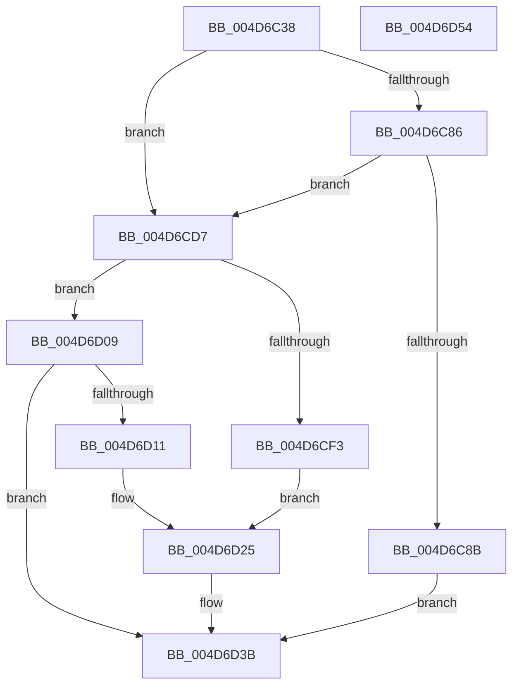

# HalpDmaMapContiguousTransferV3

- RVA: `0x004D6C38`–`0x004D6D55` (길이 `285` bytes)
- VA: `0x00000001404D6C38`
- 실행 섹션: `.text`
- PDB 이름 있음: `예`; PDB Function 태그: `아니요`
- unwind 정보 RVA: `0x00093E28`
- 디코드: `76`개 명령, `285/285` bytes 표시
- 미해석 바이트: `0` (있으면 어셈블리에 `.byte`로 보존)

> 이 문서는 커널 이미지의 기계어와 PDB 기호를 분석해 생성했습니다. 4번과 5번은 함수 원형과 자료형을 바이너리 사용 방식에서 추정한 C 해석이며 원본 소스 복구 결과는 아닙니다.

## 1. Dependencies

- 직접 호출 지점: **3**; 고유 호출 대상: **3**
- 직접 호출자로 확인된 함수: **1**
- RIP 상대 이미지 참조: **0**

### Outgoing calls
- `0x004D6C7A` → [HalpDmaNextContiguousPiece](../3D/HalpDmaNextContiguousPiece_function_003DECB0.md) (function, `0x003DECB0`)
- `0x004D6CD0` → [HalpDmaFlushBuffer](../3D/HalpDmaFlushBuffer_function_003DC1DC.md) (function, `0x003DC1DC`)
- `0x004D6D36` → [HalpDmaSyncMapBuffers](../3D/HalpDmaSyncMapBuffers_function_003DEFD0.md) (function, `0x003DEFD0`)

### Direct callers
- [HalpMapTransferV3](../3D/HalpMapTransferV3_function_003DCCAC.md) at `0x003DCD52`

### Static image references
- 디코드된 RIP-relative 메모리 참조가 없습니다.

## 2. Other-region calls and transfers

- 다른 실행 섹션으로 향하는 call: **0**
- 별도 외부 분기/꼬리 이동을 확인하지 못했습니다.

## 3. Assembly (complete function range)

```asm
004D6C38  4C 8B DC                        mov r11, rsp
004D6C3B  49 89 5B 08                     mov qword ptr [r11 + 8], rbx
004D6C3F  49 89 6B 10                     mov qword ptr [r11 + 0x10], rbp
004D6C43  49 89 73 18                     mov qword ptr [r11 + 0x18], rsi
004D6C47  57                              push rdi
004D6C48  41 56                           push r14
004D6C4A  41 57                           push r15
004D6C4C  48 83 EC 40                     sub rsp, 0x40
004D6C50  48 8B 84 24 80 00 00 00         mov rax, qword ptr [rsp + 0x80]
004D6C58  49 8B F8                        mov rdi, r8
004D6C5B  44 8A BC 24 88 00 00 00         mov r15b, byte ptr [rsp + 0x88]
004D6C63  45 33 C0                        xor r8d, r8d
004D6C66  49 8B D9                        mov rbx, r9
004D6C69  48 8B F2                        mov rsi, rdx
004D6C6C  48 8B E9                        mov rbp, rcx
004D6C6F  44 8B 30                        mov r14d, dword ptr [rax]
004D6C72  45 89 73 D0                     mov dword ptr [r11 - 0x30], r14d
004D6C76  45 88 7B C8                     mov byte ptr [r11 - 0x38], r15b
004D6C7A  E8 31 80 F0 FF                  call 0x1403decb0
004D6C7F  33 D2                           xor edx, edx
004D6C81  41 3B C6                        cmp eax, r14d
004D6C84  75 51                           jne 0x1404d6cd7
004D6C86  38 57 40                        cmp byte ptr [rdi + 0x40], dl
004D6C89  75 4C                           jne 0x1404d6cd7
004D6C8B  48 8B C3                        mov rax, rbx
004D6C8E  45 8B CE                        mov r9d, r14d
004D6C91  48 2B 46 20                     sub rax, qword ptr [rsi + 0x20]
004D6C95  4C 8B C3                        mov r8, rbx
004D6C98  48 C1 E8 0C                     shr rax, 0xc
004D6C9C  48 8B D6                        mov rdx, rsi
004D6C9F  8B C0                           mov eax, eax
004D6CA1  48 8B 4C C6 30                  mov rcx, qword ptr [rsi + rax*8 + 0x30]
004D6CA6  48 8B C3                        mov rax, rbx
004D6CA9  25 FF 0F 00 00                  and eax, 0xfff
004D6CAE  48 C1 E1 0C                     shl rcx, 0xc
004D6CB2  48 03 C8                        add rcx, rax
004D6CB5  48 8B 84 24 98 00 00 00         mov rax, qword ptr [rsp + 0x98]
004D6CBD  48 89 08                        mov qword ptr [rax], rcx
004D6CC0  8A 84 24 90 00 00 00            mov al, byte ptr [rsp + 0x90]
004D6CC7  88 44 24 28                     mov byte ptr [rsp + 0x28], al
004D6CCB  44 88 7C 24 20                  mov byte ptr [rsp + 0x20], r15b
004D6CD0  E8 07 55 F0 FF                  call 0x1403dc1dc
004D6CD5  EB 64                           jmp 0x1404d6d3b
004D6CD7  48 8B 84 24 98 00 00 00         mov rax, qword ptr [rsp + 0x98]
004D6CDF  48 8B CB                        mov rcx, rbx
004D6CE2  81 E1 FF 0F 00 00               and ecx, 0xfff
004D6CE8  48 03 0F                        add rcx, qword ptr [rdi]
004D6CEB  48 89 08                        mov qword ptr [rax], rcx
004D6CEE  45 84 FF                        test r15b, r15b
004D6CF1  74 16                           je 0x1404d6d09
004D6CF3  8A 84 24 90 00 00 00            mov al, byte ptr [rsp + 0x90]
004D6CFA  88 44 24 38                     mov byte ptr [rsp + 0x38], al
004D6CFE  88 54 24 30                     mov byte ptr [rsp + 0x30], dl
004D6D02  44 88 7C 24 28                  mov byte ptr [rsp + 0x28], r15b
004D6D07  EB 1C                           jmp 0x1404d6d25
004D6D09  38 95 BD 01 00 00               cmp byte ptr [rbp + 0x1bd], dl
004D6D0F  75 2A                           jne 0x1404d6d3b
004D6D11  8A 84 24 90 00 00 00            mov al, byte ptr [rsp + 0x90]
004D6D18  88 44 24 38                     mov byte ptr [rsp + 0x38], al
004D6D1C  C6 44 24 30 01                  mov byte ptr [rsp + 0x30], 1
004D6D21  88 54 24 28                     mov byte ptr [rsp + 0x28], dl
004D6D25  4C 8B CF                        mov r9, rdi
004D6D28  44 89 74 24 20                  mov dword ptr [rsp + 0x20], r14d
004D6D2D  4C 8B C3                        mov r8, rbx
004D6D30  48 8B D6                        mov rdx, rsi
004D6D33  48 8B CD                        mov rcx, rbp
004D6D36  E8 95 82 F0 FF                  call 0x1403defd0
004D6D3B  48 8B 5C 24 60                  mov rbx, qword ptr [rsp + 0x60]
004D6D40  48 8B 6C 24 68                  mov rbp, qword ptr [rsp + 0x68]
004D6D45  48 8B 74 24 70                  mov rsi, qword ptr [rsp + 0x70]
004D6D4A  48 83 C4 40                     add rsp, 0x40
004D6D4E  41 5F                           pop r15
004D6D50  41 5E                           pop r14
004D6D52  5F                              pop rdi
004D6D53  C3                              ret
004D6D54  CC                              int3
```

## 4. C-style interpretation (structured pseudocode)

```c
__int64 __fastcall HalpDmaMapContiguousTransferV3(__int64 a1, __int64 a2, __int64 a3, __int64 a4, __int64 a5, unsigned __int8 a6, unsigned __int8 a7, __int64 a8)
{
    __int64 result;
    __int64 v_rsp;
    unsigned __int8 v_stack_m20;
    unsigned __int8 v_stack_m28;
    unsigned __int8 v_stack_m30;
    unsigned __int8 v_stack_m38;
    unsigned __int64 v_stack_p10;
    unsigned __int64 v_stack_p18;
    unsigned __int64 v_stack_p8;

    *(unsigned __int64 *)(v_rsp + 8) = v_rbx;
    *(unsigned __int64 *)(v_rsp + 16) = v_rbp;
    *(unsigned __int64 *)(v_rsp + 24) = v_rsi;
    v_rsp = (v_rsp) - (64);
    a3 = 0;
    *(unsigned int *)(v_rsp - 48) = (unsigned int)((unsigned int)(*(unsigned int *)(a5)));
    *(unsigned __int8 *)(v_rsp - 56) = a6;
    result = HalpDmaNextContiguousPiece(a1, a2, a3, a4);
    a2 = 0;
    if (((unsigned int)(result)) != ((unsigned int)((unsigned int)(*(unsigned int *)(a5))))) goto loc_004D6CD7;
    if ((*(unsigned __int8 *)(a3 + 64)) != 0) goto loc_004D6CD7;
    result = (a4) - (*(unsigned __int64 *)(a2 + 32));
    result = (result) >> (12);
    result = (unsigned int)((a4) & (0xFFFULL));
    a1 = (*(unsigned __int64 *)(a2 + (unsigned int)((unsigned int)(result)) * 8 + 48)) << (12);
    a1 = (a1) + (result);
    *(unsigned __int64 *)(a8) = a1;
    v_stack_m30 = a7;
    v_stack_m38 = a6;
    result = HalpDmaFlushBuffer(a1, 0, a4, (unsigned int)((unsigned int)((unsigned int)(*(unsigned int *)(a5)))));
    goto loc_004D6D3B;
loc_004D6CD7:
    a1 = (unsigned int)((a4) & (0xFFFULL));
    a1 = (a1) + (*(unsigned __int64 *)(a3));
    *(unsigned __int64 *)(a8) = a1;
    if (a6 == 0) goto loc_004D6D09;
    v_stack_m20 = a7;
    v_stack_m28 = 0;
    v_stack_m30 = a6;
    goto loc_004D6D25;
loc_004D6D09:
    if ((*(unsigned __int8 *)(a1 + 445)) != 0) goto loc_004D6D3B;
    v_stack_m20 = a7;
    v_stack_m28 = 1;
    v_stack_m30 = 0;
loc_004D6D25:
    v_stack_m38 = (unsigned int)((unsigned int)(*(unsigned int *)(a5)));
    result = HalpDmaSyncMapBuffers(a1, 0, a4, 0);
loc_004D6D3B:
    v_rsp = (v_rsp) + (64);
    return result;
}
```

## 5. (Beta) C Style

```c
int64_t HalpDmaMapContiguousTransferV3(void *Arg1, void *Arg2, void *Arg3, int64_t Arg4, void *Arg5, uint8_t Arg6, uint8_t Arg7, void *Arg8)
{
    uint8_t *arg1 = (uint8_t *)Arg1;
    uint8_t *arg2 = (uint8_t *)Arg2;
    uint8_t *arg3 = (uint8_t *)Arg3;
    uint8_t *arg5 = (uint8_t *)Arg5;
    uint8_t *arg8 = (uint8_t *)Arg8;

    int64_t result;
    int64_t local_rsp;
    uint8_t v_stack_m20;
    uint8_t v_stack_m28;
    uint8_t v_stack_m30;
    uint8_t v_stack_m38;
    uint64_t v_stack_p10;
    uint64_t v_stack_p18;
    uint64_t v_stack_p8;

    *(uint64_t *)(local_rsp + 0x8) = local_rbx;
    *(uint64_t *)(local_rsp + 0x10) = local_rbp;
    *(uint64_t *)(local_rsp + 0x18) = local_rsi;
    local_rsp = (local_rsp) - (64);
    Arg3 = 0;
    *(uint32_t *)(local_rsp - 0x30) = (uint32_t)((uint32_t)(*(uint32_t *)(arg5)));
    *(uint8_t *)(local_rsp - 0x38) = Arg6;
    result = HalpDmaNextContiguousPiece(Arg1, Arg2, Arg3, Arg4);
    Arg2 = 0;
    if (((uint32_t)(result)) != ((uint32_t)((uint32_t)(*(uint32_t *)(arg5))))) goto loc_004D6CD7;
    if ((*(uint8_t *)(arg3 + 0x40)) != 0) goto loc_004D6CD7;
    result = (Arg4) - (*(uint64_t *)(arg2 + 0x20));
    result = (result) >> (12);
    result = (uint32_t)((Arg4) & (0xFFFULL));
    Arg1 = (*(uint64_t *)(arg2 + (uint32_t)((uint32_t)(result)) * 8 + 0x30)) << (12);
    Arg1 = (Arg1) + (result);
    *(void **)(arg8) = Arg1;
    v_stack_m30 = Arg7;
    v_stack_m38 = Arg6;
    result = HalpDmaFlushBuffer(Arg1, 0, Arg4, (uint32_t)((uint32_t)((uint32_t)(*(uint32_t *)(arg5)))));
    goto loc_004D6D3B;
loc_004D6CD7:
    Arg1 = (uint32_t)((Arg4) & (0xFFFULL));
    Arg1 = (Arg1) + (*(uint64_t *)(arg3));
    *(void **)(arg8) = Arg1;
    if (Arg6 == 0) goto loc_004D6D09;
    v_stack_m20 = Arg7;
    v_stack_m28 = 0;
    v_stack_m30 = Arg6;
    goto loc_004D6D25;
loc_004D6D09:
    if ((*(uint8_t *)(arg1 + 0x1BD)) != 0) goto loc_004D6D3B;
    v_stack_m20 = Arg7;
    v_stack_m28 = 1;
    v_stack_m30 = 0;
loc_004D6D25:
    v_stack_m38 = (uint32_t)((uint32_t)(*(uint32_t *)(arg5)));
    result = HalpDmaSyncMapBuffers(Arg1, 0, Arg4, 0);
loc_004D6D3B:
    local_rsp = (local_rsp) + (64);
    return result;
}
```

### 관측된 메모리 오프셋

구조체 형식이 확인되지 않은 접근은 인자 기준의 오프셋으로만 기록했습니다.

| 기준 인자 | 오프셋 표현 | 폭 (bit) | 접근 |
|---|---:|---:|---|
| `Arg1` | `+ 0x1BD` | `8` | `R` |
| `Arg2` | `+ 0x20` | `64` | `R` |
| `Arg2` | `+ 0x30 + rax*8` | `64` | `R` |
| `Arg3` | `+ 0x0` | `64` | `R` |
| `Arg3` | `+ 0x40` | `8` | `R` |
| `Arg5` | `+ 0x0` | `32` | `R` |
| `Arg8` | `+ 0x0` | `64` | `W` |

## 6. Execution-region graph

[열기: 2D/3D 그래프와 함수 탐색 컨트롤 패널](../../../control-panel.html?section=text&rva=0x004D6C38&view=graph)

- 2D 그래프는 위에서 아래로 흐르고, 3D 그래프는 빈 공간을 드래그해 회전합니다. Shift+드래그는 이동, 휠은 확대·축소, 함수 노드 선택은 대상 보고서 이동입니다.

### Static fallback


