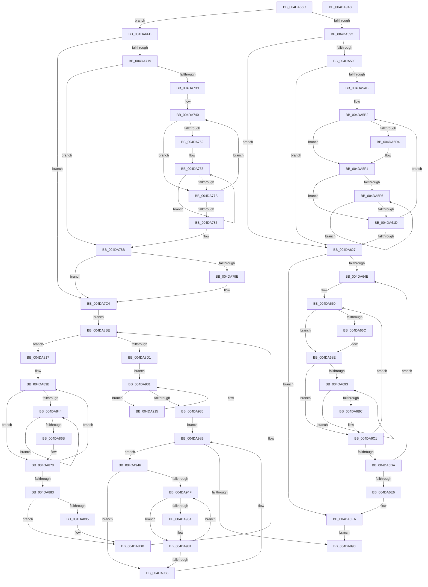

# HalpDmaMarkHiberAdapter

- RVA: `0x004DA56C`–`0x004DA9A9` (길이 `1,085` bytes)
- VA: `0x00000001404DA56C`
- 실행 섹션: `.text`
- PDB 이름 있음: `예`; PDB Function 태그: `아니요`
- unwind 정보 RVA: `0x000BE998`
- 디코드: `264`개 명령, `1,085/1,085` bytes 표시
- 미해석 바이트: `0` (있으면 어셈블리에 `.byte`로 보존)

> 이 문서는 커널 이미지의 기계어와 PDB 기호를 분석해 생성했습니다. 4번과 5번은 함수 원형과 자료형을 바이너리 사용 방식에서 추정한 C 해석이며 원본 소스 복구 결과는 아닙니다.

## 1. Dependencies

- 직접 호출 지점: **20**; 고유 호출 대상: **5**
- 직접 호출자로 확인된 함수: **1**
- RIP 상대 이미지 참조: **8**

### Outgoing calls
- `0x004DA5EC` → [HalpIommuDomainMarkHiberLogicalRange](../55/HalpIommuDomainMarkHiberLogicalRange_function_005550B4.md) (function, `0x005550B4`)
- `0x004DA60E` → [PoSetHiberRange](../47/PoSetHiberRange_function_0047C580.md) (function, `0x0047C580`)
- `0x004DA62E` → [KeAcquireSpinLockRaiseToDpc](../20/KeAcquireSpinLockRaiseToDpc_function_00208470.md) (function, `0x00208470`)
- `0x004DA684` → [HalpIommuDomainMarkHiberLogicalRange](../55/HalpIommuDomainMarkHiberLogicalRange_function_005550B4.md) (function, `0x005550B4`)
- `0x004DA6AB` → [PoSetHiberRange](../47/PoSetHiberRange_function_0047C580.md) (function, `0x0047C580`)
- `0x004DA6F3` → [KeReleaseSpinLock](../39/KeReleaseSpinLock_function_00392BA0.md) (function, `0x00392BA0`)
- `0x004DA729` → [PoSetHiberRange](../47/PoSetHiberRange_function_0047C580.md) (function, `0x0047C580`)
- `0x004DA76C` → [PoSetHiberRange](../47/PoSetHiberRange_function_0047C580.md) (function, `0x0047C580`)
- `0x004DA7BF` → [PoSetHiberRange](../47/PoSetHiberRange_function_0047C580.md) (function, `0x0047C580`)
- `0x004DA7DE` → [PoSetHiberRange](../47/PoSetHiberRange_function_0047C580.md) (function, `0x0047C580`)
- `0x004DA7FA` → [PoSetHiberRange](../47/PoSetHiberRange_function_0047C580.md) (function, `0x0047C580`)
- `0x004DA806` → [KeTestSpinLock](../41/KeTestSpinLock_function_00419C10.md) (function, `0x00419C10`)
- `0x004DA824` → [PoSetHiberRange](../47/PoSetHiberRange_function_0047C580.md) (function, `0x0047C580`)
- `0x004DA85C` → [PoSetHiberRange](../47/PoSetHiberRange_function_0047C580.md) (function, `0x0047C580`)
- `0x004DA8B6` → [PoSetHiberRange](../47/PoSetHiberRange_function_0047C580.md) (function, `0x0047C580`)
- `0x004DA8DF` → [PoSetHiberRange](../47/PoSetHiberRange_function_0047C580.md) (function, `0x0047C580`)
- `0x004DA8FB` → [PoSetHiberRange](../47/PoSetHiberRange_function_0047C580.md) (function, `0x0047C580`)
- `0x004DA907` → [KeTestSpinLock](../41/KeTestSpinLock_function_00419C10.md) (function, `0x00419C10`)
- `0x004DA929` → [PoSetHiberRange](../47/PoSetHiberRange_function_0047C580.md) (function, `0x0047C580`)
- `0x004DA97C` → [PoSetHiberRange](../47/PoSetHiberRange_function_0047C580.md) (function, `0x0047C580`)

### Direct callers
- [HaliLocateHiberRanges](../../pagelk/B5/HaliLocateHiberRanges_function_00B5CE50.md) at `0x00B5CF4F`
- [HaliLocateHiberRanges](../../pagelk/B5/HaliLocateHiberRanges_function_00B5CE50.md) at `0x00B5CF60`

### Static image references
- `0x004DA592` → RVA `0x00FC3E60` (`.data`; read)
- `0x004DA59F` → RVA `0x00FC3E8C` (`.data`; read)
- `0x004DA5AB` → RVA `0x00FC3EE0` (`.data`; read)
- `0x004DA627` → RVA `0x00FC3E80` (`.data`; read)
- `0x004DA633` → RVA `0x00FC3EA0` (`.data`; read)
- `0x004DA8D1` → RVA `0x00FC3EB0` (`.data`; read)
- `0x004DA8EF` → RVA `0x00FC3EC8` (`.data`; read)
- `0x004DA936` → RVA `0x00FC16F0` (`.data`; read)

## 2. Other-region calls and transfers

- 다른 실행 섹션으로 향하는 call: **0**
- 별도 외부 분기/꼬리 이동을 확인하지 못했습니다.

## 3. Assembly (complete function range)

```asm
004DA56C  48 89 5C 24 18                  mov qword ptr [rsp + 0x18], rbx
004DA571  48 89 6C 24 20                  mov qword ptr [rsp + 0x20], rbp
004DA576  57                              push rdi
004DA577  41 54                           push r12
004DA579  41 55                           push r13
004DA57B  41 56                           push r14
004DA57D  41 57                           push r15
004DA57F  48 83 EC 30                     sub rsp, 0x30
004DA583  45 33 ED                        xor r13d, r13d
004DA586  4C 8B F9                        mov r15, rcx
004DA589  48 85 C9                        test rcx, rcx
004DA58C  0F 84 6B 01 00 00               je 0x1404da6fd
004DA592  4C 39 2D C7 98 AE 00            cmp qword ptr [rip + 0xae98c7], r13
004DA599  0F 84 88 00 00 00               je 0x1404da627
004DA59F  44 39 2D E6 98 AE 00            cmp dword ptr [rip + 0xae98e6], r13d
004DA5A6  41 8B FD                        mov edi, r13d
004DA5A9  74 7C                           je 0x1404da627
004DA5AB  48 8D 2D 2E 99 AE 00            lea rbp, [rip + 0xae992e]
004DA5B2  48 8B 15 A7 98 AE 00            mov rdx, qword ptr [rip + 0xae98a7]
004DA5B9  8B C7                           mov eax, edi
004DA5BB  48 03 C0                        add rax, rax
004DA5BE  44 8B 64 C5 08                  mov r12d, dword ptr [rbp + rax*8 + 8]
004DA5C3  41 8B DC                        mov ebx, r12d
004DA5C6  4C 8B 74 C5 00                  mov r14, qword ptr [rbp + rax*8]
004DA5CB  44 39 AA 08 02 00 00            cmp dword ptr [rdx + 0x208], r13d
004DA5D2  74 1D                           je 0x1404da5f1
004DA5D4  4D 8B 46 18                     mov r8, qword ptr [r14 + 0x18]
004DA5D8  44 8B CB                        mov r9d, ebx
004DA5DB  48 8B 92 00 02 00 00            mov rdx, qword ptr [rdx + 0x200]
004DA5E2  49 8B CF                        mov rcx, r15
004DA5E5  4D 8B 00                        mov r8, qword ptr [r8]
004DA5E8  48 8B 52 28                     mov rdx, qword ptr [rdx + 0x28]
004DA5EC  E8 C3 AA 07 00                  call 0x1405550b4
004DA5F1  45 85 E4                        test r12d, r12d
004DA5F4  74 27                           je 0x1404da61d
004DA5F6  41 B9 48 00 00 00               mov r9d, 0x48
004DA5FC  C7 44 24 20 68 61 6C 74         mov dword ptr [rsp + 0x20], 0x746c6168
004DA604  4D 8B C6                        mov r8, r14
004DA607  49 8B CF                        mov rcx, r15
004DA60A  41 8D 51 BA                     lea edx, [r9 - 0x46]
004DA60E  E8 6D 1F FA FF                  call 0x14047c580
004DA613  4D 8B 76 08                     mov r14, qword ptr [r14 + 8]
004DA617  48 83 EB 01                     sub rbx, 1
004DA61B  75 D9                           jne 0x1404da5f6
004DA61D  FF C7                           inc edi
004DA61F  3B 3D 67 98 AE 00               cmp edi, dword ptr [rip + 0xae9867]
004DA625  72 8B                           jb 0x1404da5b2
004DA627  48 8D 0D 52 98 AE 00            lea rcx, [rip + 0xae9852]
004DA62E  E8 3D DE D2 FF                  call 0x140208470
004DA633  48 8B 1D 66 98 AE 00            mov rbx, qword ptr [rip + 0xae9866]
004DA63A  4C 8D 25 5F 98 AE 00            lea r12, [rip + 0xae985f]
004DA641  88 44 24 60                     mov byte ptr [rsp + 0x60], al
004DA645  49 3B DC                        cmp rbx, r12
004DA648  0F 84 9C 00 00 00               je 0x1404da6ea
004DA64E  B8 02 00 00 00                  mov eax, 2
004DA653  48 8D 7B F0                     lea rdi, [rbx - 0x10]
004DA657  48 89 44 24 68                  mov qword ptr [rsp + 0x68], rax
004DA65C  4C 8D 73 E0                     lea r14, [rbx - 0x20]
004DA660  49 8B 2E                        mov rbp, qword ptr [r14]
004DA663  44 39 AB E8 00 00 00            cmp dword ptr [rbx + 0xe8], r13d
004DA66A  74 22                           je 0x1404da68e
004DA66C  4C 8B 45 18                     mov r8, qword ptr [rbp + 0x18]
004DA670  49 8B CF                        mov rcx, r15
004DA673  48 8B 93 E0 00 00 00            mov rdx, qword ptr [rbx + 0xe0]
004DA67A  44 8B 0F                        mov r9d, dword ptr [rdi]
004DA67D  4D 8B 00                        mov r8, qword ptr [r8]
004DA680  48 8B 52 28                     mov rdx, qword ptr [rdx + 0x28]
004DA684  E8 2B AA 07 00                  call 0x1405550b4
004DA689  48 8B 44 24 68                  mov rax, qword ptr [rsp + 0x68]
004DA68E  83 3F 00                        cmp dword ptr [rdi], 0
004DA691  76 2E                           jbe 0x1404da6c1
004DA693  41 B9 48 00 00 00               mov r9d, 0x48
004DA699  C7 44 24 20 68 61 6C 74         mov dword ptr [rsp + 0x20], 0x746c6168
004DA6A1  4C 8B C5                        mov r8, rbp
004DA6A4  49 8B CF                        mov rcx, r15
004DA6A7  41 8D 51 BA                     lea edx, [r9 - 0x46]
004DA6AB  E8 D0 1E FA FF                  call 0x14047c580
004DA6B0  48 8B 6D 08                     mov rbp, qword ptr [rbp + 8]
004DA6B4  41 FF C5                        inc r13d
004DA6B7  44 3B 2F                        cmp r13d, dword ptr [rdi]
004DA6BA  72 D7                           jb 0x1404da693
004DA6BC  48 8B 44 24 68                  mov rax, qword ptr [rsp + 0x68]
004DA6C1  49 83 C6 08                     add r14, 8
004DA6C5  48 83 C7 04                     add rdi, 4
004DA6C9  48 83 E8 01                     sub rax, 1
004DA6CD  41 BD 00 00 00 00               mov r13d, 0
004DA6D3  48 89 44 24 68                  mov qword ptr [rsp + 0x68], rax
004DA6D8  75 86                           jne 0x1404da660
004DA6DA  48 8B 1B                        mov rbx, qword ptr [rbx]
004DA6DD  49 3B DC                        cmp rbx, r12
004DA6E0  0F 85 68 FF FF FF               jne 0x1404da64e
004DA6E6  8A 44 24 60                     mov al, byte ptr [rsp + 0x60]
004DA6EA  8A D0                           mov dl, al
004DA6EC  48 8D 0D 8D 97 AE 00            lea rcx, [rip + 0xae978d]
004DA6F3  E8 A8 84 EB FF                  call 0x140392ba0
004DA6F8  E9 93 02 00 00                  jmp 0x1404da990
004DA6FD  4C 8B 05 5C 97 AE 00            mov r8, qword ptr [rip + 0xae975c]
004DA704  41 BF 68 61 6C 74               mov r15d, 0x746c6168
004DA70A  41 BE 00 00 01 00               mov r14d, 0x10000
004DA710  4D 85 C0                        test r8, r8
004DA713  0F 84 AB 00 00 00               je 0x1404da7c4
004DA719  41 B9 88 02 00 00               mov r9d, 0x288
004DA71F  44 89 6C 24 20                  mov dword ptr [rsp + 0x20], r13d
004DA724  41 8B D6                        mov edx, r14d
004DA727  33 C9                           xor ecx, ecx
004DA729  E8 52 1E FA FF                  call 0x14047c580
004DA72E  41 8B DD                        mov ebx, r13d
004DA731  39 1D 55 97 AE 00               cmp dword ptr [rip + 0xae9755], ebx
004DA737  74 52                           je 0x1404da78b
004DA739  48 8D 2D A0 97 AE 00            lea rbp, [rip + 0xae97a0]
004DA740  8B C3                           mov eax, ebx
004DA742  48 03 C0                        add rax, rax
004DA745  8B 4C C5 08                     mov ecx, dword ptr [rbp + rax*8 + 8]
004DA749  48 8B 7C C5 00                  mov rdi, qword ptr [rbp + rax*8]
004DA74E  85 C9                           test ecx, ecx
004DA750  74 29                           je 0x1404da77b
004DA752  44 8B F1                        mov r14d, ecx
004DA755  4C 8B 07                        mov r8, qword ptr [rdi]
004DA758  33 C9                           xor ecx, ecx
004DA75A  49 C1 E8 0C                     shr r8, 0xc
004DA75E  BA 00 40 01 00                  mov edx, 0x14000
004DA763  44 89 7C 24 20                  mov dword ptr [rsp + 0x20], r15d
004DA768  44 8D 49 01                     lea r9d, [rcx + 1]
004DA76C  E8 0F 1E FA FF                  call 0x14047c580
004DA771  48 8B 7F 08                     mov rdi, qword ptr [rdi + 8]
004DA775  49 83 EE 01                     sub r14, 1
004DA779  75 DA                           jne 0x1404da755
004DA77B  FF C3                           inc ebx
004DA77D  3B 1D 09 97 AE 00               cmp ebx, dword ptr [rip + 0xae9709]
004DA783  72 BB                           jb 0x1404da740
004DA785  41 BE 00 00 01 00               mov r14d, 0x10000
004DA78B  48 8B 05 CE 96 AE 00            mov rax, qword ptr [rip + 0xae96ce]
004DA792  4C 8B 80 30 01 00 00            mov r8, qword ptr [rax + 0x130]
004DA799  4D 85 C0                        test r8, r8
004DA79C  74 26                           je 0x1404da7c4
004DA79E  45 8B 48 28                     mov r9d, dword ptr [r8 + 0x28]
004DA7A2  41 8B D6                        mov edx, r14d
004DA7A5  49 81 C1 FF 0F 00 00            add r9, 0xfff
004DA7AC  44 89 7C 24 20                  mov dword ptr [rsp + 0x20], r15d
004DA7B1  49 C1 E9 0C                     shr r9, 0xc
004DA7B5  33 C9                           xor ecx, ecx
004DA7B7  4E 8D 0C CD 30 00 00 00         lea r9, [r9*8 + 0x30]
004DA7BF  E8 BC 1D FA FF                  call 0x14047c580
004DA7C4  4C 8D 25 D5 96 AE 00            lea r12, [rip + 0xae96d5]
004DA7CB  44 89 6C 24 20                  mov dword ptr [rsp + 0x20], r13d
004DA7D0  4D 8B C4                        mov r8, r12
004DA7D3  41 B9 10 00 00 00               mov r9d, 0x10
004DA7D9  41 8B D6                        mov edx, r14d
004DA7DC  33 C9                           xor ecx, ecx
004DA7DE  E8 9D 1D FA FF                  call 0x14047c580
004DA7E3  41 B9 08 00 00 00               mov r9d, 8
004DA7E9  44 89 6C 24 20                  mov dword ptr [rsp + 0x20], r13d
004DA7EE  4C 8D 05 8B 96 AE 00            lea r8, [rip + 0xae968b]
004DA7F5  41 8B D6                        mov edx, r14d
004DA7F8  33 C9                           xor ecx, ecx
004DA7FA  E8 81 1D FA FF                  call 0x14047c580
004DA7FF  48 8D 0D 7A 96 AE 00            lea rcx, [rip + 0xae967a]
004DA806  E8 05 F4 F3 FF                  call 0x140419c10
004DA80B  48 8B 1D 8E 96 AE 00            mov rbx, qword ptr [rip + 0xae968e]
004DA812  E9 A7 00 00 00                  jmp 0x1404da8be
004DA817  41 B9 88 02 00 00               mov r9d, 0x288
004DA81D  4C 8D 83 E0 FE FF FF            lea r8, [rbx - 0x120]
004DA824  E8 57 1D FA FF                  call 0x14047c580
004DA829  B8 02 00 00 00                  mov eax, 2
004DA82E  48 8D 7B F0                     lea rdi, [rbx - 0x10]
004DA832  48 89 44 24 60                  mov qword ptr [rsp + 0x60], rax
004DA837  4C 8D 73 E0                     lea r14, [rbx - 0x20]
004DA83B  4D 8B 2E                        mov r13, qword ptr [r14]
004DA83E  33 ED                           xor ebp, ebp
004DA840  39 2F                           cmp dword ptr [rdi], ebp
004DA842  76 2C                           jbe 0x1404da870
004DA844  4D 8B 45 00                     mov r8, qword ptr [r13]
004DA848  33 C9                           xor ecx, ecx
004DA84A  49 C1 E8 0C                     shr r8, 0xc
004DA84E  BA 00 40 01 00                  mov edx, 0x14000
004DA853  44 89 7C 24 20                  mov dword ptr [rsp + 0x20], r15d
004DA858  44 8D 49 01                     lea r9d, [rcx + 1]
004DA85C  E8 1F 1D FA FF                  call 0x14047c580
004DA861  4D 8B 6D 08                     mov r13, qword ptr [r13 + 8]
004DA865  FF C5                           inc ebp
004DA867  3B 2F                           cmp ebp, dword ptr [rdi]
004DA869  72 D9                           jb 0x1404da844
004DA86B  48 8B 44 24 60                  mov rax, qword ptr [rsp + 0x60]
004DA870  49 83 C6 08                     add r14, 8
004DA874  48 83 C7 04                     add rdi, 4
004DA878  48 83 E8 01                     sub rax, 1
004DA87C  48 89 44 24 60                  mov qword ptr [rsp + 0x60], rax
004DA881  75 B8                           jne 0x1404da83b
004DA883  4C 8B 43 10                     mov r8, qword ptr [rbx + 0x10]
004DA887  45 33 ED                        xor r13d, r13d
004DA88A  41 BE 00 00 01 00               mov r14d, 0x10000
004DA890  4D 85 C0                        test r8, r8
004DA893  74 26                           je 0x1404da8bb
004DA895  45 8B 48 28                     mov r9d, dword ptr [r8 + 0x28]
004DA899  41 8B D6                        mov edx, r14d
004DA89C  49 81 C1 FF 0F 00 00            add r9, 0xfff
004DA8A3  44 89 7C 24 20                  mov dword ptr [rsp + 0x20], r15d
004DA8A8  49 C1 E9 0C                     shr r9, 0xc
004DA8AC  33 C9                           xor ecx, ecx
004DA8AE  4E 8D 0C CD 30 00 00 00         lea r9, [r9*8 + 0x30]
004DA8B6  E8 C5 1C FA FF                  call 0x14047c580
004DA8BB  48 8B 1B                        mov rbx, qword ptr [rbx]
004DA8BE  33 C9                           xor ecx, ecx
004DA8C0  44 89 6C 24 20                  mov dword ptr [rsp + 0x20], r13d
004DA8C5  41 8B D6                        mov edx, r14d
004DA8C8  49 3B DC                        cmp rbx, r12
004DA8CB  0F 85 46 FF FF FF               jne 0x1404da817
004DA8D1  48 8D 3D D8 95 AE 00            lea rdi, [rip + 0xae95d8]
004DA8D8  4C 8B C7                        mov r8, rdi
004DA8DB  44 8D 49 10                     lea r9d, [rcx + 0x10]
004DA8DF  E8 9C 1C FA FF                  call 0x14047c580
004DA8E4  41 B9 08 00 00 00               mov r9d, 8
004DA8EA  44 89 6C 24 20                  mov dword ptr [rsp + 0x20], r13d
004DA8EF  4C 8D 05 D2 95 AE 00            lea r8, [rip + 0xae95d2]
004DA8F6  41 8B D6                        mov edx, r14d
004DA8F9  33 C9                           xor ecx, ecx
004DA8FB  E8 80 1C FA FF                  call 0x14047c580
004DA900  48 8D 0D C1 95 AE 00            lea rcx, [rip + 0xae95c1]
004DA907  E8 04 F3 F3 FF                  call 0x140419c10
004DA90C  48 8B 1D 9D 95 AE 00            mov rbx, qword ptr [rip + 0xae959d]
004DA913  EB 1C                           jmp 0x1404da931
004DA915  4C 8D 43 E0                     lea r8, [rbx - 0x20]
004DA919  44 89 6C 24 20                  mov dword ptr [rsp + 0x20], r13d
004DA91E  41 B9 30 00 00 00               mov r9d, 0x30
004DA924  41 8B D6                        mov edx, r14d
004DA927  33 C9                           xor ecx, ecx
004DA929  E8 52 1C FA FF                  call 0x14047c580
004DA92E  48 8B 1B                        mov rbx, qword ptr [rbx]
004DA931  48 3B DF                        cmp rbx, rdi
004DA934  75 DF                           jne 0x1404da915
004DA936  48 8B 1D B3 6D AE 00            mov rbx, qword ptr [rip + 0xae6db3]
004DA93D  48 8D 2D AC 6D AE 00            lea rbp, [rip + 0xae6dac]
004DA944  EB 45                           jmp 0x1404da98b
004DA946  41 8B FD                        mov edi, r13d
004DA949  44 39 6B 2C                     cmp dword ptr [rbx + 0x2c], r13d
004DA94D  76 39                           jbe 0x1404da988
004DA94F  8B C7                           mov eax, edi
004DA951  48 8D 0C 80                     lea rcx, [rax + rax*4]
004DA955  48 8B 43 38                     mov rax, qword ptr [rbx + 0x38]
004DA959  48 C1 E1 05                     shl rcx, 5
004DA95D  4C 8B 84 01 80 00 00 00         mov r8, qword ptr [rcx + rax + 0x80]
004DA965  4D 85 C0                        test r8, r8
004DA968  74 17                           je 0x1404da981
004DA96A  44 8B 4C 01 78                  mov r9d, dword ptr [rcx + rax + 0x78]
004DA96F  41 8B D6                        mov edx, r14d
004DA972  33 C9                           xor ecx, ecx
004DA974  C7 44 24 20 48 61 6C 45         mov dword ptr [rsp + 0x20], 0x456c6148
004DA97C  E8 FF 1B FA FF                  call 0x14047c580
004DA981  FF C7                           inc edi
004DA983  3B 7B 2C                        cmp edi, dword ptr [rbx + 0x2c]
004DA986  72 C7                           jb 0x1404da94f
004DA988  48 8B 1B                        mov rbx, qword ptr [rbx]
004DA98B  48 3B DD                        cmp rbx, rbp
004DA98E  75 B6                           jne 0x1404da946
004DA990  48 8B 5C 24 70                  mov rbx, qword ptr [rsp + 0x70]
004DA995  48 8B 6C 24 78                  mov rbp, qword ptr [rsp + 0x78]
004DA99A  48 83 C4 30                     add rsp, 0x30
004DA99E  41 5F                           pop r15
004DA9A0  41 5E                           pop r14
004DA9A2  41 5D                           pop r13
004DA9A4  41 5C                           pop r12
004DA9A6  5F                              pop rdi
004DA9A7  C3                              ret
004DA9A8  CC                              int3
```

## 4. C-style interpretation (structured pseudocode)

```c
__int64 __fastcall HalpDmaMarkHiberAdapter(__int64 a1)
{
    __int64 result;
    __int64 v_r13;
    __int64 v_r14;
    __int64 v_rbp;
    __int64 v_rbx;
    __int64 v_rdi;
    __int64 v_rsp;
    unsigned int v_stack_m38;
    unsigned __int64 v_stack_p10;
    unsigned __int64 v_stack_p18;
    unsigned __int64 v_stack_p20;
    unsigned __int8 v_stack_p8;

    v_stack_p18 = v_rbx;
    v_stack_p20 = v_rbp;
    v_rsp = (v_rsp) - (48);
    v_r13 = 0;
    if (a1 == 0) goto loc_004DA6FD;
    if ((*(unsigned __int64 *)(v_rip + 11442375)) == 0) goto loc_004DA627;
    if ((*(unsigned int *)(v_rip + 11442406)) == 0) goto loc_004DA627;
loc_004DA5B2:
    result = (0) + (0);
    if ((*(unsigned int *)(*(unsigned __int64 *)(v_rip + 11442343) + 520)) != 0) {
        a3 = *(unsigned __int64 *)(*(unsigned __int64 *)(v_rip + 11442478 + result * 8) + 24);
        a4 = (unsigned int)((unsigned int)((unsigned int)((unsigned int)(*(unsigned int *)(v_rip + 11442478 + result * 8 + 8)))));
        a2 = *(unsigned __int64 *)(*(unsigned __int64 *)(v_rip + 11442343) + 512);
        a1 = a1;
        a3 = *(unsigned __int64 *)(a3);
        a2 = *(unsigned __int64 *)(a2 + 40);
        result = HalpIommuDomainMarkHiberLogicalRange(a1, a2, a3, a4);
    }
    if ((unsigned int)((unsigned int)(*(unsigned int *)(v_rip + 11442478 + result * 8 + 8))) == 0) goto loc_004DA61D;
loc_004DA5F6:
    v_stack_m38 = 0x746C6168ULL;
    result = PoSetHiberRange(a1, 72 - 70, *(unsigned __int64 *)(v_rip + 11442478 + result * 8), 72);
    v_rbx = ((unsigned int)((unsigned int)((unsigned int)(*(unsigned int *)(v_rip + 11442478 + result * 8 + 8))))) - (1);
    if (condition_is_not_equal) goto loc_004DA5F6;
loc_004DA61D:
    v_rdi = (unsigned int)((0) + 1);
    if (((unsigned int)(v_rdi)) < (*(unsigned int *)(v_rip + 11442279))) goto loc_004DA5B2;
loc_004DA627:
    result = KeAcquireSpinLockRaiseToDpc(v_rip + 11442258, 72 - 70, *(unsigned __int64 *)(v_rip + 11442478 + result * 8), 72);
    v_stack_p8 = (unsigned __int8)(result);
    if ((*(unsigned __int64 *)(v_rip + 11442278)) == (v_rip + 11442271)) goto loc_004DA6EA;
loc_004DA64E:
    v_stack_p10 = 2;
loc_004DA660:
    result = 2;
    if ((*(unsigned int *)(*(unsigned __int64 *)(v_rip + 11442278) + 232)) != 0) {
        a3 = *(unsigned __int64 *)(*(unsigned __int64 *)(*(unsigned __int64 *)(v_rip + 11442278) - 32) + 24);
        a1 = a1;
        a2 = *(unsigned __int64 *)(*(unsigned __int64 *)(v_rip + 11442278) + 224);
        a4 = *(unsigned int *)(*(unsigned __int64 *)(v_rip + 11442278) - 16);
        a3 = *(unsigned __int64 *)(a3);
        a2 = *(unsigned __int64 *)(a2 + 40);
        result = HalpIommuDomainMarkHiberLogicalRange(a1, a2, a3, a4);
        result = v_stack_p10;
    }
    if ((*(unsigned int *)(*(unsigned __int64 *)(v_rip + 11442278) - 16)) <= 0) goto loc_004DA6C1;
loc_004DA693:
    v_stack_m38 = 0x746C6168ULL;
    result = PoSetHiberRange(a1, 72 - 70, *(unsigned __int64 *)(*(unsigned __int64 *)(v_rip + 11442278) - 32), 72);
    v_r13 = (unsigned int)((v_r13) + 1);
    if (((unsigned int)(v_r13)) < (*(unsigned int *)(*(unsigned __int64 *)(v_rip + 11442278) - 16))) goto loc_004DA693;
loc_004DA6C1:
    v_r14 = (*(unsigned __int64 *)(v_rip + 11442278) - 32) + (8);
    v_rdi = (*(unsigned __int64 *)(v_rip + 11442278) - 16) + (4);
    result = (v_stack_p10) - (1);
    v_stack_p10 = result;
    if (condition_is_not_equal) goto loc_004DA660;
    if ((*(unsigned __int64 *)(*(unsigned __int64 *)(v_rip + 11442278))) != (v_rip + 11442271)) goto loc_004DA64E;
loc_004DA6EA:
    result = KeReleaseSpinLock(v_rip + 11442061, (unsigned __int8)(v_stack_p8), *(unsigned __int64 *)(*(unsigned __int64 *)(v_rip + 11442278) - 32), 72);
    goto loc_004DA990;
loc_004DA6FD:
    if (*(unsigned __int64 *)(v_rip + 11442012) == 0) goto loc_004DA7C4;
    v_stack_m38 = 0;
    a1 = 0;
    result = PoSetHiberRange(a1, (unsigned int)((unsigned int)((unsigned int)(0x10000ULL))), *(unsigned __int64 *)(v_rip + 11442012), 648);
    if ((*(unsigned int *)(v_rip + 11442005)) == 0) goto loc_004DA78B;
loc_004DA740:
    result = (0) + (0);
    if ((unsigned int)((unsigned int)(*(unsigned int *)(v_rip + 11442080 + result * 8 + 8))) == 0) goto loc_004DA77B;
loc_004DA755:
    a1 = 0;
    a3 = (*(unsigned __int64 *)(*(unsigned __int64 *)(v_rip + 11442080 + result * 8))) >> (12);
    v_stack_m38 = (unsigned int)((unsigned int)(0x746C6168ULL));
    result = PoSetHiberRange(a1, (unsigned int)(0x14000ULL), a3, a1 + 1);
    v_r14 = ((unsigned int)((unsigned int)((unsigned int)(*(unsigned int *)(v_rip + 11442080 + result * 8 + 8))))) - (1);
    if (condition_is_not_equal) goto loc_004DA755;
loc_004DA77B:
    v_rbx = (unsigned int)((0) + 1);
    if (((unsigned int)(v_rbx)) < (*(unsigned int *)(v_rip + 11441929))) goto loc_004DA740;
loc_004DA78B:
    result = *(unsigned __int64 *)(v_rip + 11441870);
    if (*(unsigned __int64 *)(*(unsigned __int64 *)(v_rip + 11441870) + 304) != 0) {
        a4 = *(unsigned int *)(*(unsigned __int64 *)(*(unsigned __int64 *)(v_rip + 11441870) + 304) + 40);
        a2 = (unsigned int)((unsigned int)(0x10000ULL));
        a4 = (a4) + (0xFFFULL);
        v_stack_m38 = (unsigned int)((unsigned int)(0x746C6168ULL));
        a4 = (a4) >> (12);
        a1 = 0;
        a4 = a4 * 8 + 48;
        result = PoSetHiberRange(a1, a2, *(unsigned __int64 *)(*(unsigned __int64 *)(v_rip + 11441870) + 304), a4);
    }
    v_stack_m38 = 0;
    a1 = 0;
    result = PoSetHiberRange(a1, (unsigned int)((unsigned int)((unsigned int)(0x10000ULL))), v_rip + 11441877, 16);
    v_stack_m38 = 0;
    a1 = 0;
    result = PoSetHiberRange(a1, (unsigned int)((unsigned int)((unsigned int)(0x10000ULL))), v_rip + 11441803, 8);
    result = KeTestSpinLock(v_rip + 11441786, (unsigned int)((unsigned int)((unsigned int)(0x10000ULL))), v_rip + 11441803, 8);
    goto loc_004DA8BE;
loc_004DA817:
    result = PoSetHiberRange(v_rip + 11441786, (unsigned int)((unsigned int)((unsigned int)(0x10000ULL))), *(unsigned __int64 *)(v_rip + 11441806) - 288, 648);
    v_stack_p8 = 2;
loc_004DA83B:
    v_rbp = 0;
    if ((*(unsigned int *)(*(unsigned __int64 *)(v_rip + 11441806) - 16)) <= 0) goto loc_004DA870;
loc_004DA844:
    a1 = 0;
    a3 = (*(unsigned __int64 *)(*(unsigned __int64 *)(*(unsigned __int64 *)(v_rip + 11441806) - 32))) >> (12);
    v_stack_m38 = (unsigned int)((unsigned int)(0x746C6168ULL));
    result = PoSetHiberRange(a1, (unsigned int)(0x14000ULL), a3, a1 + 1);
    v_rbp = (unsigned int)((v_rbp) + 1);
    if (((unsigned int)(v_rbp)) < (*(unsigned int *)(*(unsigned __int64 *)(v_rip + 11441806) - 16))) goto loc_004DA844;
loc_004DA870:
    v_r14 = (*(unsigned __int64 *)(v_rip + 11441806) - 32) + (8);
    v_rdi = (*(unsigned __int64 *)(v_rip + 11441806) - 16) + (4);
    result = (v_stack_p8) - (1);
    v_stack_p8 = result;
    if (condition_is_not_equal) goto loc_004DA83B;
    v_r13 = 0;
    if (*(unsigned __int64 *)(*(unsigned __int64 *)(v_rip + 11441806) + 16) != 0) {
        a4 = *(unsigned int *)(*(unsigned __int64 *)(*(unsigned __int64 *)(v_rip + 11441806) + 16) + 40);
        a2 = (unsigned int)((unsigned int)(0x10000ULL));
        a4 = (a4) + (0xFFFULL);
        v_stack_m38 = (unsigned int)((unsigned int)(0x746C6168ULL));
        a4 = (a4) >> (12);
        a1 = 0;
        a4 = a4 * 8 + 48;
        result = PoSetHiberRange(a1, a2, *(unsigned __int64 *)(*(unsigned __int64 *)(v_rip + 11441806) + 16), a4);
    }
loc_004DA8BE:
    a1 = 0;
    v_stack_m38 = 0;
    if ((*(unsigned __int64 *)(*(unsigned __int64 *)(v_rip + 11441806))) != (v_rip + 11441877)) goto loc_004DA817;
    result = PoSetHiberRange(a1, (unsigned int)((unsigned int)((unsigned int)(0x10000ULL))), v_rip + 11441624, a1 + 16);
    v_stack_m38 = 0;
    a1 = 0;
    result = PoSetHiberRange(a1, (unsigned int)((unsigned int)((unsigned int)(0x10000ULL))), v_rip + 11441618, 8);
    result = KeTestSpinLock(v_rip + 11441601, (unsigned int)((unsigned int)((unsigned int)(0x10000ULL))), v_rip + 11441618, 8);
    goto loc_004DA931;
loc_004DA915:
    v_stack_m38 = 0;
    a1 = 0;
    result = PoSetHiberRange(a1, (unsigned int)((unsigned int)((unsigned int)(0x10000ULL))), *(unsigned __int64 *)(v_rip + 11441565) - 32, 48);
loc_004DA931:
    if ((*(unsigned __int64 *)(*(unsigned __int64 *)(v_rip + 11441565))) != (v_rip + 11441624)) goto loc_004DA915;
    goto loc_004DA98B;
loc_004DA946:
    if ((*(unsigned int *)(*(unsigned __int64 *)(v_rip + 11431347) + 44)) <= 0) goto loc_004DA988;
loc_004DA94F:
    a1 = (0 + 0 * 4) << (5);
    result = *(unsigned __int64 *)(*(unsigned __int64 *)(v_rip + 11431347) + 56);
    if (*(unsigned __int64 *)(a1 + *(unsigned __int64 *)(*(unsigned __int64 *)(v_rip + 11431347) + 56) * 1 + 128) != 0) {
        a4 = *(unsigned int *)(a1 + *(unsigned __int64 *)(*(unsigned __int64 *)(v_rip + 11431347) + 56) * 1 + 120);
        a2 = (unsigned int)((unsigned int)(0x10000ULL));
        a1 = 0;
        v_stack_m38 = 0x456C6148ULL;
        result = PoSetHiberRange(a1, a2, *(unsigned __int64 *)(a1 + *(unsigned __int64 *)(*(unsigned __int64 *)(v_rip + 11431347) + 56) * 1 + 128), a4);
    }
    v_rdi = (unsigned int)((0) + 1);
    if (((unsigned int)(v_rdi)) < (*(unsigned int *)(*(unsigned __int64 *)(v_rip + 11431347) + 44))) goto loc_004DA94F;
loc_004DA988:
loc_004DA98B:
    if ((*(unsigned __int64 *)(*(unsigned __int64 *)(v_rip + 11431347))) != (v_rip + 11431340)) goto loc_004DA946;
loc_004DA990:
    v_rsp = (v_rsp) + (48);
    return result;
}
```

## 5. (Beta) C Style

```c
int64_t HalpDmaMarkHiberAdapter(int64_t Arg1)
{
    int64_t result;
    int64_t local_r13;
    int64_t local_r14;
    int64_t local_rbp;
    int64_t local_rbx;
    int64_t local_rdi;
    int64_t local_rsp;
    uint32_t v_stack_m38;
    uint64_t v_stack_p10;
    uint64_t v_stack_p18;
    uint64_t v_stack_p20;
    uint8_t v_stack_p8;

    v_stack_p18 = local_rbx;
    v_stack_p20 = local_rbp;
    local_rsp = (local_rsp) - (48);
    local_r13 = 0;
    if (Arg1 == 0) goto loc_004DA6FD;
    if ((*(uint64_t *)(v_rip + 0xAE98C7)) == 0) goto loc_004DA627;
    if ((*(uint32_t *)(v_rip + 0xAE98E6)) == 0) goto loc_004DA627;
loc_004DA5B2:
    result = (0) + (0);
    if ((*(uint32_t *)(*(uint64_t *)(v_rip + 0xAE98A7) + 0x208)) != 0) {
        a3 = *(uint64_t *)(*(uint64_t *)(v_rip + 0xAE992E + result * 8) + 0x18);
        a4 = (uint32_t)((uint32_t)((uint32_t)((uint32_t)(*(uint32_t *)(v_rip + 0xAE992E + result * 8 + 0x8)))));
        a2 = *(uint64_t *)(*(uint64_t *)(v_rip + 0xAE98A7) + 0x200);
        Arg1 = Arg1;
        a3 = *(uint64_t *)(a3);
        a2 = *(uint64_t *)(a2 + 0x28);
        result = HalpIommuDomainMarkHiberLogicalRange(Arg1, a2, a3, a4);
    }
    if ((uint32_t)((uint32_t)(*(uint32_t *)(v_rip + 0xAE992E + result * 8 + 0x8))) == 0) goto loc_004DA61D;
loc_004DA5F6:
    v_stack_m38 = 0x746C6168ULL;
    result = PoSetHiberRange(Arg1, 72 - 70, *(uint64_t *)(v_rip + 0xAE992E + result * 8), 72);
    local_rbx = ((uint32_t)((uint32_t)((uint32_t)(*(uint32_t *)(v_rip + 0xAE992E + result * 8 + 0x8))))) - (1);
    if (condition_is_not_equal) goto loc_004DA5F6;
loc_004DA61D:
    local_rdi = (uint32_t)((0) + 1);
    if (((uint32_t)(local_rdi)) < (*(uint32_t *)(v_rip + 0xAE9867))) goto loc_004DA5B2;
loc_004DA627:
    result = KeAcquireSpinLockRaiseToDpc(v_rip + 11442258, 72 - 70, *(uint64_t *)(v_rip + 0xAE992E + result * 8), 72);
    v_stack_p8 = (uint8_t)(result);
    if ((*(uint64_t *)(v_rip + 0xAE9866)) == (v_rip + 11442271)) goto loc_004DA6EA;
loc_004DA64E:
    v_stack_p10 = 2;
loc_004DA660:
    result = 2;
    if ((*(uint32_t *)(*(uint64_t *)(v_rip + 0xAE9866) + 0xE8)) != 0) {
        a3 = *(uint64_t *)(*(uint64_t *)(*(uint64_t *)(v_rip + 0xAE9866) - 0x20) + 0x18);
        Arg1 = Arg1;
        a2 = *(uint64_t *)(*(uint64_t *)(v_rip + 0xAE9866) + 0xE0);
        a4 = *(uint32_t *)(*(uint64_t *)(v_rip + 0xAE9866) - 0x10);
        a3 = *(uint64_t *)(a3);
        a2 = *(uint64_t *)(a2 + 0x28);
        result = HalpIommuDomainMarkHiberLogicalRange(Arg1, a2, a3, a4);
        result = v_stack_p10;
    }
    if ((*(uint32_t *)(*(uint64_t *)(v_rip + 0xAE9866) - 0x10)) <= 0) goto loc_004DA6C1;
loc_004DA693:
    v_stack_m38 = 0x746C6168ULL;
    result = PoSetHiberRange(Arg1, 72 - 70, *(uint64_t *)(*(uint64_t *)(v_rip + 0xAE9866) - 0x20), 72);
    local_r13 = (uint32_t)((local_r13) + 1);
    if (((uint32_t)(local_r13)) < (*(uint32_t *)(*(uint64_t *)(v_rip + 0xAE9866) - 0x10))) goto loc_004DA693;
loc_004DA6C1:
    local_r14 = (*(uint64_t *)(v_rip + 0xAE9866) - 32) + (8);
    local_rdi = (*(uint64_t *)(v_rip + 0xAE9866) - 16) + (4);
    result = (v_stack_p10) - (1);
    v_stack_p10 = result;
    if (condition_is_not_equal) goto loc_004DA660;
    if ((*(uint64_t *)(*(uint64_t *)(v_rip + 0xAE9866))) != (v_rip + 11442271)) goto loc_004DA64E;
loc_004DA6EA:
    result = KeReleaseSpinLock(v_rip + 11442061, (uint8_t)(v_stack_p8), *(uint64_t *)(*(uint64_t *)(v_rip + 0xAE9866) - 0x20), 72);
    goto loc_004DA990;
loc_004DA6FD:
    if (*(uint64_t *)(v_rip + 0xAE975C) == 0) goto loc_004DA7C4;
    v_stack_m38 = 0;
    Arg1 = 0;
    result = PoSetHiberRange(Arg1, (uint32_t)((uint32_t)((uint32_t)(0x10000ULL))), *(uint64_t *)(v_rip + 0xAE975C), 648);
    if ((*(uint32_t *)(v_rip + 0xAE9755)) == 0) goto loc_004DA78B;
loc_004DA740:
    result = (0) + (0);
    if ((uint32_t)((uint32_t)(*(uint32_t *)(v_rip + 0xAE97A0 + result * 8 + 0x8))) == 0) goto loc_004DA77B;
loc_004DA755:
    Arg1 = 0;
    a3 = (*(uint64_t *)(*(uint64_t *)(v_rip + 0xAE97A0 + result * 8))) >> (12);
    v_stack_m38 = (uint32_t)((uint32_t)(0x746C6168ULL));
    result = PoSetHiberRange(Arg1, (uint32_t)(0x14000ULL), a3, Arg1 + 1);
    local_r14 = ((uint32_t)((uint32_t)((uint32_t)(*(uint32_t *)(v_rip + 0xAE97A0 + result * 8 + 0x8))))) - (1);
    if (condition_is_not_equal) goto loc_004DA755;
loc_004DA77B:
    local_rbx = (uint32_t)((0) + 1);
    if (((uint32_t)(local_rbx)) < (*(uint32_t *)(v_rip + 0xAE9709))) goto loc_004DA740;
loc_004DA78B:
    result = *(uint64_t *)(v_rip + 0xAE96CE);
    if (*(uint64_t *)(*(uint64_t *)(v_rip + 0xAE96CE) + 0x130) != 0) {
        a4 = *(uint32_t *)(*(uint64_t *)(*(uint64_t *)(v_rip + 0xAE96CE) + 0x130) + 0x28);
        a2 = (uint32_t)((uint32_t)(0x10000ULL));
        a4 = (a4) + (0xFFFULL);
        v_stack_m38 = (uint32_t)((uint32_t)(0x746C6168ULL));
        a4 = (a4) >> (12);
        Arg1 = 0;
        a4 = a4 * 8 + 48;
        result = PoSetHiberRange(Arg1, a2, *(uint64_t *)(*(uint64_t *)(v_rip + 0xAE96CE) + 0x130), a4);
    }
    v_stack_m38 = 0;
    Arg1 = 0;
    result = PoSetHiberRange(Arg1, (uint32_t)((uint32_t)((uint32_t)(0x10000ULL))), v_rip + 11441877, 16);
    v_stack_m38 = 0;
    Arg1 = 0;
    result = PoSetHiberRange(Arg1, (uint32_t)((uint32_t)((uint32_t)(0x10000ULL))), v_rip + 11441803, 8);
    result = KeTestSpinLock(v_rip + 11441786, (uint32_t)((uint32_t)((uint32_t)(0x10000ULL))), v_rip + 11441803, 8);
    goto loc_004DA8BE;
loc_004DA817:
    result = PoSetHiberRange(v_rip + 11441786, (uint32_t)((uint32_t)((uint32_t)(0x10000ULL))), *(uint64_t *)(v_rip + 0xAE968E) - 288, 648);
    v_stack_p8 = 2;
loc_004DA83B:
    local_rbp = 0;
    if ((*(uint32_t *)(*(uint64_t *)(v_rip + 0xAE968E) - 0x10)) <= 0) goto loc_004DA870;
loc_004DA844:
    Arg1 = 0;
    a3 = (*(uint64_t *)(*(uint64_t *)(*(uint64_t *)(v_rip + 0xAE968E) - 0x20))) >> (12);
    v_stack_m38 = (uint32_t)((uint32_t)(0x746C6168ULL));
    result = PoSetHiberRange(Arg1, (uint32_t)(0x14000ULL), a3, Arg1 + 1);
    local_rbp = (uint32_t)((local_rbp) + 1);
    if (((uint32_t)(local_rbp)) < (*(uint32_t *)(*(uint64_t *)(v_rip + 0xAE968E) - 0x10))) goto loc_004DA844;
loc_004DA870:
    local_r14 = (*(uint64_t *)(v_rip + 0xAE968E) - 32) + (8);
    local_rdi = (*(uint64_t *)(v_rip + 0xAE968E) - 16) + (4);
    result = (v_stack_p8) - (1);
    v_stack_p8 = result;
    if (condition_is_not_equal) goto loc_004DA83B;
    local_r13 = 0;
    if (*(uint64_t *)(*(uint64_t *)(v_rip + 0xAE968E) + 0x10) != 0) {
        a4 = *(uint32_t *)(*(uint64_t *)(*(uint64_t *)(v_rip + 0xAE968E) + 0x10) + 0x28);
        a2 = (uint32_t)((uint32_t)(0x10000ULL));
        a4 = (a4) + (0xFFFULL);
        v_stack_m38 = (uint32_t)((uint32_t)(0x746C6168ULL));
        a4 = (a4) >> (12);
        Arg1 = 0;
        a4 = a4 * 8 + 48;
        result = PoSetHiberRange(Arg1, a2, *(uint64_t *)(*(uint64_t *)(v_rip + 0xAE968E) + 0x10), a4);
    }
loc_004DA8BE:
    Arg1 = 0;
    v_stack_m38 = 0;
    if ((*(uint64_t *)(*(uint64_t *)(v_rip + 0xAE968E))) != (v_rip + 11441877)) goto loc_004DA817;
    result = PoSetHiberRange(Arg1, (uint32_t)((uint32_t)((uint32_t)(0x10000ULL))), v_rip + 11441624, Arg1 + 16);
    v_stack_m38 = 0;
    Arg1 = 0;
    result = PoSetHiberRange(Arg1, (uint32_t)((uint32_t)((uint32_t)(0x10000ULL))), v_rip + 11441618, 8);
    result = KeTestSpinLock(v_rip + 11441601, (uint32_t)((uint32_t)((uint32_t)(0x10000ULL))), v_rip + 11441618, 8);
    goto loc_004DA931;
loc_004DA915:
    v_stack_m38 = 0;
    Arg1 = 0;
    result = PoSetHiberRange(Arg1, (uint32_t)((uint32_t)((uint32_t)(0x10000ULL))), *(uint64_t *)(v_rip + 0xAE959D) - 32, 48);
loc_004DA931:
    if ((*(uint64_t *)(*(uint64_t *)(v_rip + 0xAE959D))) != (v_rip + 11441624)) goto loc_004DA915;
    goto loc_004DA98B;
loc_004DA946:
    if ((*(uint32_t *)(*(uint64_t *)(v_rip + 0xAE6DB3) + 0x2C)) <= 0) goto loc_004DA988;
loc_004DA94F:
    Arg1 = (0 + 0 * 4) << (5);
    result = *(uint64_t *)(*(uint64_t *)(v_rip + 0xAE6DB3) + 0x38);
    if (*(uint64_t *)(Arg1 + *(uint64_t *)(*(uint64_t *)(v_rip + 0xAE6DB3) + 0x38) * 1 + 0x80) != 0) {
        a4 = *(uint32_t *)(Arg1 + *(uint64_t *)(*(uint64_t *)(v_rip + 0xAE6DB3) + 0x38) * 1 + 0x78);
        a2 = (uint32_t)((uint32_t)(0x10000ULL));
        Arg1 = 0;
        v_stack_m38 = 0x456C6148ULL;
        result = PoSetHiberRange(Arg1, a2, *(uint64_t *)(Arg1 + *(uint64_t *)(*(uint64_t *)(v_rip + 0xAE6DB3) + 0x38) * 1 + 0x80), a4);
    }
    local_rdi = (uint32_t)((0) + 1);
    if (((uint32_t)(local_rdi)) < (*(uint32_t *)(*(uint64_t *)(v_rip + 0xAE6DB3) + 0x2C))) goto loc_004DA94F;
loc_004DA988:
loc_004DA98B:
    if ((*(uint64_t *)(*(uint64_t *)(v_rip + 0xAE6DB3))) != (v_rip + 11431340)) goto loc_004DA946;
loc_004DA990:
    local_rsp = (local_rsp) + (48);
    return result;
}
```

## 6. Execution-region graph

[열기: 2D/3D 그래프와 함수 탐색 컨트롤 패널](../../../control-panel.html?section=text&rva=0x004DA56C&view=graph)

- 2D 그래프는 위에서 아래로 흐르고, 3D 그래프는 빈 공간을 드래그해 회전합니다. Shift+드래그는 이동, 휠은 확대·축소, 함수 노드 선택은 대상 보고서 이동입니다.

### Static fallback


