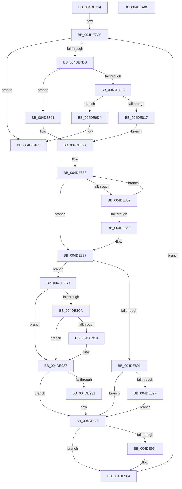

# HalpDmaSyncMapBuffersWithEmergencyResources

- RVA: `0x004DE714`–`0x004DEA0D` (길이 `761` bytes)
- VA: `0x00000001404DE714`
- 실행 섹션: `.text`
- PDB 이름 있음: `예`; PDB Function 태그: `아니요`
- unwind 정보 RVA: `0x000BECA4`
- 디코드: `198`개 명령, `761/761` bytes 표시
- 미해석 바이트: `0` (있으면 어셈블리에 `.byte`로 보존)

> 이 문서는 커널 이미지의 기계어와 PDB 기호를 분석해 생성했습니다. 4번과 5번은 함수 원형과 자료형을 바이너리 사용 방식에서 추정한 C 해석이며 원본 소스 복구 결과는 아닙니다.

## 1. Dependencies

- 직접 호출 지점: **12**; 고유 호출 대상: **9**
- 직접 호출자로 확인된 함수: **1**
- RIP 상대 이미지 참조: **6**

### Outgoing calls
- `0x004DE750` → [HalpDmaGetAdapterCacheAlignment](../3D/HalpDmaGetAdapterCacheAlignment_function_003DC150.md) (function, `0x003DC150`)
- `0x004DE768` → [KeAcquireInStackQueuedSpinLock](../27/KeAcquireInStackQueuedSpinLock_function_002757A0.md) (function, `0x002757A0`)
- `0x004DE806` → [MmMapLockedPagesWithReservedMapping](../3E/MmMapLockedPagesWithReservedMapping_function_003E8910.md) (function, `0x003E8910`)
- `0x004DE845` → [MmMapLockedPagesWithReservedMapping](../3E/MmMapLockedPagesWithReservedMapping_function_003E8910.md) (function, `0x003E8910`)
- `0x004DE871` → [KeBugCheckEx](../4F/KeBugCheckEx_function_004FD660.md) (function, `0x004FD660`)
- `0x004DE8AF` → [guard_dispatch_icall](../6B/guard_dispatch_icall_function_006BAAD0.md) (function, `0x006BAAD0`)
- `0x004DE922` → [KeFlushIoBuffers](../3D/KeFlushIoBuffers_function_003DA340.md) (function, `0x003DA340`)
- `0x004DE93A` → [memcpy](../6C/memcpy_function_006C6840.md) (function, `0x006C6840`)
- `0x004DE94A` → [MmUnmapReservedMapping](../3E/MmUnmapReservedMapping_function_003E7BE0.md) (function, `0x003E7BE0`)
- `0x004DE95F` → [MmUnmapReservedMapping](../3E/MmUnmapReservedMapping_function_003E7BE0.md) (function, `0x003E7BE0`)
- `0x004DE9EB` → [KeBugCheckEx](../4F/KeBugCheckEx_function_004FD660.md) (function, `0x004FD660`)
- `0x004DE9F6` → [KeReleaseInStackQueuedSpinLock](../34/KeReleaseInStackQueuedSpinLock_function_00342CE0.md) (function, `0x00342CE0`)

### Direct callers
- [sub_003DF230](../3D/Unknown_function_003DF230.md) at `0x003DF271`

### Static image references
- `0x004DE761` → RVA `0x00E3EC80` (`.data`; read)
- `0x004DE76D` → RVA `0x00E3EC58` (`.data`; read)
- `0x004DE77E` → RVA `0x00E3EC20` (`.data`; read)
- `0x004DE7EF` → RVA `0x00E3EC60` (`.data`; read)
- `0x004DE833` → RVA `0x00E3EC30` (`.data`; read)
- `0x004DE89F` → RVA `0x00E002C8` (`.data`; read)

## 2. Other-region calls and transfers

- 다른 실행 섹션으로 향하는 call: **0**
- 별도 외부 분기/꼬리 이동을 확인하지 못했습니다.

## 3. Assembly (complete function range)

```asm
004DE714  4C 8B DC                        mov r11, rsp
004DE717  4D 89 4B 20                     mov qword ptr [r11 + 0x20], r9
004DE71B  4D 89 43 18                     mov qword ptr [r11 + 0x18], r8
004DE71F  49 89 4B 08                     mov qword ptr [r11 + 8], rcx
004DE723  53                              push rbx
004DE724  55                              push rbp
004DE725  56                              push rsi
004DE726  57                              push rdi
004DE727  41 54                           push r12
004DE729  41 55                           push r13
004DE72B  41 56                           push r14
004DE72D  41 57                           push r15
004DE72F  48 83 EC 58                     sub rsp, 0x58
004DE733  48 8B C1                        mov rax, rcx
004DE736  0F 57 C0                        xorps xmm0, xmm0
004DE739  33 C9                           xor ecx, ecx
004DE73B  4D 8B F9                        mov r15, r9
004DE73E  0F 11 44 24 38                  movups xmmword ptr [rsp + 0x38], xmm0
004DE743  49 89 4B B0                     mov qword ptr [r11 - 0x50], rcx
004DE747  49 8B F8                        mov rdi, r8
004DE74A  48 8B C8                        mov rcx, rax
004DE74D  48 8B DA                        mov rbx, rdx
004DE750  E8 FB D9 EF FF                  call 0x1403dc150
004DE755  48 8D 54 24 38                  lea rdx, [rsp + 0x38]
004DE75A  89 84 24 A8 00 00 00            mov dword ptr [rsp + 0xa8], eax
004DE761  48 8D 0D 18 05 96 00            lea rcx, [rip + 0x960518]
004DE768  E8 33 70 D9 FF                  call 0x1402757a0
004DE76D  4C 8B 35 E4 04 96 00            mov r14, qword ptr [rip + 0x9604e4]
004DE774  4C 8B CF                        mov r9, rdi
004DE777  4C 2B 4B 20                     sub r9, qword ptr [rbx + 0x20]
004DE77B  44 8B E7                        mov r12d, edi
004DE77E  48 8B 35 9B 04 96 00            mov rsi, qword ptr [rip + 0x96049b]
004DE785  41 81 E4 FF 0F 00 00            and r12d, 0xfff
004DE78C  8B AC 24 C0 00 00 00            mov ebp, dword ptr [rsp + 0xc0]
004DE793  41 BD 00 10 00 00               mov r13d, 0x1000
004DE799  49 C1 E9 0C                     shr r9, 0xc
004DE79D  41 8B CD                        mov ecx, r13d
004DE7A0  41 2B CC                        sub ecx, r12d
004DE7A3  45 89 66 2C                     mov dword ptr [r14 + 0x2c], r12d
004DE7A7  41 89 4E 28                     mov dword ptr [r14 + 0x28], ecx
004DE7AB  48 8B C7                        mov rax, rdi
004DE7AE  45 8B C9                        mov r9d, r9d
004DE7B1  49 83 C1 06                     add r9, 6
004DE7B5  48 25 00 F0 FF FF               and rax, 0xfffffffffffff000
004DE7BB  49 89 46 20                     mov qword ptr [r14 + 0x20], rax
004DE7BF  48 89 46 20                     mov qword ptr [rsi + 0x20], rax
004DE7C3  4E 8D 0C CB                     lea r9, [rbx + r9*8]
004DE7C7  44 89 66 2C                     mov dword ptr [rsi + 0x2c], r12d
004DE7CB  89 4E 28                        mov dword ptr [rsi + 0x28], ecx
004DE7CE  4C 89 4C 24 30                  mov qword ptr [rsp + 0x30], r9
004DE7D3  85 ED                           test ebp, ebp
004DE7D5  0F 84 16 02 00 00               je 0x1404de9f1
004DE7DB  49 8B 5F 30                     mov rbx, qword ptr [r15 + 0x30]
004DE7DF  48 81 E3 00 F0 FF FF            and rbx, 0xfffffffffffff000
004DE7E6  75 39                           jne 0x1404de821
004DE7E8  49 8B 07                        mov rax, qword ptr [r15]
004DE7EB  44 8D 4B 01                     lea r9d, [rbx + 1]
004DE7EF  48 8B 0D 6A 04 96 00            mov rcx, qword ptr [rip + 0x96046a]
004DE7F6  4C 8B C6                        mov r8, rsi
004DE7F9  48 C1 E8 0C                     shr rax, 0xc
004DE7FD  BA 48 61 6C 44                  mov edx, 0x446c6148
004DE802  48 89 46 30                     mov qword ptr [rsi + 0x30], rax
004DE806  E8 05 A1 F0 FF                  call 0x1403e8910
004DE80B  48 8B D8                        mov rbx, rax
004DE80E  48 85 C0                        test rax, rax
004DE811  0F 84 BD 01 00 00               je 0x1404de9d4
004DE817  4C 8B 4C 24 30                  mov r9, qword ptr [rsp + 0x30]
004DE81C  41 B5 01                        mov r13b, 1
004DE81F  EB 09                           jmp 0x1404de82a
004DE821  41 8B C4                        mov eax, r12d
004DE824  48 03 D8                        add rbx, rax
004DE827  45 32 ED                        xor r13b, r13b
004DE82A  49 8B 01                        mov rax, qword ptr [r9]
004DE82D  33 FF                           xor edi, edi
004DE82F  49 89 46 30                     mov qword ptr [r14 + 0x30], rax
004DE833  48 8B 0D F6 03 96 00            mov rcx, qword ptr [rip + 0x9603f6]
004DE83A  44 8B CF                        mov r9d, edi
004DE83D  4D 8B C6                        mov r8, r14
004DE840  BA 48 61 6C 44                  mov edx, 0x446c6148
004DE845  E8 C6 A0 F0 FF                  call 0x1403e8910
004DE84A  4C 8B F8                        mov r15, rax
004DE84D  48 85 C0                        test rax, rax
004DE850  75 25                           jne 0x1404de877
004DE852  FF C7                           inc edi
004DE854  83 FF 06                        cmp edi, 6
004DE857  7C DA                           jl 0x1404de833
004DE859  48 21 44 24 20                  and qword ptr [rsp + 0x20], rax
004DE85E  45 33 C9                        xor r9d, r9d
004DE861  BA 00 10 00 00                  mov edx, 0x1000
004DE866  B9 AC 00 00 00                  mov ecx, 0xac
004DE86B  41 B8 01 EF 00 00               mov r8d, 0xef01
004DE871  E8 EA ED 01 00                  call 0x1404fd660
004DE876  CC                              int3
004DE877  BF 00 10 00 00                  mov edi, 0x1000
004DE87C  41 2B FC                        sub edi, r12d
004DE87F  3B EF                           cmp ebp, edi
004DE881  0F 42 FD                        cmovb edi, ebp
004DE884  45 33 E4                        xor r12d, r12d
004DE887  44 38 A4 24 C8 00 00 00         cmp byte ptr [rsp + 0xc8], r12b
004DE88F  74 28                           je 0x1404de8b9
004DE891  44 38 A4 24 D0 00 00 00         cmp byte ptr [rsp + 0xd0], r12b
004DE899  0F 85 A0 00 00 00               jne 0x1404de93f
004DE89F  48 8B 05 22 1A 92 00            mov rax, qword ptr [rip + 0x921a22]
004DE8A6  49 8B D7                        mov rdx, r15
004DE8A9  44 8B C7                        mov r8d, edi
004DE8AC  48 8B CB                        mov rcx, rbx
004DE8AF  E8 1C C2 1D 00                  call 0x1406baad0
004DE8B4  E9 86 00 00 00                  jmp 0x1404de93f
004DE8B9  48 8B 84 24 A0 00 00 00         mov rax, qword ptr [rsp + 0xa0]
004DE8C1  44 38 A0 BD 01 00 00            cmp byte ptr [rax + 0x1bd], r12b
004DE8C8  75 5D                           jne 0x1404de927
004DE8CA  44 8B 8C 24 A8 00 00 00         mov r9d, dword ptr [rsp + 0xa8]
004DE8D2  8B C3                           mov eax, ebx
004DE8D4  8B D3                           mov edx, ebx
004DE8D6  48 8B CB                        mov rcx, rbx
004DE8D9  45 8D 41 FF                     lea r8d, [r9 - 1]
004DE8DD  41 F7 D0                        not r8d
004DE8E0  41 23 C0                        and eax, r8d
004DE8E3  2B D0                           sub edx, eax
004DE8E5  8B C2                           mov eax, edx
004DE8E7  48 2B C8                        sub rcx, rax
004DE8EA  48 8B C1                        mov rax, rcx
004DE8ED  81 E1 FF 0F 00 00               and ecx, 0xfff
004DE8F3  48 25 00 F0 FF FF               and rax, 0xfffffffffffff000
004DE8F9  89 4E 2C                        mov dword ptr [rsi + 0x2c], ecx
004DE8FC  48 89 46 20                     mov qword ptr [rsi + 0x20], rax
004DE900  8D 4A FF                        lea ecx, [rdx - 1]
004DE903  42 8D 04 0F                     lea eax, [rdi + r9]
004DE907  03 C8                           add ecx, eax
004DE909  41 23 C8                        and ecx, r8d
004DE90C  89 4E 28                        mov dword ptr [rsi + 0x28], ecx
004DE90F  44 38 A4 24 D8 00 00 00         cmp byte ptr [rsp + 0xd8], r12b
004DE917  75 0E                           jne 0x1404de927
004DE919  41 B0 01                        mov r8b, 1
004DE91C  48 8B CE                        mov rcx, rsi
004DE91F  41 8A D0                        mov dl, r8b
004DE922  E8 19 BA EF FF                  call 0x1403da340
004DE927  44 38 A4 24 D0 00 00 00         cmp byte ptr [rsp + 0xd0], r12b
004DE92F  75 0E                           jne 0x1404de93f
004DE931  44 8B C7                        mov r8d, edi
004DE934  48 8B D3                        mov rdx, rbx
004DE937  49 8B CF                        mov rcx, r15
004DE93A  E8 01 7F 1E 00                  call 0x1406c6840
004DE93F  4D 8B C6                        mov r8, r14
004DE942  BA 48 61 6C 44                  mov edx, 0x446c6148
004DE947  49 8B CF                        mov rcx, r15
004DE94A  E8 91 92 F0 FF                  call 0x1403e7be0
004DE94F  45 84 ED                        test r13b, r13b
004DE952  74 10                           je 0x1404de964
004DE954  4C 8B C6                        mov r8, rsi
004DE957  BA 48 61 6C 44                  mov edx, 0x446c6148
004DE95C  48 8B CB                        mov rcx, rbx
004DE95F  E8 7C 92 F0 FF                  call 0x1403e7be0
004DE964  4C 8B 84 24 B0 00 00 00         mov r8, qword ptr [rsp + 0xb0]
004DE96C  2B EF                           sub ebp, edi
004DE96E  4C 8B BC 24 B8 00 00 00         mov r15, qword ptr [rsp + 0xb8]
004DE976  41 BD 00 10 00 00               mov r13d, 0x1000
004DE97C  4C 8B 4C 24 30                  mov r9, qword ptr [rsp + 0x30]
004DE981  8B D5                           mov edx, ebp
004DE983  8B C7                           mov eax, edi
004DE985  49 83 C1 08                     add r9, 8
004DE989  4C 03 C0                        add r8, rax
004DE98C  4D 8B 7F 08                     mov r15, qword ptr [r15 + 8]
004DE990  41 3B ED                        cmp ebp, r13d
004DE993  49 8B C8                        mov rcx, r8
004DE996  4C 89 BC 24 B8 00 00 00         mov qword ptr [rsp + 0xb8], r15
004DE99E  41 0F 47 D5                     cmova edx, r13d
004DE9A2  4C 89 84 24 B0 00 00 00         mov qword ptr [rsp + 0xb0], r8
004DE9AA  48 81 E1 00 F0 FF FF            and rcx, 0xfffffffffffff000
004DE9B1  41 89 56 28                     mov dword ptr [r14 + 0x28], edx
004DE9B5  49 89 4E 20                     mov qword ptr [r14 + 0x20], rcx
004DE9B9  41 8B C0                        mov eax, r8d
004DE9BC  25 FF 0F 00 00                  and eax, 0xfff
004DE9C1  41 89 46 2C                     mov dword ptr [r14 + 0x2c], eax
004DE9C5  48 89 4E 20                     mov qword ptr [rsi + 0x20], rcx
004DE9C9  89 46 2C                        mov dword ptr [rsi + 0x2c], eax
004DE9CC  89 56 28                        mov dword ptr [rsi + 0x28], edx
004DE9CF  E9 FA FD FF FF                  jmp 0x1404de7ce
004DE9D4  48 83 64 24 20 00               and qword ptr [rsp + 0x20], 0
004DE9DA  45 33 C9                        xor r9d, r9d
004DE9DD  41 B8 00 EF 00 00               mov r8d, 0xef00
004DE9E3  49 8B D5                        mov rdx, r13
004DE9E6  B9 AC 00 00 00                  mov ecx, 0xac
004DE9EB  E8 70 EC 01 00                  call 0x1404fd660
004DE9F0  CC                              int3
004DE9F1  48 8D 4C 24 38                  lea rcx, [rsp + 0x38]
004DE9F6  E8 E5 42 E6 FF                  call 0x140342ce0
004DE9FB  48 83 C4 58                     add rsp, 0x58
004DE9FF  41 5F                           pop r15
004DEA01  41 5E                           pop r14
004DEA03  41 5D                           pop r13
004DEA05  41 5C                           pop r12
004DEA07  5F                              pop rdi
004DEA08  5E                              pop rsi
004DEA09  5D                              pop rbp
004DEA0A  5B                              pop rbx
004DEA0B  C3                              ret
004DEA0C  CC                              int3
```

## 4. C-style interpretation (structured pseudocode)

```c
__int64 __fastcall HalpDmaSyncMapBuffersWithEmergencyResources(__int64 a1, __int64 a2, __int64 a3, __int64 a4, unsigned int a5, unsigned __int8 a6, unsigned __int8 a7, unsigned __int8 a8)
{
    __int64 result;
    __int64 v_r12;
    __int64 v_r13;
    __int64 v_rbp;
    __int64 v_rbx;
    __int64 v_rdi;
    __int64 v_rsp;
    unsigned __int64 v_stack_m60;
    unsigned __int64 v_stack_m68;
    unsigned __int64 v_stack_m78;
    unsigned int v_stack_p10;
    unsigned __int64 v_stack_p18;
    unsigned __int64 v_stack_p20;
    unsigned __int64 v_stack_p8;

    *(unsigned __int64 *)(v_rsp + 32) = a4;
    *(unsigned __int64 *)(v_rsp + 24) = a3;
    *(unsigned __int64 *)(v_rsp + 8) = a1;
    v_rsp = (v_rsp) - (88);
    a1 = 0;
    v_stack_m60 = v_xmm0;
    *(unsigned __int64 *)(v_rsp - 80) = 0;
    result = HalpDmaGetAdapterCacheAlignment(0, a2, a3, a4);
    v_stack_p10 = (unsigned int)(result);
    result = KeAcquireInStackQueuedSpinLock(v_rip + 9831704, v_stack_m60, a3, a4);
    a4 = (a3) - (*(unsigned __int64 *)(a2 + 32));
    v_r12 = (unsigned int)(((unsigned int)((unsigned int)(a3))) & (0xFFFULL));
    a4 = (a4) >> (12);
    a1 = (unsigned int)(((unsigned int)((unsigned int)((unsigned int)(0x1000ULL)))) - ((unsigned int)(v_r12)));
    *(unsigned int *)(*(unsigned __int64 *)(v_rip + 9831652) + 44) = (unsigned int)(v_r12);
    *(unsigned int *)(*(unsigned __int64 *)(v_rip + 9831652) + 40) = (unsigned int)(a1);
    a4 = ((unsigned int)((unsigned int)(a4))) + (6);
    result = (a3) & (0xFFFFFFFFFFFFF000ULL);
    *(unsigned __int64 *)(*(unsigned __int64 *)(v_rip + 9831652) + 32) = result;
    *(unsigned __int64 *)(*(unsigned __int64 *)(v_rip + 9831579) + 32) = result;
    *(unsigned int *)(*(unsigned __int64 *)(v_rip + 9831579) + 44) = (unsigned int)(v_r12);
    *(unsigned int *)(*(unsigned __int64 *)(v_rip + 9831579) + 40) = (unsigned int)(a1);
loc_004DE7CE:
    v_stack_m68 = a2 + a4 * 8;
    if ((unsigned int)((unsigned int)(a5)) == 0) goto loc_004DE9F1;
    v_rbx = (*(unsigned __int64 *)(a4 + 48)) & (0xFFFFFFFFFFFFF000ULL);
    if (condition_is_not_equal) goto loc_004DE821;
    result = (*(unsigned __int64 *)(a4)) >> (12);
    *(unsigned __int64 *)(*(unsigned __int64 *)(v_rip + 9831579) + 48) = result;
    result = MmMapLockedPagesWithReservedMapping(*(unsigned __int64 *)(v_rip + 9831530), (unsigned int)(0x446C6148ULL), *(unsigned __int64 *)(v_rip + 9831579), v_rbx + 1);
    if (result == 0) goto loc_004DE9D4;
    goto loc_004DE82A;
loc_004DE821:
    v_rbx = (result) + ((unsigned int)((unsigned int)(v_r12)));
    v_r13 = 0;
loc_004DE82A:
    v_rdi = 0;
    *(unsigned __int64 *)(*(unsigned __int64 *)(v_rip + 9831652) + 48) = *(unsigned __int64 *)(v_stack_m68);
loc_004DE833:
    result = MmMapLockedPagesWithReservedMapping(*(unsigned __int64 *)(v_rip + 9831414), (unsigned int)(0x446C6148ULL), *(unsigned __int64 *)(v_rip + 9831652), 0);
    if (result != 0) goto loc_004DE877;
    v_rdi = (unsigned int)((v_rdi) + 1);
    if (((unsigned int)(v_rdi)) < 6) goto loc_004DE833;
    a4 = 0;
    result = KeBugCheckEx(172, (unsigned int)(0x1000ULL), (unsigned int)(0xEF01ULL), a4);
loc_004DE877:
    v_rdi = (unsigned int)(((unsigned int)(0x1000ULL)) - ((unsigned int)(v_r12)));
    if (((unsigned int)((unsigned int)(a5))) < ((unsigned int)(v_rdi))) { v_rdi = (unsigned int)((unsigned int)(a5)); }
    v_r12 = 0;
    if (a6 == 0) goto loc_004DE8B9;
    if (a7 != 0) goto loc_004DE93F;
    result = guard_dispatch_icall(v_rbx, result, (unsigned int)((unsigned int)(v_rdi)), a4);
    goto loc_004DE93F;
loc_004DE8B9:
    if ((*(unsigned __int8 *)(v_stack_p8 + 445)) != 0) goto loc_004DE927;
    a3 = (unsigned int)(~((unsigned int)(v_stack_p10) - 1));
    result = (unsigned int)(((unsigned int)((unsigned int)(v_rbx))) & ((unsigned int)(a3)));
    a2 = (unsigned int)(((unsigned int)((unsigned int)(v_rbx))) - ((unsigned int)(result)));
    a1 = (v_rbx) - ((unsigned int)((unsigned int)(a2)));
    a1 = (unsigned int)((a1) & (0xFFFULL));
    result = (a1) & (0xFFFFFFFFFFFFF000ULL);
    *(unsigned int *)(*(unsigned __int64 *)(v_rip + 9831579) + 44) = (unsigned int)(a1);
    *(unsigned __int64 *)(*(unsigned __int64 *)(v_rip + 9831579) + 32) = result;
    a1 = (unsigned int)((a2 - 1) + ((unsigned int)(v_rdi + (unsigned int)(v_stack_p10) * 1)));
    a1 = (unsigned int)((a1) & ((unsigned int)(a3)));
    *(unsigned int *)(*(unsigned __int64 *)(v_rip + 9831579) + 40) = (unsigned int)(a1);
    result = v_rdi + (unsigned int)(v_stack_p10) * 1;
    if (a8 == 0) {
        a3 = 1;
        a1 = *(unsigned __int64 *)(v_rip + 9831579);
        a2 = (unsigned __int8)(a3);
        result = KeFlushIoBuffers(a1, a2, a3, (unsigned int)(v_stack_p10));
    }
    if (a7 == 0) {
        a3 = (unsigned int)(v_rdi);
        a2 = v_rbx;
        a1 = result;
        result = memcpy(a1, a2, a3, (unsigned int)(v_stack_p10));
    }
    result = MmUnmapReservedMapping(result, (unsigned int)(0x446C6148ULL), *(unsigned __int64 *)(v_rip + 9831652), (unsigned int)(v_stack_p10));
    if (0 != 0) {
        a3 = *(unsigned __int64 *)(v_rip + 9831579);
        a2 = 0x446C6148ULL;
        a1 = v_rbx;
        result = MmUnmapReservedMapping(a1, a2, a3, (unsigned int)(v_stack_p10));
    }
    v_rbp = (unsigned int)(((unsigned int)(a5)) - ((unsigned int)(v_rdi)));
    a4 = (v_stack_m68) + (8);
    a3 = (v_stack_p18) + ((unsigned int)((unsigned int)(v_rdi)));
    v_stack_p20 = *(unsigned __int64 *)(v_stack_p20 + 8);
    a2 = (unsigned int)((unsigned int)(v_rbp));
    if (((unsigned int)(v_rbp)) > ((unsigned int)((unsigned int)(0x1000ULL)))) { a2 = (unsigned int)((unsigned int)(0x1000ULL)); }
    v_stack_p18 = a3;
    a1 = (a3) & (0xFFFFFFFFFFFFF000ULL);
    *(unsigned int *)(*(unsigned __int64 *)(v_rip + 9831652) + 40) = (unsigned int)(a2);
    *(unsigned __int64 *)(*(unsigned __int64 *)(v_rip + 9831652) + 32) = a1;
    result = (unsigned int)(((unsigned int)((unsigned int)(a3))) & (0xFFFULL));
    *(unsigned int *)(*(unsigned __int64 *)(v_rip + 9831652) + 44) = (unsigned int)(result);
    *(unsigned __int64 *)(*(unsigned __int64 *)(v_rip + 9831579) + 32) = a1;
    *(unsigned int *)(*(unsigned __int64 *)(v_rip + 9831579) + 44) = (unsigned int)(result);
    *(unsigned int *)(*(unsigned __int64 *)(v_rip + 9831579) + 40) = (unsigned int)(a2);
    goto loc_004DE7CE;
loc_004DE9D4:
    a4 = 0;
    result = KeBugCheckEx(172, (unsigned int)(0x1000ULL), (unsigned int)(0xEF00ULL), a4);
loc_004DE9F1:
    result = KeReleaseInStackQueuedSpinLock(v_stack_m60, (unsigned int)(0x1000ULL), (unsigned int)(0xEF00ULL), a4);
    v_rsp = (v_rsp) + (88);
    return result;
}
```

## 5. (Beta) C Style

```c
int64_t HalpDmaSyncMapBuffersWithEmergencyResources(int64_t Arg1, void *Arg2, int64_t Arg3, int64_t Arg4, uint32_t Arg5, uint8_t Arg6, uint8_t Arg7, uint8_t Arg8)
{
    uint8_t *arg2 = (uint8_t *)Arg2;

    int64_t result;
    int64_t local_r12;
    int64_t local_r13;
    int64_t local_rbp;
    int64_t local_rbx;
    int64_t local_rdi;
    int64_t local_rsp;
    uint64_t v_stack_m60;
    uint64_t v_stack_m68;
    uint64_t v_stack_m78;
    uint32_t v_stack_p10;
    uint64_t v_stack_p18;
    uint64_t v_stack_p20;
    uint64_t v_stack_p8;

    *(uint64_t *)(local_rsp + 0x20) = Arg4;
    *(uint64_t *)(local_rsp + 0x18) = Arg3;
    *(uint64_t *)(local_rsp + 0x8) = Arg1;
    local_rsp = (local_rsp) - (88);
    Arg1 = 0;
    v_stack_m60 = v_xmm0;
    *(uint64_t *)(local_rsp - 0x50) = 0;
    result = HalpDmaGetAdapterCacheAlignment(0, Arg2, Arg3, Arg4);
    v_stack_p10 = (uint32_t)(result);
    result = KeAcquireInStackQueuedSpinLock(v_rip + 9831704, v_stack_m60, Arg3, Arg4);
    Arg4 = (Arg3) - (*(uint64_t *)(arg2 + 0x20));
    local_r12 = (uint32_t)(((uint32_t)((uint32_t)(Arg3))) & (0xFFFULL));
    Arg4 = (Arg4) >> (12);
    Arg1 = (uint32_t)(((uint32_t)((uint32_t)((uint32_t)(0x1000ULL)))) - ((uint32_t)(local_r12)));
    *(uint32_t *)(*(uint64_t *)(v_rip + 0x9604E4) + 0x2C) = (uint32_t)(local_r12);
    *(uint32_t *)(*(uint64_t *)(v_rip + 0x9604E4) + 0x28) = (uint32_t)(Arg1);
    Arg4 = ((uint32_t)((uint32_t)(Arg4))) + (6);
    result = (Arg3) & (0xFFFFFFFFFFFFF000ULL);
    *(uint64_t *)(*(uint64_t *)(v_rip + 0x9604E4) + 0x20) = result;
    *(uint64_t *)(*(uint64_t *)(v_rip + 0x96049B) + 0x20) = result;
    *(uint32_t *)(*(uint64_t *)(v_rip + 0x96049B) + 0x2C) = (uint32_t)(local_r12);
    *(uint32_t *)(*(uint64_t *)(v_rip + 0x96049B) + 0x28) = (uint32_t)(Arg1);
loc_004DE7CE:
    v_stack_m68 = Arg2 + Arg4 * 8;
    if ((uint32_t)((uint32_t)(Arg5)) == 0) goto loc_004DE9F1;
    local_rbx = (*(uint64_t *)(Arg4 + 0x30)) & (0xFFFFFFFFFFFFF000ULL);
    if (condition_is_not_equal) goto loc_004DE821;
    result = (*(uint64_t *)(Arg4)) >> (12);
    *(uint64_t *)(*(uint64_t *)(v_rip + 0x96049B) + 0x30) = result;
    result = MmMapLockedPagesWithReservedMapping(*(uint64_t *)(v_rip + 0x96046A), (uint32_t)(0x446C6148ULL), *(uint64_t *)(v_rip + 0x96049B), local_rbx + 1);
    if (result == 0) goto loc_004DE9D4;
    goto loc_004DE82A;
loc_004DE821:
    local_rbx = (result) + ((uint32_t)((uint32_t)(local_r12)));
    local_r13 = 0;
loc_004DE82A:
    local_rdi = 0;
    *(uint64_t *)(*(uint64_t *)(v_rip + 0x9604E4) + 0x30) = *(uint64_t *)(v_stack_m68);
loc_004DE833:
    result = MmMapLockedPagesWithReservedMapping(*(uint64_t *)(v_rip + 0x9603F6), (uint32_t)(0x446C6148ULL), *(uint64_t *)(v_rip + 0x9604E4), 0);
    if (result != 0) goto loc_004DE877;
    local_rdi = (uint32_t)((local_rdi) + 1);
    if (((uint32_t)(local_rdi)) < 6) goto loc_004DE833;
    Arg4 = 0;
    result = KeBugCheckEx(172, (uint32_t)(0x1000ULL), (uint32_t)(0xEF01ULL), Arg4);
loc_004DE877:
    local_rdi = (uint32_t)(((uint32_t)(0x1000ULL)) - ((uint32_t)(local_r12)));
    if (((uint32_t)((uint32_t)(Arg5))) < ((uint32_t)(local_rdi))) { local_rdi = (uint32_t)((uint32_t)(Arg5)); }
    local_r12 = 0;
    if (Arg6 == 0) goto loc_004DE8B9;
    if (Arg7 != 0) goto loc_004DE93F;
    result = guard_dispatch_icall(local_rbx, result, (uint32_t)((uint32_t)(local_rdi)), Arg4);
    goto loc_004DE93F;
loc_004DE8B9:
    if ((*(uint8_t *)(v_stack_p8 + 0x1BD)) != 0) goto loc_004DE927;
    Arg3 = (uint32_t)(~((uint32_t)(v_stack_p10) - 1));
    result = (uint32_t)(((uint32_t)((uint32_t)(local_rbx))) & ((uint32_t)(Arg3)));
    Arg2 = (uint32_t)(((uint32_t)((uint32_t)(local_rbx))) - ((uint32_t)(result)));
    Arg1 = (local_rbx) - ((uint32_t)((uint32_t)(Arg2)));
    Arg1 = (uint32_t)((Arg1) & (0xFFFULL));
    result = (Arg1) & (0xFFFFFFFFFFFFF000ULL);
    *(uint32_t *)(*(uint64_t *)(v_rip + 0x96049B) + 0x2C) = (uint32_t)(Arg1);
    *(uint64_t *)(*(uint64_t *)(v_rip + 0x96049B) + 0x20) = result;
    Arg1 = (uint32_t)((Arg2 - 1) + ((uint32_t)(local_rdi + (uint32_t)(v_stack_p10) * 1)));
    Arg1 = (uint32_t)((Arg1) & ((uint32_t)(Arg3)));
    *(uint32_t *)(*(uint64_t *)(v_rip + 0x96049B) + 0x28) = (uint32_t)(Arg1);
    result = local_rdi + (uint32_t)(v_stack_p10) * 1;
    if (Arg8 == 0) {
        Arg3 = 1;
        Arg1 = *(uint64_t *)(v_rip + 0x96049B);
        Arg2 = (uint8_t)(Arg3);
        result = KeFlushIoBuffers(Arg1, Arg2, Arg3, (uint32_t)(v_stack_p10));
    }
    if (Arg7 == 0) {
        Arg3 = (uint32_t)(local_rdi);
        Arg2 = local_rbx;
        Arg1 = result;
        result = memcpy(Arg1, Arg2, Arg3, (uint32_t)(v_stack_p10));
    }
    result = MmUnmapReservedMapping(result, (uint32_t)(0x446C6148ULL), *(uint64_t *)(v_rip + 0x9604E4), (uint32_t)(v_stack_p10));
    if (0 != 0) {
        Arg3 = *(uint64_t *)(v_rip + 0x96049B);
        Arg2 = 0x446C6148ULL;
        Arg1 = local_rbx;
        result = MmUnmapReservedMapping(Arg1, Arg2, Arg3, (uint32_t)(v_stack_p10));
    }
    local_rbp = (uint32_t)(((uint32_t)(Arg5)) - ((uint32_t)(local_rdi)));
    Arg4 = (v_stack_m68) + (8);
    Arg3 = (v_stack_p18) + ((uint32_t)((uint32_t)(local_rdi)));
    v_stack_p20 = *(uint64_t *)(v_stack_p20 + 0x8);
    Arg2 = (uint32_t)((uint32_t)(local_rbp));
    if (((uint32_t)(local_rbp)) > ((uint32_t)((uint32_t)(0x1000ULL)))) { Arg2 = (uint32_t)((uint32_t)(0x1000ULL)); }
    v_stack_p18 = Arg3;
    Arg1 = (Arg3) & (0xFFFFFFFFFFFFF000ULL);
    *(uint32_t *)(*(uint64_t *)(v_rip + 0x9604E4) + 0x28) = (uint32_t)(Arg2);
    *(uint64_t *)(*(uint64_t *)(v_rip + 0x9604E4) + 0x20) = Arg1;
    result = (uint32_t)(((uint32_t)((uint32_t)(Arg3))) & (0xFFFULL));
    *(uint32_t *)(*(uint64_t *)(v_rip + 0x9604E4) + 0x2C) = (uint32_t)(result);
    *(uint64_t *)(*(uint64_t *)(v_rip + 0x96049B) + 0x20) = Arg1;
    *(uint32_t *)(*(uint64_t *)(v_rip + 0x96049B) + 0x2C) = (uint32_t)(result);
    *(uint32_t *)(*(uint64_t *)(v_rip + 0x96049B) + 0x28) = (uint32_t)(Arg2);
    goto loc_004DE7CE;
loc_004DE9D4:
    Arg4 = 0;
    result = KeBugCheckEx(172, (uint32_t)(0x1000ULL), (uint32_t)(0xEF00ULL), Arg4);
loc_004DE9F1:
    result = KeReleaseInStackQueuedSpinLock(v_stack_m60, (uint32_t)(0x1000ULL), (uint32_t)(0xEF00ULL), Arg4);
    local_rsp = (local_rsp) + (88);
    return result;
}
```

### 관측된 메모리 오프셋

구조체 형식이 확인되지 않은 접근은 인자 기준의 오프셋으로만 기록했습니다.

| 기준 인자 | 오프셋 표현 | 폭 (bit) | 접근 |
|---|---:|---:|---|
| `Arg2` | `+ 0x0 + r9*8` | `64` | `R` |
| `Arg2` | `+ 0x20` | `64` | `R` |

## 6. Execution-region graph

[열기: 2D/3D 그래프와 함수 탐색 컨트롤 패널](../../../control-panel.html?section=text&rva=0x004DE714&view=graph)

- 2D 그래프는 위에서 아래로 흐르고, 3D 그래프는 빈 공간을 드래그해 회전합니다. Shift+드래그는 이동, 휠은 확대·축소, 함수 노드 선택은 대상 보고서 이동입니다.

### Static fallback


