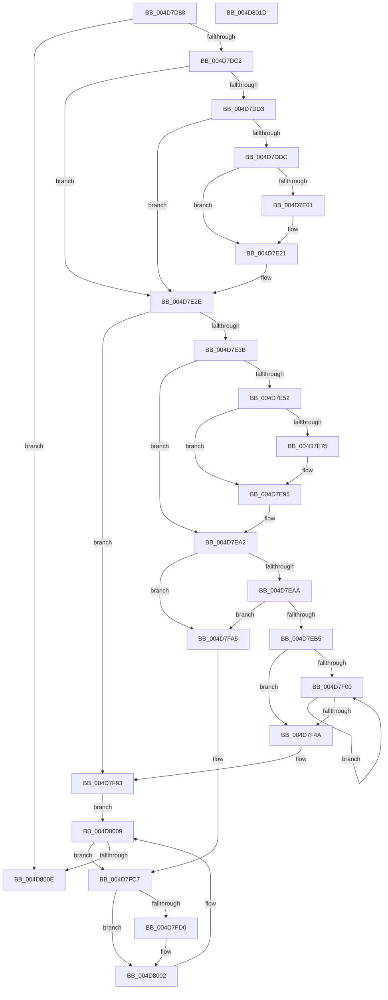

# HalpHvInitMcaPcrContext

- RVA: `0x004D7D88`–`0x004D801E` (길이 `662` bytes)
- VA: `0x00000001404D7D88`
- 실행 섹션: `.text`
- PDB 이름 있음: `예`; PDB Function 태그: `아니요`
- unwind 정보 RVA: `0x000BE754`
- 디코드: `154`개 명령, `662/662` bytes 표시
- 미해석 바이트: `0` (있으면 어셈블리에 `.byte`로 보존)

> 이 문서는 커널 이미지의 기계어와 PDB 기호를 분석해 생성했습니다. 4번과 5번은 함수 원형과 자료형을 바이너리 사용 방식에서 추정한 C 해석이며 원본 소스 복구 결과는 아닙니다.

## 1. Dependencies

- 직접 호출 지점: **15**; 고유 호출 대상: **10**
- 직접 호출자로 확인된 함수: **1**
- RIP 상대 이미지 참조: **5**

### Outgoing calls
- `0x004D7DC7` → [KeGetCurrentProcessorNumberEx](../40/KeGetCurrentProcessorNumberEx_function_00401690.md) (function, `0x00401690`)
- `0x004D7DE1` → [KeQueryMaximumProcessorCountEx](../26/KeQueryMaximumProcessorCountEx_function_00264D60.md) (function, `0x00264D60`)
- `0x004D7DF0` → [HalpMmAllocCtxAlloc](../3E/HalpMmAllocCtxAlloc_function_003E10B8.md) (function, `0x003E10B8`)
- `0x004D7E1B` → [KeBugCheckEx](../4F/KeBugCheckEx_function_004FD660.md) (function, `0x004FD660`)
- `0x004D7E29` → [memset](../6C/memset_function_006C6C40.md) (function, `0x006C6C40`)
- `0x004D7E46` → [HalpHvQueryAssociatedProcessors](../54/HalpHvQueryAssociatedProcessors_function_0054CEC8.md) (function, `0x0054CEC8`)
- `0x004D7E68` → [ExAllocatePool2](../../poolcode/B8/ExAllocatePool2_function_00B820F0.md) (function, `0x00B820F0`)
- `0x004D7E8F` → [KeBugCheckEx](../4F/KeBugCheckEx_function_004FD660.md) (function, `0x004FD660`)
- `0x004D7E9D` → [HalpHvQueryAssociatedProcessors](../54/HalpHvQueryAssociatedProcessors_function_0054CEC8.md) (function, `0x0054CEC8`)
- `0x004D7ED8` → [HalpGetMcaPcrContext](../48/HalpGetMcaPcrContext_function_00487A38.md) (function, `0x00487A38`)
- `0x004D7F25` → [HalpGetMcaPcrContext](../48/HalpGetMcaPcrContext_function_00487A38.md) (function, `0x00487A38`)
- `0x004D7F6C` → [HalpGetMcaPcrContext](../48/HalpGetMcaPcrContext_function_00487A38.md) (function, `0x00487A38`)
- `0x004D7F8E` → [ExFreePoolWithTag](../../poolcode/B8/ExFreePoolWithTag_function_00B82870.md) (function, `0x00B82870`)
- `0x004D7FC1` → [KeBugCheckEx](../4F/KeBugCheckEx_function_004FD660.md) (function, `0x004FD660`)
- `0x004D7FF6` → [KeSetTargetProcessorDpcEx](../2D/KeSetTargetProcessorDpcEx_function_002DD280.md) (function, `0x002DD280`)

### Direct callers
- [HalpMceInit](../../pagelk/B7/HalpMceInit_function_00B7B144.md) at `0x00B7B208`

### Static image references
- `0x004D7DA8` → RVA `0x00FC1C48` (`.data`; read)
- `0x004D7DD3` → RVA `0x00E10370` (`.data`; read)
- `0x004D7DF5` → RVA `0x00E10370` (`.data`; write)
- `0x004D7E01` → RVA `0x00023EB8` (`.rdata`; read)
- `0x004D7FD4` → RVA `0x00487290` (`HalpCmciDeferredRoutine`; read)

## 2. Other-region calls and transfers

- 다른 실행 섹션으로 향하는 call: **2**
  - `0x004D7E68` → [ExAllocatePool2](../../poolcode/B8/ExAllocatePool2_function_00B820F0.md) (`.text` → `POOLCODE`)
  - `0x004D7F8E` → [ExFreePoolWithTag](../../poolcode/B8/ExFreePoolWithTag_function_00B82870.md) (`.text` → `POOLCODE`)
- 별도 외부 분기/꼬리 이동을 확인하지 못했습니다.

## 3. Assembly (complete function range)

```asm
004D7D88  40 53                           push rbx
004D7D8A  55                              push rbp
004D7D8B  56                              push rsi
004D7D8C  57                              push rdi
004D7D8D  41 54                           push r12
004D7D8F  41 56                           push r14
004D7D91  41 57                           push r15
004D7D93  48 83 EC 30                     sub rsp, 0x30
004D7D97  45 33 E4                        xor r12d, r12d
004D7D9A  44 89 64 24 70                  mov dword ptr [rsp + 0x70], r12d
004D7D9F  65 48 8B 3C 25 18 00 00 00      mov rdi, qword ptr gs:[0x18]
004D7DA8  44 38 25 99 9E AE 00            cmp byte ptr [rip + 0xae9e99], r12b
004D7DAF  4C 89 A4 24 80 00 00 00         mov qword ptr [rsp + 0x80], r12
004D7DB7  44 89 64 24 78                  mov dword ptr [rsp + 0x78], r12d
004D7DBC  0F 84 4C 02 00 00               je 0x1404d800e
004D7DC2  48 8D 4C 24 78                  lea rcx, [rsp + 0x78]
004D7DC7  E8 C4 98 F2 FF                  call 0x140401690
004D7DCC  44 8B F8                        mov r15d, eax
004D7DCF  85 C0                           test eax, eax
004D7DD1  75 5B                           jne 0x1404d7e2e
004D7DD3  4C 39 25 96 85 93 00            cmp qword ptr [rip + 0x938596], r12
004D7DDA  75 52                           jne 0x1404d7e2e
004D7DDC  B9 FF FF 00 00                  mov ecx, 0xffff
004D7DE1  E8 7A CF D8 FF                  call 0x140264d60
004D7DE6  8D 0C 40                        lea ecx, [rax + rax*2]
004D7DE9  C1 E1 06                        shl ecx, 6
004D7DEC  8B D1                           mov edx, ecx
004D7DEE  8B D9                           mov ebx, ecx
004D7DF0  E8 C3 92 F0 FF                  call 0x1403e10b8
004D7DF5  48 89 05 74 85 93 00            mov qword ptr [rip + 0x938574], rax
004D7DFC  48 85 C0                        test rax, rax
004D7DFF  75 20                           jne 0x1404d7e21
004D7E01  4C 8D 0D B0 C0 B4 FF            lea r9, [rip - 0x4b3f50]
004D7E08  48 C7 44 24 20 CA 04 00 00      mov qword ptr [rsp + 0x20], 0x4ca
004D7E11  45 33 C0                        xor r8d, r8d
004D7E14  8B D3                           mov edx, ebx
004D7E16  B9 AC 00 00 00                  mov ecx, 0xac
004D7E1B  E8 40 58 02 00                  call 0x1404fd660
004D7E20  CC                              int3
004D7E21  4C 8B C3                        mov r8, rbx
004D7E24  33 D2                           xor edx, edx
004D7E26  48 8B C8                        mov rcx, rax
004D7E29  E8 12 EE 1E 00                  call 0x1406c6c40
004D7E2E  4C 39 A7 D8 00 00 00            cmp qword ptr [rdi + 0xd8], r12
004D7E35  0F 85 58 01 00 00               jne 0x1404d7f93
004D7E3B  45 33 C0                        xor r8d, r8d
004D7E3E  48 8D 54 24 70                  lea rdx, [rsp + 0x70]
004D7E43  49 8B F4                        mov rsi, r12
004D7E46  E8 7D 50 07 00                  call 0x14054cec8
004D7E4B  3D 23 00 00 C0                  cmp eax, 0xc0000023
004D7E50  75 50                           jne 0x1404d7ea2
004D7E52  8B 44 24 70                     mov eax, dword ptr [rsp + 0x70]
004D7E56  41 B8 48 61 6C 48               mov r8d, 0x486c6148
004D7E5C  C1 E0 03                        shl eax, 3
004D7E5F  B9 40 00 00 00                  mov ecx, 0x40
004D7E64  8B D0                           mov edx, eax
004D7E66  8B D8                           mov ebx, eax
004D7E68  E8 83 A2 6A 00                  call 0x140b820f0
004D7E6D  48 8B F0                        mov rsi, rax
004D7E70  48 85 C0                        test rax, rax
004D7E73  75 20                           jne 0x1404d7e95
004D7E75  4C 8D 0D 3C C0 B4 FF            lea r9, [rip - 0x4b3fc4]
004D7E7C  48 C7 44 24 20 E5 04 00 00      mov qword ptr [rsp + 0x20], 0x4e5
004D7E85  45 33 C0                        xor r8d, r8d
004D7E88  8B D3                           mov edx, ebx
004D7E8A  B9 AC 00 00 00                  mov ecx, 0xac
004D7E8F  E8 CC 57 02 00                  call 0x1404fd660
004D7E94  CC                              int3
004D7E95  4C 8B C0                        mov r8, rax
004D7E98  48 8D 54 24 70                  lea rdx, [rsp + 0x70]
004D7E9D  E8 26 50 07 00                  call 0x14054cec8
004D7EA2  85 C0                           test eax, eax
004D7EA4  0F 88 FB 00 00 00               js 0x1404d7fa5
004D7EAA  44 39 64 24 70                  cmp dword ptr [rsp + 0x70], r12d
004D7EAF  0F 84 F0 00 00 00               je 0x1404d7fa5
004D7EB5  8B 06                           mov eax, dword ptr [rsi]
004D7EB7  41 8B EC                        mov ebp, r12d
004D7EBA  0F BA F0 1F                     btr eax, 0x1f
004D7EBE  44 89 A4 24 84 00 00 00         mov dword ptr [rsp + 0x84], r12d
004D7EC6  89 84 24 80 00 00 00            mov dword ptr [rsp + 0x80], eax
004D7ECD  48 8B 9C 24 80 00 00 00         mov rbx, qword ptr [rsp + 0x80]
004D7ED5  48 8B CB                        mov rcx, rbx
004D7ED8  E8 5B FB FA FF                  call 0x140487a38
004D7EDD  4C 8B F0                        mov r14, rax
004D7EE0  48 89 98 AC 00 00 00            mov qword ptr [rax + 0xac], rbx
004D7EE7  4C 89 A0 B8 00 00 00            mov qword ptr [rax + 0xb8], r12
004D7EEE  48 89 87 D8 00 00 00            mov qword ptr [rdi + 0xd8], rax
004D7EF5  BF 01 00 00 00                  mov edi, 1
004D7EFA  39 7C 24 70                     cmp dword ptr [rsp + 0x70], edi
004D7EFE  76 4A                           jbe 0x1404d7f4a
004D7F00  8B CF                           mov ecx, edi
004D7F02  83 E5 FE                        and ebp, 0xfffffffe
004D7F05  89 AC 24 84 00 00 00            mov dword ptr [rsp + 0x84], ebp
004D7F0C  8B 14 8E                        mov edx, dword ptr [rsi + rcx*4]
004D7F0F  0F BA F2 1F                     btr edx, 0x1f
004D7F13  89 94 24 80 00 00 00            mov dword ptr [rsp + 0x80], edx
004D7F1A  48 8B 9C 24 80 00 00 00         mov rbx, qword ptr [rsp + 0x80]
004D7F22  48 8B CB                        mov rcx, rbx
004D7F25  E8 0E FB FA FF                  call 0x140487a38
004D7F2A  FF C7                           inc edi
004D7F2C  4C 89 A0 B8 00 00 00            mov qword ptr [rax + 0xb8], r12
004D7F33  48 89 98 AC 00 00 00            mov qword ptr [rax + 0xac], rbx
004D7F3A  49 89 86 B8 00 00 00            mov qword ptr [r14 + 0xb8], rax
004D7F41  4C 8B F0                        mov r14, rax
004D7F44  3B 7C 24 70                     cmp edi, dword ptr [rsp + 0x70]
004D7F48  72 B6                           jb 0x1404d7f00
004D7F4A  83 CD 01                        or ebp, 1
004D7F4D  41 0F BA F7 1F                  btr r15d, 0x1f
004D7F52  89 AC 24 84 00 00 00            mov dword ptr [rsp + 0x84], ebp
004D7F59  44 89 BC 24 80 00 00 00         mov dword ptr [rsp + 0x80], r15d
004D7F61  48 8B 9C 24 80 00 00 00         mov rbx, qword ptr [rsp + 0x80]
004D7F69  48 8B CB                        mov rcx, rbx
004D7F6C  E8 C7 FA FA FF                  call 0x140487a38
004D7F71  BA 48 61 6C 48                  mov edx, 0x486c6148
004D7F76  48 8B CE                        mov rcx, rsi
004D7F79  4C 89 A0 B8 00 00 00            mov qword ptr [rax + 0xb8], r12
004D7F80  48 89 98 AC 00 00 00            mov qword ptr [rax + 0xac], rbx
004D7F87  49 89 86 B8 00 00 00            mov qword ptr [r14 + 0xb8], rax
004D7F8E  E8 DD A8 6A 00                  call 0x140b82870
004D7F93  65 48 8B 04 25 18 00 00 00      mov rax, qword ptr gs:[0x18]
004D7F9C  48 8B 98 D8 00 00 00            mov rbx, qword ptr [rax + 0xd8]
004D7FA3  EB 64                           jmp 0x1404d8009
004D7FA5  45 33 C0                        xor r8d, r8d
004D7FA8  48 C7 44 24 20 F1 04 00 00      mov qword ptr [rsp + 0x20], 0x4f1
004D7FB1  4C 8D 0D 00 BF B4 FF            lea r9, [rip - 0x4b4100]
004D7FB8  BA 00 82 00 00                  mov edx, 0x8200
004D7FBD  41 8D 48 5C                     lea ecx, [r8 + 0x5c]
004D7FC1  E8 9A 56 02 00                  call 0x1404fd660
004D7FC6  CC                              int3
004D7FC7  44 38 A3 A0 00 00 00            cmp byte ptr [rbx + 0xa0], r12b
004D7FCE  75 32                           jne 0x1404d8002
004D7FD0  48 8D 4B 30                     lea rcx, [rbx + 0x30]
004D7FD4  48 8D 05 B5 F2 FA FF            lea rax, [rip - 0x50d4b]
004D7FDB  C7 01 13 01 00 00               mov dword ptr [rcx], 0x113
004D7FE1  48 8D 54 24 78                  lea rdx, [rsp + 0x78]
004D7FE6  48 89 41 18                     mov qword ptr [rcx + 0x18], rax
004D7FEA  48 89 59 20                     mov qword ptr [rcx + 0x20], rbx
004D7FEE  4C 89 61 38                     mov qword ptr [rcx + 0x38], r12
004D7FF2  4C 89 61 10                     mov qword ptr [rcx + 0x10], r12
004D7FF6  E8 85 52 E0 FF                  call 0x1402dd280
004D7FFB  C6 83 A0 00 00 00 01            mov byte ptr [rbx + 0xa0], 1
004D8002  48 8B 9B B8 00 00 00            mov rbx, qword ptr [rbx + 0xb8]
004D8009  48 85 DB                        test rbx, rbx
004D800C  75 B9                           jne 0x1404d7fc7
004D800E  48 83 C4 30                     add rsp, 0x30
004D8012  41 5F                           pop r15
004D8014  41 5E                           pop r14
004D8016  41 5C                           pop r12
004D8018  5F                              pop rdi
004D8019  5E                              pop rsi
004D801A  5D                              pop rbp
004D801B  5B                              pop rbx
004D801C  C3                              ret
004D801D  CC                              int3
```

## 4. C-style interpretation (structured pseudocode)

```c
__int64 __fastcall HalpHvInitMcaPcrContext(__int64 a1, __int64 a2, int a3)
{
    __int64 result;
    __int64 v_r12;
    __int64 v_rbp;
    __int64 v_rdi;
    __int64 v_rsp;
    unsigned __int64 v_stack_m48;
    unsigned int v_stack_p10;
    unsigned __int64 v_stack_p18;
    unsigned int v_stack_p1C;
    unsigned int v_stack_p8;

    v_rsp = (v_rsp) - (48);
    v_r12 = 0;
    v_stack_p8 = 0;
    v_stack_p18 = 0;
    v_stack_p10 = 0;
    if ((*(unsigned __int8 *)(v_rip + 11443865)) == 0) goto loc_004D800E;
    result = KeGetCurrentProcessorNumberEx(v_stack_p10, a2, a3, a4);
    if ((unsigned int)(result) != 0) goto loc_004D7E2E;
    if ((*(unsigned __int64 *)(v_rip + 9667990)) != 0) goto loc_004D7E2E;
    result = KeQueryMaximumProcessorCountEx((unsigned int)(0xFFFFULL), a2, a3, a4);
    a1 = (unsigned int)((result + result * 2) << (6));
    result = HalpMmAllocCtxAlloc(a1, (unsigned int)((unsigned int)(a1)), a3, a4);
    *(unsigned __int64 *)(v_rip + 9667956) = result;
    if (result == 0) {
        a4 = v_rip - 4931408;
        v_stack_m48 = 0x4CAULL;
        a3 = 0;
        a2 = (unsigned int)((unsigned int)((unsigned int)(a1)));
        a1 = 172;
        result = KeBugCheckEx(a1, a2, a3, a4);
    }
    a2 = 0;
    result = memset(result, a2, (unsigned int)((unsigned int)(a1)), a4);
loc_004D7E2E:
    if ((*(unsigned __int64 *)(*(unsigned __int64 *)(gs_base + (0 + 24)) + 216)) != 0) goto loc_004D7F93;
    a3 = 0;
    result = HalpHvQueryAssociatedProcessors(result, v_stack_p8, a3, a4);
    if (((unsigned int)(result)) != 0xC0000023ULL) goto loc_004D7EA2;
    result = (unsigned int)(((unsigned int)(v_stack_p8)) << (3));
    result = ExAllocatePool2(64, (unsigned int)((unsigned int)(result)), (unsigned int)(0x486C6148ULL), a4);
    if (result == 0) {
        a4 = v_rip - 4931524;
        v_stack_m48 = 0x4E5ULL;
        a3 = 0;
        a2 = (unsigned int)((unsigned int)((unsigned int)(result)));
        a1 = 172;
        result = KeBugCheckEx(a1, a2, a3, a4);
    }
    result = HalpHvQueryAssociatedProcessors(a1, v_stack_p8, result, a4);
loc_004D7EA2:
    if (sign_flag) goto loc_004D7FA5;
    if (v_stack_p8 == 0) goto loc_004D7FA5;
    v_stack_p1C = 0;
    v_stack_p18 = (unsigned int)((unsigned int)(*(unsigned int *)(result)));
    result = HalpGetMcaPcrContext(v_stack_p18, v_stack_p8, result, a4);
    *(unsigned __int64 *)(result + 172) = v_stack_p18;
    *(unsigned __int64 *)(result + 184) = 0;
    *(unsigned __int64 *)(*(unsigned __int64 *)(gs_base + (0 + 24)) + 216) = result;
    if (v_stack_p8 <= 1) goto loc_004D7F4A;
loc_004D7F00:
    v_rbp = (unsigned int)((0) & (0xFFFFFFFEULL));
    v_stack_p1C = (unsigned int)(v_rbp);
    v_stack_p18 = (unsigned int)((unsigned int)(*(unsigned int *)(result + 1 * 4)));
    result = HalpGetMcaPcrContext(v_stack_p18, (unsigned int)(*(unsigned int *)(result + 1 * 4)), result, a4);
    v_rdi = (unsigned int)((1) + 1);
    *(unsigned __int64 *)(result + 184) = 0;
    *(unsigned __int64 *)(result + 172) = v_stack_p18;
    *(unsigned __int64 *)(result + 184) = result;
    if (((unsigned int)(v_rdi)) < v_stack_p8) goto loc_004D7F00;
loc_004D7F4A:
    v_rbp = (unsigned int)((v_rbp) | (1));
    v_stack_p1C = (unsigned int)(v_rbp);
    v_stack_p18 = (unsigned int)((unsigned int)((unsigned int)(result)));
    result = HalpGetMcaPcrContext(v_stack_p18, (unsigned int)(*(unsigned int *)(result + 1 * 4)), result, a4);
    *(unsigned __int64 *)(result + 184) = 0;
    *(unsigned __int64 *)(result + 172) = v_stack_p18;
    *(unsigned __int64 *)(result + 184) = result;
    result = ExFreePoolWithTag(result, (unsigned int)(0x486C6148ULL), result, a4);
loc_004D7F93:
    goto loc_004D8009;
loc_004D7FA5:
    a3 = 0;
    v_stack_m48 = 0x4F1ULL;
    result = KeBugCheckEx(a3 + 92, (unsigned int)(0x8200ULL), a3, v_rip - 4931840);
loc_004D7FC7:
    if ((*(unsigned __int8 *)(*(unsigned __int64 *)(*(unsigned __int64 *)(gs_base + (0 + 24)) + 216) + 160)) == 0) {
        a1 = *(unsigned __int64 *)(*(unsigned __int64 *)(gs_base + (0 + 24)) + 216) + 48;
        result = v_rip - 331083;
        *(unsigned int *)(a1) = 275;
        a2 = v_stack_p10;
        *(unsigned __int64 *)(a1 + 24) = result;
        *(unsigned __int64 *)(a1 + 32) = *(unsigned __int64 *)(*(unsigned __int64 *)(gs_base + (0 + 24)) + 216);
        *(unsigned __int64 *)(a1 + 56) = 0;
        *(unsigned __int64 *)(a1 + 16) = 0;
        result = KeSetTargetProcessorDpcEx(a1, a2, a3, v_rip - 4931840);
        *(unsigned __int8 *)(*(unsigned __int64 *)(*(unsigned __int64 *)(gs_base + (0 + 24)) + 216) + 160) = 1;
    }
loc_004D8009:
    if (*(unsigned __int64 *)(*(unsigned __int64 *)(*(unsigned __int64 *)(gs_base + (0 + 24)) + 216) + 184) != 0) goto loc_004D7FC7;
loc_004D800E:
    v_rsp = (v_rsp) + (48);
    return result;
}
```

## 5. (Beta) C Style

```c
int64_t HalpHvInitMcaPcrContext(int64_t Arg1, int64_t Arg2, int32_t Arg3)
{
    int64_t result;
    int64_t local_r12;
    int64_t local_rbp;
    int64_t local_rdi;
    int64_t local_rsp;
    uint64_t v_stack_m48;
    uint32_t v_stack_p10;
    uint64_t v_stack_p18;
    uint32_t v_stack_p1C;
    uint32_t v_stack_p8;

    local_rsp = (local_rsp) - (48);
    local_r12 = 0;
    v_stack_p8 = 0;
    v_stack_p18 = 0;
    v_stack_p10 = 0;
    if ((*(uint8_t *)(v_rip + 0xAE9E99)) == 0) goto loc_004D800E;
    result = KeGetCurrentProcessorNumberEx(v_stack_p10, Arg2, Arg3, a4);
    if ((uint32_t)(result) != 0) goto loc_004D7E2E;
    if ((*(uint64_t *)(v_rip + 0x938596)) != 0) goto loc_004D7E2E;
    result = KeQueryMaximumProcessorCountEx((uint32_t)(0xFFFFULL), Arg2, Arg3, a4);
    Arg1 = (uint32_t)((result + result * 2) << (6));
    result = HalpMmAllocCtxAlloc(Arg1, (uint32_t)((uint32_t)(Arg1)), Arg3, a4);
    *(uint64_t *)(v_rip + 0x938574) = result;
    if (result == 0) {
        a4 = v_rip - 4931408;
        v_stack_m48 = 0x4CAULL;
        Arg3 = 0;
        Arg2 = (uint32_t)((uint32_t)((uint32_t)(Arg1)));
        Arg1 = 172;
        result = KeBugCheckEx(Arg1, Arg2, Arg3, a4);
    }
    Arg2 = 0;
    result = memset(result, Arg2, (uint32_t)((uint32_t)(Arg1)), a4);
loc_004D7E2E:
    if ((*(uint64_t *)(*(uint64_t *)(gs_base + (0 + 0x18)) + 0xD8)) != 0) goto loc_004D7F93;
    Arg3 = 0;
    result = HalpHvQueryAssociatedProcessors(result, v_stack_p8, Arg3, a4);
    if (((uint32_t)(result)) != 0xC0000023ULL) goto loc_004D7EA2;
    result = (uint32_t)(((uint32_t)(v_stack_p8)) << (3));
    result = ExAllocatePool2(64, (uint32_t)((uint32_t)(result)), (uint32_t)(0x486C6148ULL), a4);
    if (result == 0) {
        a4 = v_rip - 4931524;
        v_stack_m48 = 0x4E5ULL;
        Arg3 = 0;
        Arg2 = (uint32_t)((uint32_t)((uint32_t)(result)));
        Arg1 = 172;
        result = KeBugCheckEx(Arg1, Arg2, Arg3, a4);
    }
    result = HalpHvQueryAssociatedProcessors(Arg1, v_stack_p8, result, a4);
loc_004D7EA2:
    if (sign_flag) goto loc_004D7FA5;
    if (v_stack_p8 == 0) goto loc_004D7FA5;
    v_stack_p1C = 0;
    v_stack_p18 = (uint32_t)((uint32_t)(*(uint32_t *)(result)));
    result = HalpGetMcaPcrContext(v_stack_p18, v_stack_p8, result, a4);
    *(uint64_t *)(result + 0xAC) = v_stack_p18;
    *(uint64_t *)(result + 0xB8) = 0;
    *(uint64_t *)(*(uint64_t *)(gs_base + (0 + 0x18)) + 0xD8) = result;
    if (v_stack_p8 <= 1) goto loc_004D7F4A;
loc_004D7F00:
    local_rbp = (uint32_t)((0) & (0xFFFFFFFEULL));
    v_stack_p1C = (uint32_t)(local_rbp);
    v_stack_p18 = (uint32_t)((uint32_t)(*(uint32_t *)(result + 0x1 * 4)));
    result = HalpGetMcaPcrContext(v_stack_p18, (uint32_t)(*(uint32_t *)(result + 0x1 * 4)), result, a4);
    local_rdi = (uint32_t)((1) + 1);
    *(uint64_t *)(result + 0xB8) = 0;
    *(uint64_t *)(result + 0xAC) = v_stack_p18;
    *(uint64_t *)(result + 0xB8) = result;
    if (((uint32_t)(local_rdi)) < v_stack_p8) goto loc_004D7F00;
loc_004D7F4A:
    local_rbp = (uint32_t)((local_rbp) | (1));
    v_stack_p1C = (uint32_t)(local_rbp);
    v_stack_p18 = (uint32_t)((uint32_t)((uint32_t)(result)));
    result = HalpGetMcaPcrContext(v_stack_p18, (uint32_t)(*(uint32_t *)(result + 0x1 * 4)), result, a4);
    *(uint64_t *)(result + 0xB8) = 0;
    *(uint64_t *)(result + 0xAC) = v_stack_p18;
    *(uint64_t *)(result + 0xB8) = result;
    result = ExFreePoolWithTag(result, (uint32_t)(0x486C6148ULL), result, a4);
loc_004D7F93:
    goto loc_004D8009;
loc_004D7FA5:
    Arg3 = 0;
    v_stack_m48 = 0x4F1ULL;
    result = KeBugCheckEx(Arg3 + 92, (uint32_t)(0x8200ULL), Arg3, v_rip - 4931840);
loc_004D7FC7:
    if ((*(uint8_t *)(*(uint64_t *)(*(uint64_t *)(gs_base + (0 + 0x18)) + 0xD8) + 0xA0)) == 0) {
        Arg1 = *(uint64_t *)(*(uint64_t *)(gs_base + (0 + 0x18)) + 0xD8) + 48;
        result = v_rip - 331083;
        *(uint32_t *)(Arg1) = 275;
        Arg2 = v_stack_p10;
        *(uint64_t *)(Arg1 + 0x18) = result;
        *(uint64_t *)(Arg1 + 0x20) = *(uint64_t *)(*(uint64_t *)(gs_base + (0 + 0x18)) + 0xD8);
        *(uint64_t *)(Arg1 + 0x38) = 0;
        *(uint64_t *)(Arg1 + 0x10) = 0;
        result = KeSetTargetProcessorDpcEx(Arg1, Arg2, Arg3, v_rip - 4931840);
        *(uint8_t *)(*(uint64_t *)(*(uint64_t *)(gs_base + (0 + 0x18)) + 0xD8) + 0xA0) = 1;
    }
loc_004D8009:
    if (*(uint64_t *)(*(uint64_t *)(*(uint64_t *)(gs_base + (0 + 0x18)) + 0xD8) + 0xB8) != 0) goto loc_004D7FC7;
loc_004D800E:
    local_rsp = (local_rsp) + (48);
    return result;
}
```

## 6. Execution-region graph

[열기: 2D/3D 그래프와 함수 탐색 컨트롤 패널](../../../control-panel.html?section=text&rva=0x004D7D88&view=graph)

- 2D 그래프는 위에서 아래로 흐르고, 3D 그래프는 빈 공간을 드래그해 회전합니다. Shift+드래그는 이동, 휠은 확대·축소, 함수 노드 선택은 대상 보고서 이동입니다.

### Static fallback


