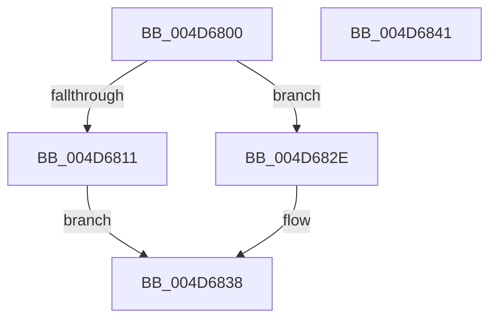

# HalpInterruptGetApicVersion

- RVA: `0x004D6800`–`0x004D6842` (길이 `66` bytes)
- VA: `0x00000001404D6800`
- 실행 섹션: `.text`
- PDB 이름 있음: `예`; PDB Function 태그: `아니요`
- unwind 정보 RVA: `0x0005C788`
- 디코드: `19`개 명령, `66/66` bytes 표시
- 미해석 바이트: `0` (있으면 어셈블리에 `.byte`로 보존)

> 이 문서는 커널 이미지의 기계어와 PDB 기호를 분석해 생성했습니다. 4번과 5번은 함수 원형과 자료형을 바이너리 사용 방식에서 추정한 C 해석이며 원본 소스 복구 결과는 아닙니다.

## 1. Dependencies

- 직접 호출 지점: **1**; 고유 호출 대상: **1**
- 직접 호출자로 확인된 함수: **0**
- RIP 상대 이미지 참조: **0**

### Outgoing calls
- `0x004D6807` → [HalpInterruptFindLinesForGsiRange](../2D/HalpInterruptFindLinesForGsiRange_function_002D204C.md) (function, `0x002D204C`)

### Direct callers
- 이 함수 시작 RVA로 연결되는 직접 call은 확인되지 않았습니다. 간접 호출은 완전히 역산할 수 없습니다.

### Static image references
- 디코드된 RIP-relative 메모리 참조가 없습니다.

## 2. Other-region calls and transfers

- 다른 실행 섹션으로 향하는 call: **0**
- 별도 외부 분기/꼬리 이동을 확인하지 못했습니다.

## 3. Assembly (complete function range)

```asm
004D6800  48 83 EC 28                     sub rsp, 0x28
004D6804  8D 51 01                        lea edx, [rcx + 1]
004D6807  E8 40 B8 DF FF                  call 0x1402d204c
004D680C  48 85 C0                        test rax, rax
004D680F  74 1D                           je 0x1404d682e
004D6811  8B 50 18                        mov edx, dword ptr [rax + 0x18]
004D6814  2B 50 14                        sub edx, dword ptr [rax + 0x14]
004D6817  83 64 24 30 00                  and dword ptr [rsp + 0x30], 0
004D681C  C6 44 24 30 11                  mov byte ptr [rsp + 0x30], 0x11
004D6821  88 54 24 33                     mov byte ptr [rsp + 0x33], dl
004D6825  8D 42 FF                        lea eax, [rdx - 1]
004D6828  88 44 24 32                     mov byte ptr [rsp + 0x32], al
004D682C  EB 0A                           jmp 0x1404d6838
004D682E  83 64 24 30 00                  and dword ptr [rsp + 0x30], 0
004D6833  C6 44 24 33 F0                  mov byte ptr [rsp + 0x33], 0xf0
004D6838  8B 44 24 30                     mov eax, dword ptr [rsp + 0x30]
004D683C  48 83 C4 28                     add rsp, 0x28
004D6840  C3                              ret
004D6841  CC                              int3
```

## 4. C-style interpretation (structured pseudocode)

```c
__int64 __fastcall HalpInterruptGetApicVersion(__int64 a1)
{
    __int64 result;
    __int64 v_rsp;
    unsigned int v_stack_p8;
    unsigned __int8 v_stack_pA;
    unsigned __int8 v_stack_pB;

    v_rsp = (v_rsp) - (40);
    result = HalpInterruptFindLinesForGsiRange(a1, a1 + 1, a3, a4);
    if (result == 0) goto loc_004D682E;
    a2 = (unsigned int)(((unsigned int)(*(unsigned int *)(result + 24))) - (*(unsigned int *)(result + 20)));
    v_stack_p8 = 17;
    v_stack_pB = (unsigned __int8)(a2);
    v_stack_pA = (unsigned __int8)(a2 - 1);
    goto loc_004D6838;
loc_004D682E:
    v_stack_pB = 240;
loc_004D6838:
    v_rsp = (v_rsp) + (40);
    return (unsigned int)(v_stack_p8);
}
```

## 5. (Beta) C Style

```c
int64_t HalpInterruptGetApicVersion(void *Arg1)
{
    uint8_t *arg1 = (uint8_t *)Arg1;

    int64_t result;
    int64_t local_rsp;
    uint32_t v_stack_p8;
    uint8_t v_stack_pA;
    uint8_t v_stack_pB;

    local_rsp = (local_rsp) - (40);
    result = HalpInterruptFindLinesForGsiRange(Arg1, Arg1 + 1, a3, a4);
    if (result == 0) goto loc_004D682E;
    a2 = (uint32_t)(((uint32_t)(*(uint32_t *)(result + 0x18))) - (*(uint32_t *)(result + 0x14)));
    v_stack_p8 = 17;
    v_stack_pB = (uint8_t)(a2);
    v_stack_pA = (uint8_t)(a2 - 1);
    goto loc_004D6838;
loc_004D682E:
    v_stack_pB = 240;
loc_004D6838:
    local_rsp = (local_rsp) + (40);
    return (uint32_t)(v_stack_p8);
}
```

### 관측된 메모리 오프셋

구조체 형식이 확인되지 않은 접근은 인자 기준의 오프셋으로만 기록했습니다.

| 기준 인자 | 오프셋 표현 | 폭 (bit) | 접근 |
|---|---:|---:|---|
| `Arg1` | `+ 0x1` | `32` | `R` |

## 6. Execution-region graph

[열기: 2D/3D 그래프와 함수 탐색 컨트롤 패널](../../../control-panel.html?section=text&rva=0x004D6800&view=graph)

- 2D 그래프는 위에서 아래로 흐르고, 3D 그래프는 빈 공간을 드래그해 회전합니다. Shift+드래그는 이동, 휠은 확대·축소, 함수 노드 선택은 대상 보고서 이동입니다.

### Static fallback


