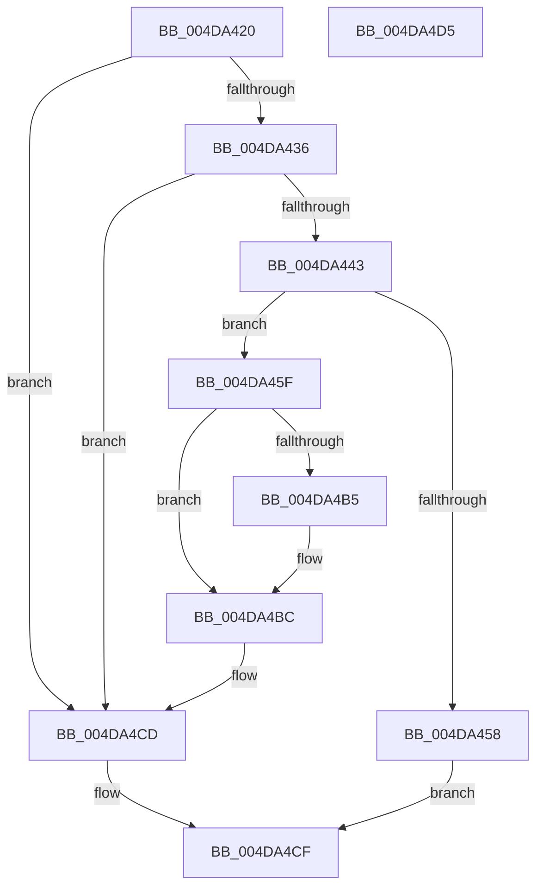

# HalpIommuAddDebuggerException

- RVA: `0x004DA420`–`0x004DA4D6` (길이 `182` bytes)
- VA: `0x00000001404DA420`
- 실행 섹션: `.text`
- PDB 이름 있음: `예`; PDB Function 태그: `아니요`
- unwind 정보 RVA: `0x0005CF00`
- 디코드: `50`개 명령, `182/182` bytes 표시
- 미해석 바이트: `0` (있으면 어셈블리에 `.byte`로 보존)

> 이 문서는 커널 이미지의 기계어와 PDB 기호를 분석해 생성했습니다. 4번과 5번은 함수 원형과 자료형을 바이너리 사용 방식에서 추정한 C 해석이며 원본 소스 복구 결과는 아닙니다.

## 1. Dependencies

- 직접 호출 지점: **1**; 고유 호출 대상: **1**
- 직접 호출자로 확인된 함수: **1**
- RIP 상대 이미지 참조: **4**

### Outgoing calls
- `0x004DA44B` → [HalpMmAllocateMemoryInternal](../54/HalpMmAllocateMemoryInternal_function_00544990.md) (function, `0x00544990`)

### Direct callers
- [HalpIommuPopulateExceptionList](HalpIommuPopulateExceptionList_function_004DA400.md) at `0x004DA404`

### Static image references
- `0x004DA426` → RVA `0x00FC19A0` (`.data`; read)
- `0x004DA49E` → RVA `0x00FC1720` (`.data`; read)
- `0x004DA4A9` → RVA `0x00FC1728` (`.data`; read)
- `0x004DA4C6` → RVA `0x00FC1728` (`.data`; write)

## 2. Other-region calls and transfers

- 다른 실행 섹션으로 향하는 call: **0**
- 별도 외부 분기/꼬리 이동을 확인하지 못했습니다.

## 3. Assembly (complete function range)

```asm
004DA420  40 53                           push rbx
004DA422  48 83 EC 20                     sub rsp, 0x20
004DA426  48 8B 1D 73 75 AE 00            mov rbx, qword ptr [rip + 0xae7573]
004DA42D  48 85 DB                        test rbx, rbx
004DA430  0F 84 97 00 00 00               je 0x1404da4cd
004DA436  83 BB DC 00 00 00 00            cmp dword ptr [rbx + 0xdc], 0
004DA43D  0F 85 8A 00 00 00               jne 0x1404da4cd
004DA443  BA 01 00 00 00                  mov edx, 1
004DA448  8D 4A 27                        lea ecx, [rdx + 0x27]
004DA44B  E8 40 A5 06 00                  call 0x140544990
004DA450  48 8B D0                        mov rdx, rax
004DA453  48 85 C0                        test rax, rax
004DA456  75 07                           jne 0x1404da45f
004DA458  B8 9A 00 00 C0                  mov eax, 0xc000009a
004DA45D  EB 70                           jmp 0x1404da4cf
004DA45F  33 C0                           xor eax, eax
004DA461  0F 57 C0                        xorps xmm0, xmm0
004DA464  0F 11 02                        movups xmmword ptr [rdx], xmm0
004DA467  0F 11 42 10                     movups xmmword ptr [rdx + 0x10], xmm0
004DA46B  48 89 42 20                     mov qword ptr [rdx + 0x20], rax
004DA46F  0F B7 43 08                     movzx eax, word ptr [rbx + 8]
004DA473  89 42 10                        mov dword ptr [rdx + 0x10], eax
004DA476  8B 03                           mov eax, dword ptr [rbx]
004DA478  48 C1 E0 08                     shl rax, 8
004DA47C  48 89 42 18                     mov qword ptr [rdx + 0x18], rax
004DA480  8B 4B 04                        mov ecx, dword ptr [rbx + 4]
004DA483  83 E1 1F                        and ecx, 0x1f
004DA486  48 C1 E1 03                     shl rcx, 3
004DA48A  48 0B C8                        or rcx, rax
004DA48D  48 89 4A 18                     mov qword ptr [rdx + 0x18], rcx
004DA491  8B 43 04                        mov eax, dword ptr [rbx + 4]
004DA494  48 C1 E8 05                     shr rax, 5
004DA498  83 E0 07                        and eax, 7
004DA49B  48 0B C1                        or rax, rcx
004DA49E  48 8D 0D 7B 72 AE 00            lea rcx, [rip + 0xae727b]
004DA4A5  48 89 42 18                     mov qword ptr [rdx + 0x18], rax
004DA4A9  48 8B 05 78 72 AE 00            mov rax, qword ptr [rip + 0xae7278]
004DA4B0  48 39 08                        cmp qword ptr [rax], rcx
004DA4B3  74 07                           je 0x1404da4bc
004DA4B5  B9 03 00 00 00                  mov ecx, 3
004DA4BA  CD 29                           int 0x29
004DA4BC  48 89 0A                        mov qword ptr [rdx], rcx
004DA4BF  48 89 42 08                     mov qword ptr [rdx + 8], rax
004DA4C3  48 89 10                        mov qword ptr [rax], rdx
004DA4C6  48 89 15 5B 72 AE 00            mov qword ptr [rip + 0xae725b], rdx
004DA4CD  33 C0                           xor eax, eax
004DA4CF  48 83 C4 20                     add rsp, 0x20
004DA4D3  5B                              pop rbx
004DA4D4  C3                              ret
004DA4D5  CC                              int3
```

## 4. C-style interpretation (structured pseudocode)

```c
__int64 __fastcall HalpIommuAddDebuggerException(void)
{
    __int64 result;
    __int64 v_rsp;

    v_rsp = (v_rsp) - (32);
    if (*(unsigned __int64 *)(v_rip + 11433331) == 0) goto loc_004DA4CD;
    if ((*(unsigned int *)(*(unsigned __int64 *)(v_rip + 11433331) + 220)) != 0) goto loc_004DA4CD;
    result = HalpMmAllocateMemoryInternal(1 + 39, 1, a3, a4);
    if (result != 0) goto loc_004DA45F;
    goto loc_004DA4CF;
loc_004DA45F:
    result = 0;
    *(unsigned __int64 *)(result) = v_xmm0;
    *(unsigned __int64 *)(result + 16) = v_xmm0;
    *(unsigned __int64 *)(result + 32) = 0;
    *(unsigned int *)(result + 16) = (unsigned int)(*(unsigned __int16 *)(*(unsigned __int64 *)(v_rip + 11433331) + 8));
    result = ((unsigned int)(*(unsigned int *)(*(unsigned __int64 *)(v_rip + 11433331)))) << (8);
    *(unsigned __int64 *)(result + 24) = result;
    a1 = (unsigned int)(((unsigned int)(*(unsigned int *)(*(unsigned __int64 *)(v_rip + 11433331) + 4))) & (31));
    a1 = (a1) << (3);
    a1 = (a1) | (result);
    *(unsigned __int64 *)(result + 24) = a1;
    result = ((unsigned int)(*(unsigned int *)(*(unsigned __int64 *)(v_rip + 11433331) + 4))) >> (5);
    result = (unsigned int)((result) & (7));
    result = (result) | (a1);
    *(unsigned __int64 *)(result + 24) = result;
    if ((*(unsigned __int64 *)(*(unsigned __int64 *)(v_rip + 11432568))) != (v_rip + 11432571)) {
        a1 = 3;
    }
    *(unsigned __int64 *)(result) = a1;
    *(unsigned __int64 *)(result + 8) = *(unsigned __int64 *)(v_rip + 11432568);
    *(unsigned __int64 *)(*(unsigned __int64 *)(v_rip + 11432568)) = result;
    *(unsigned __int64 *)(v_rip + 11432539) = result;
loc_004DA4CD:
    result = 0;
loc_004DA4CF:
    v_rsp = (v_rsp) + (32);
    return result;
}
```

## 5. (Beta) C Style

```c
void HalpIommuAddDebuggerException(void)
{
    int64_t result;
    int64_t local_rsp;

    local_rsp = (local_rsp) - (32);
    if (*(uint64_t *)(v_rip + 0xAE7573) == 0) goto loc_004DA4CD;
    if ((*(uint32_t *)(*(uint64_t *)(v_rip + 0xAE7573) + 0xDC)) != 0) goto loc_004DA4CD;
    result = HalpMmAllocateMemoryInternal(1 + 39, 1, a3, a4);
    if (result != 0) goto loc_004DA45F;
    goto loc_004DA4CF;
loc_004DA45F:
    result = 0;
    *(uint64_t *)(result) = v_xmm0;
    *(uint64_t *)(result + 0x10) = v_xmm0;
    *(uint64_t *)(result + 0x20) = 0;
    *(uint32_t *)(result + 0x10) = (uint32_t)(*(uint16_t *)(*(uint64_t *)(v_rip + 0xAE7573) + 0x8));
    result = ((uint32_t)(*(uint32_t *)(*(uint64_t *)(v_rip + 0xAE7573)))) << (8);
    *(uint64_t *)(result + 0x18) = result;
    a1 = (uint32_t)(((uint32_t)(*(uint32_t *)(*(uint64_t *)(v_rip + 0xAE7573) + 0x4))) & (31));
    a1 = (a1) << (3);
    a1 = (a1) | (result);
    *(uint64_t *)(result + 0x18) = a1;
    result = ((uint32_t)(*(uint32_t *)(*(uint64_t *)(v_rip + 0xAE7573) + 0x4))) >> (5);
    result = (uint32_t)((result) & (7));
    result = (result) | (a1);
    *(uint64_t *)(result + 0x18) = result;
    if ((*(uint64_t *)(*(uint64_t *)(v_rip + 0xAE7278))) != (v_rip + 11432571)) {
        a1 = 3;
    }
    *(uint64_t *)(result) = a1;
    *(uint64_t *)(result + 0x8) = *(uint64_t *)(v_rip + 0xAE7278);
    *(uint64_t *)(*(uint64_t *)(v_rip + 0xAE7278)) = result;
    *(uint64_t *)(v_rip + 0xAE725B) = result;
loc_004DA4CD:
    result = 0;
loc_004DA4CF:
    local_rsp = (local_rsp) + (32);
    return result;
}
```

## 6. Execution-region graph

[열기: 2D/3D 그래프와 함수 탐색 컨트롤 패널](../../../control-panel.html?section=text&rva=0x004DA420&view=graph)

- 2D 그래프는 위에서 아래로 흐르고, 3D 그래프는 빈 공간을 드래그해 회전합니다. Shift+드래그는 이동, 휠은 확대·축소, 함수 노드 선택은 대상 보고서 이동입니다.

### Static fallback


