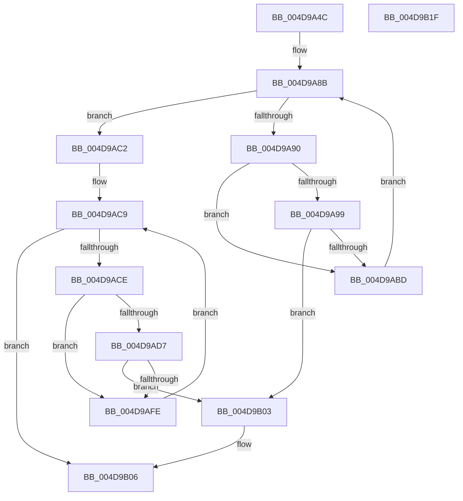

# HalpIommuCreateDeviceInternal

- RVA: `0x004D9A4C`–`0x004D9B20` (길이 `212` bytes)
- VA: `0x00000001404D9A4C`
- 실행 섹션: `.text`
- PDB 이름 있음: `예`; PDB Function 태그: `아니요`
- unwind 정보 RVA: `0x000BC898`
- 디코드: `61`개 명령, `212/212` bytes 표시
- 미해석 바이트: `0` (있으면 어셈블리에 `.byte`로 보존)

> 이 문서는 커널 이미지의 기계어와 PDB 기호를 분석해 생성했습니다. 4번과 5번은 함수 원형과 자료형을 바이너리 사용 방식에서 추정한 C 해석이며 원본 소스 복구 결과는 아닙니다.

## 1. Dependencies

- 직접 호출 지점: **2**; 고유 호출 대상: **1**
- 직접 호출자로 확인된 함수: **1**
- RIP 상대 이미지 참조: **1**

### Outgoing calls
- `0x004D9AB4` → [guard_dispatch_icall](../6B/guard_dispatch_icall_function_006BAAD0.md) (function, `0x006BAAD0`)
- `0x004D9AF5` → [guard_dispatch_icall](../6B/guard_dispatch_icall_function_006BAAD0.md) (function, `0x006BAAD0`)

### Direct callers
- [HalpIommuCreateDevice](../54/HalpIommuCreateDevice_function_0054ED60.md) at `0x0054F162`

### Static image references
- `0x004D9A68` → RVA `0x00FC1740` (`.data`; read)

## 2. Other-region calls and transfers

- 다른 실행 섹션으로 향하는 call: **0**
- 별도 외부 분기/꼬리 이동을 확인하지 못했습니다.

## 3. Assembly (complete function range)

```asm
004D9A4C  48 89 5C 24 08                  mov qword ptr [rsp + 8], rbx
004D9A51  48 89 6C 24 10                  mov qword ptr [rsp + 0x10], rbp
004D9A56  48 89 74 24 18                  mov qword ptr [rsp + 0x18], rsi
004D9A5B  57                              push rdi
004D9A5C  41 54                           push r12
004D9A5E  41 56                           push r14
004D9A60  48 83 EC 40                     sub rsp, 0x40
004D9A64  49 83 20 00                     and qword ptr [r8], 0
004D9A68  4C 8D 25 D1 7C AE 00            lea r12, [rip + 0xae7cd1]
004D9A6F  49 83 21 00                     and qword ptr [r9], 0
004D9A73  49 8B F9                        mov rdi, r9
004D9A76  48 8B 1D C3 7C AE 00            mov rbx, qword ptr [rip + 0xae7cc3]
004D9A7D  49 8B F0                        mov rsi, r8
004D9A80  48 8B EA                        mov rbp, rdx
004D9A83  4C 8B F1                        mov r14, rcx
004D9A86  B8 25 02 00 C0                  mov eax, 0xc0000225
004D9A8B  49 3B DC                        cmp rbx, r12
004D9A8E  74 32                           je 0x1404d9ac2
004D9A90  4C 8B 53 58                     mov r10, qword ptr [rbx + 0x58]
004D9A94  4D 85 D2                        test r10, r10
004D9A97  74 24                           je 0x1404d9abd
004D9A99  48 83 64 24 28 00               and qword ptr [rsp + 0x28], 0
004D9A9F  4C 8B CD                        mov r9, rbp
004D9AA2  48 8B 4B 10                     mov rcx, qword ptr [rbx + 0x10]
004D9AA6  45 33 C0                        xor r8d, r8d
004D9AA9  49 8B D6                        mov rdx, r14
004D9AAC  48 89 74 24 20                  mov qword ptr [rsp + 0x20], rsi
004D9AB1  49 8B C2                        mov rax, r10
004D9AB4  E8 17 10 1E 00                  call 0x1406baad0
004D9AB9  85 C0                           test eax, eax
004D9ABB  79 46                           jns 0x1404d9b03
004D9ABD  48 8B 1B                        mov rbx, qword ptr [rbx]
004D9AC0  EB C9                           jmp 0x1404d9a8b
004D9AC2  48 8B 1D 77 7C AE 00            mov rbx, qword ptr [rip + 0xae7c77]
004D9AC9  49 3B DC                        cmp rbx, r12
004D9ACC  74 38                           je 0x1404d9b06
004D9ACE  4C 8B 53 58                     mov r10, qword ptr [rbx + 0x58]
004D9AD2  4D 85 D2                        test r10, r10
004D9AD5  74 27                           je 0x1404d9afe
004D9AD7  48 83 64 24 28 00               and qword ptr [rsp + 0x28], 0
004D9ADD  4C 8B CD                        mov r9, rbp
004D9AE0  48 8B 4B 10                     mov rcx, qword ptr [rbx + 0x10]
004D9AE4  41 B8 01 00 00 00               mov r8d, 1
004D9AEA  49 8B D6                        mov rdx, r14
004D9AED  48 89 74 24 20                  mov qword ptr [rsp + 0x20], rsi
004D9AF2  49 8B C2                        mov rax, r10
004D9AF5  E8 D6 0F 1E 00                  call 0x1406baad0
004D9AFA  85 C0                           test eax, eax
004D9AFC  79 05                           jns 0x1404d9b03
004D9AFE  48 8B 1B                        mov rbx, qword ptr [rbx]
004D9B01  EB C6                           jmp 0x1404d9ac9
004D9B03  48 89 1F                        mov qword ptr [rdi], rbx
004D9B06  48 8B 5C 24 60                  mov rbx, qword ptr [rsp + 0x60]
004D9B0B  48 8B 6C 24 68                  mov rbp, qword ptr [rsp + 0x68]
004D9B10  48 8B 74 24 70                  mov rsi, qword ptr [rsp + 0x70]
004D9B15  48 83 C4 40                     add rsp, 0x40
004D9B19  41 5E                           pop r14
004D9B1B  41 5C                           pop r12
004D9B1D  5F                              pop rdi
004D9B1E  C3                              ret
004D9B1F  CC                              int3
```

## 4. C-style interpretation (structured pseudocode)

```c
__int64 __fastcall HalpIommuCreateDeviceInternal(__int64 a1, __int64 a2, __int64 a3, __int64 a4)
{
    __int64 result;
    __int64 v_rsp;
    unsigned __int64 v_stack_m30;
    unsigned __int64 v_stack_m38;
    unsigned __int64 v_stack_p10;
    unsigned __int64 v_stack_p18;
    unsigned __int64 v_stack_p8;

    v_stack_p8 = v_rbx;
    v_stack_p10 = v_rbp;
    v_stack_p18 = v_rsi;
    v_rsp = (v_rsp) - (64);
loc_004D9A8B:
    if ((*(unsigned __int64 *)(v_rip + 11435203)) == (v_rip + 11435217)) goto loc_004D9AC2;
    if (*(unsigned __int64 *)(*(unsigned __int64 *)(v_rip + 11435203) + 88) == 0) goto loc_004D9ABD;
    a3 = 0;
    v_stack_m38 = 0;
    result = guard_dispatch_icall(*(unsigned __int64 *)(*(unsigned __int64 *)(v_rip + 11435203) + 16), a1, a3, a2);
    if (!sign_flag) goto loc_004D9B03;
loc_004D9ABD:
    goto loc_004D9A8B;
loc_004D9AC2:
loc_004D9AC9:
    if ((*(unsigned __int64 *)(v_rip + 11435127)) == (v_rip + 11435217)) goto loc_004D9B06;
    if (*(unsigned __int64 *)(*(unsigned __int64 *)(v_rip + 11435127) + 88) == 0) goto loc_004D9AFE;
    v_stack_m38 = 0;
    result = guard_dispatch_icall(*(unsigned __int64 *)(*(unsigned __int64 *)(v_rip + 11435127) + 16), a1, 1, a2);
    if (!sign_flag) goto loc_004D9B03;
loc_004D9AFE:
    goto loc_004D9AC9;
loc_004D9B03:
    *(unsigned __int64 *)(a4) = *(unsigned __int64 *)(*(unsigned __int64 *)(v_rip + 11435127));
loc_004D9B06:
    v_rsp = (v_rsp) + (64);
    return result;
}
```

## 5. (Beta) C Style

```c
int64_t HalpIommuCreateDeviceInternal(int64_t Arg1, int64_t Arg2, void *Arg3, void *Arg4)
{
    uint8_t *arg3 = (uint8_t *)Arg3;
    uint8_t *arg4 = (uint8_t *)Arg4;

    int64_t result;
    int64_t local_rsp;
    uint64_t v_stack_m30;
    uint64_t v_stack_m38;
    uint64_t v_stack_p10;
    uint64_t v_stack_p18;
    uint64_t v_stack_p8;

    v_stack_p8 = local_rbx;
    v_stack_p10 = local_rbp;
    v_stack_p18 = local_rsi;
    local_rsp = (local_rsp) - (64);
loc_004D9A8B:
    if ((*(uint64_t *)(v_rip + 0xAE7CC3)) == (v_rip + 11435217)) goto loc_004D9AC2;
    if (*(uint64_t *)(*(uint64_t *)(v_rip + 0xAE7CC3) + 0x58) == 0) goto loc_004D9ABD;
    Arg3 = 0;
    v_stack_m38 = 0;
    result = guard_dispatch_icall(*(uint64_t *)(*(uint64_t *)(v_rip + 0xAE7CC3) + 0x10), Arg1, Arg3, Arg2);
    if (!sign_flag) goto loc_004D9B03;
loc_004D9ABD:
    goto loc_004D9A8B;
loc_004D9AC2:
loc_004D9AC9:
    if ((*(uint64_t *)(v_rip + 0xAE7C77)) == (v_rip + 11435217)) goto loc_004D9B06;
    if (*(uint64_t *)(*(uint64_t *)(v_rip + 0xAE7C77) + 0x58) == 0) goto loc_004D9AFE;
    v_stack_m38 = 0;
    result = guard_dispatch_icall(*(uint64_t *)(*(uint64_t *)(v_rip + 0xAE7C77) + 0x10), Arg1, 1, Arg2);
    if (!sign_flag) goto loc_004D9B03;
loc_004D9AFE:
    goto loc_004D9AC9;
loc_004D9B03:
    *(uint64_t *)(arg4) = *(uint64_t *)(*(uint64_t *)(v_rip + 0xAE7C77));
loc_004D9B06:
    local_rsp = (local_rsp) + (64);
    return result;
}
```

### 관측된 메모리 오프셋

구조체 형식이 확인되지 않은 접근은 인자 기준의 오프셋으로만 기록했습니다.

| 기준 인자 | 오프셋 표현 | 폭 (bit) | 접근 |
|---|---:|---:|---|
| `Arg3` | `+ 0x0` | `64` | `R/W` |
| `Arg4` | `+ 0x0` | `64` | `R/W` |
| `Arg4` | `+ 0x0` | `64` | `W` |

## 6. Execution-region graph

[열기: 2D/3D 그래프와 함수 탐색 컨트롤 패널](../../../control-panel.html?section=text&rva=0x004D9A4C&view=graph)

- 2D 그래프는 위에서 아래로 흐르고, 3D 그래프는 빈 공간을 드래그해 회전합니다. Shift+드래그는 이동, 휠은 확대·축소, 함수 노드 선택은 대상 보고서 이동입니다.

### Static fallback


