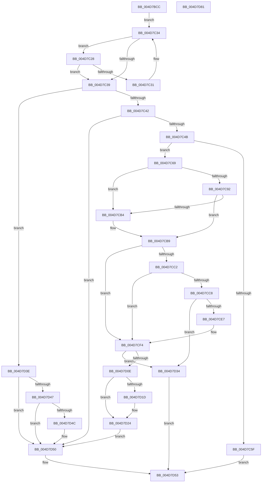

# HalpIommuGetHardwareDomain

- RVA: `0x004D7BCC`–`0x004D7D82` (길이 `438` bytes)
- VA: `0x00000001404D7BCC`
- 실행 섹션: `.text`
- PDB 이름 있음: `예`; PDB Function 태그: `아니요`
- unwind 정보 RVA: `0x0007BBB4`
- 디코드: `131`개 명령, `438/438` bytes 표시
- 미해석 바이트: `0` (있으면 어셈블리에 `.byte`로 보존)

> 이 문서는 커널 이미지의 기계어와 PDB 기호를 분석해 생성했습니다. 4번과 5번은 함수 원형과 자료형을 바이너리 사용 방식에서 추정한 C 해석이며 원본 소스 복구 결과는 아닙니다.

## 1. Dependencies

- 직접 호출 지점: **7**; 고유 호출 대상: **7**
- 직접 호출자로 확인된 함수: **5**
- RIP 상대 이미지 참조: **1**

### Outgoing calls
- `0x004D7C16` → [KeAcquireSpinLockRaiseToDpc](../20/KeAcquireSpinLockRaiseToDpc_function_00208470.md) (function, `0x00208470`)
- `0x004D7C52` → [HalpMmAllocCtxAlloc](../3E/HalpMmAllocCtxAlloc_function_003E10B8.md) (function, `0x003E10B8`)
- `0x004D7C71` → [memset](../6C/memset_function_006C6C40.md) (function, `0x006C6C40`)
- `0x004D7CDC` → [HalpIommuGetDmarptRootAddress](../56/HalpIommuGetDmarptRootAddress_function_00568EC0.md) (function, `0x00568EC0`)
- `0x004D7D03` → [HalpIommuAcquireNewDomain](../55/HalpIommuAcquireNewDomain_function_0055339C.md) (function, `0x0055339C`)
- `0x004D7D37` → [HalpMmAllocCtxFree](../3E/HalpMmAllocCtxFree_function_003E1904.md) (function, `0x003E1904`)
- `0x004D7D5C` → [KeReleaseSpinLock](../39/KeReleaseSpinLock_function_00392BA0.md) (function, `0x00392BA0`)

### Direct callers
- [HalpIommuLeaveDmaDomain](../4B/HalpIommuLeaveDmaDomain_function_004BF220.md) at `0x004BF2F7`
- [IommupDomainAttachPasidDevice](../54/IommupDomainAttachPasidDevice_function_0054F984.md) at `0x0054FAA7`
- [IommupDomainDetachPasidDevice](../54/IommupDomainDetachPasidDevice_function_0054FD50.md) at `0x0054FE90`
- [HalpIommuInitializeDmar](../55/HalpIommuInitializeDmar_function_0055541C.md) at `0x0055549E`
- [HalpIommuJoinDmaDomain](../55/HalpIommuJoinDmaDomain_function_005554E8.md) at `0x005555B2`
- [HalpIommuJoinDmaDomain](../55/HalpIommuJoinDmaDomain_function_005554E8.md) at `0x00555605`

### Static image references
- `0x004D7D3E` → RVA `0x00FC16B0` (`.data`; read)

## 2. Other-region calls and transfers

- 다른 실행 섹션으로 향하는 call: **0**
- 별도 외부 분기/꼬리 이동을 확인하지 못했습니다.

## 3. Assembly (complete function range)

```asm
004D7BCC  48 8B C4                        mov rax, rsp
004D7BCF  48 89 58 10                     mov qword ptr [rax + 0x10], rbx
004D7BD3  48 89 68 18                     mov qword ptr [rax + 0x18], rbp
004D7BD7  48 89 70 20                     mov qword ptr [rax + 0x20], rsi
004D7BDB  57                              push rdi
004D7BDC  41 54                           push r12
004D7BDE  41 55                           push r13
004D7BE0  41 56                           push r14
004D7BE2  41 57                           push r15
004D7BE4  48 83 EC 40                     sub rsp, 0x40
004D7BE8  48 83 60 C0 00                  and qword ptr [rax - 0x40], 0
004D7BED  33 DB                           xor ebx, ebx
004D7BEF  48 21 5C 24 20                  and qword ptr [rsp + 0x20], rbx
004D7BF4  48 8D 41 20                     lea rax, [rcx + 0x20]
004D7BF8  4C 8B BC 24 98 00 00 00         mov r15, qword ptr [rsp + 0x98]
004D7C00  48 8B F1                        mov rsi, rcx
004D7C03  48 8B C8                        mov rcx, rax
004D7C06  48 89 44 24 30                  mov qword ptr [rsp + 0x30], rax
004D7C0B  33 ED                           xor ebp, ebp
004D7C0D  41 8A F9                        mov dil, r9b
004D7C10  45 8A E0                        mov r12b, r8b
004D7C13  4C 8B EA                        mov r13, rdx
004D7C16  E8 55 08 D3 FF                  call 0x140208470
004D7C1B  4C 8D 76 10                     lea r14, [rsi + 0x10]
004D7C1F  88 44 24 70                     mov byte ptr [rsp + 0x70], al
004D7C23  49 8B 06                        mov rax, qword ptr [r14]
004D7C26  EB 0C                           jmp 0x1404d7c34
004D7C28  48 8B D8                        mov rbx, rax
004D7C2B  4C 39 68 18                     cmp qword ptr [rax + 0x18], r13
004D7C2F  74 08                           je 0x1404d7c39
004D7C31  48 8B 00                        mov rax, qword ptr [rax]
004D7C34  49 3B C6                        cmp rax, r14
004D7C37  75 EF                           jne 0x1404d7c28
004D7C39  49 3B C6                        cmp rax, r14
004D7C3C  0F 85 FC 00 00 00               jne 0x1404d7d3e
004D7C42  45 84 E4                        test r12b, r12b
004D7C45  0F 84 05 01 00 00               je 0x1404d7d50
004D7C4B  BF 90 00 00 00                  mov edi, 0x90
004D7C50  8B D7                           mov edx, edi
004D7C52  E8 61 94 F0 FF                  call 0x1403e10b8
004D7C57  48 8B D8                        mov rbx, rax
004D7C5A  48 85 C0                        test rax, rax
004D7C5D  75 0A                           jne 0x1404d7c69
004D7C5F  BD 9A 00 00 C0                  mov ebp, 0xc000009a
004D7C64  E9 EA 00 00 00                  jmp 0x1404d7d53
004D7C69  4C 8B C7                        mov r8, rdi
004D7C6C  33 D2                           xor edx, edx
004D7C6E  48 8B CB                        mov rcx, rbx
004D7C71  E8 CA EF 1E 00                  call 0x1406c6c40
004D7C76  48 C7 43 10 01 00 00 00         mov qword ptr [rbx + 0x10], 1
004D7C7E  48 8D 7B 20                     lea rdi, [rbx + 0x20]
004D7C82  4C 89 6B 18                     mov qword ptr [rbx + 0x18], r13
004D7C86  C7 07 01 00 00 00               mov dword ptr [rdi], 1
004D7C8C  40 38 6E 34                     cmp byte ptr [rsi + 0x34], bpl
004D7C90  74 22                           je 0x1404d7cb4
004D7C92  8A 4F 10                        mov cl, byte ptr [rdi + 0x10]
004D7C95  4C 8D 66 30                     lea r12, [rsi + 0x30]
004D7C99  8A 94 24 90 00 00 00            mov dl, byte ptr [rsp + 0x90]
004D7CA0  8A C2                           mov al, dl
004D7CA2  89 2F                           mov dword ptr [rdi], ebp
004D7CA4  C0 E0 02                        shl al, 2
004D7CA7  32 C1                           xor al, cl
004D7CA9  24 04                           and al, 4
004D7CAB  32 C1                           xor al, cl
004D7CAD  88 47 10                        mov byte ptr [rdi + 0x10], al
004D7CB0  84 D2                           test dl, dl
004D7CB2  75 05                           jne 0x1404d7cb9
004D7CB4  4C 8B 64 24 20                  mov r12, qword ptr [rsp + 0x20]
004D7CB9  48 8B 4E 28                     mov rcx, qword ptr [rsi + 0x28]
004D7CBD  48 85 C9                        test rcx, rcx
004D7CC0  74 32                           je 0x1404d7cf4
004D7CC2  40 38 6E 34                     cmp byte ptr [rsi + 0x34], bpl
004D7CC6  75 2C                           jne 0x1404d7cf4
004D7CC8  41 8B 95 D8 01 00 00            mov edx, dword ptr [r13 + 0x1d8]
004D7CCF  4C 8D 44 24 28                  lea r8, [rsp + 0x28]
004D7CD4  C1 EA 0D                        shr edx, 0xd
004D7CD7  83 E2 07                        and edx, 7
004D7CDA  FF C2                           inc edx
004D7CDC  E8 DF 11 09 00                  call 0x140568ec0
004D7CE1  8B E8                           mov ebp, eax
004D7CE3  85 C0                           test eax, eax
004D7CE5  78 4D                           js 0x1404d7d34
004D7CE7  48 8B 44 24 28                  mov rax, qword ptr [rsp + 0x28]
004D7CEC  48 89 47 28                     mov qword ptr [rdi + 0x28], rax
004D7CF0  C6 47 20 03                     mov byte ptr [rdi + 0x20], 3
004D7CF4  8B 46 0C                        mov eax, dword ptr [rsi + 0xc]
004D7CF7  4D 8B C4                        mov r8, r12
004D7CFA  48 8B D7                        mov rdx, rdi
004D7CFD  89 47 04                        mov dword ptr [rdi + 4], eax
004D7D00  49 8B CD                        mov rcx, r13
004D7D03  E8 94 B6 07 00                  call 0x14055339c
004D7D08  8B E8                           mov ebp, eax
004D7D0A  85 C0                           test eax, eax
004D7D0C  78 26                           js 0x1404d7d34
004D7D0E  8B 47 30                        mov eax, dword ptr [rdi + 0x30]
004D7D11  89 46 30                        mov dword ptr [rsi + 0x30], eax
004D7D14  49 8B 46 08                     mov rax, qword ptr [r14 + 8]
004D7D18  4C 39 30                        cmp qword ptr [rax], r14
004D7D1B  74 07                           je 0x1404d7d24
004D7D1D  B9 03 00 00 00                  mov ecx, 3
004D7D22  CD 29                           int 0x29
004D7D24  4C 89 33                        mov qword ptr [rbx], r14
004D7D27  48 89 43 08                     mov qword ptr [rbx + 8], rax
004D7D2B  48 89 18                        mov qword ptr [rax], rbx
004D7D2E  49 89 5E 08                     mov qword ptr [r14 + 8], rbx
004D7D32  EB 1C                           jmp 0x1404d7d50
004D7D34  48 8B D3                        mov rdx, rbx
004D7D37  E8 C8 9B F0 FF                  call 0x1403e1904
004D7D3C  EB 15                           jmp 0x1404d7d53
004D7D3E  48 3B 35 6B 99 AE 00            cmp rsi, qword ptr [rip + 0xae996b]
004D7D45  74 09                           je 0x1404d7d50
004D7D47  40 84 FF                        test dil, dil
004D7D4A  74 04                           je 0x1404d7d50
004D7D4C  48 FF 43 10                     inc qword ptr [rbx + 0x10]
004D7D50  49 89 1F                        mov qword ptr [r15], rbx
004D7D53  8A 54 24 70                     mov dl, byte ptr [rsp + 0x70]
004D7D57  48 8B 4C 24 30                  mov rcx, qword ptr [rsp + 0x30]
004D7D5C  E8 3F AE EB FF                  call 0x140392ba0
004D7D61  4C 8D 5C 24 40                  lea r11, [rsp + 0x40]
004D7D66  8B C5                           mov eax, ebp
004D7D68  49 8B 5B 38                     mov rbx, qword ptr [r11 + 0x38]
004D7D6C  49 8B 6B 40                     mov rbp, qword ptr [r11 + 0x40]
004D7D70  49 8B 73 48                     mov rsi, qword ptr [r11 + 0x48]
004D7D74  49 8B E3                        mov rsp, r11
004D7D77  41 5F                           pop r15
004D7D79  41 5E                           pop r14
004D7D7B  41 5D                           pop r13
004D7D7D  41 5C                           pop r12
004D7D7F  5F                              pop rdi
004D7D80  C3                              ret
004D7D81  CC                              int3
```

## 4. C-style interpretation (structured pseudocode)

```c
__int64 __fastcall HalpIommuGetHardwareDomain(__int64 a1, __int64 a2, unsigned __int8 a3, unsigned __int8 a4, unsigned __int8 a5, __int64 a6)
{
    __int64 result;
    __int64 v_r12;
    __int64 v_rbp;
    __int64 v_rbx;
    __int64 v_rsp;
    unsigned __int64 v_stack_m28;
    unsigned __int64 v_stack_m38;
    unsigned __int64 v_stack_m40;
    unsigned __int64 v_stack_m48;
    unsigned __int8 v_stack_p8;

    *(unsigned __int64 *)(v_rsp + 16) = v_rbx;
    *(unsigned __int64 *)(v_rsp + 24) = v_rbp;
    *(unsigned __int64 *)(v_rsp + 32) = v_rsi;
    v_rsp = (v_rsp) - (64);
    v_rbx = 0;
    v_stack_m38 = a1 + 32;
    v_rbp = 0;
    result = KeAcquireSpinLockRaiseToDpc(a1 + 32, a2, a3, a4);
    v_stack_p8 = (unsigned __int8)(result);
    goto loc_004D7C34;
loc_004D7C28:
    if ((*(unsigned __int64 *)(*(unsigned __int64 *)(a1 + 16) + 24)) == a2) goto loc_004D7C39;
loc_004D7C34:
    if ((*(unsigned __int64 *)(*(unsigned __int64 *)(a1 + 16))) != (a1 + 16)) goto loc_004D7C28;
loc_004D7C39:
    if ((*(unsigned __int64 *)(*(unsigned __int64 *)(a1 + 16))) != (a1 + 16)) goto loc_004D7D3E;
    if (a3 == 0) goto loc_004D7D50;
    result = HalpMmAllocCtxAlloc(a1 + 32, 144, a3, a4);
    if (result != 0) goto loc_004D7C69;
    goto loc_004D7D53;
loc_004D7C69:
    a2 = 0;
    result = memset(result, a2, 144, a4);
    *(unsigned __int64 *)(result + 16) = 1;
    *(unsigned __int64 *)(result + 24) = 0;
    *(unsigned int *)(result + 32) = 1;
    if ((*(unsigned __int8 *)(a1 + 52)) == ((unsigned __int8)((unsigned int)(0xC000009AULL)))) goto loc_004D7CB4;
    *(unsigned int *)(result + 32) = (unsigned int)((unsigned int)(0xC000009AULL));
    result = (unsigned __int8)((a5) << (2));
    result = (unsigned __int8)((result) ^ ((unsigned __int8)(*(unsigned __int8 *)(result + 32 + 16))));
    result = (unsigned __int8)((result) & (4));
    result = (unsigned __int8)((result) ^ ((unsigned __int8)(*(unsigned __int8 *)(result + 32 + 16))));
    *(unsigned __int8 *)(result + 32 + 16) = (unsigned __int8)(result);
    v_r12 = a1 + 48;
    if (a5 == 0) {
        v_r12 = v_stack_m48;
    }
    if (*(unsigned __int64 *)(a1 + 40) == 0) goto loc_004D7CF4;
    if ((*(unsigned __int8 *)(a1 + 52)) != ((unsigned __int8)((unsigned int)(0xC000009AULL)))) goto loc_004D7CF4;
    a2 = (unsigned int)(((unsigned int)(*(unsigned int *)(a2 + 472))) >> (13));
    a2 = (unsigned int)((a2) & (7));
    a2 = (unsigned int)((a2) + 1);
    result = HalpIommuGetDmarptRootAddress(*(unsigned __int64 *)(a1 + 40), a2, v_stack_m40, a4);
    if (sign_flag) goto loc_004D7D34;
    *(unsigned __int64 *)(result + 32 + 40) = v_stack_m40;
    *(unsigned __int8 *)(result + 32 + 32) = 3;
loc_004D7CF4:
    *(unsigned int *)(result + 32 + 4) = (unsigned int)((unsigned int)(*(unsigned int *)(a1 + 12)));
    result = HalpIommuAcquireNewDomain(a2, result + 32, v_r12, a4);
    if (sign_flag) goto loc_004D7D34;
    *(unsigned int *)(a1 + 48) = (unsigned int)((unsigned int)(*(unsigned int *)(result + 32 + 48)));
    if ((*(unsigned __int64 *)(*(unsigned __int64 *)(a1 + 16 + 8))) != (a1 + 16)) {
        a1 = 3;
    }
    *(unsigned __int64 *)(result) = a1 + 16;
    *(unsigned __int64 *)(result + 8) = *(unsigned __int64 *)(a1 + 16 + 8);
    *(unsigned __int64 *)(*(unsigned __int64 *)(a1 + 16 + 8)) = result;
    *(unsigned __int64 *)(a1 + 16 + 8) = result;
    goto loc_004D7D50;
loc_004D7D34:
    result = HalpMmAllocCtxFree(a1, result, v_r12, a4);
    goto loc_004D7D53;
loc_004D7D3E:
    if (a1 == (*(unsigned __int64 *)(v_rip + 11442539))) goto loc_004D7D50;
    if ((unsigned __int8)(result + 32) != 0) {
    }
    *(unsigned __int64 *)(a6) = result;
loc_004D7D53:
    result = KeReleaseSpinLock(v_stack_m38, v_stack_p8, v_r12, a4);
    return (unsigned int)((unsigned int)((unsigned int)((unsigned int)(result))));
}
```

## 5. (Beta) C Style

```c
int64_t HalpIommuGetHardwareDomain(void *Arg1, void *Arg2, uint8_t Arg3, uint8_t Arg4, uint8_t Arg5, void *Arg6)
{
    uint8_t *arg1 = (uint8_t *)Arg1;
    uint8_t *arg2 = (uint8_t *)Arg2;
    uint8_t *arg6 = (uint8_t *)Arg6;

    int64_t result;
    int64_t local_r12;
    int64_t local_rbp;
    int64_t local_rbx;
    int64_t local_rsp;
    uint64_t v_stack_m28;
    uint64_t v_stack_m38;
    uint64_t v_stack_m40;
    uint64_t v_stack_m48;
    uint8_t v_stack_p8;

    *(uint64_t *)(local_rsp + 0x10) = local_rbx;
    *(uint64_t *)(local_rsp + 0x18) = local_rbp;
    *(uint64_t *)(local_rsp + 0x20) = local_rsi;
    local_rsp = (local_rsp) - (64);
    local_rbx = 0;
    v_stack_m38 = Arg1 + 32;
    local_rbp = 0;
    result = KeAcquireSpinLockRaiseToDpc(Arg1 + 32, Arg2, Arg3, Arg4);
    v_stack_p8 = (uint8_t)(result);
    goto loc_004D7C34;
loc_004D7C28:
    if ((*(uint64_t *)(*(uint64_t *)(arg1 + 0x10) + 0x18)) == Arg2) goto loc_004D7C39;
loc_004D7C34:
    if ((*(uint64_t *)(*(uint64_t *)(arg1 + 0x10))) != (Arg1 + 16)) goto loc_004D7C28;
loc_004D7C39:
    if ((*(uint64_t *)(*(uint64_t *)(arg1 + 0x10))) != (Arg1 + 16)) goto loc_004D7D3E;
    if (Arg3 == 0) goto loc_004D7D50;
    result = HalpMmAllocCtxAlloc(Arg1 + 32, 144, Arg3, Arg4);
    if (result != 0) goto loc_004D7C69;
    goto loc_004D7D53;
loc_004D7C69:
    Arg2 = 0;
    result = memset(result, Arg2, 144, Arg4);
    *(uint64_t *)(result + 0x10) = 1;
    *(uint64_t *)(result + 0x18) = 0;
    *(uint32_t *)(result + 0x20) = 1;
    if ((*(uint8_t *)(arg1 + 0x34)) == ((uint8_t)((uint32_t)(0xC000009AULL)))) goto loc_004D7CB4;
    *(uint32_t *)(result + 0x20) = (uint32_t)((uint32_t)(0xC000009AULL));
    result = (uint8_t)((Arg5) << (2));
    result = (uint8_t)((result) ^ ((uint8_t)(*(uint8_t *)(result + 0x20 + 0x10))));
    result = (uint8_t)((result) & (4));
    result = (uint8_t)((result) ^ ((uint8_t)(*(uint8_t *)(result + 0x20 + 0x10))));
    *(uint8_t *)(result + 0x20 + 0x10) = (uint8_t)(result);
    local_r12 = Arg1 + 48;
    if (Arg5 == 0) {
        local_r12 = v_stack_m48;
    }
    if (*(uint64_t *)(arg1 + 0x28) == 0) goto loc_004D7CF4;
    if ((*(uint8_t *)(arg1 + 0x34)) != ((uint8_t)((uint32_t)(0xC000009AULL)))) goto loc_004D7CF4;
    Arg2 = (uint32_t)(((uint32_t)(*(uint32_t *)(arg2 + 0x1D8))) >> (13));
    Arg2 = (uint32_t)((Arg2) & (7));
    Arg2 = (uint32_t)((Arg2) + 1);
    result = HalpIommuGetDmarptRootAddress(*(uint64_t *)(arg1 + 0x28), Arg2, v_stack_m40, Arg4);
    if (sign_flag) goto loc_004D7D34;
    *(uint64_t *)(result + 0x20 + 0x28) = v_stack_m40;
    *(uint8_t *)(result + 0x20 + 0x20) = 3;
loc_004D7CF4:
    *(uint32_t *)(result + 0x20 + 0x4) = (uint32_t)((uint32_t)(*(uint32_t *)(arg1 + 0xC)));
    result = HalpIommuAcquireNewDomain(Arg2, result + 32, local_r12, Arg4);
    if (sign_flag) goto loc_004D7D34;
    *(uint32_t *)(arg1 + 0x30) = (uint32_t)((uint32_t)(*(uint32_t *)(result + 0x20 + 0x30)));
    if ((*(uint64_t *)(*(uint64_t *)(arg1 + 0x10 + 0x8))) != (Arg1 + 16)) {
        Arg1 = 3;
    }
    *(void **)(result) = Arg1 + 16;
    *(uint64_t *)(result + 0x8) = *(uint64_t *)(arg1 + 0x10 + 0x8);
    *(uint64_t *)(*(uint64_t *)(arg1 + 0x10 + 0x8)) = result;
    *(uint64_t *)(arg1 + 0x10 + 0x8) = result;
    goto loc_004D7D50;
loc_004D7D34:
    result = HalpMmAllocCtxFree(Arg1, result, local_r12, Arg4);
    goto loc_004D7D53;
loc_004D7D3E:
    if (Arg1 == (*(uint64_t *)(v_rip + 0xAE996B))) goto loc_004D7D50;
    if ((uint8_t)(result + 32) != 0) {
    }
    *(uint64_t *)(arg6) = result;
loc_004D7D53:
    result = KeReleaseSpinLock(v_stack_m38, v_stack_p8, local_r12, Arg4);
    return (uint32_t)((uint32_t)((uint32_t)((uint32_t)(result))));
}
```

### 관측된 메모리 오프셋

구조체 형식이 확인되지 않은 접근은 인자 기준의 오프셋으로만 기록했습니다.

| 기준 인자 | 오프셋 표현 | 폭 (bit) | 접근 |
|---|---:|---:|---|
| `Arg1` | `+ 0x0` | `64` | `R` |
| `Arg1` | `+ 0x8` | `64` | `R` |
| `Arg1` | `+ 0x8` | `64` | `W` |
| `Arg1` | `+ 0xC` | `32` | `R` |
| `Arg1` | `+ 0x10` | `64` | `R` |
| `Arg1` | `+ 0x20` | `64` | `R` |
| `Arg1` | `+ 0x28` | `64` | `R` |
| `Arg1` | `+ 0x30` | `32` | `W` |
| `Arg1` | `+ 0x30` | `64` | `R` |
| `Arg1` | `+ 0x34` | `8` | `R` |
| `Arg2` | `+ 0x1D8` | `32` | `R` |
| `Arg6` | `+ 0x0` | `64` | `W` |

## 6. Execution-region graph

[열기: 2D/3D 그래프와 함수 탐색 컨트롤 패널](../../../control-panel.html?section=text&rva=0x004D7BCC&view=graph)

- 2D 그래프는 위에서 아래로 흐르고, 3D 그래프는 빈 공간을 드래그해 회전합니다. Shift+드래그는 이동, 휠은 확대·축소, 함수 노드 선택은 대상 보고서 이동입니다.

### Static fallback


