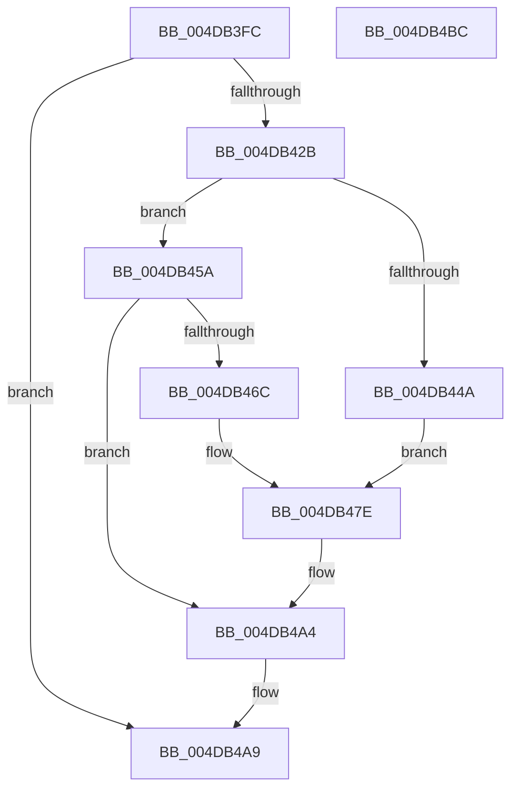

# HalpMcUpdateMicrocode

- RVA: `0x004DB3FC`–`0x004DB4BD` (길이 `193` bytes)
- VA: `0x00000001404DB3FC`
- 실행 섹션: `.text`
- PDB 이름 있음: `예`; PDB Function 태그: `아니요`
- unwind 정보 RVA: `0x000606C0`
- 디코드: `48`개 명령, `193/193` bytes 표시
- 미해석 바이트: `0` (있으면 어셈블리에 `.byte`로 보존)

> 이 문서는 커널 이미지의 기계어와 PDB 기호를 분석해 생성했습니다. 4번과 5번은 함수 원형과 자료형을 바이너리 사용 방식에서 추정한 C 해석이며 원본 소스 복구 결과는 아닙니다.

## 1. Dependencies

- 직접 호출 지점: **3**; 고유 호출 대상: **3**
- 직접 호출자로 확인된 함수: **5**
- RIP 상대 이미지 참조: **2**

### Outgoing calls
- `0x004DB41F` → [PrExtApplyPatch](../4F/PrExtApplyPatch_function_004FB058.md) (function, `0x004FB058`)
- `0x004DB49E` → [KeBugCheckEx](../4F/KeBugCheckEx_function_004FD660.md) (function, `0x004FD660`)
- `0x004DB4B1` → [_security_check_cookie](../6A/_security_check_cookie_function_006AC640.md) (function, `0x006AC640`)

### Direct callers
- [HalpMcLoadMicrocodeWorker](../55/HalpMcLoadMicrocodeWorker_function_0055B0B0.md) at `0x0055B0FB`
- [HalpMcLoadMicrocodeWorker](../55/HalpMcLoadMicrocodeWorker_function_0055B0B0.md) at `0x0055B121`
- [HalpLoadMicrocodeSerialized](../../page/70/HalpLoadMicrocodeSerialized_function_0070B450.md) at `0x0070B4E2`
- [HalpProcInitSystem](../../pagelk/B5/HalpProcInitSystem_function_00B5D440.md) at `0x00B5D4C9`
- [HalpPostSleepMP](../../pagelk/B5/HalpPostSleepMP_function_00B5ECC4.md) at `0x00B5EE21`
- [HalpDpPostReplaceInitialization](../../pagelk/B5/HalpDpPostReplaceInitialization_function_00B5FE3C.md) at `0x00B5FEC9`

### Static image references
- `0x004DB402` → RVA `0x00E0A740` (`.data`; read)
- `0x004DB411` → RVA `0x00FC19F0` (`.data`; read)

## 2. Other-region calls and transfers

- 다른 실행 섹션으로 향하는 call: **0**
- 별도 외부 분기/꼬리 이동을 확인하지 못했습니다.

## 3. Assembly (complete function range)

```asm
004DB3FC  40 53                           push rbx
004DB3FE  48 83 EC 50                     sub rsp, 0x50
004DB402  48 8B 05 37 F3 92 00            mov rax, qword ptr [rip + 0x92f337]
004DB409  48 33 C4                        xor rax, rsp
004DB40C  48 89 44 24 40                  mov qword ptr [rsp + 0x40], rax
004DB411  8B 15 D9 65 AE 00               mov edx, dword ptr [rip + 0xae65d9]
004DB417  0F 57 C0                        xorps xmm0, xmm0
004DB41A  0F 11 44 24 30                  movups xmmword ptr [rsp + 0x30], xmm0
004DB41F  E8 34 FC 01 00                  call 0x1404fb058
004DB424  3D 3E 00 00 C0                  cmp eax, 0xc000003e
004DB429  75 7E                           jne 0x1404db4a9
004DB42B  B8 01 00 00 00                  mov eax, 1
004DB430  33 C9                           xor ecx, ecx
004DB432  0F A2                           cpuid
004DB434  89 44 24 30                     mov dword ptr [rsp + 0x30], eax
004DB438  65 48 8B 04 25 20 00 00 00      mov rax, qword ptr gs:[0x20]
004DB441  80 B8 8D 00 00 00 01            cmp byte ptr [rax + 0x8d], 1
004DB448  75 10                           jne 0x1404db45a
004DB44A  B9 8B 00 00 00                  mov ecx, 0x8b
004DB44F  0F 32                           rdmsr
004DB451  48 C1 E2 20                     shl rdx, 0x20
004DB455  48 0B D0                        or rdx, rax
004DB458  EB 24                           jmp 0x1404db47e
004DB45A  65 48 8B 04 25 20 00 00 00      mov rax, qword ptr gs:[0x20]
004DB463  80 B8 8D 00 00 00 02            cmp byte ptr [rax + 0x8d], 2
004DB46A  75 38                           jne 0x1404db4a4
004DB46C  B9 8B 00 00 00                  mov ecx, 0x8b
004DB471  0F 32                           rdmsr
004DB473  48 C1 E2 20                     shl rdx, 0x20
004DB477  48 0B D0                        or rdx, rax
004DB47A  48 C1 EA 20                     shr rdx, 0x20
004DB47E  65 48 8B 04 25 20 00 00 00      mov rax, qword ptr gs:[0x20]
004DB487  45 33 C0                        xor r8d, r8d
004DB48A  44 8B CA                        mov r9d, edx
004DB48D  8B 54 24 30                     mov edx, dword ptr [rsp + 0x30]
004DB491  8B 48 24                        mov ecx, dword ptr [rax + 0x24]
004DB494  48 89 4C 24 20                  mov qword ptr [rsp + 0x20], rcx
004DB499  B9 7E 01 00 00                  mov ecx, 0x17e
004DB49E  E8 BD 21 02 00                  call 0x1404fd660
004DB4A3  CC                              int3
004DB4A4  B8 60 02 00 C0                  mov eax, 0xc0000260
004DB4A9  48 8B 4C 24 40                  mov rcx, qword ptr [rsp + 0x40]
004DB4AE  48 33 CC                        xor rcx, rsp
004DB4B1  E8 8A 11 1D 00                  call 0x1406ac640
004DB4B6  48 83 C4 50                     add rsp, 0x50
004DB4BA  5B                              pop rbx
004DB4BB  C3                              ret
004DB4BC  CC                              int3
```

## 4. C-style interpretation (structured pseudocode)

```c
__int64 __fastcall HalpMcUpdateMicrocode(int a1, __int64 a2, int a3)
{
    __int64 result;
    __int64 v_rsp;
    unsigned __int64 v_stack_m18;
    unsigned __int64 v_stack_m28;
    unsigned __int64 v_stack_m38;

    v_rsp = (v_rsp) - (80);
    result = (*(unsigned __int64 *)(v_rip + 9630519)) ^ (v_rsp);
    v_stack_m18 = result;
    v_stack_m28 = v_xmm0;
    result = PrExtApplyPatch(a1, (unsigned int)(*(unsigned int *)(v_rip + 11429337)), a3, a4);
    if (((unsigned int)(result)) != 0xC000003EULL) goto loc_004DB4A9;
    a1 = 0;
    v_stack_m28 = 1;
    if ((*(unsigned __int8 *)(*(unsigned __int64 *)(gs_base + (0 + 32)) + 141)) != 1) goto loc_004DB45A;
    a2 = ((unsigned int)(*(unsigned int *)(v_rip + 11429337))) << (32);
    a2 = (a2) | (*(unsigned __int64 *)(gs_base + (0 + 32)));
    goto loc_004DB47E;
loc_004DB45A:
    if ((*(unsigned __int8 *)(*(unsigned __int64 *)(gs_base + (0 + 32)) + 141)) != 2) goto loc_004DB4A4;
    a2 = (a2) << (32);
    a2 = (a2) | (*(unsigned __int64 *)(gs_base + (0 + 32)));
    a2 = (a2) >> (32);
loc_004DB47E:
    a3 = 0;
    v_stack_m38 = (unsigned int)(*(unsigned int *)(*(unsigned __int64 *)(gs_base + (0 + 32)) + 36));
    result = KeBugCheckEx(382, (unsigned int)(v_stack_m28), a3, (unsigned int)((unsigned int)(a2)));
loc_004DB4A4:
loc_004DB4A9:
    a1 = (v_stack_m18) ^ (v_rsp);
    result = _security_check_cookie(a1, (unsigned int)(v_stack_m28), a3, (unsigned int)((unsigned int)(a2)));
    v_rsp = (v_rsp) + (80);
    return result;
}
```

## 5. (Beta) C Style

```c
int64_t HalpMcUpdateMicrocode(int32_t Arg1, int64_t Arg2, int32_t Arg3)
{
    int64_t result;
    int64_t local_rsp;
    uint64_t v_stack_m18;
    uint64_t v_stack_m28;
    uint64_t v_stack_m38;

    local_rsp = (local_rsp) - (80);
    result = (*(uint64_t *)(v_rip + 0x92F337)) ^ (local_rsp);
    v_stack_m18 = result;
    v_stack_m28 = v_xmm0;
    result = PrExtApplyPatch(Arg1, (uint32_t)(*(uint32_t *)(v_rip + 0xAE65D9)), Arg3, a4);
    if (((uint32_t)(result)) != 0xC000003EULL) goto loc_004DB4A9;
    Arg1 = 0;
    v_stack_m28 = 1;
    if ((*(uint8_t *)(*(uint64_t *)(gs_base + (0 + 0x20)) + 0x8D)) != 1) goto loc_004DB45A;
    Arg2 = ((uint32_t)(*(uint32_t *)(v_rip + 0xAE65D9))) << (32);
    Arg2 = (Arg2) | (*(uint64_t *)(gs_base + (0 + 0x20)));
    goto loc_004DB47E;
loc_004DB45A:
    if ((*(uint8_t *)(*(uint64_t *)(gs_base + (0 + 0x20)) + 0x8D)) != 2) goto loc_004DB4A4;
    Arg2 = (Arg2) << (32);
    Arg2 = (Arg2) | (*(uint64_t *)(gs_base + (0 + 0x20)));
    Arg2 = (Arg2) >> (32);
loc_004DB47E:
    Arg3 = 0;
    v_stack_m38 = (uint32_t)(*(uint32_t *)(*(uint64_t *)(gs_base + (0 + 0x20)) + 0x24));
    result = KeBugCheckEx(382, (uint32_t)(v_stack_m28), Arg3, (uint32_t)((uint32_t)(Arg2)));
loc_004DB4A4:
loc_004DB4A9:
    Arg1 = (v_stack_m18) ^ (local_rsp);
    result = _security_check_cookie(Arg1, (uint32_t)(v_stack_m28), Arg3, (uint32_t)((uint32_t)(Arg2)));
    local_rsp = (local_rsp) + (80);
    return result;
}
```

## 6. Execution-region graph

[열기: 2D/3D 그래프와 함수 탐색 컨트롤 패널](../../../control-panel.html?section=text&rva=0x004DB3FC&view=graph)

- 2D 그래프는 위에서 아래로 흐르고, 3D 그래프는 빈 공간을 드래그해 회전합니다. Shift+드래그는 이동, 휠은 확대·축소, 함수 노드 선택은 대상 보고서 이동입니다.

### Static fallback


