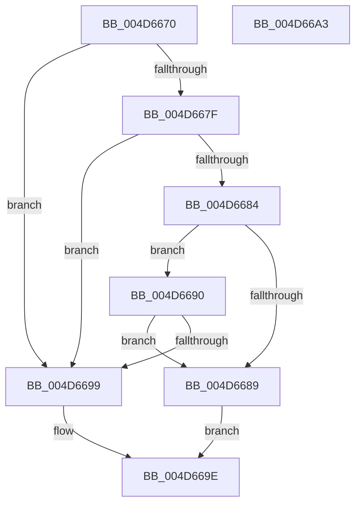

# HalpMcUpdatePostUpdate

- RVA: `0x004D6670`–`0x004D66A4` (길이 `52` bytes)
- VA: `0x00000001404D6670`
- 실행 섹션: `.text`
- PDB 이름 있음: `예`; PDB Function 태그: `아니요`
- unwind 정보 RVA: `0x0005C788`
- 디코드: `17`개 명령, `52/52` bytes 표시
- 미해석 바이트: `0` (있으면 어셈블리에 `.byte`로 보존)

> 이 문서는 커널 이미지의 기계어와 PDB 기호를 분석해 생성했습니다. 4번과 5번은 함수 원형과 자료형을 바이너리 사용 방식에서 추정한 C 해석이며 원본 소스 복구 결과는 아닙니다.

## 1. Dependencies

- 직접 호출 지점: **2**; 고유 호출 대상: **2**
- 직접 호출자로 확인된 함수: **2**
- RIP 상대 이미지 참조: **1**

### Outgoing calls
- `0x004D6690` → [Feature_Microcode_Client_CD__private_IsEnabledDeviceUsageNoInline](../66/Feature_Microcode_Client_CD__private_IsEnabledDeviceUsageNoInline_function_00666A18.md) (function, `0x00666A18`)
- `0x004D6699` → [MicrocodeLogRegistry](../66/MicrocodeLogRegistry_function_00667340.md) (function, `0x00667340`)

### Direct callers
- [HalpLoadMicrocode](../../page/70/HalpLoadMicrocode_function_0070B200.md) at `0x0070B3E3`
- [HalpProcInitSystem](../../pagelk/B5/HalpProcInitSystem_function_00B5D440.md) at `0x00B5D488`

### Static image references
- `0x004D6674` → RVA `0x00F9053C` (`.data`; read)

## 2. Other-region calls and transfers

- 다른 실행 섹션으로 향하는 call: **0**
- 별도 외부 분기/꼬리 이동을 확인하지 못했습니다.

## 3. Assembly (complete function range)

```asm
004D6670  48 83 EC 28                     sub rsp, 0x28
004D6674  8B 0D C2 9E AB 00               mov ecx, dword ptr [rip + 0xab9ec2]
004D667A  83 E9 01                        sub ecx, 1
004D667D  74 1A                           je 0x1404d6699
004D667F  83 E9 01                        sub ecx, 1
004D6682  74 15                           je 0x1404d6699
004D6684  83 F9 0B                        cmp ecx, 0xb
004D6687  74 07                           je 0x1404d6690
004D6689  B8 BB 00 00 C0                  mov eax, 0xc00000bb
004D668E  EB 0E                           jmp 0x1404d669e
004D6690  E8 83 03 19 00                  call 0x140666a18
004D6695  85 C0                           test eax, eax
004D6697  74 F0                           je 0x1404d6689
004D6699  E8 A2 0C 19 00                  call 0x140667340
004D669E  48 83 C4 28                     add rsp, 0x28
004D66A2  C3                              ret
004D66A3  CC                              int3
```

## 4. C-style interpretation (structured pseudocode)

```c
__int64 __fastcall HalpMcUpdatePostUpdate(void)
{
    __int64 result;
    __int64 v_rsp;

    v_rsp = (v_rsp) - (40);
    a1 = (unsigned int)(((unsigned int)(*(unsigned int *)(v_rip + 11247298))) - (1));
    if (condition_is_equal) goto loc_004D6699;
    a1 = (unsigned int)((a1) - (1));
    if (condition_is_equal) goto loc_004D6699;
    if (((unsigned int)(a1)) == 11) goto loc_004D6690;
loc_004D6689:
    goto loc_004D669E;
loc_004D6690:
    result = Feature_Microcode_Client_CD__private_IsEnabledDeviceUsageNoInline(a1, a2, a3, a4);
    if ((unsigned int)(result) == 0) goto loc_004D6689;
loc_004D6699:
    result = MicrocodeLogRegistry(a1, a2, a3, a4);
loc_004D669E:
    v_rsp = (v_rsp) + (40);
    return result;
}
```

## 5. (Beta) C Style

```c
void HalpMcUpdatePostUpdate(void)
{
    int64_t result;
    int64_t local_rsp;

    local_rsp = (local_rsp) - (40);
    a1 = (uint32_t)(((uint32_t)(*(uint32_t *)(v_rip + 0xAB9EC2))) - (1));
    if (condition_is_equal) goto loc_004D6699;
    a1 = (uint32_t)((a1) - (1));
    if (condition_is_equal) goto loc_004D6699;
    if (((uint32_t)(a1)) == 11) goto loc_004D6690;
loc_004D6689:
    goto loc_004D669E;
loc_004D6690:
    result = Feature_Microcode_Client_CD__private_IsEnabledDeviceUsageNoInline(a1, a2, a3, a4);
    if ((uint32_t)(result) == 0) goto loc_004D6689;
loc_004D6699:
    result = MicrocodeLogRegistry(a1, a2, a3, a4);
loc_004D669E:
    local_rsp = (local_rsp) + (40);
    return result;
}
```

## 6. Execution-region graph

[열기: 2D/3D 그래프와 함수 탐색 컨트롤 패널](../../../control-panel.html?section=text&rva=0x004D6670&view=graph)

- 2D 그래프는 위에서 아래로 흐르고, 3D 그래프는 빈 공간을 드래그해 회전합니다. Shift+드래그는 이동, 휠은 확대·축소, 함수 노드 선택은 대상 보고서 이동입니다.

### Static fallback


