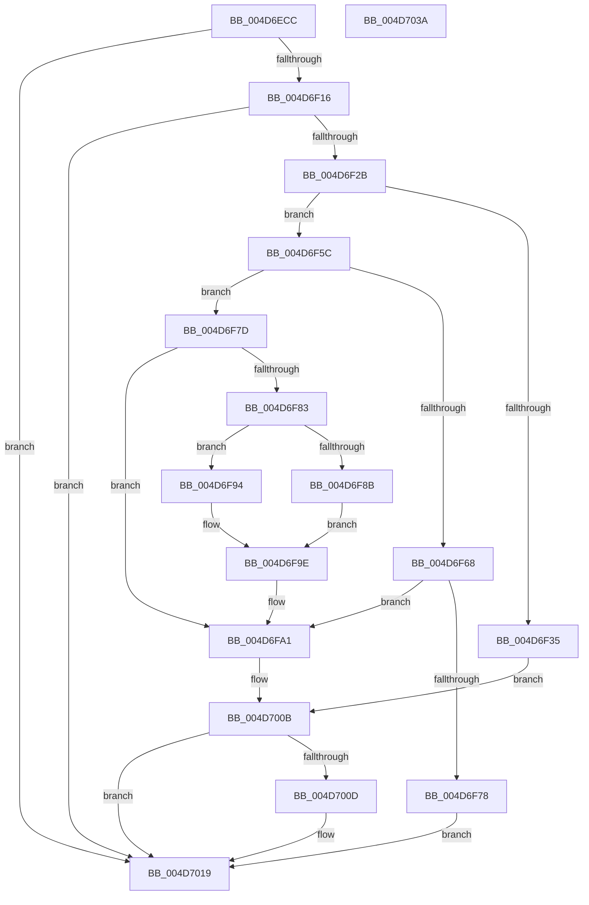

# HalpTimerEnableHypervisorTimer

- RVA: `0x004D6ECC`–`0x004D703B` (길이 `367` bytes)
- VA: `0x00000001404D6ECC`
- 실행 섹션: `.text`
- PDB 이름 있음: `예`; PDB Function 태그: `아니요`
- unwind 정보 RVA: `0x000BC800`
- 디코드: `90`개 명령, `367/367` bytes 표시
- 미해석 바이트: `0` (있으면 어셈블리에 `.byte`로 보존)

> 이 문서는 커널 이미지의 기계어와 PDB 기호를 분석해 생성했습니다. 4번과 5번은 함수 원형과 자료형을 바이너리 사용 방식에서 추정한 C 해석이며 원본 소스 복구 결과는 아닙니다.

## 1. Dependencies

- 직접 호출 지점: **8**; 고유 호출 대상: **6**
- 직접 호출자로 확인된 함수: **2**
- RIP 상대 이미지 참조: **4**

### Outgoing calls
- `0x004D6F1E` → [guard_dispatch_icall](../6B/guard_dispatch_icall_function_006BAAD0.md) (function, `0x006BAAD0`)
- `0x004D6F50` → [guard_dispatch_icall](../6B/guard_dispatch_icall_function_006BAAD0.md) (function, `0x006BAAD0`)
- `0x004D6F6F` → [HalpInterruptGsiToLine](../2D/HalpInterruptGsiToLine_function_002D2DD0.md) (function, `0x002D2DD0`)
- `0x004D6FC2` → [HalpAcquireHighLevelLock](../2D/HalpAcquireHighLevelLock_function_002D2390.md) (function, `0x002D2390`)
- `0x004D6FF3` → [HalpInterruptSetLineState](../48/HalpInterruptSetLineState_function_0048A0C8.md) (function, `0x0048A0C8`)
- `0x004D7004` → [HalpReleaseHighLevelLock](../2D/HalpReleaseHighLevelLock_function_002D1C58.md) (function, `0x002D1C58`)
- `0x004D7014` → [guard_dispatch_icall](../6B/guard_dispatch_icall_function_006BAAD0.md) (function, `0x006BAAD0`)
- `0x004D7020` → [_security_check_cookie](../6A/_security_check_cookie_function_006AC640.md) (function, `0x006AC640`)

### Direct callers
- [HalpTimerInitializeHypervisorTimer](../54/HalpTimerInitializeHypervisorTimer_function_0054B8F4.md) at `0x0054BB86`
- [HalpAcpiPostSleep](../../pagelk/B7/HalpAcpiPostSleep_function_00B79990.md) at `0x00B79B12`

### Static image references
- `0x004D6EE1` → RVA `0x00E0A740` (`.data`; read)
- `0x004D6EEF` → RVA `0x00FC4110` (`.data`; read)
- `0x004D6FA9` → RVA `0x00FC19A8` (`.data`; read)
- `0x004D700D` → RVA `0x00FC1CC8` (`.data`; read)

## 2. Other-region calls and transfers

- 다른 실행 섹션으로 향하는 call: **0**
- 별도 외부 분기/꼬리 이동을 확인하지 못했습니다.

## 3. Assembly (complete function range)

```asm
004D6ECC  48 89 5C 24 08                  mov qword ptr [rsp + 8], rbx
004D6ED1  48 89 7C 24 10                  mov qword ptr [rsp + 0x10], rdi
004D6ED6  55                              push rbp
004D6ED7  48 8B EC                        mov rbp, rsp
004D6EDA  48 81 EC 80 00 00 00            sub rsp, 0x80
004D6EE1  48 8B 05 58 38 93 00            mov rax, qword ptr [rip + 0x933858]
004D6EE8  48 33 C4                        xor rax, rsp
004D6EEB  48 89 45 F8                     mov qword ptr [rbp - 8], rax
004D6EEF  48 8B 1D 1A D2 AE 00            mov rbx, qword ptr [rip + 0xaed21a]
004D6EF6  33 C0                           xor eax, eax
004D6EF8  21 45 DC                        and dword ptr [rbp - 0x24], eax
004D6EFB  0F 57 C0                        xorps xmm0, xmm0
004D6EFE  48 21 45 C0                     and qword ptr [rbp - 0x40], rax
004D6F02  89 45 D4                        mov dword ptr [rbp - 0x2c], eax
004D6F05  48 21 45 D4                     and qword ptr [rbp - 0x2c], rax
004D6F09  0F 11 45 E8                     movups xmmword ptr [rbp - 0x18], xmm0
004D6F0D  48 85 DB                        test rbx, rbx
004D6F10  0F 84 03 01 00 00               je 0x1404d7019
004D6F16  48 8B 43 68                     mov rax, qword ptr [rbx + 0x68]
004D6F1A  48 8B 4B 48                     mov rcx, qword ptr [rbx + 0x48]
004D6F1E  E8 AD 3B 1E 00                  call 0x1406baad0
004D6F23  85 C0                           test eax, eax
004D6F25  0F 88 EE 00 00 00               js 0x1404d7019
004D6F2B  8B 83 B8 00 00 00               mov eax, dword ptr [rbx + 0xb8]
004D6F31  A8 10                           test al, 0x10
004D6F33  74 27                           je 0x1404d6f5c
004D6F35  48 8B 83 98 00 00 00            mov rax, qword ptr [rbx + 0x98]
004D6F3C  B2 01                           mov dl, 1
004D6F3E  44 8B 8B F0 00 00 00            mov r9d, dword ptr [rbx + 0xf0]
004D6F45  4C 8B 83 E8 00 00 00            mov r8, qword ptr [rbx + 0xe8]
004D6F4C  48 8B 4B 48                     mov rcx, qword ptr [rbx + 0x48]
004D6F50  E8 7B 3B 1E 00                  call 0x1406baad0
004D6F55  85 C0                           test eax, eax
004D6F57  E9 AF 00 00 00                  jmp 0x1404d700b
004D6F5C  8B 83 E0 00 00 00               mov eax, dword ptr [rbx + 0xe0]
004D6F62  0F BA E0 09                     bt eax, 9
004D6F66  73 15                           jae 0x1404d6f7d
004D6F68  8B 4B 58                        mov ecx, dword ptr [rbx + 0x58]
004D6F6B  48 8D 55 C0                     lea rdx, [rbp - 0x40]
004D6F6F  E8 5C BE DF FF                  call 0x1402d2dd0
004D6F74  85 C0                           test eax, eax
004D6F76  79 29                           jns 0x1404d6fa1
004D6F78  E9 9C 00 00 00                  jmp 0x1404d7019
004D6F7D  0F BA E0 08                     bt eax, 8
004D6F81  73 1E                           jae 0x1404d6fa1
004D6F83  8B 43 54                        mov eax, dword ptr [rbx + 0x54]
004D6F86  83 F8 08                        cmp eax, 8
004D6F89  73 09                           jae 0x1404d6f94
004D6F8B  C7 45 C0 00 B0 00 00            mov dword ptr [rbp - 0x40], 0xb000
004D6F92  EB 0A                           jmp 0x1404d6f9e
004D6F94  C7 45 C0 01 B0 00 00            mov dword ptr [rbp - 0x40], 0xb001
004D6F9B  83 C0 F8                        add eax, -8
004D6F9E  89 45 C4                        mov dword ptr [rbp - 0x3c], eax
004D6FA1  83 4D C8 FF                     or dword ptr [rbp - 0x38], 0xffffffff
004D6FA5  48 8D 45 E8                     lea rax, [rbp - 0x18]
004D6FA9  48 8D 0D F8 A9 AE 00            lea rcx, [rip + 0xaea9f8]
004D6FB0  48 89 45 E0                     mov qword ptr [rbp - 0x20], rax
004D6FB4  C7 45 D0 03 00 00 00            mov dword ptr [rbp - 0x30], 3
004D6FBB  C7 45 CC 01 00 00 00            mov dword ptr [rbp - 0x34], 1
004D6FC2  E8 C9 B3 DF FF                  call 0x1402d2390
004D6FC7  8B 53 5C                        mov edx, dword ptr [rbx + 0x5c]
004D6FCA  48 8D 4D C0                     lea rcx, [rbp - 0x40]
004D6FCE  44 8B 4B 60                     mov r9d, dword ptr [rbx + 0x60]
004D6FD2  40 8A F8                        mov dil, al
004D6FD5  48 8D 45 C8                     lea rax, [rbp - 0x38]
004D6FD9  41 B0 0F                        mov r8b, 0xf
004D6FDC  48 89 44 24 30                  mov qword ptr [rsp + 0x30], rax
004D6FE1  48 8D 45 D0                     lea rax, [rbp - 0x30]
004D6FE5  48 89 44 24 28                  mov qword ptr [rsp + 0x28], rax
004D6FEA  89 54 24 20                     mov dword ptr [rsp + 0x20], edx
004D6FEE  BA D4 00 00 00                  mov edx, 0xd4
004D6FF3  E8 D0 30 FB FF                  call 0x14048a0c8
004D6FF8  40 8A D7                        mov dl, dil
004D6FFB  48 8D 0D A6 A9 AE 00            lea rcx, [rip + 0xaea9a6]
004D7002  8B D8                           mov ebx, eax
004D7004  E8 4F AC DF FF                  call 0x1402d1c58
004D7009  85 DB                           test ebx, ebx
004D700B  78 0C                           js 0x1404d7019
004D700D  48 8B 05 B4 AC AE 00            mov rax, qword ptr [rip + 0xaeacb4]
004D7014  E8 B7 3A 1E 00                  call 0x1406baad0
004D7019  48 8B 4D F8                     mov rcx, qword ptr [rbp - 8]
004D701D  48 33 CC                        xor rcx, rsp
004D7020  E8 1B 56 1D 00                  call 0x1406ac640
004D7025  4C 8D 9C 24 80 00 00 00         lea r11, [rsp + 0x80]
004D702D  49 8B 5B 10                     mov rbx, qword ptr [r11 + 0x10]
004D7031  49 8B 7B 18                     mov rdi, qword ptr [r11 + 0x18]
004D7035  49 8B E3                        mov rsp, r11
004D7038  5D                              pop rbp
004D7039  C3                              ret
004D703A  CC                              int3
```

## 4. C-style interpretation (structured pseudocode)

```c
__int64 __fastcall HalpTimerEnableHypervisorTimer(void)
{
    __int64 result;
    __int64 v_rsp;
    unsigned __int64 v_stack_m10;
    unsigned __int64 v_stack_m20;
    unsigned __int64 v_stack_m28;
    unsigned int v_stack_m2C;
    unsigned int v_stack_m34;
    unsigned int v_stack_m38;
    unsigned int v_stack_m3C;
    unsigned int v_stack_m40;
    unsigned int v_stack_m44;
    unsigned __int64 v_stack_m48;
    unsigned __int64 v_stack_m58;
    unsigned __int64 v_stack_m60;
    unsigned int v_stack_m68;
    unsigned __int64 v_stack_m8;
    unsigned __int64 v_stack_p10;
    unsigned __int64 v_stack_p8;

    v_stack_p8 = v_rbx;
    v_stack_p10 = v_rdi;
    v_rsp = (v_rsp) - (128);
    result = (*(unsigned __int64 *)(v_rip + 9648216)) ^ (v_rsp);
    v_stack_m10 = result;
    result = 0;
    v_stack_m34 = 0;
    v_stack_m20 = v_xmm0;
    if (*(unsigned __int64 *)(v_rip + 11457050) == 0) goto loc_004D7019;
    result = guard_dispatch_icall(*(unsigned __int64 *)(*(unsigned __int64 *)(v_rip + 11457050) + 72), a2, a3, a4);
    if (sign_flag) goto loc_004D7019;
    if ((((unsigned __int8)((unsigned int)(*(unsigned int *)(*(unsigned __int64 *)(v_rip + 11457050) + 184)))) & (16)) == 0) goto loc_004D6F5C;
    result = guard_dispatch_icall(*(unsigned __int64 *)(*(unsigned __int64 *)(v_rip + 11457050) + 72), 1, *(unsigned __int64 *)(*(unsigned __int64 *)(v_rip + 11457050) + 232), (unsigned int)(*(unsigned int *)(*(unsigned __int64 *)(v_rip + 11457050) + 240)));
    goto loc_004D700B;
loc_004D6F5C:
    if (condition_is_above_or_equal) goto loc_004D6F7D;
    result = HalpInterruptGsiToLine((unsigned int)(*(unsigned int *)(*(unsigned __int64 *)(v_rip + 11457050) + 88)), v_stack_m48, *(unsigned __int64 *)(*(unsigned __int64 *)(v_rip + 11457050) + 232), (unsigned int)(*(unsigned int *)(*(unsigned __int64 *)(v_rip + 11457050) + 240)));
    if (!sign_flag) goto loc_004D6FA1;
    goto loc_004D7019;
loc_004D6F7D:
    if (condition_is_above_or_equal) goto loc_004D6FA1;
    if (((unsigned int)((unsigned int)(*(unsigned int *)(*(unsigned __int64 *)(v_rip + 11457050) + 84)))) >= 8) goto loc_004D6F94;
    v_stack_m48 = 0xB000ULL;
    goto loc_004D6F9E;
loc_004D6F94:
    v_stack_m48 = 0xB001ULL;
    result = (unsigned int)(((unsigned int)(*(unsigned int *)(*(unsigned __int64 *)(v_rip + 11457050) + 84))) + (-8));
loc_004D6F9E:
    v_stack_m44 = (unsigned int)(result);
loc_004D6FA1:
    v_stack_m28 = v_stack_m20;
    v_stack_m38 = 3;
    v_stack_m3C = 1;
    result = HalpAcquireHighLevelLock(v_rip + 11446776, v_stack_m48, *(unsigned __int64 *)(*(unsigned __int64 *)(v_rip + 11457050) + 232), (unsigned int)(*(unsigned int *)(*(unsigned __int64 *)(v_rip + 11457050) + 240)));
    v_stack_m58 = v_stack_m40;
    v_stack_m60 = v_stack_m38;
    v_stack_m68 = (unsigned int)((unsigned int)(*(unsigned int *)(*(unsigned __int64 *)(v_rip + 11457050) + 92)));
    result = HalpInterruptSetLineState(v_stack_m48, 212, 15, (unsigned int)(*(unsigned int *)(*(unsigned __int64 *)(v_rip + 11457050) + 96)));
    result = HalpReleaseHighLevelLock(v_rip + 11446694, (unsigned __int8)((unsigned __int8)(result)), 15, (unsigned int)(*(unsigned int *)(*(unsigned __int64 *)(v_rip + 11457050) + 96)));
loc_004D700B:
    if (!(sign_flag)) {
        result = *(unsigned __int64 *)(v_rip + 11447476);
        result = guard_dispatch_icall(v_rip + 11446694, (unsigned __int8)((unsigned __int8)(result)), 15, (unsigned int)(*(unsigned int *)(*(unsigned __int64 *)(v_rip + 11457050) + 96)));
    }
    a1 = (v_stack_m10) ^ (v_rsp);
    result = _security_check_cookie(a1, (unsigned __int8)((unsigned __int8)(result)), 15, (unsigned int)(*(unsigned int *)(*(unsigned __int64 *)(v_rip + 11457050) + 96)));
    return result;
}
```

## 5. (Beta) C Style

```c
void HalpTimerEnableHypervisorTimer(void)
{
    int64_t result;
    int64_t local_rsp;
    uint64_t v_stack_m10;
    uint64_t v_stack_m20;
    uint64_t v_stack_m28;
    uint32_t v_stack_m2C;
    uint32_t v_stack_m34;
    uint32_t v_stack_m38;
    uint32_t v_stack_m3C;
    uint32_t v_stack_m40;
    uint32_t v_stack_m44;
    uint64_t v_stack_m48;
    uint64_t v_stack_m58;
    uint64_t v_stack_m60;
    uint32_t v_stack_m68;
    uint64_t v_stack_m8;
    uint64_t v_stack_p10;
    uint64_t v_stack_p8;

    v_stack_p8 = local_rbx;
    v_stack_p10 = local_rdi;
    local_rsp = (local_rsp) - (128);
    result = (*(uint64_t *)(v_rip + 0x933858)) ^ (local_rsp);
    v_stack_m10 = result;
    result = 0;
    v_stack_m34 = 0;
    v_stack_m20 = v_xmm0;
    if (*(uint64_t *)(v_rip + 0xAED21A) == 0) goto loc_004D7019;
    result = guard_dispatch_icall(*(uint64_t *)(*(uint64_t *)(v_rip + 0xAED21A) + 0x48), a2, a3, a4);
    if (sign_flag) goto loc_004D7019;
    if ((((uint8_t)((uint32_t)(*(uint32_t *)(*(uint64_t *)(v_rip + 0xAED21A) + 0xB8)))) & (16)) == 0) goto loc_004D6F5C;
    result = guard_dispatch_icall(*(uint64_t *)(*(uint64_t *)(v_rip + 0xAED21A) + 0x48), 1, *(uint64_t *)(*(uint64_t *)(v_rip + 0xAED21A) + 0xE8), (uint32_t)(*(uint32_t *)(*(uint64_t *)(v_rip + 0xAED21A) + 0xF0)));
    goto loc_004D700B;
loc_004D6F5C:
    if (condition_is_above_or_equal) goto loc_004D6F7D;
    result = HalpInterruptGsiToLine((uint32_t)(*(uint32_t *)(*(uint64_t *)(v_rip + 0xAED21A) + 0x58)), v_stack_m48, *(uint64_t *)(*(uint64_t *)(v_rip + 0xAED21A) + 0xE8), (uint32_t)(*(uint32_t *)(*(uint64_t *)(v_rip + 0xAED21A) + 0xF0)));
    if (!sign_flag) goto loc_004D6FA1;
    goto loc_004D7019;
loc_004D6F7D:
    if (condition_is_above_or_equal) goto loc_004D6FA1;
    if (((uint32_t)((uint32_t)(*(uint32_t *)(*(uint64_t *)(v_rip + 0xAED21A) + 0x54)))) >= 8) goto loc_004D6F94;
    v_stack_m48 = 0xB000ULL;
    goto loc_004D6F9E;
loc_004D6F94:
    v_stack_m48 = 0xB001ULL;
    result = (uint32_t)(((uint32_t)(*(uint32_t *)(*(uint64_t *)(v_rip + 0xAED21A) + 0x54))) + (-8));
loc_004D6F9E:
    v_stack_m44 = (uint32_t)(result);
loc_004D6FA1:
    v_stack_m28 = v_stack_m20;
    v_stack_m38 = 3;
    v_stack_m3C = 1;
    result = HalpAcquireHighLevelLock(v_rip + 11446776, v_stack_m48, *(uint64_t *)(*(uint64_t *)(v_rip + 0xAED21A) + 0xE8), (uint32_t)(*(uint32_t *)(*(uint64_t *)(v_rip + 0xAED21A) + 0xF0)));
    v_stack_m58 = v_stack_m40;
    v_stack_m60 = v_stack_m38;
    v_stack_m68 = (uint32_t)((uint32_t)(*(uint32_t *)(*(uint64_t *)(v_rip + 0xAED21A) + 0x5C)));
    result = HalpInterruptSetLineState(v_stack_m48, 212, 15, (uint32_t)(*(uint32_t *)(*(uint64_t *)(v_rip + 0xAED21A) + 0x60)));
    result = HalpReleaseHighLevelLock(v_rip + 11446694, (uint8_t)((uint8_t)(result)), 15, (uint32_t)(*(uint32_t *)(*(uint64_t *)(v_rip + 0xAED21A) + 0x60)));
loc_004D700B:
    if (!(sign_flag)) {
        result = *(uint64_t *)(v_rip + 0xAEACB4);
        result = guard_dispatch_icall(v_rip + 11446694, (uint8_t)((uint8_t)(result)), 15, (uint32_t)(*(uint32_t *)(*(uint64_t *)(v_rip + 0xAED21A) + 0x60)));
    }
    a1 = (v_stack_m10) ^ (local_rsp);
    result = _security_check_cookie(a1, (uint8_t)((uint8_t)(result)), 15, (uint32_t)(*(uint32_t *)(*(uint64_t *)(v_rip + 0xAED21A) + 0x60)));
    return result;
}
```

## 6. Execution-region graph

[열기: 2D/3D 그래프와 함수 탐색 컨트롤 패널](../../../control-panel.html?section=text&rva=0x004D6ECC&view=graph)

- 2D 그래프는 위에서 아래로 흐르고, 3D 그래프는 빈 공간을 드래그해 회전합니다. Shift+드래그는 이동, 휠은 확대·축소, 함수 노드 선택은 대상 보고서 이동입니다.

### Static fallback


