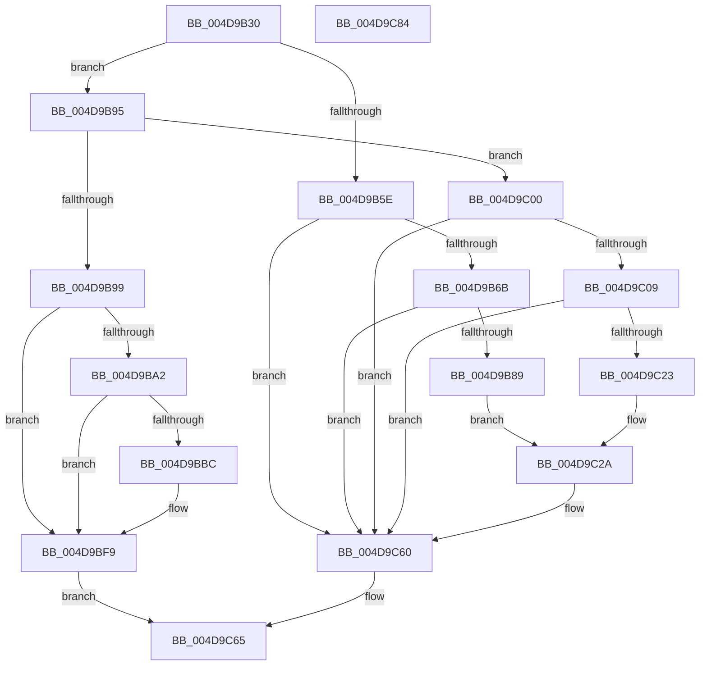

# HalpTimerQueryAndResetRtcErrors

- RVA: `0x004D9B30`–`0x004D9C85` (길이 `341` bytes)
- VA: `0x00000001404D9B30`
- 실행 섹션: `.text`
- PDB 이름 있음: `예`; PDB Function 태그: `아니요`
- unwind 정보 RVA: `0x000BE8B8`
- 디코드: `71`개 명령, `341/341` bytes 표시
- 미해석 바이트: `0` (있으면 어셈블리에 `.byte`로 보존)

> 이 문서는 커널 이미지의 기계어와 PDB 기호를 분석해 생성했습니다. 4번과 5번은 함수 원형과 자료형을 바이너리 사용 방식에서 추정한 C 해석이며 원본 소스 복구 결과는 아닙니다.

## 1. Dependencies

- 직접 호출 지점: **6**; 고유 호출 대상: **3**
- 직접 호출자로 확인된 함수: **1**
- RIP 상대 이미지 참조: **6**

### Outgoing calls
- `0x004D9B7C` → [tlgKeywordOn](../42/tlgKeywordOn_function_0042EAA0.md) (function, `0x0042EAA0`)
- `0x004D9BB3` → [tlgKeywordOn](../42/tlgKeywordOn_function_0042EAA0.md) (function, `0x0042EAA0`)
- `0x004D9BF4` → [tlgWriteEx_EtwWriteEx](../4A/tlgWriteEx_EtwWriteEx_function_004AA348.md) (function, `0x004AA348`)
- `0x004D9C1A` → [tlgKeywordOn](../42/tlgKeywordOn_function_0042EAA0.md) (function, `0x0042EAA0`)
- `0x004D9C5B` → [tlgWriteEx_EtwWriteEx](../4A/tlgWriteEx_EtwWriteEx_function_004AA348.md) (function, `0x004AA348`)
- `0x004D9C6E` → [_security_check_cookie](../6A/_security_check_cookie_function_006AC640.md) (function, `0x006AC640`)

### Direct callers
- [HalpTimerInitSystem](../53/HalpTimerInitSystem_function_0053CB70.md) at `0x0053CBE4`

### Static image references
- `0x004D9B40` → RVA `0x00E0A740` (`.data`; read)
- `0x004D9B54` → RVA `0x00FC3F90` (`.data`; read/write)
- `0x004D9B5E` → RVA `0x00E03B28` (`.data`; read)
- `0x004D9B89` → RVA `0x000436C5` (`.rdata`; read)
- `0x004D9BC7` → RVA `0x00043650` (`.rdata`; read)
- `0x004D9C23` → RVA `0x0004368A` (`.rdata`; read)

## 2. Other-region calls and transfers

- 다른 실행 섹션으로 향하는 call: **0**
- 별도 외부 분기/꼬리 이동을 확인하지 못했습니다.

## 3. Assembly (complete function range)

```asm
004D9B30  48 89 5C 24 08                  mov qword ptr [rsp + 8], rbx
004D9B35  55                              push rbp
004D9B36  48 8B EC                        mov rbp, rsp
004D9B39  48 81 EC 80 00 00 00            sub rsp, 0x80
004D9B40  48 8B 05 F9 0B 93 00            mov rax, qword ptr [rip + 0x930bf9]
004D9B47  48 33 C4                        xor rax, rsp
004D9B4A  48 89 45 F8                     mov qword ptr [rbp - 8], rax
004D9B4E  45 33 C0                        xor r8d, r8d
004D9B51  41 8B D8                        mov ebx, r8d
004D9B54  87 1D 36 A4 AE 00               xchg dword ptr [rip + 0xaea436], ebx
004D9B5A  84 D2                           test dl, dl
004D9B5C  74 37                           je 0x1404d9b95
004D9B5E  83 3D C3 9F 92 00 05            cmp dword ptr [rip + 0x929fc3], 5
004D9B65  0F 86 F5 00 00 00               jbe 0x1404d9c60
004D9B6B  48 BA 00 00 00 00 00 20 00 00   movabs rdx, 0x200000000000
004D9B75  48 8D 0D AC 9F 92 00            lea rcx, [rip + 0x929fac]
004D9B7C  E8 1F 4F F5 FF                  call 0x14042eaa0
004D9B81  84 C0                           test al, al
004D9B83  0F 84 D7 00 00 00               je 0x1404d9c60
004D9B89  48 8D 15 35 9B B6 FF            lea rdx, [rip - 0x4964cb]
004D9B90  E9 95 00 00 00                  jmp 0x1404d9c2a
004D9B95  84 C9                           test cl, cl
004D9B97  74 67                           je 0x1404d9c00
004D9B99  83 3D 88 9F 92 00 05            cmp dword ptr [rip + 0x929f88], 5
004D9BA0  76 57                           jbe 0x1404d9bf9
004D9BA2  48 BA 00 00 00 00 00 40 00 00   movabs rdx, 0x400000000000
004D9BAC  48 8D 0D 75 9F 92 00            lea rcx, [rip + 0x929f75]
004D9BB3  E8 E8 4E F5 FF                  call 0x14042eaa0
004D9BB8  84 C0                           test al, al
004D9BBA  74 3D                           je 0x1404d9bf9
004D9BBC  48 8D 45 C0                     lea rax, [rbp - 0x40]
004D9BC0  89 5D C0                        mov dword ptr [rbp - 0x40], ebx
004D9BC3  48 89 45 E8                     mov qword ptr [rbp - 0x18], rax
004D9BC7  48 8D 15 82 9A B6 FF            lea rdx, [rip - 0x49657e]
004D9BCE  48 8D 45 C8                     lea rax, [rbp - 0x38]
004D9BD2  48 C7 45 F0 04 00 00 00         mov qword ptr [rbp - 0x10], 4
004D9BDA  48 89 44 24 38                  mov qword ptr [rsp + 0x38], rax
004D9BDF  48 8D 0D 42 9F 92 00            lea rcx, [rip + 0x929f42]
004D9BE6  41 B9 01 00 00 00               mov r9d, 1
004D9BEC  C7 44 24 30 03 00 00 00         mov dword ptr [rsp + 0x30], 3
004D9BF4  E8 4F 07 FD FF                  call 0x1404aa348
004D9BF9  B8 09 00 00 00                  mov eax, 9
004D9BFE  EB 65                           jmp 0x1404d9c65
004D9C00  83 3D 21 9F 92 00 05            cmp dword ptr [rip + 0x929f21], 5
004D9C07  76 57                           jbe 0x1404d9c60
004D9C09  48 BA 00 00 00 00 00 40 00 00   movabs rdx, 0x400000000000
004D9C13  48 8D 0D 0E 9F 92 00            lea rcx, [rip + 0x929f0e]
004D9C1A  E8 81 4E F5 FF                  call 0x14042eaa0
004D9C1F  84 C0                           test al, al
004D9C21  74 3D                           je 0x1404d9c60
004D9C23  48 8D 15 60 9A B6 FF            lea rdx, [rip - 0x4965a0]
004D9C2A  48 8D 45 C0                     lea rax, [rbp - 0x40]
004D9C2E  48 89 45 E8                     mov qword ptr [rbp - 0x18], rax
004D9C32  48 8D 45 C8                     lea rax, [rbp - 0x38]
004D9C36  48 89 44 24 38                  mov qword ptr [rsp + 0x38], rax
004D9C3B  C7 44 24 30 03 00 00 00         mov dword ptr [rsp + 0x30], 3
004D9C43  41 B9 01 00 00 00               mov r9d, 1
004D9C49  89 5D C0                        mov dword ptr [rbp - 0x40], ebx
004D9C4C  48 8D 0D D5 9E 92 00            lea rcx, [rip + 0x929ed5]
004D9C53  48 C7 45 F0 04 00 00 00         mov qword ptr [rbp - 0x10], 4
004D9C5B  E8 E8 06 FD FF                  call 0x1404aa348
004D9C60  B8 1F 00 00 00                  mov eax, 0x1f
004D9C65  23 C3                           and eax, ebx
004D9C67  48 8B 4D F8                     mov rcx, qword ptr [rbp - 8]
004D9C6B  48 33 CC                        xor rcx, rsp
004D9C6E  E8 CD 29 1D 00                  call 0x1406ac640
004D9C73  48 8B 9C 24 90 00 00 00         mov rbx, qword ptr [rsp + 0x90]
004D9C7B  48 81 C4 80 00 00 00            add rsp, 0x80
004D9C82  5D                              pop rbp
004D9C83  C3                              ret
004D9C84  CC                              int3
```

## 4. C-style interpretation (structured pseudocode)

```c
__int64 __fastcall HalpTimerQueryAndResetRtcErrors(__int64 a1, unsigned __int8 a2, int a3)
{
    __int64 result;
    __int64 v_rsp;
    unsigned __int64 v_stack_m10;
    unsigned __int64 v_stack_m18;
    unsigned __int64 v_stack_m20;
    unsigned __int64 v_stack_m40;
    unsigned __int64 v_stack_m48;
    unsigned __int64 v_stack_m50;
    unsigned int v_stack_m58;
    unsigned __int64 v_stack_p8;

    v_stack_p8 = v_rbx;
    v_rsp = (v_rsp) - (128);
    result = (*(unsigned __int64 *)(v_rip + 9636857)) ^ (v_rsp);
    v_stack_m10 = result;
    a3 = 0;
    if (a2 == 0) goto loc_004D9B95;
    if ((*(unsigned int *)(v_rip + 9609155)) <= 5) goto loc_004D9C60;
    result = tlgKeywordOn(v_rip + 9609132, a2, a3, a4);
    if ((unsigned __int8)(result) == 0) goto loc_004D9C60;
    goto loc_004D9C2A;
loc_004D9B95:
    if ((unsigned __int8)(v_rip + 9609132) == 0) goto loc_004D9C00;
    if ((*(unsigned int *)(v_rip + 9609096)) <= 5) goto loc_004D9BF9;
    result = tlgKeywordOn(v_rip + 9609077, v_rip - 4809931, a3, a4);
    if ((unsigned __int8)(result) != 0) {
        result = v_stack_m48;
        v_stack_m48 = 0;
        v_stack_m20 = result;
        a2 = v_rip - 4810110;
        result = v_stack_m40;
        v_stack_m18 = 4;
        v_stack_m50 = result;
        a1 = v_rip + 9609026;
        a4 = 1;
        v_stack_m58 = 3;
        result = tlgWriteEx_EtwWriteEx(a1, a2, a3, a4);
    }
    goto loc_004D9C65;
loc_004D9C00:
    if ((*(unsigned int *)(v_rip + 9608993)) <= 5) goto loc_004D9C60;
    result = tlgKeywordOn(v_rip + 9608974, a2, a3, a4);
    if ((unsigned __int8)(result) == 0) goto loc_004D9C60;
loc_004D9C2A:
    v_stack_m20 = v_stack_m48;
    v_stack_m50 = v_stack_m40;
    v_stack_m58 = 3;
    v_stack_m48 = 0;
    v_stack_m18 = 4;
    result = tlgWriteEx_EtwWriteEx(v_rip + 9608917, v_rip - 4810144, a3, 1);
loc_004D9C60:
loc_004D9C65:
    result = (unsigned int)((31) & (0));
    a1 = (v_stack_m10) ^ (v_rsp);
    result = _security_check_cookie(a1, v_rip - 4810144, a3, 1);
    v_rsp = (v_rsp) + (128);
    return result;
}
```

## 5. (Beta) C Style

```c
int64_t HalpTimerQueryAndResetRtcErrors(int64_t Arg1, uint8_t Arg2, int32_t Arg3)
{
    int64_t result;
    int64_t local_rsp;
    uint64_t v_stack_m10;
    uint64_t v_stack_m18;
    uint64_t v_stack_m20;
    uint64_t v_stack_m40;
    uint64_t v_stack_m48;
    uint64_t v_stack_m50;
    uint32_t v_stack_m58;
    uint64_t v_stack_p8;

    v_stack_p8 = local_rbx;
    local_rsp = (local_rsp) - (128);
    result = (*(uint64_t *)(v_rip + 0x930BF9)) ^ (local_rsp);
    v_stack_m10 = result;
    Arg3 = 0;
    if (Arg2 == 0) goto loc_004D9B95;
    if ((*(uint32_t *)(v_rip + 0x929FC3)) <= 5) goto loc_004D9C60;
    result = tlgKeywordOn(v_rip + 9609132, Arg2, Arg3, a4);
    if ((uint8_t)(result) == 0) goto loc_004D9C60;
    goto loc_004D9C2A;
loc_004D9B95:
    if ((uint8_t)(v_rip + 9609132) == 0) goto loc_004D9C00;
    if ((*(uint32_t *)(v_rip + 0x929F88)) <= 5) goto loc_004D9BF9;
    result = tlgKeywordOn(v_rip + 9609077, v_rip - 4809931, Arg3, a4);
    if ((uint8_t)(result) != 0) {
        result = v_stack_m48;
        v_stack_m48 = 0;
        v_stack_m20 = result;
        Arg2 = v_rip - 4810110;
        result = v_stack_m40;
        v_stack_m18 = 4;
        v_stack_m50 = result;
        Arg1 = v_rip + 9609026;
        a4 = 1;
        v_stack_m58 = 3;
        result = tlgWriteEx_EtwWriteEx(Arg1, Arg2, Arg3, a4);
    }
    goto loc_004D9C65;
loc_004D9C00:
    if ((*(uint32_t *)(v_rip + 0x929F21)) <= 5) goto loc_004D9C60;
    result = tlgKeywordOn(v_rip + 9608974, Arg2, Arg3, a4);
    if ((uint8_t)(result) == 0) goto loc_004D9C60;
loc_004D9C2A:
    v_stack_m20 = v_stack_m48;
    v_stack_m50 = v_stack_m40;
    v_stack_m58 = 3;
    v_stack_m48 = 0;
    v_stack_m18 = 4;
    result = tlgWriteEx_EtwWriteEx(v_rip + 9608917, v_rip - 4810144, Arg3, 1);
loc_004D9C60:
loc_004D9C65:
    result = (uint32_t)((31) & (0));
    Arg1 = (v_stack_m10) ^ (local_rsp);
    result = _security_check_cookie(Arg1, v_rip - 4810144, Arg3, 1);
    local_rsp = (local_rsp) + (128);
    return result;
}
```

## 6. Execution-region graph

[열기: 2D/3D 그래프와 함수 탐색 컨트롤 패널](../../../control-panel.html?section=text&rva=0x004D9B30&view=graph)

- 2D 그래프는 위에서 아래로 흐르고, 3D 그래프는 빈 공간을 드래그해 회전합니다. Shift+드래그는 이동, 휠은 확대·축소, 함수 노드 선택은 대상 보고서 이동입니다.

### Static fallback


