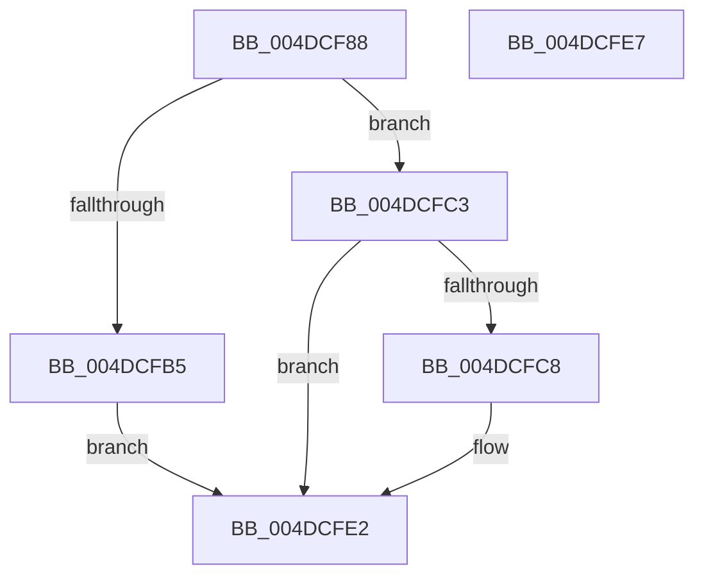

# HalpTimerSaveProcessorCounter

- RVA: `0x004DCF88`–`0x004DCFE8` (길이 `96` bytes)
- VA: `0x00000001404DCF88`
- 실행 섹션: `.text`
- PDB 이름 있음: `예`; PDB Function 태그: `아니요`
- unwind 정보 RVA: `0x0005C788`
- 디코드: `22`개 명령, `96/96` bytes 표시
- 미해석 바이트: `0` (있으면 어셈블리에 `.byte`로 보존)

> 이 문서는 커널 이미지의 기계어와 PDB 기호를 분석해 생성했습니다. 4번과 5번은 함수 원형과 자료형을 바이너리 사용 방식에서 추정한 C 해석이며 원본 소스 복구 결과는 아닙니다.

## 1. Dependencies

- 직접 호출 지점: **1**; 고유 호출 대상: **1**
- 직접 호출자로 확인된 함수: **1**
- RIP 상대 이미지 참조: **6**

### Outgoing calls
- `0x004DCFD6` → [guard_dispatch_icall](../6B/guard_dispatch_icall_function_006BAAD0.md) (function, `0x006BAAD0`)

### Direct callers
- [HaliAcpiSleep](../56/HaliAcpiSleep_function_0056AD60.md) at `0x0056AE09`

### Static image references
- `0x004DCF97` → RVA `0x00FC4040` (`.data`; read)
- `0x004DCFA9` → RVA `0x00FC1C88` (`.data`; read)
- `0x004DCFB5` → RVA `0x00FC3FA0` (`.data`; read/write)
- `0x004DCFBB` → RVA `0x00FC40D8` (`.data`; write)
- `0x004DCFC8` → RVA `0x00FC3FA0` (`.data`; read)
- `0x004DCFDB` → RVA `0x00FC3FB0` (`.data`; write)

## 2. Other-region calls and transfers

- 다른 실행 섹션으로 향하는 call: **0**
- 별도 외부 분기/꼬리 이동을 확인하지 못했습니다.

## 3. Assembly (complete function range)

```asm
004DCF88  48 83 EC 28                     sub rsp, 0x28
004DCF8C  65 44 8B 04 25 A4 01 00 00      mov r8d, dword ptr gs:[0x1a4]
004DCF95  0F 31                           rdtsc
004DCF97  48 8B 0D A2 70 AE 00            mov rcx, qword ptr [rip + 0xae70a2]
004DCF9E  48 C1 E2 20                     shl rdx, 0x20
004DCFA2  48 0B C2                        or rax, rdx
004DCFA5  4A 89 04 C1                     mov qword ptr [rcx + r8*8], rax
004DCFA9  48 8B 05 D8 4C AE 00            mov rax, qword ptr [rip + 0xae4cd8]
004DCFB0  48 85 C0                        test rax, rax
004DCFB3  75 0E                           jne 0x1404dcfc3
004DCFB5  21 05 E5 6F AE 00               and dword ptr [rip + 0xae6fe5], eax
004DCFBB  88 05 17 71 AE 00               mov byte ptr [rip + 0xae7117], al
004DCFC1  EB 1F                           jmp 0x1404dcfe2
004DCFC3  45 85 C0                        test r8d, r8d
004DCFC6  75 1A                           jne 0x1404dcfe2
004DCFC8  48 8D 0D D1 6F AE 00            lea rcx, [rip + 0xae6fd1]
004DCFCF  C6 05 02 71 AE 00 01            mov byte ptr [rip + 0xae7102], 1
004DCFD6  E8 F5 DA 1D 00                  call 0x1406baad0
004DCFDB  48 89 05 CE 6F AE 00            mov qword ptr [rip + 0xae6fce], rax
004DCFE2  48 83 C4 28                     add rsp, 0x28
004DCFE6  C3                              ret
004DCFE7  CC                              int3
```

## 4. C-style interpretation (structured pseudocode)

```c
__int64 __fastcall HalpTimerSaveProcessorCounter(__int64 a1, __int64 a2)
{
    __int64 result;
    __int64 v_rsp;

    v_rsp = (v_rsp) - (40);
    a2 = (a2) << (32);
    result = (result) | (a2);
    *(unsigned __int64 *)(*(unsigned __int64 *)(v_rip + 11432098) + (unsigned int)(*(unsigned int *)(gs_base + (0 + 420))) * 8) = result;
    if (*(unsigned __int64 *)(v_rip + 11422936) != 0) goto loc_004DCFC3;
    *(unsigned __int8 *)(v_rip + 11432215) = (unsigned __int8)(*(unsigned __int64 *)(v_rip + 11422936));
    goto loc_004DCFE2;
loc_004DCFC3:
    result = *(unsigned __int64 *)(v_rip + 11422936);
    if ((unsigned int)((unsigned int)(*(unsigned int *)(gs_base + (0 + 420)))) == 0) {
        a1 = v_rip + 11431889;
        *(unsigned __int8 *)(v_rip + 11432194) = 1;
        result = guard_dispatch_icall(a1, a2, (unsigned int)(*(unsigned int *)(gs_base + (0 + 420))), a4);
        *(unsigned __int64 *)(v_rip + 11431886) = result;
    }
    v_rsp = (v_rsp) + (40);
    return result;
}
```

## 5. (Beta) C Style

```c
int64_t HalpTimerSaveProcessorCounter(int64_t Arg1, int64_t Arg2)
{
    int64_t result;
    int64_t local_rsp;

    local_rsp = (local_rsp) - (40);
    Arg2 = (Arg2) << (32);
    result = (result) | (Arg2);
    *(uint64_t *)(*(uint64_t *)(v_rip + 0xAE70A2) + (uint32_t)(*(uint32_t *)(gs_base + (0 + 0x1A4))) * 8) = result;
    if (*(uint64_t *)(v_rip + 0xAE4CD8) != 0) goto loc_004DCFC3;
    *(uint8_t *)(v_rip + 0xAE7117) = (uint8_t)(*(uint64_t *)(v_rip + 0xAE4CD8));
    goto loc_004DCFE2;
loc_004DCFC3:
    result = *(uint64_t *)(v_rip + 0xAE4CD8);
    if ((uint32_t)((uint32_t)(*(uint32_t *)(gs_base + (0 + 0x1A4)))) == 0) {
        Arg1 = v_rip + 11431889;
        *(uint8_t *)(v_rip + 0xAE7102) = 1;
        result = guard_dispatch_icall(Arg1, Arg2, (uint32_t)(*(uint32_t *)(gs_base + (0 + 0x1A4))), a4);
        *(uint64_t *)(v_rip + 0xAE6FCE) = result;
    }
    local_rsp = (local_rsp) + (40);
    return result;
}
```

## 6. Execution-region graph

[열기: 2D/3D 그래프와 함수 탐색 컨트롤 패널](../../../control-panel.html?section=text&rva=0x004DCF88&view=graph)

- 2D 그래프는 위에서 아래로 흐르고, 3D 그래프는 빈 공간을 드래그해 회전합니다. Shift+드래그는 이동, 휠은 확대·축소, 함수 노드 선택은 대상 보고서 이동입니다.

### Static fallback


