# HvlEnlightenProcessor

- RVA: `0x004DCD9C`–`0x004DCF82` (길이 `486` bytes)
- VA: `0x00000001404DCD9C`
- 실행 섹션: `.text`
- PDB 이름 있음: `예`; PDB Function 태그: `아니요`
- unwind 정보 RVA: `0x000A2298`
- 디코드: `130`개 명령, `486/486` bytes 표시
- 미해석 바이트: `0` (있으면 어셈블리에 `.byte`로 보존)

> 이 문서는 커널 이미지의 기계어와 PDB 기호를 분석해 생성했습니다. 4번과 5번은 함수 원형과 자료형을 바이너리 사용 방식에서 추정한 C 해석이며 원본 소스 복구 결과는 아닙니다.

## 1. Dependencies

- 직접 호출 지점: **11**; 고유 호출 대상: **7**
- 직접 호출자로 확인된 함수: **3**
- RIP 상대 이미지 참조: **7**

### Outgoing calls
- `0x004DCDEE` → [HvlpGetRegister64](../37/HvlpGetRegister64_function_00379050.md) (function, `0x00379050`)
- `0x004DCE9B` → [HvlpGetRegister64](../37/HvlpGetRegister64_function_00379050.md) (function, `0x00379050`)
- `0x004DCEAB` → [HvlpSetRegister64](HvlpSetRegister64_function_004DDA70.md) (function, `0x004DDA70`)
- `0x004DCEB3` → [HvlpSetupSchedulerAssist](../58/HvlpSetupSchedulerAssist_function_005868F8.md) (function, `0x005868F8`)
- `0x004DCEC8` → [HvlGetLpIndexFromProcessorIndex](../44/HvlGetLpIndexFromProcessorIndex_function_0044FFE0.md) (function, `0x0044FFE0`)
- `0x004DCECF` → [HvlpGetLpcbByLpIndex](../44/HvlpGetLpcbByLpIndex_function_0044FFA0.md) (function, `0x0044FFA0`)
- `0x004DCEEB` → [HvlpGetRegister64](../37/HvlpGetRegister64_function_00379050.md) (function, `0x00379050`)
- `0x004DCF00` → [HvlpSetRegister64](HvlpSetRegister64_function_004DDA70.md) (function, `0x004DDA70`)
- `0x004DCF2F` → [HvlpSetRegister64](HvlpSetRegister64_function_004DDA70.md) (function, `0x004DDA70`)
- `0x004DCF4F` → [HvlSharedIsr](../44/HvlSharedIsr_function_0044B020.md) (function, `0x0044B020`)
- `0x004DCF6F` → [HvlpDiscoverTopologyLocal](../../page/71/HvlpDiscoverTopologyLocal_function_0071836C.md) (function, `0x0071836C`)

### Direct callers
- [HvlpInitializeBootProcessor](../58/HvlpInitializeBootProcessor_function_00585964.md) at `0x00585AD8`
- [KiInitializeKernel](../../pagelk/B6/KiInitializeKernel_function_00B68D20.md) at `0x00B69287`
- [PopHandleNextState](../../pagelk/B7/PopHandleNextState_function_00B77350.md) at `0x00B7763A`

### Static image references
- `0x004DCDB4` → RVA `0x00FC6A97` (`ALMOSTRO`; read)
- `0x004DCDC5` → RVA `0x00FC6A90` (`ALMOSTRO`; read)
- `0x004DCDF8` → RVA `0x00FCD260` (`ALMOSTRO`; read)
- `0x004DCE1F` → RVA `0x00FC5007` (`ALMOSTRO`; write)
- `0x004DCE31` → RVA `0x00FC6AB8` (`ALMOSTRO`; read/write)
- `0x004DCE37` → RVA `0x00FC6C98` (`ALMOSTRO`; read/write)
- `0x004DCE62` → RVA `0x00FC6A90` (`ALMOSTRO`; write)

## 2. Other-region calls and transfers

- 다른 실행 섹션으로 향하는 call: **1**
  - `0x004DCF6F` → [HvlpDiscoverTopologyLocal](../../page/71/HvlpDiscoverTopologyLocal_function_0071836C.md) (`.text` → `PAGE`)
- 별도 외부 분기/꼬리 이동을 확인하지 못했습니다.

## 3. Assembly (complete function range)

```asm
004DCD9C  48 89 5C 24 08                  mov qword ptr [rsp + 8], rbx
004DCDA1  55                              push rbp
004DCDA2  56                              push rsi
004DCDA3  57                              push rdi
004DCDA4  48 83 EC 20                     sub rsp, 0x20
004DCDA8  48 83 64 24 48 00               and qword ptr [rsp + 0x48], 0
004DCDAE  48 83 64 24 50 00               and qword ptr [rsp + 0x50], 0
004DCDB4  80 3D DC 9C AE 00 00            cmp byte ptr [rip + 0xae9cdc], 0
004DCDBB  0F 84 B3 01 00 00               je 0x1404dcf74
004DCDC1  84 C9                           test cl, cl
004DCDC3  74 0E                           je 0x1404dcdd3
004DCDC5  8B 05 C5 9C AE 00               mov eax, dword ptr [rip + 0xae9cc5]
004DCDCB  A8 02                           test al, 2
004DCDCD  0F 85 A1 01 00 00               jne 0x1404dcf74
004DCDD3  65 48 8B 34 25 20 00 00 00      mov rsi, qword ptr gs:[0x20]
004DCDDC  84 C9                           test cl, cl
004DCDDE  0F 85 85 00 00 00               jne 0x1404dce69
004DCDE4  48 8D 54 24 48                  lea rdx, [rsp + 0x48]
004DCDE9  B9 03 00 09 00                  mov ecx, 0x90003
004DCDEE  E8 5D C2 E9 FF                  call 0x140379050
004DCDF3  48 8B 54 24 48                  mov rdx, qword ptr [rsp + 0x48]
004DCDF8  4C 8D 0D 61 04 AF 00            lea r9, [rip + 0xaf0461]
004DCDFF  8B 46 24                        mov eax, dword ptr [rsi + 0x24]
004DCE02  44 8B C2                        mov r8d, edx
004DCE05  41 C1 E8 06                     shr r8d, 6
004DCE09  8A CA                           mov cl, dl
004DCE0B  80 E1 3F                        and cl, 0x3f
004DCE0E  45 88 04 41                     mov byte ptr [r9 + rax*2], r8b
004DCE12  8B 46 24                        mov eax, dword ptr [rsi + 0x24]
004DCE15  41 88 4C 41 01                  mov byte ptr [r9 + rax*2 + 1], cl
004DCE1A  3B 56 24                        cmp edx, dword ptr [rsi + 0x24]
004DCE1D  74 07                           je 0x1404dce26
004DCE1F  C6 05 E1 81 AE 00 00            mov byte ptr [rip + 0xae81e1], 0
004DCE26  41 83 F8 10                     cmp r8d, 0x10
004DCE2A  72 13                           jb 0x1404dce3f
004DCE2C  B8 7F FF FF FF                  mov eax, 0xffffff7f
004DCE31  21 05 81 9C AE 00               and dword ptr [rip + 0xae9c81], eax
004DCE37  21 05 5B 9E AE 00               and dword ptr [rip + 0xae9e5b], eax
004DCE3D  EB 2A                           jmp 0x1404dce69
004DCE3F  8B 05 4B 9C AE 00               mov eax, dword ptr [rip + 0xae9c4b]
004DCE45  8B C8                           mov ecx, eax
004DCE47  C1 E9 08                        shr ecx, 8
004DCE4A  83 E1 0F                        and ecx, 0xf
004DCE4D  44 3B C1                        cmp r8d, ecx
004DCE50  76 17                           jbe 0x1404dce69
004DCE52  41 83 E0 0F                     and r8d, 0xf
004DCE56  25 FF F0 FF FF                  and eax, 0xfffff0ff
004DCE5B  41 C1 E0 08                     shl r8d, 8
004DCE5F  44 0B C0                        or r8d, eax
004DCE62  44 89 05 27 9C AE 00            mov dword ptr [rip + 0xae9c27], r8d
004DCE69  8B 05 21 9C AE 00               mov eax, dword ptr [rip + 0xae9c21]
004DCE6F  0F BA E0 13                     bt eax, 0x13
004DCE73  73 3B                           jae 0x1404dceb0
004DCE75  48 83 64 24 48 00               and qword ptr [rsp + 0x48], 0
004DCE7B  BB 13 00 09 00                  mov ebx, 0x90013
004DCE80  A8 02                           test al, 2
004DCE82  75 10                           jne 0x1404dce94
004DCE84  48 8B 96 E0 8B 00 00            mov rdx, qword ptr [rsi + 0x8be0]
004DCE8B  48 81 E2 00 F0 FF FF            and rdx, 0xfffffffffffff000
004DCE92  EB 11                           jmp 0x1404dcea5
004DCE94  48 8D 54 24 48                  lea rdx, [rsp + 0x48]
004DCE99  8B CB                           mov ecx, ebx
004DCE9B  E8 B0 C1 E9 FF                  call 0x140379050
004DCEA0  48 8B 54 24 48                  mov rdx, qword ptr [rsp + 0x48]
004DCEA5  48 83 CA 01                     or rdx, 1
004DCEA9  8B CB                           mov ecx, ebx
004DCEAB  E8 C0 0B 00 00                  call 0x1404dda70
004DCEB0  48 8B CE                        mov rcx, rsi
004DCEB3  E8 40 9A 0A 00                  call 0x1405868f8
004DCEB8  8B 1D D2 9B AE 00               mov ebx, dword ptr [rip + 0xae9bd2]
004DCEBE  33 FF                           xor edi, edi
004DCEC0  F6 C3 02                        test bl, 2
004DCEC3  74 40                           je 0x1404dcf05
004DCEC5  8B 4E 24                        mov ecx, dword ptr [rsi + 0x24]
004DCEC8  E8 13 31 F7 FF                  call 0x14044ffe0
004DCECD  8B C8                           mov ecx, eax
004DCECF  E8 CC 30 F7 FF                  call 0x14044ffa0
004DCED4  48 8B E8                        mov rbp, rax
004DCED7  48 8B F8                        mov rdi, rax
004DCEDA  F6 C3 20                        test bl, 0x20
004DCEDD  74 26                           je 0x1404dcf05
004DCEDF  BB 13 00 0A 00                  mov ebx, 0xa0013
004DCEE4  48 8D 54 24 50                  lea rdx, [rsp + 0x50]
004DCEE9  8B CB                           mov ecx, ebx
004DCEEB  E8 60 C1 E9 FF                  call 0x140379050
004DCEF0  48 8B 54 24 50                  mov rdx, qword ptr [rsp + 0x50]
004DCEF5  F6 C2 01                        test dl, 1
004DCEF8  75 0B                           jne 0x1404dcf05
004DCEFA  48 83 CA 01                     or rdx, 1
004DCEFE  8B CB                           mov ecx, ebx
004DCF00  E8 6B 0B 00 00                  call 0x1404dda70
004DCF05  8B 05 85 9B AE 00               mov eax, dword ptr [rip + 0xae9b85]
004DCF0B  A8 20                           test al, 0x20
004DCF0D  74 45                           je 0x1404dcf54
004DCF0F  8B D8                           mov ebx, eax
004DCF11  C1 EB 04                        shr ebx, 4
004DCF14  F7 D3                           not ebx
004DCF16  83 E3 01                        and ebx, 1
004DCF19  48 C1 E3 11                     shl rbx, 0x11
004DCF1D  48 83 CB 30                     or rbx, 0x30
004DCF21  0F BA E0 19                     bt eax, 0x19
004DCF25  73 0D                           jae 0x1404dcf34
004DCF27  48 8B D3                        mov rdx, rbx
004DCF2A  B9 00 00 0A 00                  mov ecx, 0xa0000
004DCF2F  E8 3C 0B 00 00                  call 0x1404dda70
004DCF34  8B 05 56 9B AE 00               mov eax, dword ptr [rip + 0xae9b56]
004DCF3A  A8 02                           test al, 2
004DCF3C  74 11                           je 0x1404dcf4f
004DCF3E  48 8B D3                        mov rdx, rbx
004DCF41  48 8B C3                        mov rax, rbx
004DCF44  48 C1 EA 20                     shr rdx, 0x20
004DCF48  B9 94 00 00 40                  mov ecx, 0x40000094
004DCF4D  0F 30                           wrmsr
004DCF4F  E8 CC E0 F6 FF                  call 0x14044b020
004DCF54  8B 05 36 9B AE 00               mov eax, dword ptr [rip + 0xae9b36]
004DCF5A  A8 02                           test al, 2
004DCF5C  74 16                           je 0x1404dcf74
004DCF5E  83 7E 24 00                     cmp dword ptr [rsi + 0x24], 0
004DCF62  74 10                           je 0x1404dcf74
004DCF64  8B 57 08                        mov edx, dword ptr [rdi + 8]
004DCF67  4C 8D 4F 10                     lea r9, [rdi + 0x10]
004DCF6B  4C 8D 47 0C                     lea r8, [rdi + 0xc]
004DCF6F  E8 F8 B3 23 00                  call 0x14071836c
004DCF74  48 8B 5C 24 40                  mov rbx, qword ptr [rsp + 0x40]
004DCF79  48 83 C4 20                     add rsp, 0x20
004DCF7D  5F                              pop rdi
004DCF7E  5E                              pop rsi
004DCF7F  5D                              pop rbp
004DCF80  C3                              ret
004DCF81  CC                              int3
```

## 4. C-style interpretation (structured pseudocode)

```c
__int64 __fastcall HvlEnlightenProcessor(unsigned __int8 a1)
{
    __int64 result;
    __int64 v_rbx;
    __int64 v_rdi;
    __int64 v_rsp;
    unsigned __int64 v_stack_p10;
    unsigned __int64 v_stack_p18;
    unsigned __int64 v_stack_p8;

    v_stack_p8 = v_rbx;
    v_rsp = (v_rsp) - (32);
    if ((*(unsigned __int8 *)(v_rip + 11443420)) == 0) goto loc_004DCF74;
    if (a1 == 0) goto loc_004DCDD3;
    if ((((unsigned __int8)((unsigned int)(*(unsigned int *)(v_rip + 11443397)))) & (2)) != 0) goto loc_004DCF74;
loc_004DCDD3:
    if (a1 != 0) goto loc_004DCE69;
    result = HvlpGetRegister64((unsigned int)(0x90003ULL), v_stack_p10, a3, a4);
    a3 = (unsigned int)(((unsigned int)((unsigned int)(v_stack_p10))) >> (6));
    a1 = (unsigned __int8)(((unsigned __int8)(v_stack_p10)) & (63));
    *(unsigned __int8 *)(v_rip + 11469921 + (unsigned int)(*(unsigned int *)(*(unsigned __int64 *)(gs_base + (0 + 32)) + 36)) * 2) = (unsigned __int8)(a3);
    *(unsigned __int8 *)(v_rip + 11469921 + (unsigned int)(*(unsigned int *)(*(unsigned __int64 *)(gs_base + (0 + 32)) + 36)) * 2 + 1) = a1;
    if (((unsigned int)(v_stack_p10)) != (*(unsigned int *)(*(unsigned __int64 *)(gs_base + (0 + 32)) + 36))) {
        *(unsigned __int8 *)(v_rip + 11436513) = 0;
    }
    if (((unsigned int)(a3)) < 16) goto loc_004DCE3F;
    goto loc_004DCE69;
loc_004DCE3F:
    a1 = (unsigned int)(((unsigned int)((unsigned int)((unsigned int)(*(unsigned int *)(v_rip + 11443275))))) >> (8));
    a1 = (unsigned int)((a1) & (15));
    result = (unsigned int)(*(unsigned int *)(v_rip + 11443275));
    if (((unsigned int)(a3)) >= = a1) {
        a3 = (unsigned int)((a3) & (15));
        result = (unsigned int)(((unsigned int)(*(unsigned int *)(v_rip + 11443275))) & (0xFFFFF0FFULL));
        a3 = (unsigned int)((a3) << (8));
        a3 = (unsigned int)((a3) | ((unsigned int)(result)));
        *(unsigned int *)(v_rip + 11443239) = (unsigned int)(a3);
    }
    if (condition_is_above_or_equal) goto loc_004DCEB0;
    if ((((unsigned __int8)((unsigned int)(*(unsigned int *)(v_rip + 11443233)))) & (2)) != 0) goto loc_004DCE94;
    a2 = (*(unsigned __int64 *)(*(unsigned __int64 *)(gs_base + (0 + 32)) + 35808)) & (0xFFFFFFFFFFFFF000ULL);
    goto loc_004DCEA5;
loc_004DCE94:
    result = HvlpGetRegister64((unsigned int)((unsigned int)((unsigned int)(0x90013ULL))), v_stack_p10, a3, v_rip + 11469921);
loc_004DCEA5:
    a2 = (v_stack_p10) | (1);
    result = HvlpSetRegister64((unsigned int)((unsigned int)((unsigned int)(0x90013ULL))), a2, a3, v_rip + 11469921);
loc_004DCEB0:
    result = HvlpSetupSchedulerAssist(*(unsigned __int64 *)(gs_base + (0 + 32)), a2, a3, v_rip + 11469921);
    v_rdi = 0;
    if ((((unsigned __int8)((unsigned int)(*(unsigned int *)(v_rip + 11443154)))) & (2)) == 0) goto loc_004DCF05;
    result = HvlGetLpIndexFromProcessorIndex((unsigned int)(*(unsigned int *)(*(unsigned __int64 *)(gs_base + (0 + 32)) + 36)), a2, a3, v_rip + 11469921);
    result = HvlpGetLpcbByLpIndex((unsigned int)((unsigned int)(result)), a2, a3, v_rip + 11469921);
    if ((((unsigned __int8)((unsigned int)(*(unsigned int *)(v_rip + 11443154)))) & (32)) == 0) goto loc_004DCF05;
    result = HvlpGetRegister64((unsigned int)((unsigned int)((unsigned int)(0xA0013ULL))), v_stack_p18, a3, v_rip + 11469921);
    if ((((unsigned __int8)(v_stack_p18)) & (1)) == 0) {
        a2 = (v_stack_p18) | (1);
        a1 = (unsigned int)((unsigned int)(0xA0013ULL));
        result = HvlpSetRegister64(a1, a2, a3, v_rip + 11469921);
    }
    if ((((unsigned __int8)((unsigned int)(*(unsigned int *)(v_rip + 11443077)))) & (32)) == 0) goto loc_004DCF54;
    v_rbx = (unsigned int)(((unsigned int)((unsigned int)((unsigned int)(*(unsigned int *)(v_rip + 11443077))))) >> (4));
    v_rbx = (unsigned int)(~(v_rbx));
    v_rbx = (unsigned int)((v_rbx) & (1));
    v_rbx = (v_rbx) << (17);
    v_rbx = (v_rbx) | (48);
    result = (unsigned int)(*(unsigned int *)(v_rip + 11443077));
    if (!(condition_is_above_or_equal)) {
        a2 = v_rbx;
        a1 = 0xA0000ULL;
        result = HvlpSetRegister64(a1, a2, a3, v_rip + 11469921);
    }
    result = (unsigned int)(*(unsigned int *)(v_rip + 11443030));
    if ((((unsigned __int8)((unsigned int)(*(unsigned int *)(v_rip + 11443030)))) & (2)) != 0) {
        a2 = v_rbx;
        result = v_rbx;
        a2 = (a2) >> (32);
        a1 = 0x40000094ULL;
    }
    result = HvlSharedIsr(a1, a2, a3, v_rip + 11469921);
loc_004DCF54:
    if ((((unsigned __int8)((unsigned int)(*(unsigned int *)(v_rip + 11442998)))) & (2)) == 0) goto loc_004DCF74;
    result = (unsigned int)(*(unsigned int *)(v_rip + 11442998));
    if ((*(unsigned int *)(*(unsigned __int64 *)(gs_base + (0 + 32)) + 36)) != 0) {
        a2 = *(unsigned int *)(result + 8);
        a4 = result + 16;
        a3 = result + 12;
        result = HvlpDiscoverTopologyLocal(a1, a2, a3, a4);
    }
    v_rsp = (v_rsp) + (32);
    return result;
}
```

## 5. (Beta) C Style

```c
int64_t HvlEnlightenProcessor(uint8_t Arg1)
{
    int64_t result;
    int64_t local_rbx;
    int64_t local_rdi;
    int64_t local_rsp;
    uint64_t v_stack_p10;
    uint64_t v_stack_p18;
    uint64_t v_stack_p8;

    v_stack_p8 = local_rbx;
    local_rsp = (local_rsp) - (32);
    if ((*(uint8_t *)(v_rip + 0xAE9CDC)) == 0) goto loc_004DCF74;
    if (Arg1 == 0) goto loc_004DCDD3;
    if ((((uint8_t)((uint32_t)(*(uint32_t *)(v_rip + 0xAE9CC5)))) & (2)) != 0) goto loc_004DCF74;
loc_004DCDD3:
    if (Arg1 != 0) goto loc_004DCE69;
    result = HvlpGetRegister64((uint32_t)(0x90003ULL), v_stack_p10, a3, a4);
    a3 = (uint32_t)(((uint32_t)((uint32_t)(v_stack_p10))) >> (6));
    Arg1 = (uint8_t)(((uint8_t)(v_stack_p10)) & (63));
    *(uint8_t *)(v_rip + 0xAF0461 + (uint32_t)(*(uint32_t *)(*(uint64_t *)(gs_base + (0 + 0x20)) + 0x24)) * 2) = (uint8_t)(a3);
    *(uint8_t *)(v_rip + 0xAF0461 + (uint32_t)(*(uint32_t *)(*(uint64_t *)(gs_base + (0 + 0x20)) + 0x24)) * 2 + 0x1) = Arg1;
    if (((uint32_t)(v_stack_p10)) != (*(uint32_t *)(*(uint64_t *)(gs_base + (0 + 0x20)) + 0x24))) {
        *(uint8_t *)(v_rip + 0xAE81E1) = 0;
    }
    if (((uint32_t)(a3)) < 16) goto loc_004DCE3F;
    goto loc_004DCE69;
loc_004DCE3F:
    Arg1 = (uint32_t)(((uint32_t)((uint32_t)((uint32_t)(*(uint32_t *)(v_rip + 0xAE9C4B))))) >> (8));
    Arg1 = (uint32_t)((Arg1) & (15));
    result = (uint32_t)(*(uint32_t *)(v_rip + 0xAE9C4B));
    if (((uint32_t)(a3)) >= = Arg1) {
        a3 = (uint32_t)((a3) & (15));
        result = (uint32_t)(((uint32_t)(*(uint32_t *)(v_rip + 0xAE9C4B))) & (0xFFFFF0FFULL));
        a3 = (uint32_t)((a3) << (8));
        a3 = (uint32_t)((a3) | ((uint32_t)(result)));
        *(uint32_t *)(v_rip + 0xAE9C27) = (uint32_t)(a3);
    }
    if (condition_is_above_or_equal) goto loc_004DCEB0;
    if ((((uint8_t)((uint32_t)(*(uint32_t *)(v_rip + 0xAE9C21)))) & (2)) != 0) goto loc_004DCE94;
    a2 = (*(uint64_t *)(*(uint64_t *)(gs_base + (0 + 0x20)) + 0x8BE0)) & (0xFFFFFFFFFFFFF000ULL);
    goto loc_004DCEA5;
loc_004DCE94:
    result = HvlpGetRegister64((uint32_t)((uint32_t)((uint32_t)(0x90013ULL))), v_stack_p10, a3, v_rip + 11469921);
loc_004DCEA5:
    a2 = (v_stack_p10) | (1);
    result = HvlpSetRegister64((uint32_t)((uint32_t)((uint32_t)(0x90013ULL))), a2, a3, v_rip + 11469921);
loc_004DCEB0:
    result = HvlpSetupSchedulerAssist(*(uint64_t *)(gs_base + (0 + 0x20)), a2, a3, v_rip + 11469921);
    local_rdi = 0;
    if ((((uint8_t)((uint32_t)(*(uint32_t *)(v_rip + 0xAE9BD2)))) & (2)) == 0) goto loc_004DCF05;
    result = HvlGetLpIndexFromProcessorIndex((uint32_t)(*(uint32_t *)(*(uint64_t *)(gs_base + (0 + 0x20)) + 0x24)), a2, a3, v_rip + 11469921);
    result = HvlpGetLpcbByLpIndex((uint32_t)((uint32_t)(result)), a2, a3, v_rip + 11469921);
    if ((((uint8_t)((uint32_t)(*(uint32_t *)(v_rip + 0xAE9BD2)))) & (32)) == 0) goto loc_004DCF05;
    result = HvlpGetRegister64((uint32_t)((uint32_t)((uint32_t)(0xA0013ULL))), v_stack_p18, a3, v_rip + 11469921);
    if ((((uint8_t)(v_stack_p18)) & (1)) == 0) {
        a2 = (v_stack_p18) | (1);
        Arg1 = (uint32_t)((uint32_t)(0xA0013ULL));
        result = HvlpSetRegister64(Arg1, a2, a3, v_rip + 11469921);
    }
    if ((((uint8_t)((uint32_t)(*(uint32_t *)(v_rip + 0xAE9B85)))) & (32)) == 0) goto loc_004DCF54;
    local_rbx = (uint32_t)(((uint32_t)((uint32_t)((uint32_t)(*(uint32_t *)(v_rip + 0xAE9B85))))) >> (4));
    local_rbx = (uint32_t)(~(local_rbx));
    local_rbx = (uint32_t)((local_rbx) & (1));
    local_rbx = (local_rbx) << (17);
    local_rbx = (local_rbx) | (48);
    result = (uint32_t)(*(uint32_t *)(v_rip + 0xAE9B85));
    if (!(condition_is_above_or_equal)) {
        a2 = local_rbx;
        Arg1 = 0xA0000ULL;
        result = HvlpSetRegister64(Arg1, a2, a3, v_rip + 11469921);
    }
    result = (uint32_t)(*(uint32_t *)(v_rip + 0xAE9B56));
    if ((((uint8_t)((uint32_t)(*(uint32_t *)(v_rip + 0xAE9B56)))) & (2)) != 0) {
        a2 = local_rbx;
        result = local_rbx;
        a2 = (a2) >> (32);
        Arg1 = 0x40000094ULL;
    }
    result = HvlSharedIsr(Arg1, a2, a3, v_rip + 11469921);
loc_004DCF54:
    if ((((uint8_t)((uint32_t)(*(uint32_t *)(v_rip + 0xAE9B36)))) & (2)) == 0) goto loc_004DCF74;
    result = (uint32_t)(*(uint32_t *)(v_rip + 0xAE9B36));
    if ((*(uint32_t *)(*(uint64_t *)(gs_base + (0 + 0x20)) + 0x24)) != 0) {
        a2 = *(uint32_t *)(result + 0x8);
        a4 = result + 16;
        a3 = result + 12;
        result = HvlpDiscoverTopologyLocal(Arg1, a2, a3, a4);
    }
    local_rsp = (local_rsp) + (32);
    return result;
}
```

## 6. Execution-region graph

[열기: 2D/3D 그래프와 함수 탐색 컨트롤 패널](../../../control-panel.html?section=text&rva=0x004DCD9C&view=graph)

- 2D 그래프는 위에서 아래로 흐르고, 3D 그래프는 빈 공간을 드래그해 회전합니다. Shift+드래그는 이동, 휠은 확대·축소, 함수 노드 선택은 대상 보고서 이동입니다.

### Static fallback

```mermaid
flowchart TD
  bb_004DCD9C[BB_004DCD9C]
  bb_004DCDC1[BB_004DCDC1]
  bb_004DCDC5[BB_004DCDC5]
  bb_004DCDD3[BB_004DCDD3]
  bb_004DCDE4[BB_004DCDE4]
  bb_004DCE1F[BB_004DCE1F]
  bb_004DCE26[BB_004DCE26]
  bb_004DCE2C[BB_004DCE2C]
  bb_004DCE3F[BB_004DCE3F]
  bb_004DCE52[BB_004DCE52]
  bb_004DCE69[BB_004DCE69]
  bb_004DCE75[BB_004DCE75]
  bb_004DCE84[BB_004DCE84]
  bb_004DCE94[BB_004DCE94]
  bb_004DCEA5[BB_004DCEA5]
  bb_004DCEB0[BB_004DCEB0]
  bb_004DCEC5[BB_004DCEC5]
  bb_004DCEDF[BB_004DCEDF]
  bb_004DCEFA[BB_004DCEFA]
  bb_004DCF05[BB_004DCF05]
  bb_004DCF0F[BB_004DCF0F]
  bb_004DCF27[BB_004DCF27]
  bb_004DCF34[BB_004DCF34]
  bb_004DCF3E[BB_004DCF3E]
  bb_004DCF4F[BB_004DCF4F]
  bb_004DCF54[BB_004DCF54]
  bb_004DCF5E[BB_004DCF5E]
  bb_004DCF64[BB_004DCF64]
  bb_004DCF74[BB_004DCF74]
  bb_004DCF81[BB_004DCF81]
  bb_004DCD9C -->|branch| bb_004DCF74
  bb_004DCD9C -->|fallthrough| bb_004DCDC1
  bb_004DCDC1 -->|branch| bb_004DCDD3
  bb_004DCDC1 -->|fallthrough| bb_004DCDC5
  bb_004DCDC5 -->|branch| bb_004DCF74
  bb_004DCDC5 -->|fallthrough| bb_004DCDD3
  bb_004DCDD3 -->|branch| bb_004DCE69
  bb_004DCDD3 -->|fallthrough| bb_004DCDE4
  bb_004DCDE4 -->|branch| bb_004DCE26
  bb_004DCDE4 -->|fallthrough| bb_004DCE1F
  bb_004DCE1F -->|flow| bb_004DCE26
  bb_004DCE26 -->|branch| bb_004DCE3F
  bb_004DCE26 -->|fallthrough| bb_004DCE2C
  bb_004DCE2C -->|branch| bb_004DCE69
  bb_004DCE3F -->|branch| bb_004DCE69
  bb_004DCE3F -->|fallthrough| bb_004DCE52
  bb_004DCE52 -->|flow| bb_004DCE69
  bb_004DCE69 -->|branch| bb_004DCEB0
  bb_004DCE69 -->|fallthrough| bb_004DCE75
  bb_004DCE75 -->|branch| bb_004DCE94
  bb_004DCE75 -->|fallthrough| bb_004DCE84
  bb_004DCE84 -->|branch| bb_004DCEA5
  bb_004DCE94 -->|flow| bb_004DCEA5
  bb_004DCEA5 -->|flow| bb_004DCEB0
  bb_004DCEB0 -->|branch| bb_004DCF05
  bb_004DCEB0 -->|fallthrough| bb_004DCEC5
  bb_004DCEC5 -->|branch| bb_004DCF05
  bb_004DCEC5 -->|fallthrough| bb_004DCEDF
  bb_004DCEDF -->|branch| bb_004DCF05
  bb_004DCEDF -->|fallthrough| bb_004DCEFA
  bb_004DCEFA -->|flow| bb_004DCF05
  bb_004DCF05 -->|branch| bb_004DCF54
  bb_004DCF05 -->|fallthrough| bb_004DCF0F
  bb_004DCF0F -->|branch| bb_004DCF34
  bb_004DCF0F -->|fallthrough| bb_004DCF27
  bb_004DCF27 -->|flow| bb_004DCF34
  bb_004DCF34 -->|branch| bb_004DCF4F
  bb_004DCF34 -->|fallthrough| bb_004DCF3E
  bb_004DCF3E -->|flow| bb_004DCF4F
  bb_004DCF4F -->|flow| bb_004DCF54
  bb_004DCF54 -->|branch| bb_004DCF74
  bb_004DCF54 -->|fallthrough| bb_004DCF5E
  bb_004DCF5E -->|branch| bb_004DCF74
  bb_004DCF5E -->|fallthrough| bb_004DCF64
  bb_004DCF64 -->|flow| bb_004DCF74
```


