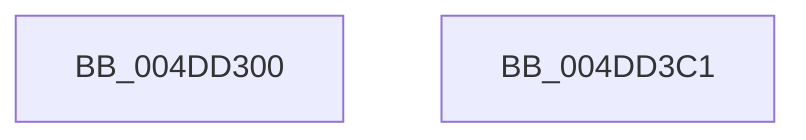

# HvlSetDeviceDmaEnabled

- RVA: `0x004DD300`–`0x004DD3C2` (길이 `194` bytes)
- VA: `0x00000001404DD300`
- 실행 섹션: `.text`
- PDB 이름 있음: `예`; PDB Function 태그: `아니요`
- unwind 정보 RVA: `0x000AF370`
- 디코드: `42`개 명령, `194/194` bytes 표시
- 미해석 바이트: `0` (있으면 어셈블리에 `.byte`로 보존)

> 이 문서는 커널 이미지의 기계어와 PDB 기호를 분석해 생성했습니다. 4번과 5번은 함수 원형과 자료형을 바이너리 사용 방식에서 추정한 C 해석이며 원본 소스 복구 결과는 아닙니다.

## 1. Dependencies

- 직접 호출 지점: **3**; 고유 호출 대상: **3**
- 직접 호출자로 확인된 함수: **0**
- RIP 상대 이미지 참조: **1**

### Outgoing calls
- `0x004DD3A2` → [HvcallFastExtended](../31/HvcallFastExtended_function_003130E0.md) (function, `0x003130E0`)
- `0x004DD3AA` → [HvlpHvToNtStatus](../30/HvlpHvToNtStatus_function_00307BD8.md) (function, `0x00307BD8`)
- `0x004DD3B7` → [_security_check_cookie](../6A/_security_check_cookie_function_006AC640.md) (function, `0x006AC640`)

### Direct callers
- 이 함수 시작 RVA로 연결되는 직접 call은 확인되지 않았습니다. 간접 호출은 완전히 역산할 수 없습니다.

### Static image references
- `0x004DD307` → RVA `0x00E0A740` (`.data`; read)

## 2. Other-region calls and transfers

- 다른 실행 섹션으로 향하는 call: **0**
- 별도 외부 분기/꼬리 이동을 확인하지 못했습니다.

## 3. Assembly (complete function range)

```asm
004DD300  4C 8B DC                        mov r11, rsp
004DD303  48 83 EC 78                     sub rsp, 0x78
004DD307  48 8B 05 32 D4 92 00            mov rax, qword ptr [rip + 0x92d432]
004DD30E  48 33 C4                        xor rax, rsp
004DD311  48 89 44 24 60                  mov qword ptr [rsp + 0x60], rax
004DD316  83 64 24 20 00                  and dword ptr [rsp + 0x20], 0
004DD31B  33 C0                           xor eax, eax
004DD31D  48 C7 44 24 30 AB 00 00 00      mov qword ptr [rsp + 0x30], 0xab
004DD326  0F 57 C0                        xorps xmm0, xmm0
004DD329  0F 11 44 24 40                  movups xmmword ptr [rsp + 0x40], xmm0
004DD32E  49 89 43 D8                     mov qword ptr [r11 - 0x28], rax
004DD332  45 33 C9                        xor r9d, r9d
004DD335  48 B8 00 00 00 00 00 00 00 40   movabs rax, 0x4000000000000000
004DD33F  C7 44 24 30 AB 00 02 00         mov dword ptr [rsp + 0x30], 0x200ab
004DD347  49 89 43 C8                     mov qword ptr [r11 - 0x38], rax
004DD34B  0F B7 41 08                     movzx eax, word ptr [rcx + 8]
004DD34F  66 89 44 24 42                  mov word ptr [rsp + 0x42], ax
004DD354  0F B7 41 0C                     movzx eax, word ptr [rcx + 0xc]
004DD358  66 89 44 24 40                  mov word ptr [rsp + 0x40], ax
004DD35D  45 0F B7 43 CE                  movzx r8d, word ptr [r11 - 0x32]
004DD362  41 0F B7 C0                     movzx eax, r8w
004DD366  66 33 41 0A                     xor ax, word ptr [rcx + 0xa]
004DD36A  66 83 E0 03                     and ax, 3
004DD36E  66 44 33 C0                     xor r8w, ax
004DD372  48 8B 44 24 30                  mov rax, qword ptr [rsp + 0x30]
004DD377  66 45 89 43 CE                  mov word ptr [r11 - 0x32], r8w
004DD37C  45 8D 41 18                     lea r8d, [r9 + 0x18]
004DD380  48 89 44 24 30                  mov qword ptr [rsp + 0x30], rax
004DD385  88 54 24 50                     mov byte ptr [rsp + 0x50], dl
004DD389  49 8D 53 C8                     lea rdx, [r11 - 0x38]
004DD38D  C7 44 24 30 AB 00 03 00         mov dword ptr [rsp + 0x30], 0x300ab
004DD395  48 8B 4C 24 30                  mov rcx, qword ptr [rsp + 0x30]
004DD39A  C7 44 24 48 01 00 00 00         mov dword ptr [rsp + 0x48], 1
004DD3A2  E8 39 5D E3 FF                  call 0x1403130e0
004DD3A7  48 8B C8                        mov rcx, rax
004DD3AA  E8 29 A8 E2 FF                  call 0x140307bd8
004DD3AF  48 8B 4C 24 60                  mov rcx, qword ptr [rsp + 0x60]
004DD3B4  48 33 CC                        xor rcx, rsp
004DD3B7  E8 84 F2 1C 00                  call 0x1406ac640
004DD3BC  48 83 C4 78                     add rsp, 0x78
004DD3C0  C3                              ret
004DD3C1  CC                              int3
```

## 4. C-style interpretation (structured pseudocode)

```c
__int64 __fastcall HvlSetDeviceDmaEnabled(__int64 a1, unsigned __int8 a2, __int64 a3, int a4)
{
    __int64 result;
    __int64 v_rsp;
    unsigned __int64 v_stack_m18;
    unsigned __int8 v_stack_m28;
    unsigned int v_stack_m30;
    unsigned __int16 v_stack_m36;
    unsigned __int64 v_stack_m38;
    unsigned __int64 v_stack_m48;
    unsigned int v_stack_m58;

    v_rsp = (v_rsp) - (120);
    result = (*(unsigned __int64 *)(v_rip + 9622578)) ^ (v_rsp);
    v_stack_m18 = result;
    result = 0;
    v_stack_m48 = 171;
    v_stack_m38 = v_xmm0;
    *(unsigned __int64 *)(v_rsp - 40) = 0;
    a4 = 0;
    v_stack_m48 = 0x200ABULL;
    *(unsigned __int64 *)(v_rsp - 56) = 0;
    v_stack_m36 = (unsigned __int16)(*(unsigned __int16 *)(a1 + 8));
    v_stack_m38 = (unsigned __int16)(*(unsigned __int16 *)(a1 + 12));
    result = (unsigned __int16)(((unsigned __int16)(*(unsigned __int16 *)(v_rsp - 50))) ^ (*(unsigned __int16 *)(a1 + 10)));
    result = (unsigned __int16)((result) & (3));
    a3 = (unsigned __int16)((*(unsigned __int16 *)(v_rsp - 50)) ^ ((unsigned __int16)(result)));
    *(unsigned __int16 *)(v_rsp - 50) = (unsigned __int16)(a3);
    v_stack_m48 = v_stack_m48;
    v_stack_m28 = a2;
    v_stack_m48 = 0x300ABULL;
    v_stack_m30 = 1;
    result = HvcallFastExtended(v_stack_m48, v_rsp - 56, a4 + 24, a4);
    result = HvlpHvToNtStatus(result, v_rsp - 56, a4 + 24, a4);
    a1 = (v_stack_m18) ^ (v_rsp);
    result = _security_check_cookie(a1, v_rsp - 56, a4 + 24, a4);
    v_rsp = (v_rsp) + (120);
    return result;
}
```

## 5. (Beta) C Style

```c
int64_t HvlSetDeviceDmaEnabled(void *Arg1, uint8_t Arg2, int64_t Arg3, int32_t Arg4)
{
    uint8_t *arg1 = (uint8_t *)Arg1;

    int64_t result;
    int64_t local_rsp;
    uint64_t v_stack_m18;
    uint8_t v_stack_m28;
    uint32_t v_stack_m30;
    uint16_t v_stack_m36;
    uint64_t v_stack_m38;
    uint64_t v_stack_m48;
    uint32_t v_stack_m58;

    local_rsp = (local_rsp) - (120);
    result = (*(uint64_t *)(v_rip + 0x92D432)) ^ (local_rsp);
    v_stack_m18 = result;
    result = 0;
    v_stack_m48 = 171;
    v_stack_m38 = v_xmm0;
    *(uint64_t *)(local_rsp - 0x28) = 0;
    Arg4 = 0;
    v_stack_m48 = 0x200ABULL;
    *(uint64_t *)(local_rsp - 0x38) = 0;
    v_stack_m36 = (uint16_t)(*(uint16_t *)(arg1 + 0x8));
    v_stack_m38 = (uint16_t)(*(uint16_t *)(arg1 + 0xC));
    result = (uint16_t)(((uint16_t)(*(uint16_t *)(local_rsp - 0x32))) ^ (*(uint16_t *)(arg1 + 0xA)));
    result = (uint16_t)((result) & (3));
    Arg3 = (uint16_t)((*(uint16_t *)(local_rsp - 0x32)) ^ ((uint16_t)(result)));
    *(uint16_t *)(local_rsp - 0x32) = (uint16_t)(Arg3);
    v_stack_m48 = v_stack_m48;
    v_stack_m28 = Arg2;
    v_stack_m48 = 0x300ABULL;
    v_stack_m30 = 1;
    result = HvcallFastExtended(v_stack_m48, local_rsp - 56, Arg4 + 24, Arg4);
    result = HvlpHvToNtStatus(result, local_rsp - 56, Arg4 + 24, Arg4);
    Arg1 = (v_stack_m18) ^ (local_rsp);
    result = _security_check_cookie(Arg1, local_rsp - 56, Arg4 + 24, Arg4);
    local_rsp = (local_rsp) + (120);
    return result;
}
```

### 관측된 메모리 오프셋

구조체 형식이 확인되지 않은 접근은 인자 기준의 오프셋으로만 기록했습니다.

| 기준 인자 | 오프셋 표현 | 폭 (bit) | 접근 |
|---|---:|---:|---|
| `Arg1` | `+ 0x8` | `16` | `R` |
| `Arg1` | `+ 0xA` | `16` | `R` |
| `Arg1` | `+ 0xC` | `16` | `R` |

## 6. Execution-region graph

[열기: 2D/3D 그래프와 함수 탐색 컨트롤 패널](../../../control-panel.html?section=text&rva=0x004DD300&view=graph)

- 2D 그래프는 위에서 아래로 흐르고, 3D 그래프는 빈 공간을 드래그해 회전합니다. Shift+드래그는 이동, 휠은 확대·축소, 함수 노드 선택은 대상 보고서 이동입니다.

### Static fallback


