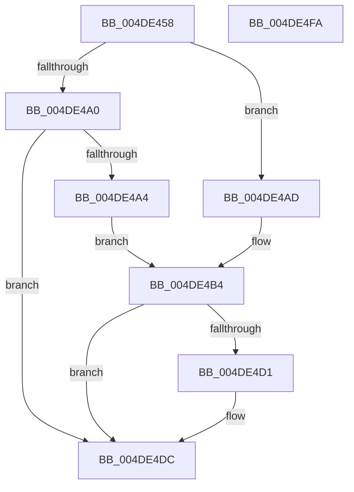

# HvlpProcessIommu

- RVA: `0x004DE458`–`0x004DE4FB` (길이 `163` bytes)
- VA: `0x00000001404DE458`
- 실행 섹션: `.text`
- PDB 이름 있음: `예`; PDB Function 태그: `아니요`
- unwind 정보 RVA: `0x000BEC6C`
- 디코드: `43`개 명령, `163/163` bytes 표시
- 미해석 바이트: `0` (있으면 어셈블리에 `.byte`로 보존)

> 이 문서는 커널 이미지의 기계어와 PDB 기호를 분석해 생성했습니다. 4번과 5번은 함수 원형과 자료형을 바이너리 사용 방식에서 추정한 C 해석이며 원본 소스 복구 결과는 아닙니다.

## 1. Dependencies

- 직접 호출 지점: **3**; 고유 호출 대상: **3**
- 직접 호출자로 확인된 함수: **1**
- RIP 상대 이미지 참조: **1**

### Outgoing calls
- `0x004DE497` → [KiGetCpuVendor](../../pagelk/B7/KiGetCpuVendor_function_00B7D5B4.md) (function, `0x00B7D5B4`)
- `0x004DE4C5` → [ZwQuerySystemInformation](../6A/ZwQuerySystemInformation_function_006AD790.md) (function, `0x006AD790`)
- `0x004DE4E5` → [_security_check_cookie](../6A/_security_check_cookie_function_006AC640.md) (function, `0x006AC640`)

### Direct callers
- [HvlQueryVsmProtectionInfo](../../page/A9/HvlQueryVsmProtectionInfo_function_00A96E30.md) at `0x00A96E9C`
- [HvlQueryVsmProtectionInfo](../../page/A9/HvlQueryVsmProtectionInfo_function_00A96E30.md) at `0x00A96F31`

### Static image references
- `0x004DE46A` → RVA `0x00E0A740` (`.data`; read)

## 2. Other-region calls and transfers

- 다른 실행 섹션으로 향하는 call: **1**
  - `0x004DE497` → [KiGetCpuVendor](../../pagelk/B7/KiGetCpuVendor_function_00B7D5B4.md) (`.text` → `PAGELK`)
- 별도 외부 분기/꼬리 이동을 확인하지 못했습니다.

## 3. Assembly (complete function range)

```asm
004DE458  48 89 5C 24 08                  mov qword ptr [rsp + 8], rbx
004DE45D  48 89 7C 24 10                  mov qword ptr [rsp + 0x10], rdi
004DE462  55                              push rbp
004DE463  48 8B EC                        mov rbp, rsp
004DE466  48 83 EC 50                     sub rsp, 0x50
004DE46A  48 8B 05 CF C2 92 00            mov rax, qword ptr [rip + 0x92c2cf]
004DE471  48 33 C4                        xor rax, rsp
004DE474  48 89 45 F0                     mov qword ptr [rbp - 0x10], rax
004DE478  33 DB                           xor ebx, ebx
004DE47A  48 C7 45 DC 01 00 00 00         mov qword ptr [rbp - 0x24], 1
004DE482  48 89 5D E4                     mov qword ptr [rbp - 0x1c], rbx
004DE486  C7 45 D8 49 50 43 41            mov dword ptr [rbp - 0x28], 0x41435049
004DE48D  C7 45 D0 14 00 00 00            mov dword ptr [rbp - 0x30], 0x14
004DE494  8D 7B 01                        lea edi, [rbx + 1]
004DE497  E8 18 F1 69 00                  call 0x140b7d5b4
004DE49C  2B C7                           sub eax, edi
004DE49E  74 0D                           je 0x1404de4ad
004DE4A0  3B C7                           cmp eax, edi
004DE4A2  75 38                           jne 0x1404de4dc
004DE4A4  C7 45 E0 44 4D 41 52            mov dword ptr [rbp - 0x20], 0x52414d44
004DE4AB  EB 07                           jmp 0x1404de4b4
004DE4AD  C7 45 E0 49 56 52 53            mov dword ptr [rbp - 0x20], 0x53525649
004DE4B4  44 8B 45 D0                     mov r8d, dword ptr [rbp - 0x30]
004DE4B8  4C 8D 4D D0                     lea r9, [rbp - 0x30]
004DE4BC  48 8D 55 D8                     lea rdx, [rbp - 0x28]
004DE4C0  B9 4C 00 00 00                  mov ecx, 0x4c
004DE4C5  E8 C6 F2 1C 00                  call 0x1406ad790
004DE4CA  3D 23 00 00 C0                  cmp eax, 0xc0000023
004DE4CF  75 0B                           jne 0x1404de4dc
004DE4D1  39 5D D0                        cmp dword ptr [rbp - 0x30], ebx
004DE4D4  0F B6 C3                        movzx eax, bl
004DE4D7  0F 47 C7                        cmova eax, edi
004DE4DA  8A D8                           mov bl, al
004DE4DC  8A C3                           mov al, bl
004DE4DE  48 8B 4D F0                     mov rcx, qword ptr [rbp - 0x10]
004DE4E2  48 33 CC                        xor rcx, rsp
004DE4E5  E8 56 E1 1C 00                  call 0x1406ac640
004DE4EA  48 8B 5C 24 60                  mov rbx, qword ptr [rsp + 0x60]
004DE4EF  48 8B 7C 24 68                  mov rdi, qword ptr [rsp + 0x68]
004DE4F4  48 83 C4 50                     add rsp, 0x50
004DE4F8  5D                              pop rbp
004DE4F9  C3                              ret
004DE4FA  CC                              int3
```

## 4. C-style interpretation (structured pseudocode)

```c
__int64 __fastcall HvlpProcessIommu(void)
{
    __int64 result;
    __int64 v_rbx;
    __int64 v_rsp;
    unsigned __int64 v_stack_m18;
    unsigned __int64 v_stack_m24;
    unsigned int v_stack_m28;
    unsigned __int64 v_stack_m2C;
    unsigned int v_stack_m30;
    unsigned int v_stack_m38;
    unsigned __int64 v_stack_p10;
    unsigned __int64 v_stack_p8;

    v_stack_p8 = v_rbx;
    v_stack_p10 = v_rdi;
    v_rsp = (v_rsp) - (80);
    result = (*(unsigned __int64 *)(v_rip + 9618127)) ^ (v_rsp);
    v_stack_m18 = result;
    v_rbx = 0;
    v_stack_m2C = 1;
    v_stack_m24 = 0;
    v_stack_m30 = 0x41435049ULL;
    v_stack_m38 = 20;
    result = KiGetCpuVendor(a1, a2, a3, a4);
    result = (unsigned int)((result) - ((unsigned int)(v_rbx + 1)));
    if (condition_is_equal) goto loc_004DE4AD;
    if (((unsigned int)(result)) != ((unsigned int)(v_rbx + 1))) goto loc_004DE4DC;
    v_stack_m28 = 0x52414D44ULL;
    goto loc_004DE4B4;
loc_004DE4AD:
    v_stack_m28 = 0x53525649ULL;
loc_004DE4B4:
    result = ZwQuerySystemInformation(76, v_stack_m30, (unsigned int)(v_stack_m38), v_stack_m38);
    if (((unsigned int)(result)) == 0xC0000023ULL) {
        result = 0;
        if (v_stack_m38 > 0) { result = (unsigned int)(v_rbx + 1); }
        v_rbx = (unsigned __int8)(result);
    }
    a1 = (v_stack_m18) ^ (v_rsp);
    result = _security_check_cookie(a1, v_stack_m30, (unsigned int)(v_stack_m38), v_stack_m38);
    v_rsp = (v_rsp) + (80);
    return result;
}
```

## 5. (Beta) C Style

```c
void HvlpProcessIommu(void)
{
    int64_t result;
    int64_t local_rbx;
    int64_t local_rsp;
    uint64_t v_stack_m18;
    uint64_t v_stack_m24;
    uint32_t v_stack_m28;
    uint64_t v_stack_m2C;
    uint32_t v_stack_m30;
    uint32_t v_stack_m38;
    uint64_t v_stack_p10;
    uint64_t v_stack_p8;

    v_stack_p8 = local_rbx;
    v_stack_p10 = local_rdi;
    local_rsp = (local_rsp) - (80);
    result = (*(uint64_t *)(v_rip + 0x92C2CF)) ^ (local_rsp);
    v_stack_m18 = result;
    local_rbx = 0;
    v_stack_m2C = 1;
    v_stack_m24 = 0;
    v_stack_m30 = 0x41435049ULL;
    v_stack_m38 = 20;
    result = KiGetCpuVendor(a1, a2, a3, a4);
    result = (uint32_t)((result) - ((uint32_t)(local_rbx + 1)));
    if (condition_is_equal) goto loc_004DE4AD;
    if (((uint32_t)(result)) != ((uint32_t)(local_rbx + 1))) goto loc_004DE4DC;
    v_stack_m28 = 0x52414D44ULL;
    goto loc_004DE4B4;
loc_004DE4AD:
    v_stack_m28 = 0x53525649ULL;
loc_004DE4B4:
    result = ZwQuerySystemInformation(76, v_stack_m30, (uint32_t)(v_stack_m38), v_stack_m38);
    if (((uint32_t)(result)) == 0xC0000023ULL) {
        result = 0;
        if (v_stack_m38 > 0) { result = (uint32_t)(local_rbx + 1); }
        local_rbx = (uint8_t)(result);
    }
    a1 = (v_stack_m18) ^ (local_rsp);
    result = _security_check_cookie(a1, v_stack_m30, (uint32_t)(v_stack_m38), v_stack_m38);
    local_rsp = (local_rsp) + (80);
    return result;
}
```

## 6. Execution-region graph

[열기: 2D/3D 그래프와 함수 탐색 컨트롤 패널](../../../control-panel.html?section=text&rva=0x004DE458&view=graph)

- 2D 그래프는 위에서 아래로 흐르고, 3D 그래프는 빈 공간을 드래그해 회전합니다. Shift+드래그는 이동, 휠은 확대·축소, 함수 노드 선택은 대상 보고서 이동입니다.

### Static fallback


