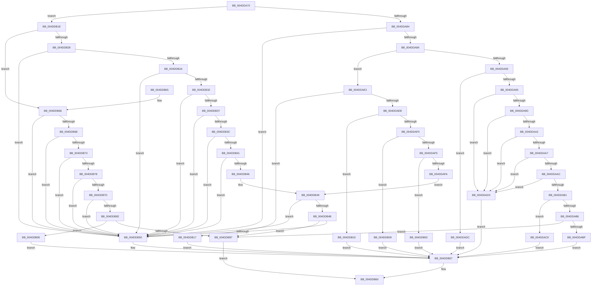

# HvlpSetRegister64

- RVA: `0x004DDA70`–`0x004DDB9C` (길이 `300` bytes)
- VA: `0x00000001404DDA70`
- 실행 섹션: `.text`
- PDB 이름 있음: `예`; PDB Function 태그: `아니요`
- unwind 정보 RVA: `0x000677F4`
- 디코드: `92`개 명령, `300/300` bytes 표시
- 미해석 바이트: `0` (있으면 어셈블리에 `.byte`로 보존)

> 이 문서는 커널 이미지의 기계어와 PDB 기호를 분석해 생성했습니다. 4번과 5번은 함수 원형과 자료형을 바이너리 사용 방식에서 추정한 C 해석이며 원본 소스 복구 결과는 아닙니다.

## 1. Dependencies

- 직접 호출 지점: **1**; 고유 호출 대상: **1**
- 직접 호출자로 확인된 함수: **8**
- RIP 상대 이미지 참조: **1**

### Outgoing calls
- `0x004DDB8E` → [RtlRaiseException](../5E/RtlRaiseException_function_005E6B00.md) (function, `0x005E6B00`)

### Direct callers
- [KiRemoveSystemWorkPriorityKick](../26/KiRemoveSystemWorkPriorityKick_function_002631D0.md) at `0x002632D1`
- [HvlEnlightenProcessor](HvlEnlightenProcessor_function_004DCD9C.md) at `0x004DCEAB`
- [HvlEnlightenProcessor](HvlEnlightenProcessor_function_004DCD9C.md) at `0x004DCF00`
- [HvlEnlightenProcessor](HvlEnlightenProcessor_function_004DCD9C.md) at `0x004DCF2F`
- [HvlConfigureMemoryZeroingOnReset](../58/HvlConfigureMemoryZeroingOnReset_function_00583760.md) at `0x0058377C`
- [HvlLogGuestCrashInformation](../58/HvlLogGuestCrashInformation_function_00583C84.md) at `0x00583CE5`
- [HvlLogGuestCrashInformation](../58/HvlLogGuestCrashInformation_function_00583C84.md) at `0x00583D56`
- [HvlpDetermineEnlightenments](../58/HvlpDetermineEnlightenments_function_0058CC9C.md) at `0x0058CE92`
- [HvlpDetermineEnlightenments](../58/HvlpDetermineEnlightenments_function_0058CC9C.md) at `0x0058CEC4`
- [HvlpPhase0Enlightenments](../58/HvlpPhase0Enlightenments_function_0058D1B8.md) at `0x0058D238`
- [PpmHvSetVirtualProcessorQos](../5D/PpmHvSetVirtualProcessorQos_function_005DD0A0.md) at `0x005DD0C4`
- [HvlDeleteProcessor](../../page/71/HvlDeleteProcessor_function_00717FA4.md) at `0x00717FE8`

### Static image references
- `0x004DDB87` → RVA `0x00E0A8C0` (`.data`; read)

## 2. Other-region calls and transfers

- 다른 실행 섹션으로 향하는 call: **0**
- 별도 외부 분기/꼬리 이동을 확인하지 못했습니다.

## 3. Assembly (complete function range)

```asm
004DDA70  48 83 EC 28                     sub rsp, 0x28
004DDA74  B8 02 00 0A 00                  mov eax, 0xa0002
004DDA79  44 8B C1                        mov r8d, ecx
004DDA7C  3B C8                           cmp ecx, eax
004DDA7E  0F 8F 9A 00 00 00               jg 0x1404ddb1e
004DDA84  0F 84 C6 00 00 00               je 0x1404ddb50
004DDA8A  B8 02 00 09 00                  mov eax, 0x90002
004DDA8F  3B C8                           cmp ecx, eax
004DDA91  7F 50                           jg 0x1404ddae3
004DDA93  74 47                           je 0x1404ddadc
004DDA95  81 E9 10 02 00 00               sub ecx, 0x210
004DDA9B  74 36                           je 0x1404ddad3
004DDA9D  83 E9 01                        sub ecx, 1
004DDAA0  74 31                           je 0x1404ddad3
004DDAA2  83 E9 01                        sub ecx, 1
004DDAA5  74 2C                           je 0x1404ddad3
004DDAA7  83 E9 01                        sub ecx, 1
004DDAAA  74 27                           je 0x1404ddad3
004DDAAC  83 E9 01                        sub ecx, 1
004DDAAF  74 22                           je 0x1404ddad3
004DDAB1  83 E9 01                        sub ecx, 1
004DDAB4  74 13                           je 0x1404ddac9
004DDAB6  83 F9 5B                        cmp ecx, 0x5b
004DDAB9  0F 85 C8 00 00 00               jne 0x1404ddb87
004DDABF  B9 16 01 00 40                  mov ecx, 0x40000116
004DDAC4  E9 8E 00 00 00                  jmp 0x1404ddb57
004DDAC9  B9 05 01 00 40                  mov ecx, 0x40000105
004DDACE  E9 84 00 00 00                  jmp 0x1404ddb57
004DDAD3  41 8D 88 F0 FE FF 3F            lea ecx, [r8 + 0x3ffffef0]
004DDADA  EB 7B                           jmp 0x1404ddb57
004DDADC  B9 00 00 00 40                  mov ecx, 0x40000000
004DDAE1  EB 74                           jmp 0x1404ddb57
004DDAE3  81 E9 07 00 09 00               sub ecx, 0x90007
004DDAE9  74 2C                           je 0x1404ddb17
004DDAEB  83 E9 0C                        sub ecx, 0xc
004DDAEE  74 20                           je 0x1404ddb10
004DDAF0  83 E9 04                        sub ecx, 4
004DDAF3  74 14                           je 0x1404ddb09
004DDAF5  83 E9 04                        sub ecx, 4
004DDAF8  74 08                           je 0x1404ddb02
004DDAFA  81 E9 E5 FF 00 00               sub ecx, 0xffe5
004DDB00  EB 47                           jmp 0x1404ddb49
004DDB02  B9 C2 00 00 40                  mov ecx, 0x400000c2
004DDB07  EB 4E                           jmp 0x1404ddb57
004DDB09  B9 21 00 00 40                  mov ecx, 0x40000021
004DDB0E  EB 47                           jmp 0x1404ddb57
004DDB10  B9 73 00 00 40                  mov ecx, 0x40000073
004DDB15  EB 40                           jmp 0x1404ddb57
004DDB17  B9 04 00 00 40                  mov ecx, 0x40000004
004DDB1C  EB 39                           jmp 0x1404ddb57
004DDB1E  B8 0A 00 0A 00                  mov eax, 0xa000a
004DDB23  44 3B C0                        cmp r8d, eax
004DDB26  7F 3E                           jg 0x1404ddb66
004DDB28  74 26                           je 0x1404ddb50
004DDB2A  81 E9 03 00 0A 00               sub ecx, 0xa0003
004DDB30  74 1E                           je 0x1404ddb50
004DDB32  83 E9 01                        sub ecx, 1
004DDB35  74 19                           je 0x1404ddb50
004DDB37  83 E9 01                        sub ecx, 1
004DDB3A  74 14                           je 0x1404ddb50
004DDB3C  83 E9 01                        sub ecx, 1
004DDB3F  74 0F                           je 0x1404ddb50
004DDB41  83 E9 01                        sub ecx, 1
004DDB44  74 0A                           je 0x1404ddb50
004DDB46  83 E9 01                        sub ecx, 1
004DDB49  74 05                           je 0x1404ddb50
004DDB4B  83 F9 01                        cmp ecx, 1
004DDB4E  75 37                           jne 0x1404ddb87
004DDB50  41 8D 88 90 00 F6 3F            lea ecx, [r8 + 0x3ff60090]
004DDB57  48 8B C2                        mov rax, rdx
004DDB5A  48 C1 EA 20                     shr rdx, 0x20
004DDB5E  0F 30                           wrmsr
004DDB60  48 83 C4 28                     add rsp, 0x28
004DDB64  C3                              ret
004DDB65  CC                              int3
004DDB66  81 E9 0B 00 0A 00               sub ecx, 0xa000b
004DDB6C  74 E2                           je 0x1404ddb50
004DDB6E  83 E9 01                        sub ecx, 1
004DDB71  74 DD                           je 0x1404ddb50
004DDB73  83 E9 01                        sub ecx, 1
004DDB76  74 D8                           je 0x1404ddb50
004DDB78  83 E9 01                        sub ecx, 1
004DDB7B  74 D3                           je 0x1404ddb50
004DDB7D  83 E9 01                        sub ecx, 1
004DDB80  74 CE                           je 0x1404ddb50
004DDB82  83 F9 04                        cmp ecx, 4
004DDB85  74 0E                           je 0x1404ddb95
004DDB87  48 8D 0D 32 CD 92 00            lea rcx, [rip + 0x92cd32]
004DDB8E  E8 6D 8F 10 00                  call 0x1405e6b00
004DDB93  EB CB                           jmp 0x1404ddb60
004DDB95  B9 83 00 00 40                  mov ecx, 0x40000083
004DDB9A  EB BB                           jmp 0x1404ddb57
```

## 4. C-style interpretation (structured pseudocode)

```c
__int64 __fastcall HvlpSetRegister64(int a1, __int64 a2)
{
    __int64 result;
    __int64 v_rsp;

    v_rsp = (v_rsp) - (40);
    if (a1 > ((unsigned int)((unsigned int)(0xA0002ULL)))) goto loc_004DDB1E;
    if (a1 == ((unsigned int)((unsigned int)(0xA0002ULL)))) goto loc_004DDB50;
    if (a1 > ((unsigned int)((unsigned int)(0x90002ULL)))) goto loc_004DDAE3;
    if (a1 == ((unsigned int)((unsigned int)(0x90002ULL)))) goto loc_004DDADC;
    a1 = (unsigned int)((a1) - (528));
    if (condition_is_equal) goto loc_004DDAD3;
    a1 = (unsigned int)((a1) - (1));
    if (condition_is_equal) goto loc_004DDAD3;
    a1 = (unsigned int)((a1) - (1));
    if (condition_is_equal) goto loc_004DDAD3;
    a1 = (unsigned int)((a1) - (1));
    if (condition_is_equal) goto loc_004DDAD3;
    a1 = (unsigned int)((a1) - (1));
    if (condition_is_equal) goto loc_004DDAD3;
    a1 = (unsigned int)((a1) - (1));
    if (condition_is_equal) goto loc_004DDAC9;
    if (a1 != 91) goto loc_004DDB87;
    goto loc_004DDB57;
loc_004DDAC9:
    goto loc_004DDB57;
loc_004DDAD3:
    goto loc_004DDB57;
loc_004DDADC:
    goto loc_004DDB57;
loc_004DDAE3:
    a1 = (unsigned int)(((unsigned int)(0x40000000ULL)) - (0x90007ULL));
    if (condition_is_equal) goto loc_004DDB17;
    a1 = (unsigned int)((a1) - (12));
    if (condition_is_equal) goto loc_004DDB10;
    a1 = (unsigned int)((a1) - (4));
    if (condition_is_equal) goto loc_004DDB09;
    a1 = (unsigned int)((a1) - (4));
    if (condition_is_equal) goto loc_004DDB02;
    a1 = (unsigned int)((a1) - (0xFFE5ULL));
    goto loc_004DDB49;
loc_004DDB02:
    goto loc_004DDB57;
loc_004DDB09:
    goto loc_004DDB57;
loc_004DDB10:
    goto loc_004DDB57;
loc_004DDB17:
    goto loc_004DDB57;
loc_004DDB1E:
    if (((unsigned int)((unsigned int)(a1))) > ((unsigned int)((unsigned int)(0xA000AULL)))) goto loc_004DDB66;
    if (((unsigned int)((unsigned int)(a1))) == ((unsigned int)((unsigned int)(0xA000AULL)))) goto loc_004DDB50;
    a1 = (unsigned int)(((unsigned int)(0x40000004ULL)) - (0xA0003ULL));
    if (condition_is_equal) goto loc_004DDB50;
    a1 = (unsigned int)((a1) - (1));
    if (condition_is_equal) goto loc_004DDB50;
    a1 = (unsigned int)((a1) - (1));
    if (condition_is_equal) goto loc_004DDB50;
    a1 = (unsigned int)((a1) - (1));
    if (condition_is_equal) goto loc_004DDB50;
    a1 = (unsigned int)((a1) - (1));
    if (condition_is_equal) goto loc_004DDB50;
    a1 = (unsigned int)((a1) - (1));
loc_004DDB49:
    if (condition_is_equal) goto loc_004DDB50;
    if (a1 != 1) goto loc_004DDB87;
loc_004DDB50:
loc_004DDB57:
    a2 = (a2) >> (32);
loc_004DDB60:
    v_rsp = (v_rsp) + (40);
    return a2;
loc_004DDB66:
    a1 = (unsigned int)(((unsigned int)(a1) + 1073086608) - (0xA000BULL));
    if (condition_is_equal) goto loc_004DDB50;
    a1 = (unsigned int)((a1) - (1));
    if (condition_is_equal) goto loc_004DDB50;
    a1 = (unsigned int)((a1) - (1));
    if (condition_is_equal) goto loc_004DDB50;
    a1 = (unsigned int)((a1) - (1));
    if (condition_is_equal) goto loc_004DDB50;
    a1 = (unsigned int)((a1) - (1));
    if (condition_is_equal) goto loc_004DDB50;
    if (a1 == 4) goto loc_004DDB95;
loc_004DDB87:
    result = RtlRaiseException(v_rip + 9620786, a2, (unsigned int)(a1), a4);
    goto loc_004DDB60;
loc_004DDB95:
    goto loc_004DDB57;
}
```

## 5. (Beta) C Style

```c
int64_t HvlpSetRegister64(void *Arg1, int64_t Arg2)
{
    uint8_t *arg1 = (uint8_t *)Arg1;

    int64_t result;
    int64_t local_rsp;

    local_rsp = (local_rsp) - (40);
    if (Arg1 > ((uint32_t)((uint32_t)(0xA0002ULL)))) goto loc_004DDB1E;
    if (Arg1 == ((uint32_t)((uint32_t)(0xA0002ULL)))) goto loc_004DDB50;
    if (Arg1 > ((uint32_t)((uint32_t)(0x90002ULL)))) goto loc_004DDAE3;
    if (Arg1 == ((uint32_t)((uint32_t)(0x90002ULL)))) goto loc_004DDADC;
    Arg1 = (uint32_t)((Arg1) - (528));
    if (condition_is_equal) goto loc_004DDAD3;
    Arg1 = (uint32_t)((Arg1) - (1));
    if (condition_is_equal) goto loc_004DDAD3;
    Arg1 = (uint32_t)((Arg1) - (1));
    if (condition_is_equal) goto loc_004DDAD3;
    Arg1 = (uint32_t)((Arg1) - (1));
    if (condition_is_equal) goto loc_004DDAD3;
    Arg1 = (uint32_t)((Arg1) - (1));
    if (condition_is_equal) goto loc_004DDAD3;
    Arg1 = (uint32_t)((Arg1) - (1));
    if (condition_is_equal) goto loc_004DDAC9;
    if (Arg1 != 91) goto loc_004DDB87;
    goto loc_004DDB57;
loc_004DDAC9:
    goto loc_004DDB57;
loc_004DDAD3:
    goto loc_004DDB57;
loc_004DDADC:
    goto loc_004DDB57;
loc_004DDAE3:
    Arg1 = (uint32_t)(((uint32_t)(0x40000000ULL)) - (0x90007ULL));
    if (condition_is_equal) goto loc_004DDB17;
    Arg1 = (uint32_t)((Arg1) - (12));
    if (condition_is_equal) goto loc_004DDB10;
    Arg1 = (uint32_t)((Arg1) - (4));
    if (condition_is_equal) goto loc_004DDB09;
    Arg1 = (uint32_t)((Arg1) - (4));
    if (condition_is_equal) goto loc_004DDB02;
    Arg1 = (uint32_t)((Arg1) - (0xFFE5ULL));
    goto loc_004DDB49;
loc_004DDB02:
    goto loc_004DDB57;
loc_004DDB09:
    goto loc_004DDB57;
loc_004DDB10:
    goto loc_004DDB57;
loc_004DDB17:
    goto loc_004DDB57;
loc_004DDB1E:
    if (((uint32_t)((uint32_t)(Arg1))) > ((uint32_t)((uint32_t)(0xA000AULL)))) goto loc_004DDB66;
    if (((uint32_t)((uint32_t)(Arg1))) == ((uint32_t)((uint32_t)(0xA000AULL)))) goto loc_004DDB50;
    Arg1 = (uint32_t)(((uint32_t)(0x40000004ULL)) - (0xA0003ULL));
    if (condition_is_equal) goto loc_004DDB50;
    Arg1 = (uint32_t)((Arg1) - (1));
    if (condition_is_equal) goto loc_004DDB50;
    Arg1 = (uint32_t)((Arg1) - (1));
    if (condition_is_equal) goto loc_004DDB50;
    Arg1 = (uint32_t)((Arg1) - (1));
    if (condition_is_equal) goto loc_004DDB50;
    Arg1 = (uint32_t)((Arg1) - (1));
    if (condition_is_equal) goto loc_004DDB50;
    Arg1 = (uint32_t)((Arg1) - (1));
loc_004DDB49:
    if (condition_is_equal) goto loc_004DDB50;
    if (Arg1 != 1) goto loc_004DDB87;
loc_004DDB50:
loc_004DDB57:
    Arg2 = (Arg2) >> (32);
loc_004DDB60:
    local_rsp = (local_rsp) + (40);
    return Arg2;
loc_004DDB66:
    Arg1 = (uint32_t)(((uint32_t)(Arg1) + 1073086608) - (0xA000BULL));
    if (condition_is_equal) goto loc_004DDB50;
    Arg1 = (uint32_t)((Arg1) - (1));
    if (condition_is_equal) goto loc_004DDB50;
    Arg1 = (uint32_t)((Arg1) - (1));
    if (condition_is_equal) goto loc_004DDB50;
    Arg1 = (uint32_t)((Arg1) - (1));
    if (condition_is_equal) goto loc_004DDB50;
    Arg1 = (uint32_t)((Arg1) - (1));
    if (condition_is_equal) goto loc_004DDB50;
    if (Arg1 == 4) goto loc_004DDB95;
loc_004DDB87:
    result = RtlRaiseException(v_rip + 9620786, Arg2, (uint32_t)(Arg1), a4);
    goto loc_004DDB60;
loc_004DDB95:
    goto loc_004DDB57;
}
```

### 관측된 메모리 오프셋

구조체 형식이 확인되지 않은 접근은 인자 기준의 오프셋으로만 기록했습니다.

| 기준 인자 | 오프셋 표현 | 폭 (bit) | 접근 |
|---|---:|---:|---|
| `Arg1` | `+ 0x3FFFFEF0` | `32` | `R` |

## 6. Execution-region graph

[열기: 2D/3D 그래프와 함수 탐색 컨트롤 패널](../../../control-panel.html?section=text&rva=0x004DDA70&view=graph)

- 2D 그래프는 위에서 아래로 흐르고, 3D 그래프는 빈 공간을 드래그해 회전합니다. Shift+드래그는 이동, 휠은 확대·축소, 함수 노드 선택은 대상 보고서 이동입니다.

### Static fallback


