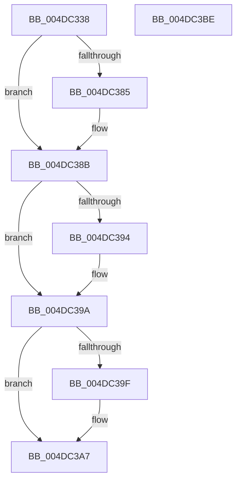

# IoPerfInit

- RVA: `0x004DC338`–`0x004DC3BF` (길이 `135` bytes)
- VA: `0x00000001404DC338`
- 실행 섹션: `.text`
- PDB 이름 있음: `예`; PDB Function 태그: `아니요`
- unwind 정보 RVA: `0x00065960`
- 디코드: `38`개 명령, `135/135` bytes 표시
- 미해석 바이트: `0` (있으면 어셈블리에 `.byte`로 보존)

> 이 문서는 커널 이미지의 기계어와 PDB 기호를 분석해 생성했습니다. 4번과 5번은 함수 원형과 자료형을 바이너리 사용 방식에서 추정한 C 해석이며 원본 소스 복구 결과는 아닙니다.

## 1. Dependencies

- 직접 호출 지점: **3**; 고유 호출 대상: **3**
- 직접 호출자로 확인된 함수: **2**
- RIP 상대 이미지 참조: **5**

### Outgoing calls
- `0x004DC361` → [KeAcquireInStackQueuedSpinLock](../27/KeAcquireInStackQueuedSpinLock_function_002757A0.md) (function, `0x002757A0`)
- `0x004DC3A2` → [IopUpdateFunctionPointers](../59/IopUpdateFunctionPointers_function_0059762C.md) (function, `0x0059762C`)
- `0x004DC3AC` → [KeReleaseInStackQueuedSpinLock](../34/KeReleaseInStackQueuedSpinLock_function_00342CE0.md) (function, `0x00342CE0`)

### Direct callers
- [IoRegisterIoTracking](../../page/71/IoRegisterIoTracking_function_0071F600.md) at `0x0071F723`
- [EtwpEnableKernelTrace](../../page/A4/EtwpEnableKernelTrace_function_00A4FBCC.md) at `0x00A4FEBE`

### Static image references
- `0x004DC34C` → RVA `0x00F8D430` (`.data`; read)
- `0x004DC366` → RVA `0x00E66138` (`.data`; read)
- `0x004DC37B` → RVA `0x00E66138` (`.data`; write)
- `0x004DC385` → RVA `0x00E6613C` (`.data`; read/write)
- `0x004DC394` → RVA `0x00E66140` (`.data`; read/write)

## 2. Other-region calls and transfers

- 다른 실행 섹션으로 향하는 call: **0**
- 별도 외부 분기/꼬리 이동을 확인하지 못했습니다.

## 3. Assembly (complete function range)

```asm
004DC338  48 89 5C 24 08                  mov qword ptr [rsp + 8], rbx
004DC33D  57                              push rdi
004DC33E  48 83 EC 40                     sub rsp, 0x40
004DC342  8B D9                           mov ebx, ecx
004DC344  48 8D 54 24 20                  lea rdx, [rsp + 0x20]
004DC349  0F 57 C0                        xorps xmm0, xmm0
004DC34C  48 8D 0D DD 10 AB 00            lea rcx, [rip + 0xab10dd]
004DC353  33 C0                           xor eax, eax
004DC355  33 FF                           xor edi, edi
004DC357  0F 11 44 24 20                  movups xmmword ptr [rsp + 0x20], xmm0
004DC35C  48 89 44 24 30                  mov qword ptr [rsp + 0x30], rax
004DC361  E8 3A 94 D9 FF                  call 0x1402757a0
004DC366  8B 05 CC 9D 98 00               mov eax, dword ptr [rip + 0x989dcc]
004DC36C  8D 57 01                        lea edx, [rdi + 1]
004DC36F  85 C0                           test eax, eax
004DC371  44 0F B6 C7                     movzx r8d, dil
004DC375  44 0F 44 C2                     cmove r8d, edx
004DC379  0B C3                           or eax, ebx
004DC37B  89 05 B7 9D 98 00               mov dword ptr [rip + 0x989db7], eax
004DC381  84 DA                           test dl, bl
004DC383  74 06                           je 0x1404dc38b
004DC385  01 15 B1 9D 98 00               add dword ptr [rip + 0x989db1], edx
004DC38B  B9 02 00 00 00                  mov ecx, 2
004DC390  84 D9                           test cl, bl
004DC392  74 06                           je 0x1404dc39a
004DC394  01 15 A6 9D 98 00               add dword ptr [rip + 0x989da6], edx
004DC39A  44 3A C2                        cmp r8b, dl
004DC39D  75 08                           jne 0x1404dc3a7
004DC39F  44 8A C2                        mov r8b, dl
004DC3A2  E8 85 B2 0B 00                  call 0x14059762c
004DC3A7  48 8D 4C 24 20                  lea rcx, [rsp + 0x20]
004DC3AC  E8 2F 69 E6 FF                  call 0x140342ce0
004DC3B1  48 8B 5C 24 50                  mov rbx, qword ptr [rsp + 0x50]
004DC3B6  33 C0                           xor eax, eax
004DC3B8  48 83 C4 40                     add rsp, 0x40
004DC3BC  5F                              pop rdi
004DC3BD  C3                              ret
004DC3BE  CC                              int3
```

## 4. C-style interpretation (structured pseudocode)

```c
__int64 __fastcall IoPerfInit(int a1)
{
    __int64 result;
    __int64 v_rdi;
    __int64 v_rsp;
    unsigned __int64 v_stack_m18;
    unsigned __int64 v_stack_m28;
    unsigned __int64 v_stack_p8;

    v_stack_p8 = v_rbx;
    v_rsp = (v_rsp) - (64);
    result = 0;
    v_rdi = 0;
    v_stack_m28 = v_xmm0;
    v_stack_m18 = 0;
    result = KeAcquireInStackQueuedSpinLock(v_rip + 11210973, v_stack_m28, a3, a4);
    a3 = 0;
    if ((unsigned int)((unsigned int)(*(unsigned int *)(v_rip + 10001868))) == 0) { a3 = (unsigned int)(v_rdi + 1); }
    result = (unsigned int)(((unsigned int)(*(unsigned int *)(v_rip + 10001868))) | ((unsigned int)((unsigned int)(a1))));
    *(unsigned int *)(v_rip + 10001847) = (unsigned int)(result);
    if ((((unsigned __int8)(v_rdi + 1)) & ((unsigned __int8)((unsigned int)(a1)))) != 0) {
    }
    if (((2) & ((unsigned __int8)((unsigned int)(a1)))) != 0) {
    }
    if (((unsigned __int8)(a3)) == ((unsigned __int8)(v_rdi + 1))) {
        a3 = (unsigned __int8)(v_rdi + 1);
        result = IopUpdateFunctionPointers(2, v_rdi + 1, a3, a4);
    }
    result = KeReleaseInStackQueuedSpinLock(v_stack_m28, v_rdi + 1, a3, a4);
    result = 0;
    v_rsp = (v_rsp) + (64);
    return result;
}
```

## 5. (Beta) C Style

```c
int64_t IoPerfInit(int32_t Arg1)
{
    int64_t result;
    int64_t local_rdi;
    int64_t local_rsp;
    uint64_t v_stack_m18;
    uint64_t v_stack_m28;
    uint64_t v_stack_p8;

    v_stack_p8 = local_rbx;
    local_rsp = (local_rsp) - (64);
    result = 0;
    local_rdi = 0;
    v_stack_m28 = v_xmm0;
    v_stack_m18 = 0;
    result = KeAcquireInStackQueuedSpinLock(v_rip + 11210973, v_stack_m28, a3, a4);
    a3 = 0;
    if ((uint32_t)((uint32_t)(*(uint32_t *)(v_rip + 0x989DCC))) == 0) { a3 = (uint32_t)(local_rdi + 1); }
    result = (uint32_t)(((uint32_t)(*(uint32_t *)(v_rip + 0x989DCC))) | ((uint32_t)((uint32_t)(Arg1))));
    *(uint32_t *)(v_rip + 0x989DB7) = (uint32_t)(result);
    if ((((uint8_t)(local_rdi + 1)) & ((uint8_t)((uint32_t)(Arg1)))) != 0) {
    }
    if (((2) & ((uint8_t)((uint32_t)(Arg1)))) != 0) {
    }
    if (((uint8_t)(a3)) == ((uint8_t)(local_rdi + 1))) {
        a3 = (uint8_t)(local_rdi + 1);
        result = IopUpdateFunctionPointers(2, local_rdi + 1, a3, a4);
    }
    result = KeReleaseInStackQueuedSpinLock(v_stack_m28, local_rdi + 1, a3, a4);
    result = 0;
    local_rsp = (local_rsp) + (64);
    return result;
}
```

## 6. Execution-region graph

[열기: 2D/3D 그래프와 함수 탐색 컨트롤 패널](../../../control-panel.html?section=text&rva=0x004DC338&view=graph)

- 2D 그래프는 위에서 아래로 흐르고, 3D 그래프는 빈 공간을 드래그해 회전합니다. Shift+드래그는 이동, 휠은 확대·축소, 함수 노드 선택은 대상 보고서 이동입니다.

### Static fallback


