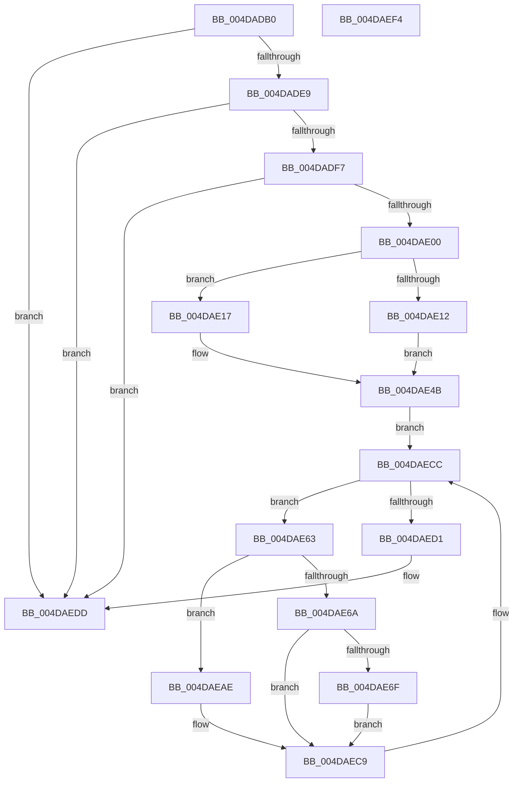

# IommupHvFlushDomainTbs

- RVA: `0x004DADB0`–`0x004DAEF5` (길이 `325` bytes)
- VA: `0x00000001404DADB0`
- 실행 섹션: `.text`
- PDB 이름 있음: `예`; PDB Function 태그: `아니요`
- unwind 정보 RVA: `0x000BCA90`
- 디코드: `89`개 명령, `325/325` bytes 표시
- 미해석 바이트: `0` (있으면 어셈블리에 `.byte`로 보존)

> 이 문서는 커널 이미지의 기계어와 PDB 기호를 분석해 생성했습니다. 4번과 5번은 함수 원형과 자료형을 바이너리 사용 방식에서 추정한 C 해석이며 원본 소스 복구 결과는 아닙니다.

## 1. Dependencies

- 직접 호출 지점: **4**; 고유 호출 대상: **3**
- 직접 호출자로 확인된 함수: **1**
- RIP 상대 이미지 참조: **3**

### Outgoing calls
- `0x004DAE4F` → [ExAcquireSpinLockShared](../24/ExAcquireSpinLockShared_function_0024DCE0.md) (function, `0x0024DCE0`)
- `0x004DAEA4` → [guard_dispatch_icall](../6B/guard_dispatch_icall_function_006BAAD0.md) (function, `0x006BAAD0`)
- `0x004DAEC4` → [guard_dispatch_icall](../6B/guard_dispatch_icall_function_006BAAD0.md) (function, `0x006BAAD0`)
- `0x004DAED8` → [ExReleaseSpinLockShared](../2F/ExReleaseSpinLockShared_function_002F0EF0.md) (function, `0x002F0EF0`)

### Direct callers
- [HalpIommuFlushDomainTbs](../30/HalpIommuFlushDomainTbs_function_003085C0.md) at `0x00308652`

### Static image references
- `0x004DADDB` → RVA `0x00FC1EA0` (`.data`; read)
- `0x004DADE9` → RVA `0x00FC1D78` (`.data`; read)
- `0x004DAE92` → RVA `0x00FC1EA8` (`.data`; read)

## 2. Other-region calls and transfers

- 다른 실행 섹션으로 향하는 call: **0**
- 별도 외부 분기/꼬리 이동을 확인하지 못했습니다.

## 3. Assembly (complete function range)

```asm
004DADB0  48 8B C4                        mov rax, rsp
004DADB3  48 89 58 08                     mov qword ptr [rax + 8], rbx
004DADB7  48 89 68 10                     mov qword ptr [rax + 0x10], rbp
004DADBB  56                              push rsi
004DADBC  57                              push rdi
004DADBD  41 54                           push r12
004DADBF  41 56                           push r14
004DADC1  41 57                           push r15
004DADC3  48 83 EC 40                     sub rsp, 0x40
004DADC7  83 60 20 00                     and dword ptr [rax + 0x20], 0
004DADCB  4C 8B CA                        mov r9, rdx
004DADCE  48 83 60 20 00                  and qword ptr [rax + 0x20], 0
004DADD3  48 8B F1                        mov rsi, rcx
004DADD6  48 83 60 C8 00                  and qword ptr [rax - 0x38], 0
004DADDB  48 83 3D BD 70 AE 00 00         cmp qword ptr [rip + 0xae70bd], 0
004DADE3  0F 84 F4 00 00 00               je 0x1404daedd
004DADE9  48 83 3D 87 6F AE 00 00         cmp qword ptr [rip + 0xae6f87], 0
004DADF1  0F 84 E6 00 00 00               je 0x1404daedd
004DADF7  4D 85 C0                        test r8, r8
004DADFA  0F 84 DD 00 00 00               je 0x1404daedd
004DAE00  49 8D 40 FF                     lea rax, [r8 - 1]
004DAE04  41 B8 01 00 00 00               mov r8d, 1
004DAE0A  48 03 C2                        add rax, rdx
004DAE0D  48 3B C2                        cmp rax, rdx
004DAE10  73 05                           jae 0x1404dae17
004DAE12  45 33 F6                        xor r14d, r14d
004DAE15  EB 34                           jmp 0x1404dae4b
004DAE17  49 33 C1                        xor rax, r9
004DAE1A  45 8B F0                        mov r14d, r8d
004DAE1D  48 0F BD C8                     bsr rcx, rax
004DAE21  B8 0C 00 00 00                  mov eax, 0xc
004DAE26  FF C1                           inc ecx
004DAE28  3B C8                           cmp ecx, eax
004DAE2A  0F 46 C8                        cmovbe ecx, eax
004DAE2D  49 8B C0                        mov rax, r8
004DAE30  48 D3 E0                        shl rax, cl
004DAE33  48 F7 D8                        neg rax
004DAE36  49 23 C1                        and rax, r9
004DAE39  8D 51 F4                        lea edx, [rcx - 0xc]
004DAE3C  48 33 C2                        xor rax, rdx
004DAE3F  48 83 E0 C0                     and rax, 0xffffffffffffffc0
004DAE43  48 33 C2                        xor rax, rdx
004DAE46  48 89 44 24 30                  mov qword ptr [rsp + 0x30], rax
004DAE4B  48 8D 4E 58                     lea rcx, [rsi + 0x58]
004DAE4F  E8 8C 2E D7 FF                  call 0x14024dce0
004DAE54  48 8D 7E 48                     lea rdi, [rsi + 0x48]
004DAE58  44 8A E0                        mov r12b, al
004DAE5B  48 8B 1F                        mov rbx, qword ptr [rdi]
004DAE5E  45 32 FF                        xor r15b, r15b
004DAE61  EB 69                           jmp 0x1404daecc
004DAE63  8B 53 10                        mov edx, dword ptr [rbx + 0x10]
004DAE66  85 D2                           test edx, edx
004DAE68  75 44                           jne 0x1404daeae
004DAE6A  45 84 FF                        test r15b, r15b
004DAE6D  75 5A                           jne 0x1404daec9
004DAE6F  48 83 A4 24 88 00 00 00 00      and qword ptr [rsp + 0x88], 0
004DAE78  4C 8D 44 24 30                  lea r8, [rsp + 0x30]
004DAE7D  8B 46 30                        mov eax, dword ptr [rsi + 0x30]
004DAE80  48 8D 8C 24 88 00 00 00         lea rcx, [rsp + 0x88]
004DAE88  89 84 24 88 00 00 00            mov dword ptr [rsp + 0x88], eax
004DAE8F  41 B1 01                        mov r9b, 1
004DAE92  48 8B 05 0F 70 AE 00            mov rax, qword ptr [rip + 0xae700f]
004DAE99  41 8B D6                        mov edx, r14d
004DAE9C  C6 84 24 8C 00 00 00 01         mov byte ptr [rsp + 0x8c], 1
004DAEA4  E8 27 FC 1D 00                  call 0x1406baad0
004DAEA9  41 B7 01                        mov r15b, 1
004DAEAC  EB 1B                           jmp 0x1404daec9
004DAEAE  48 8B 05 C3 6E AE 00            mov rax, qword ptr [rip + 0xae6ec3]
004DAEB5  4C 8D 4C 24 30                  lea r9, [rsp + 0x30]
004DAEBA  45 8B C6                        mov r8d, r14d
004DAEBD  C6 44 24 20 01                  mov byte ptr [rsp + 0x20], 1
004DAEC2  33 C9                           xor ecx, ecx
004DAEC4  E8 07 FC 1D 00                  call 0x1406baad0
004DAEC9  48 8B 1B                        mov rbx, qword ptr [rbx]
004DAECC  48 3B DF                        cmp rbx, rdi
004DAECF  75 92                           jne 0x1404dae63
004DAED1  41 8A D4                        mov dl, r12b
004DAED4  48 8D 4E 58                     lea rcx, [rsi + 0x58]
004DAED8  E8 13 60 E1 FF                  call 0x1402f0ef0
004DAEDD  48 8B 5C 24 70                  mov rbx, qword ptr [rsp + 0x70]
004DAEE2  48 8B 6C 24 78                  mov rbp, qword ptr [rsp + 0x78]
004DAEE7  48 83 C4 40                     add rsp, 0x40
004DAEEB  41 5F                           pop r15
004DAEED  41 5E                           pop r14
004DAEEF  41 5C                           pop r12
004DAEF1  5F                              pop rdi
004DAEF2  5E                              pop rsi
004DAEF3  C3                              ret
004DAEF4  CC                              int3
```

## 4. C-style interpretation (structured pseudocode)

```c
__int64 __fastcall IommupHvFlushDomainTbs(__int64 a1, __int64 a2, __int64 a3)
{
    __int64 result;
    __int64 v_r14;
    __int64 v_r15;
    __int64 v_rsp;
    unsigned __int64 v_stack_m38;
    unsigned __int8 v_stack_m48;
    unsigned __int64 v_stack_p10;
    unsigned __int64 v_stack_p20;
    unsigned __int8 v_stack_p24;
    unsigned __int64 v_stack_p8;

    *(unsigned __int64 *)(v_rsp + 8) = v_rbx;
    *(unsigned __int64 *)(v_rsp + 16) = v_rbp;
    v_rsp = (v_rsp) - (64);
    if ((*(unsigned __int64 *)(v_rip + 11432125)) == 0) goto loc_004DAEDD;
    if ((*(unsigned __int64 *)(v_rip + 11431815)) == 0) goto loc_004DAEDD;
    if (a3 == 0) goto loc_004DAEDD;
    result = (a3 - 1) + (a2);
    if (result >= a2) goto loc_004DAE17;
    v_r14 = 0;
    goto loc_004DAE4B;
loc_004DAE17:
    result = (result) ^ (a2);
    a1 = (unsigned int)((a1) + 1);
    if (((unsigned int)(a1)) <= 12) { a1 = 12; }
    result = (1) << ((unsigned __int8)(a1));
    result = -(result);
    result = (result) & (a2);
    result = (result) ^ (a1 - 12);
    result = (result) & (-64);
    result = (result) ^ (a1 - 12);
    v_stack_m38 = result;
loc_004DAE4B:
    result = ExAcquireSpinLockShared(a1 + 88, a1 - 12, 1, a2);
    v_r15 = 0;
    goto loc_004DAECC;
loc_004DAE63:
    if ((unsigned int)((unsigned int)(*(unsigned int *)(*(unsigned __int64 *)(a1 + 72) + 16))) != 0) goto loc_004DAEAE;
    if (0 != 0) goto loc_004DAEC9;
    v_stack_p20 = (unsigned int)((unsigned int)(*(unsigned int *)(a1 + 48)));
    v_stack_p24 = 1;
    result = guard_dispatch_icall(v_stack_p20, 1, v_stack_m38, 1);
    goto loc_004DAEC9;
loc_004DAEAE:
    v_stack_m48 = 1;
    a1 = 0;
    result = guard_dispatch_icall(a1, 1, 1, v_stack_m38);
loc_004DAEC9:
loc_004DAECC:
    if ((*(unsigned __int64 *)(*(unsigned __int64 *)(a1 + 72))) != (a1 + 72)) goto loc_004DAE63;
    result = ExReleaseSpinLockShared(a1 + 88, (unsigned __int8)((unsigned __int8)(result)), 1, v_stack_m38);
loc_004DAEDD:
    v_rsp = (v_rsp) + (64);
    return result;
}
```

## 5. (Beta) C Style

```c
int64_t IommupHvFlushDomainTbs(void *Arg1, int64_t Arg2, int64_t Arg3)
{
    uint8_t *arg1 = (uint8_t *)Arg1;

    int64_t result;
    int64_t local_r14;
    int64_t local_r15;
    int64_t local_rsp;
    uint64_t v_stack_m38;
    uint8_t v_stack_m48;
    uint64_t v_stack_p10;
    uint64_t v_stack_p20;
    uint8_t v_stack_p24;
    uint64_t v_stack_p8;

    *(uint64_t *)(local_rsp + 0x8) = local_rbx;
    *(uint64_t *)(local_rsp + 0x10) = local_rbp;
    local_rsp = (local_rsp) - (64);
    if ((*(uint64_t *)(v_rip + 0xAE70BD)) == 0) goto loc_004DAEDD;
    if ((*(uint64_t *)(v_rip + 0xAE6F87)) == 0) goto loc_004DAEDD;
    if (Arg3 == 0) goto loc_004DAEDD;
    result = (Arg3 - 1) + (Arg2);
    if (result >= Arg2) goto loc_004DAE17;
    local_r14 = 0;
    goto loc_004DAE4B;
loc_004DAE17:
    result = (result) ^ (Arg2);
    Arg1 = (uint32_t)((Arg1) + 1);
    if (((uint32_t)(Arg1)) <= 12) { Arg1 = 12; }
    result = (1) << ((uint8_t)(Arg1));
    result = -(result);
    result = (result) & (Arg2);
    result = (result) ^ (Arg1 - 12);
    result = (result) & (-64);
    result = (result) ^ (Arg1 - 12);
    v_stack_m38 = result;
loc_004DAE4B:
    result = ExAcquireSpinLockShared(Arg1 + 88, Arg1 - 12, 1, Arg2);
    local_r15 = 0;
    goto loc_004DAECC;
loc_004DAE63:
    if ((uint32_t)((uint32_t)(*(uint32_t *)(*(uint64_t *)(arg1 + 0x48) + 0x10))) != 0) goto loc_004DAEAE;
    if (0 != 0) goto loc_004DAEC9;
    v_stack_p20 = (uint32_t)((uint32_t)(*(uint32_t *)(arg1 + 0x30)));
    v_stack_p24 = 1;
    result = guard_dispatch_icall(v_stack_p20, 1, v_stack_m38, 1);
    goto loc_004DAEC9;
loc_004DAEAE:
    v_stack_m48 = 1;
    Arg1 = 0;
    result = guard_dispatch_icall(Arg1, 1, 1, v_stack_m38);
loc_004DAEC9:
loc_004DAECC:
    if ((*(uint64_t *)(*(uint64_t *)(arg1 + 0x48))) != (Arg1 + 72)) goto loc_004DAE63;
    result = ExReleaseSpinLockShared(Arg1 + 88, (uint8_t)((uint8_t)(result)), 1, v_stack_m38);
loc_004DAEDD:
    local_rsp = (local_rsp) + (64);
    return result;
}
```

### 관측된 메모리 오프셋

구조체 형식이 확인되지 않은 접근은 인자 기준의 오프셋으로만 기록했습니다.

| 기준 인자 | 오프셋 표현 | 폭 (bit) | 접근 |
|---|---:|---:|---|
| `Arg1` | `+ 0x0` | `64` | `R` |
| `Arg1` | `+ 0x30` | `32` | `R` |
| `Arg1` | `+ 0x48` | `64` | `R` |
| `Arg1` | `+ 0x58` | `64` | `R` |

## 6. Execution-region graph

[열기: 2D/3D 그래프와 함수 탐색 컨트롤 패널](../../../control-panel.html?section=text&rva=0x004DADB0&view=graph)

- 2D 그래프는 위에서 아래로 흐르고, 3D 그래프는 빈 공간을 드래그해 회전합니다. Shift+드래그는 이동, 휠은 확대·축소, 함수 노드 선택은 대상 보고서 이동입니다.

### Static fallback


