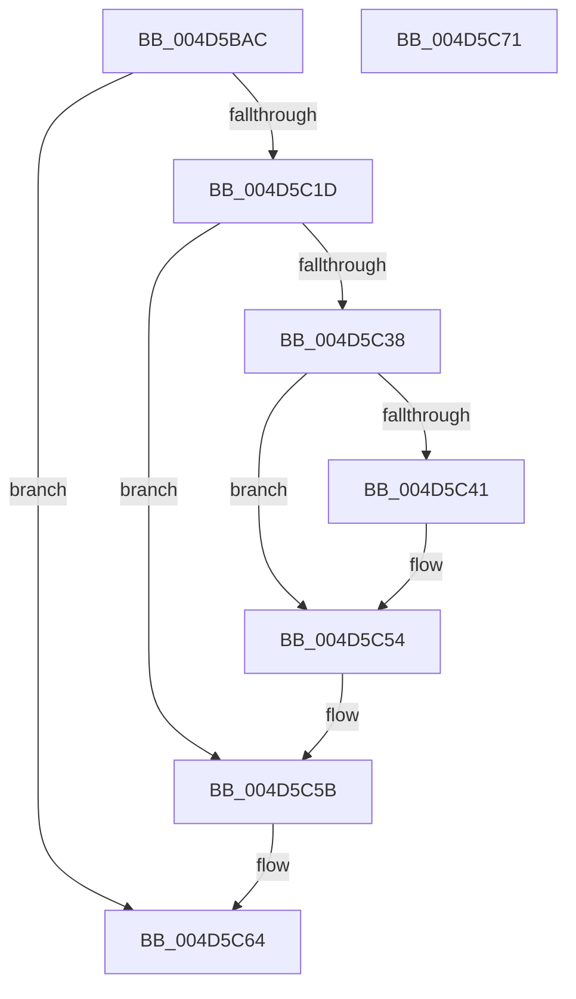

# IopAllowRemoteDASD

- RVA: `0x004D5BAC`–`0x004D5C72` (길이 `198` bytes)
- VA: `0x00000001404D5BAC`
- 실행 섹션: `.text`
- PDB 이름 있음: `예`; PDB Function 태그: `아니요`
- unwind 정보 RVA: `0x000BE300`
- 디코드: `54`개 명령, `198/198` bytes 표시
- 미해석 바이트: `0` (있으면 어셈블리에 `.byte`로 보존)

> 이 문서는 커널 이미지의 기계어와 PDB 기호를 분석해 생성했습니다. 4번과 5번은 함수 원형과 자료형을 바이너리 사용 방식에서 추정한 C 해석이며 원본 소스 복구 결과는 아닙니다.

## 1. Dependencies

- 직접 호출 지점: **6**; 고유 호출 대상: **5**
- 직접 호출자로 확인된 함수: **1**
- RIP 상대 이미지 참조: **2**

### Outgoing calls
- `0x004D5BCA` → [wcslen](../50/wcslen_function_00501BA0.md) (function, `0x00501BA0`)
- `0x004D5BDD` → [wcslen](../50/wcslen_function_00501BA0.md) (function, `0x00501BA0`)
- `0x004D5C14` → [IopOpenRegistryKey](../../page/A8/IopOpenRegistryKey_function_00A8F200.md) (function, `0x00A8F200`)
- `0x004D5C2F` → [IopGetRegistryValue](../../page/99/IopGetRegistryValue_function_009990EC.md) (function, `0x009990EC`)
- `0x004D5C56` → [ExFreePoolWithTag](../../poolcode/B8/ExFreePoolWithTag_function_00B82870.md) (function, `0x00B82870`)
- `0x004D5C5F` → [ZwClose](../6A/ZwClose_function_006AD2B0.md) (function, `0x006AD2B0`)

### Direct callers
- [IopParseDevice](../../page/89/IopParseDevice_function_0089E510.md) at `0x008A02FA`

### Static image references
- `0x004D5BBB` → RVA `0x006C9EA0` (` ?? ::FNODOBFM::`string'`; read)
- `0x004D5BCF` → RVA `0x006C9EC0` (` ?? ::FNODOBFM::`string'`; read)

## 2. Other-region calls and transfers

- 다른 실행 섹션으로 향하는 call: **3**
  - `0x004D5C14` → [IopOpenRegistryKey](../../page/A8/IopOpenRegistryKey_function_00A8F200.md) (`.text` → `PAGE`)
  - `0x004D5C2F` → [IopGetRegistryValue](../../page/99/IopGetRegistryValue_function_009990EC.md) (`.text` → `PAGE`)
  - `0x004D5C56` → [ExFreePoolWithTag](../../poolcode/B8/ExFreePoolWithTag_function_00B82870.md) (`.text` → `POOLCODE`)
- 별도 외부 분기/꼬리 이동을 확인하지 못했습니다.

## 3. Assembly (complete function range)

```asm
004D5BAC  48 89 5C 24 18                  mov qword ptr [rsp + 0x18], rbx
004D5BB1  55                              push rbp
004D5BB2  48 8B EC                        mov rbp, rsp
004D5BB5  48 83 EC 40                     sub rsp, 0x40
004D5BB9  33 DB                           xor ebx, ebx
004D5BBB  48 8D 0D DE 42 1F 00            lea rcx, [rip + 0x1f42de]
004D5BC2  48 89 5D 10                     mov qword ptr [rbp + 0x10], rbx
004D5BC6  48 89 5D 18                     mov qword ptr [rbp + 0x18], rbx
004D5BCA  E8 D1 BF 02 00                  call 0x140501ba0
004D5BCF  48 8D 0D EA 42 1F 00            lea rcx, [rip + 0x1f42ea]
004D5BD6  89 5D F4                        mov dword ptr [rbp - 0xc], ebx
004D5BD9  48 89 4D F8                     mov qword ptr [rbp - 8], rcx
004D5BDD  E8 BE BF 02 00                  call 0x140501ba0
004D5BE2  48 03 C0                        add rax, rax
004D5BE5  88 5C 24 20                     mov byte ptr [rsp + 0x20], bl
004D5BE9  48 3D FE FF 00 00               cmp rax, 0xfffe
004D5BEF  4C 8D 45 F0                     lea r8, [rbp - 0x10]
004D5BF3  B9 FC FF 00 00                  mov ecx, 0xfffc
004D5BF8  41 B9 19 00 02 00               mov r9d, 0x20019
004D5BFE  48 0F 43 C1                     cmovae rax, rcx
004D5C02  33 D2                           xor edx, edx
004D5C04  66 89 45 F0                     mov word ptr [rbp - 0x10], ax
004D5C08  48 8D 4D 10                     lea rcx, [rbp + 0x10]
004D5C0C  66 83 C0 02                     add ax, 2
004D5C10  66 89 45 F2                     mov word ptr [rbp - 0xe], ax
004D5C14  E8 E7 95 5B 00                  call 0x140a8f200
004D5C19  85 C0                           test eax, eax
004D5C1B  78 47                           js 0x1404d5c64
004D5C1D  48 8B 4D 10                     mov rcx, qword ptr [rbp + 0x10]
004D5C21  4C 8D 4D 18                     lea r9, [rbp + 0x18]
004D5C25  45 33 C0                        xor r8d, r8d
004D5C28  48 8D 15 71 42 1F 00            lea rdx, [rip + 0x1f4271]
004D5C2F  E8 B8 34 4C 00                  call 0x1409990ec
004D5C34  85 C0                           test eax, eax
004D5C36  78 23                           js 0x1404d5c5b
004D5C38  48 8B 4D 18                     mov rcx, qword ptr [rbp + 0x18]
004D5C3C  39 59 0C                        cmp dword ptr [rcx + 0xc], ebx
004D5C3F  74 13                           je 0x1404d5c54
004D5C41  8B 41 08                        mov eax, dword ptr [rcx + 8]
004D5C44  44 8D 43 01                     lea r8d, [rbx + 1]
004D5C48  0F B6 D3                        movzx edx, bl
004D5C4B  39 1C 08                        cmp dword ptr [rax + rcx], ebx
004D5C4E  41 0F 45 D0                     cmovne edx, r8d
004D5C52  8A DA                           mov bl, dl
004D5C54  33 D2                           xor edx, edx
004D5C56  E8 15 CC 6A 00                  call 0x140b82870
004D5C5B  48 8B 4D 10                     mov rcx, qword ptr [rbp + 0x10]
004D5C5F  E8 4C 76 1D 00                  call 0x1406ad2b0
004D5C64  8A C3                           mov al, bl
004D5C66  48 8B 5C 24 60                  mov rbx, qword ptr [rsp + 0x60]
004D5C6B  48 83 C4 40                     add rsp, 0x40
004D5C6F  5D                              pop rbp
004D5C70  C3                              ret
004D5C71  CC                              int3
```

## 4. C-style interpretation (structured pseudocode)

```c
__int64 __fastcall IopAllowRemoteDASD(__int64 a1, int a2)
{
    __int64 result;
    __int64 v_rbx;
    __int64 v_rsp;
    unsigned __int64 v_stack_m10;
    unsigned int v_stack_m14;
    unsigned __int16 v_stack_m16;
    unsigned __int64 v_stack_m18;
    unsigned __int8 v_stack_m28;
    unsigned __int64 v_stack_p10;
    unsigned __int64 v_stack_p18;
    unsigned __int64 v_stack_p8;

    v_stack_p18 = v_rbx;
    v_rsp = (v_rsp) - (64);
    v_rbx = 0;
    v_stack_p8 = 0;
    v_stack_p10 = 0;
    result = wcslen(v_rip + 2048734, a2, a3, a4);
    v_stack_m14 = 0;
    v_stack_m10 = v_rip + 2048746;
    result = wcslen(v_rip + 2048746, a2, a3, a4);
    result = (result) + (result);
    v_stack_m28 = 0;
    if (result >= 0xFFFEULL) { result = (unsigned int)(0xFFFCULL); }
    a2 = 0;
    v_stack_m18 = (unsigned __int16)(result);
    result = (unsigned __int16)((result) + (2));
    v_stack_m16 = (unsigned __int16)(result);
    result = IopOpenRegistryKey(v_stack_p8, a2, v_stack_m18, (unsigned int)(0x20019ULL));
    if (sign_flag) goto loc_004D5C64;
    a3 = 0;
    result = IopGetRegistryValue(v_stack_p8, v_rip + 2048625, a3, v_stack_p10);
    if (sign_flag) goto loc_004D5C5B;
    if ((*(unsigned int *)(v_stack_p10 + 12)) != 0) {
        result = *(unsigned int *)(v_stack_p10 + 8);
        a3 = v_rbx + 1;
        a2 = 0;
        if ((*(unsigned int *)(result + v_stack_p10 * 1)) != 0) { a2 = (unsigned int)(a3); }
        v_rbx = (unsigned __int8)(a2);
    }
    a2 = 0;
    result = ExFreePoolWithTag(v_stack_p10, a2, a3, v_stack_p10);
loc_004D5C5B:
    result = ZwClose(v_stack_p8, a2, a3, v_stack_p10);
loc_004D5C64:
    v_rsp = (v_rsp) + (64);
    return (unsigned __int8)(v_rbx);
}
```

## 5. (Beta) C Style

```c
int64_t IopAllowRemoteDASD(int64_t Arg1, int32_t Arg2)
{
    int64_t result;
    int64_t local_rbx;
    int64_t local_rsp;
    uint64_t v_stack_m10;
    uint32_t v_stack_m14;
    uint16_t v_stack_m16;
    uint64_t v_stack_m18;
    uint8_t v_stack_m28;
    uint64_t v_stack_p10;
    uint64_t v_stack_p18;
    uint64_t v_stack_p8;

    v_stack_p18 = local_rbx;
    local_rsp = (local_rsp) - (64);
    local_rbx = 0;
    v_stack_p8 = 0;
    v_stack_p10 = 0;
    result = wcslen(v_rip + 2048734, Arg2, a3, a4);
    v_stack_m14 = 0;
    v_stack_m10 = v_rip + 2048746;
    result = wcslen(v_rip + 2048746, Arg2, a3, a4);
    result = (result) + (result);
    v_stack_m28 = 0;
    if (result >= 0xFFFEULL) { result = (uint32_t)(0xFFFCULL); }
    Arg2 = 0;
    v_stack_m18 = (uint16_t)(result);
    result = (uint16_t)((result) + (2));
    v_stack_m16 = (uint16_t)(result);
    result = IopOpenRegistryKey(v_stack_p8, Arg2, v_stack_m18, (uint32_t)(0x20019ULL));
    if (sign_flag) goto loc_004D5C64;
    a3 = 0;
    result = IopGetRegistryValue(v_stack_p8, v_rip + 2048625, a3, v_stack_p10);
    if (sign_flag) goto loc_004D5C5B;
    if ((*(uint32_t *)(v_stack_p10 + 0xC)) != 0) {
        result = *(uint32_t *)(v_stack_p10 + 0x8);
        a3 = local_rbx + 1;
        Arg2 = 0;
        if ((*(uint32_t *)(result + v_stack_p10 * 1)) != 0) { Arg2 = (uint32_t)(a3); }
        local_rbx = (uint8_t)(Arg2);
    }
    Arg2 = 0;
    result = ExFreePoolWithTag(v_stack_p10, Arg2, a3, v_stack_p10);
loc_004D5C5B:
    result = ZwClose(v_stack_p8, Arg2, a3, v_stack_p10);
loc_004D5C64:
    local_rsp = (local_rsp) + (64);
    return (uint8_t)(local_rbx);
}
```

## 6. Execution-region graph

[열기: 2D/3D 그래프와 함수 탐색 컨트롤 패널](../../../control-panel.html?section=text&rva=0x004D5BAC&view=graph)

- 2D 그래프는 위에서 아래로 흐르고, 3D 그래프는 빈 공간을 드래그해 회전합니다. Shift+드래그는 이동, 휠은 확대·축소, 함수 노드 선택은 대상 보고서 이동입니다.

### Static fallback


