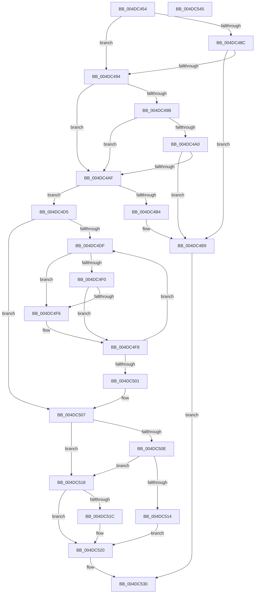

# IopCheckUnloadDriver

- RVA: `0x004DC454`–`0x004DC546` (길이 `242` bytes)
- VA: `0x00000001404DC454`
- 실행 섹션: `.text`
- PDB 이름 있음: `예`; PDB Function 태그: `아니요`
- unwind 정보 RVA: `0x0005C954`
- 디코드: `76`개 명령, `242/242` bytes 표시
- 미해석 바이트: `0` (있으면 어셈블리에 `.byte`로 보존)

> 이 문서는 커널 이미지의 기계어와 PDB 기호를 분석해 생성했습니다. 4번과 5번은 함수 원형과 자료형을 바이너리 사용 방식에서 추정한 C 해석이며 원본 소스 복구 결과는 아닙니다.

## 1. Dependencies

- 직접 호출 지점: **4**; 고유 호출 대상: **3**
- 직접 호출자로 확인된 함수: **2**
- RIP 상대 이미지 참조: **0**

### Outgoing calls
- `0x004DC475` → [KeAcquireQueuedSpinLock](../27/KeAcquireQueuedSpinLock_function_00273D80.md) (function, `0x00273D80`)
- `0x004DC4BF` → [KeReleaseQueuedSpinLock](../27/KeReleaseQueuedSpinLock_function_00272540.md) (function, `0x00272540`)
- `0x004DC4CC` → [ObfDereferenceObjectWithTag](../2F/ObfDereferenceObjectWithTag_function_002F78E0.md) (function, `0x002F78E0`)
- `0x004DC526` → [KeReleaseQueuedSpinLock](../27/KeReleaseQueuedSpinLock_function_00272540.md) (function, `0x00272540`)

### Direct callers
- [IopUnloadDriver](../../page/AB/IopUnloadDriver_function_00ABF868.md) at `0x00ABFB4C`
- [IovpUnloadDriver](../../pagevrfy/B9/IovpUnloadDriver_function_00B92AE8.md) at `0x00B92B21`

### Static image references
- 디코드된 RIP-relative 메모리 참조가 없습니다.

## 2. Other-region calls and transfers

- 다른 실행 섹션으로 향하는 call: **0**
- 별도 외부 분기/꼬리 이동을 확인하지 못했습니다.

## 3. Assembly (complete function range)

```asm
004DC454  48 89 5C 24 08                  mov qword ptr [rsp + 8], rbx
004DC459  48 89 6C 24 10                  mov qword ptr [rsp + 0x10], rbp
004DC45E  48 89 74 24 18                  mov qword ptr [rsp + 0x18], rsi
004DC463  57                              push rdi
004DC464  48 83 EC 20                     sub rsp, 0x20
004DC468  48 8B F1                        mov rsi, rcx
004DC46B  BD 0A 00 00 00                  mov ebp, 0xa
004DC470  8B CD                           mov ecx, ebp
004DC472  48 8B FA                        mov rdi, rdx
004DC475  E8 06 79 D9 FF                  call 0x140273d80
004DC47A  4C 8B 46 08                     mov r8, qword ptr [rsi + 8]
004DC47E  4C 8D 4E 10                     lea r9, [rsi + 0x10]
004DC482  33 DB                           xor ebx, ebx
004DC484  44 8A D0                        mov r10b, al
004DC487  4D 85 C0                        test r8, r8
004DC48A  75 08                           jne 0x1404dc494
004DC48C  41 8B 09                        mov ecx, dword ptr [r9]
004DC48F  F6 C1 01                        test cl, 1
004DC492  75 25                           jne 0x1404dc4b9
004DC494  41 8B 11                        mov edx, dword ptr [r9]
004DC497  84 D2                           test dl, dl
004DC499  78 14                           js 0x1404dc4af
004DC49B  4D 85 C0                        test r8, r8
004DC49E  74 0F                           je 0x1404dc4af
004DC4A0  49 8B 80 38 01 00 00            mov rax, qword ptr [r8 + 0x138]
004DC4A7  8B 48 20                        mov ecx, dword ptr [rax + 0x20]
004DC4AA  F6 C1 01                        test cl, 1
004DC4AD  75 0A                           jne 0x1404dc4b9
004DC4AF  F6 C2 10                        test dl, 0x10
004DC4B2  75 21                           jne 0x1404dc4d5
004DC4B4  BB 10 00 00 C0                  mov ebx, 0xc0000010
004DC4B9  41 8A D2                        mov dl, r10b
004DC4BC  48 8B CD                        mov rcx, rbp
004DC4BF  E8 7C 60 D9 FF                  call 0x140272540
004DC4C4  BA 44 66 6C 74                  mov edx, 0x746c6644
004DC4C9  48 8B CE                        mov rcx, rsi
004DC4CC  E8 0F B4 E1 FF                  call 0x1402f78e0
004DC4D1  8B C3                           mov eax, ebx
004DC4D3  EB 5B                           jmp 0x1404dc530
004DC4D5  C6 07 01                        mov byte ptr [rdi], 1
004DC4D8  B1 01                           mov cl, 1
004DC4DA  4D 85 C0                        test r8, r8
004DC4DD  74 28                           je 0x1404dc507
004DC4DF  49 8B 80 38 01 00 00            mov rax, qword ptr [r8 + 0x138]
004DC4E6  83 48 20 01                     or dword ptr [rax + 0x20], 1
004DC4EA  41 39 58 04                     cmp dword ptr [r8 + 4], ebx
004DC4EE  75 06                           jne 0x1404dc4f6
004DC4F0  49 39 58 18                     cmp qword ptr [r8 + 0x18], rbx
004DC4F4  74 02                           je 0x1404dc4f8
004DC4F6  88 1F                           mov byte ptr [rdi], bl
004DC4F8  4D 8B 40 10                     mov r8, qword ptr [r8 + 0x10]
004DC4FC  4D 85 C0                        test r8, r8
004DC4FF  75 DE                           jne 0x1404dc4df
004DC501  8A 0F                           mov cl, byte ptr [rdi]
004DC503  4C 8D 4E 10                     lea r9, [rsi + 0x10]
004DC507  41 8B 01                        mov eax, dword ptr [r9]
004DC50A  84 C0                           test al, al
004DC50C  79 0A                           jns 0x1404dc518
004DC50E  48 39 5E 08                     cmp qword ptr [rsi + 8], rbx
004DC512  74 04                           je 0x1404dc518
004DC514  88 1F                           mov byte ptr [rdi], bl
004DC516  EB 08                           jmp 0x1404dc520
004DC518  84 C9                           test cl, cl
004DC51A  74 04                           je 0x1404dc520
004DC51C  41 83 09 01                     or dword ptr [r9], 1
004DC520  41 8A D2                        mov dl, r10b
004DC523  48 8B CD                        mov rcx, rbp
004DC526  E8 15 60 D9 FF                  call 0x140272540
004DC52B  B8 01 00 00 C0                  mov eax, 0xc0000001
004DC530  48 8B 5C 24 30                  mov rbx, qword ptr [rsp + 0x30]
004DC535  48 8B 6C 24 38                  mov rbp, qword ptr [rsp + 0x38]
004DC53A  48 8B 74 24 40                  mov rsi, qword ptr [rsp + 0x40]
004DC53F  48 83 C4 20                     add rsp, 0x20
004DC543  5F                              pop rdi
004DC544  C3                              ret
004DC545  CC                              int3
```

## 4. C-style interpretation (structured pseudocode)

```c
__int64 __fastcall IopCheckUnloadDriver(__int64 a1, __int64 a2)
{
    __int64 result;
    __int64 v_rbx;
    __int64 v_rsp;
    unsigned __int64 v_stack_p10;
    unsigned __int64 v_stack_p18;
    unsigned __int64 v_stack_p8;

    v_stack_p8 = v_rbx;
    v_stack_p10 = v_rbp;
    v_stack_p18 = v_rsi;
    v_rsp = (v_rsp) - (32);
    result = KeAcquireQueuedSpinLock(10, a2, a3, a4);
    v_rbx = 0;
    if (*(unsigned __int64 *)(a1 + 8) != 0) goto loc_004DC494;
    if ((((unsigned __int8)((unsigned int)(*(unsigned int *)(a1 + 16)))) & (1)) != 0) goto loc_004DC4B9;
loc_004DC494:
    if (sign_flag) goto loc_004DC4AF;
    if (*(unsigned __int64 *)(a1 + 8) == 0) goto loc_004DC4AF;
    if ((((unsigned __int8)((unsigned int)(*(unsigned int *)(*(unsigned __int64 *)(*(unsigned __int64 *)(a1 + 8) + 312) + 32)))) & (1)) != 0) goto loc_004DC4B9;
loc_004DC4AF:
    if ((((unsigned __int8)((unsigned int)(*(unsigned int *)(a1 + 16)))) & (16)) != 0) goto loc_004DC4D5;
loc_004DC4B9:
    result = KeReleaseQueuedSpinLock(10, (unsigned __int8)((unsigned __int8)(result)), *(unsigned __int64 *)(a1 + 8), a1 + 16);
    result = ObfDereferenceObjectWithTag(a1, (unsigned int)(0x746C6644ULL), *(unsigned __int64 *)(a1 + 8), a1 + 16);
    goto loc_004DC530;
loc_004DC4D5:
    *(unsigned __int8 *)(a2) = 1;
    if (*(unsigned __int64 *)(a1 + 8) == 0) goto loc_004DC507;
loc_004DC4DF:
    if ((*(unsigned int *)(*(unsigned __int64 *)(a1 + 8) + 4)) != ((unsigned int)((unsigned int)(0xC0000010ULL)))) goto loc_004DC4F6;
    if ((*(unsigned __int64 *)(*(unsigned __int64 *)(a1 + 8) + 24)) != ((unsigned int)(0xC0000010ULL))) {
        *(unsigned __int8 *)(a2) = (unsigned __int8)((unsigned int)(0xC0000010ULL));
    }
    if (*(unsigned __int64 *)(*(unsigned __int64 *)(a1 + 8) + 16) != 0) goto loc_004DC4DF;
loc_004DC507:
    if (!sign_flag) goto loc_004DC518;
    if ((*(unsigned __int64 *)(a1 + 8)) == ((unsigned int)(0xC0000010ULL))) goto loc_004DC518;
    *(unsigned __int8 *)(a2) = (unsigned __int8)((unsigned int)(0xC0000010ULL));
    goto loc_004DC520;
loc_004DC518:
    if ((unsigned __int8)(*(unsigned __int8 *)(a2)) != 0) {
    }
    result = KeReleaseQueuedSpinLock(10, (unsigned __int8)((unsigned __int8)(result)), *(unsigned __int64 *)(*(unsigned __int64 *)(a1 + 8) + 16), a1 + 16);
loc_004DC530:
    v_rsp = (v_rsp) + (32);
    return (unsigned int)(0xC0000001ULL);
}
```

## 5. (Beta) C Style

```c
int64_t IopCheckUnloadDriver(void *Arg1, void *Arg2)
{
    uint8_t *arg1 = (uint8_t *)Arg1;
    uint8_t *arg2 = (uint8_t *)Arg2;

    int64_t result;
    int64_t local_rbx;
    int64_t local_rsp;
    uint64_t v_stack_p10;
    uint64_t v_stack_p18;
    uint64_t v_stack_p8;

    v_stack_p8 = local_rbx;
    v_stack_p10 = local_rbp;
    v_stack_p18 = local_rsi;
    local_rsp = (local_rsp) - (32);
    result = KeAcquireQueuedSpinLock(10, Arg2, a3, a4);
    local_rbx = 0;
    if (*(uint64_t *)(arg1 + 0x8) != 0) goto loc_004DC494;
    if ((((uint8_t)((uint32_t)(*(uint32_t *)(arg1 + 0x10)))) & (1)) != 0) goto loc_004DC4B9;
loc_004DC494:
    if (sign_flag) goto loc_004DC4AF;
    if (*(uint64_t *)(arg1 + 0x8) == 0) goto loc_004DC4AF;
    if ((((uint8_t)((uint32_t)(*(uint32_t *)(*(uint64_t *)(*(uint64_t *)(arg1 + 0x8) + 0x138) + 0x20)))) & (1)) != 0) goto loc_004DC4B9;
loc_004DC4AF:
    if ((((uint8_t)((uint32_t)(*(uint32_t *)(arg1 + 0x10)))) & (16)) != 0) goto loc_004DC4D5;
loc_004DC4B9:
    result = KeReleaseQueuedSpinLock(10, (uint8_t)((uint8_t)(result)), *(uint64_t *)(arg1 + 0x8), Arg1 + 16);
    result = ObfDereferenceObjectWithTag(Arg1, (uint32_t)(0x746C6644ULL), *(uint64_t *)(arg1 + 0x8), Arg1 + 16);
    goto loc_004DC530;
loc_004DC4D5:
    *(uint8_t *)(arg2) = 1;
    if (*(uint64_t *)(arg1 + 0x8) == 0) goto loc_004DC507;
loc_004DC4DF:
    if ((*(uint32_t *)(*(uint64_t *)(arg1 + 0x8) + 0x4)) != ((uint32_t)((uint32_t)(0xC0000010ULL)))) goto loc_004DC4F6;
    if ((*(uint64_t *)(*(uint64_t *)(arg1 + 0x8) + 0x18)) != ((uint32_t)(0xC0000010ULL))) {
        *(uint8_t *)(arg2) = (uint8_t)((uint32_t)(0xC0000010ULL));
    }
    if (*(uint64_t *)(*(uint64_t *)(arg1 + 0x8) + 0x10) != 0) goto loc_004DC4DF;
loc_004DC507:
    if (!sign_flag) goto loc_004DC518;
    if ((*(uint64_t *)(arg1 + 0x8)) == ((uint32_t)(0xC0000010ULL))) goto loc_004DC518;
    *(uint8_t *)(arg2) = (uint8_t)((uint32_t)(0xC0000010ULL));
    goto loc_004DC520;
loc_004DC518:
    if ((uint8_t)(*(uint8_t *)(arg2)) != 0) {
    }
    result = KeReleaseQueuedSpinLock(10, (uint8_t)((uint8_t)(result)), *(uint64_t *)(*(uint64_t *)(arg1 + 0x8) + 0x10), Arg1 + 16);
loc_004DC530:
    local_rsp = (local_rsp) + (32);
    return (uint32_t)(0xC0000001ULL);
}
```

### 관측된 메모리 오프셋

구조체 형식이 확인되지 않은 접근은 인자 기준의 오프셋으로만 기록했습니다.

| 기준 인자 | 오프셋 표현 | 폭 (bit) | 접근 |
|---|---:|---:|---|
| `Arg1` | `+ 0x0` | `32` | `R` |
| `Arg1` | `+ 0x0` | `32` | `R/W` |
| `Arg1` | `+ 0x8` | `64` | `R` |
| `Arg1` | `+ 0x10` | `64` | `R` |
| `Arg2` | `+ 0x0` | `8` | `R` |
| `Arg2` | `+ 0x0` | `8` | `W` |

## 6. Execution-region graph

[열기: 2D/3D 그래프와 함수 탐색 컨트롤 패널](../../../control-panel.html?section=text&rva=0x004DC454&view=graph)

- 2D 그래프는 위에서 아래로 흐르고, 3D 그래프는 빈 공간을 드래그해 회전합니다. Shift+드래그는 이동, 휠은 확대·축소, 함수 노드 선택은 대상 보고서 이동입니다.

### Static fallback


