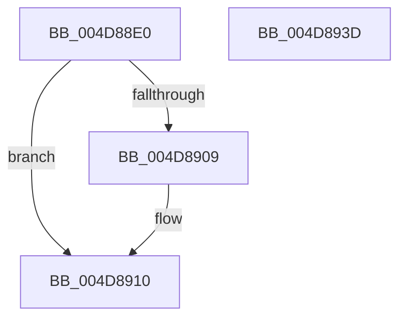

# IopErrorLogRequeueEntry

- RVA: `0x004D88E0`–`0x004D893E` (길이 `94` bytes)
- VA: `0x00000001404D88E0`
- 실행 섹션: `.text`
- PDB 이름 있음: `예`; PDB Function 태그: `아니요`
- unwind 정보 RVA: `0x0005CF00`
- 디코드: `23`개 명령, `94/94` bytes 표시
- 미해석 바이트: `0` (있으면 어셈블리에 `.byte`로 보존)

> 이 문서는 커널 이미지의 기계어와 PDB 기호를 분석해 생성했습니다. 4번과 5번은 함수 원형과 자료형을 바이너리 사용 방식에서 추정한 C 해석이며 원본 소스 복구 결과는 아닙니다.

## 1. Dependencies

- 직접 호출 지점: **2**; 고유 호출 대상: **2**
- 직접 호출자로 확인된 함수: **1**
- RIP 상대 이미지 참조: **4**

### Outgoing calls
- `0x004D88F0` → [KeAcquireSpinLockRaiseToDpc](../20/KeAcquireSpinLockRaiseToDpc_function_00208470.md) (function, `0x00208470`)
- `0x004D8932` → [KeReleaseSpinLock](../39/KeReleaseSpinLock_function_00392BA0.md) (function, `0x00392BA0`)

### Direct callers
- [IopErrorLogThread](../../page/A5/IopErrorLogThread_function_00A5DC80.md) at `0x00A5DF22`

### Static image references
- `0x004D88E9` → RVA `0x00FCF1C0` (`CACHEALI`; read)
- `0x004D88F5` → RVA `0x00F8D670` (`.data`; read)
- `0x004D8924` → RVA `0x00F8D670` (`.data`; write)
- `0x004D892B` → RVA `0x00F8D059` (`.data`; write)

## 2. Other-region calls and transfers

- 다른 실행 섹션으로 향하는 call: **0**
- 별도 외부 분기/꼬리 이동을 확인하지 못했습니다.

## 3. Assembly (complete function range)

```asm
004D88E0  40 53                           push rbx
004D88E2  48 83 EC 20                     sub rsp, 0x20
004D88E6  48 8B D9                        mov rbx, rcx
004D88E9  48 8D 0D D0 68 AF 00            lea rcx, [rip + 0xaf68d0]
004D88F0  E8 7B FB D2 FF                  call 0x140208470
004D88F5  48 8B 0D 74 4D AB 00            mov rcx, qword ptr [rip + 0xab4d74]
004D88FC  48 8D 15 6D 4D AB 00            lea rdx, [rip + 0xab4d6d]
004D8903  48 39 51 08                     cmp qword ptr [rcx + 8], rdx
004D8907  74 07                           je 0x1404d8910
004D8909  B9 03 00 00 00                  mov ecx, 3
004D890E  CD 29                           int 0x29
004D8910  48 89 0B                        mov qword ptr [rbx], rcx
004D8913  48 89 53 08                     mov qword ptr [rbx + 8], rdx
004D8917  8A D0                           mov dl, al
004D8919  48 89 59 08                     mov qword ptr [rcx + 8], rbx
004D891D  48 8D 0D 9C 68 AF 00            lea rcx, [rip + 0xaf689c]
004D8924  48 89 1D 45 4D AB 00            mov qword ptr [rip + 0xab4d45], rbx
004D892B  C6 05 27 47 AB 00 00            mov byte ptr [rip + 0xab4727], 0
004D8932  E8 69 A2 EB FF                  call 0x140392ba0
004D8937  48 83 C4 20                     add rsp, 0x20
004D893B  5B                              pop rbx
004D893C  C3                              ret
004D893D  CC                              int3
```

## 4. C-style interpretation (structured pseudocode)

```c
__int64 __fastcall IopErrorLogRequeueEntry(__int64 a1)
{
    __int64 result;
    __int64 v_rsp;

    v_rsp = (v_rsp) - (32);
    result = KeAcquireSpinLockRaiseToDpc(v_rip + 11495632, a2, a3, a4);
    if ((*(unsigned __int64 *)(*(unsigned __int64 *)(v_rip + 11226484) + 8)) != (v_rip + 11226477)) {
        a1 = 3;
    }
    *(unsigned __int64 *)(a1) = a1;
    *(unsigned __int64 *)(a1 + 8) = v_rip + 11226477;
    *(unsigned __int64 *)(a1 + 8) = a1;
    *(unsigned __int64 *)(v_rip + 11226437) = a1;
    *(unsigned __int8 *)(v_rip + 11224871) = 0;
    result = KeReleaseSpinLock(v_rip + 11495580, (unsigned __int8)(result), a3, a4);
    v_rsp = (v_rsp) + (32);
    return result;
}
```

## 5. (Beta) C Style

```c
int64_t IopErrorLogRequeueEntry(void *Arg1)
{
    uint8_t *arg1 = (uint8_t *)Arg1;

    int64_t result;
    int64_t local_rsp;

    local_rsp = (local_rsp) - (32);
    result = KeAcquireSpinLockRaiseToDpc(v_rip + 11495632, a2, a3, a4);
    if ((*(uint64_t *)(*(uint64_t *)(v_rip + 0xAB4D74) + 0x8)) != (v_rip + 11226477)) {
        Arg1 = 3;
    }
    *(void **)(arg1) = Arg1;
    *(uint64_t *)(arg1 + 0x8) = v_rip + 11226477;
    *(void **)(arg1 + 0x8) = Arg1;
    *(void **)(v_rip + 0xAB4D45) = Arg1;
    *(uint8_t *)(v_rip + 0xAB4727) = 0;
    result = KeReleaseSpinLock(v_rip + 11495580, (uint8_t)(result), a3, a4);
    local_rsp = (local_rsp) + (32);
    return result;
}
```

### 관측된 메모리 오프셋

구조체 형식이 확인되지 않은 접근은 인자 기준의 오프셋으로만 기록했습니다.

| 기준 인자 | 오프셋 표현 | 폭 (bit) | 접근 |
|---|---:|---:|---|
| `Arg1` | `+ 0x0` | `64` | `W` |
| `Arg1` | `+ 0x8` | `64` | `W` |

## 6. Execution-region graph

[열기: 2D/3D 그래프와 함수 탐색 컨트롤 패널](../../../control-panel.html?section=text&rva=0x004D88E0&view=graph)

- 2D 그래프는 위에서 아래로 흐르고, 3D 그래프는 빈 공간을 드래그해 회전합니다. Shift+드래그는 이동, 휠은 확대·축소, 함수 노드 선택은 대상 보고서 이동입니다.

### Static fallback


