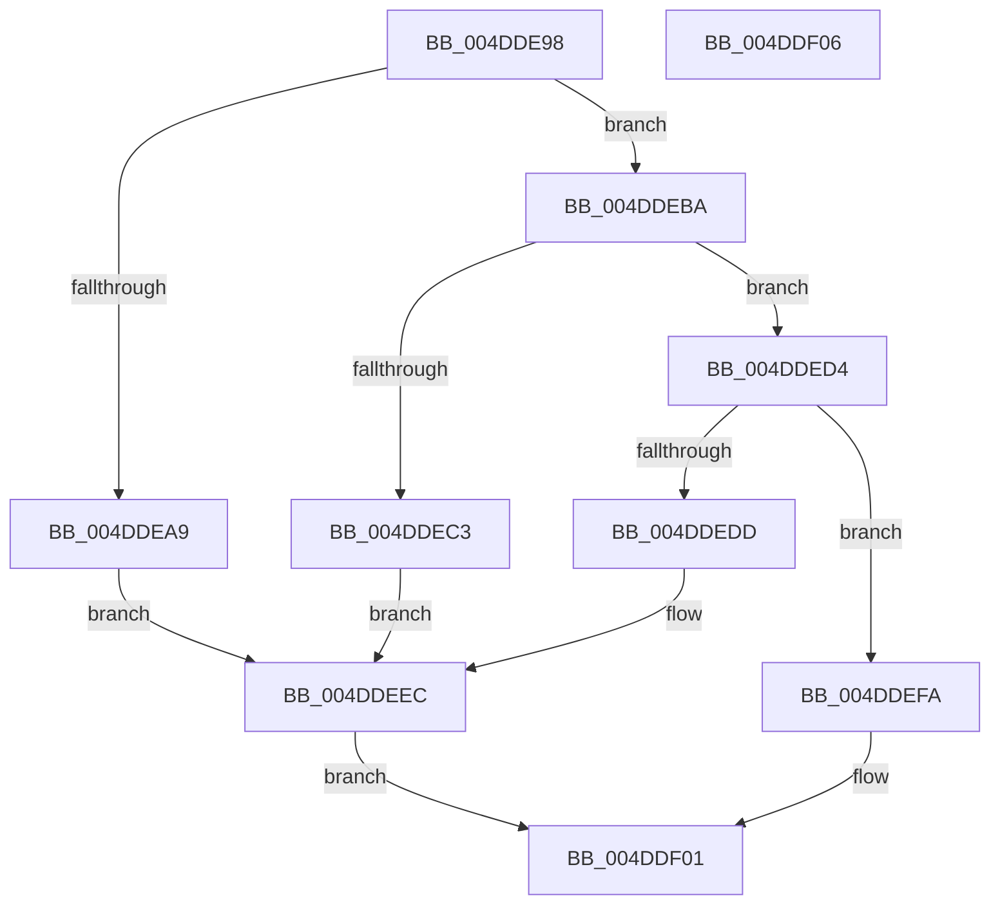

# IopFreeReserveIrp

- RVA: `0x004DDE98`–`0x004DDF07` (길이 `111` bytes)
- VA: `0x00000001404DDE98`
- 실행 섹션: `.text`
- PDB 이름 있음: `예`; PDB Function 태그: `아니요`
- unwind 정보 RVA: `0x0005C788`
- 디코드: `28`개 명령, `111/111` bytes 표시
- 미해석 바이트: `0` (있으면 어셈블리에 `.byte`로 보존)

> 이 문서는 커널 이미지의 기계어와 PDB 기호를 분석해 생성했습니다. 4번과 5번은 함수 원형과 자료형을 바이너리 사용 방식에서 추정한 C 해석이며 원본 소스 복구 결과는 아닙니다.

## 1. Dependencies

- 직접 호출 지점: **2**; 고유 호출 대상: **2**
- 직접 호출자로 확인된 함수: **2**
- RIP 상대 이미지 참조: **9**

### Outgoing calls
- `0x004DDEF3` → [KeSetEvent](../33/KeSetEvent_function_0033F310.md) (function, `0x0033F310`)
- `0x004DDEFC` → [IopFreeBackpocketIrp](../59/IopFreeBackpocketIrp_function_00597338.md) (function, `0x00597338`)

### Direct callers
- [sub_0024E626](../24/Unknown_function_0024E626.md) at `0x0024E629`
- [sub_0024ED3C](../24/Unknown_function_0024ED3C.md) at `0x0024ED3F`

### Static image references
- `0x004DDEA0` → RVA `0x00F8D580` (`.data`; read)
- `0x004DDEAB` → RVA `0x00F8D590` (`.data`; read)
- `0x004DDEB2` → RVA `0x00F8D588` (`.data`; read/write)
- `0x004DDEBA` → RVA `0x00F8D5A8` (`.data`; read)
- `0x004DDEC5` → RVA `0x00F8D5B8` (`.data`; read)
- `0x004DDECC` → RVA `0x00F8D5B0` (`.data`; read/write)
- `0x004DDED4` → RVA `0x00F8D5D0` (`.data`; read)
- `0x004DDEDF` → RVA `0x00F8D5E0` (`.data`; read)
- `0x004DDEE6` → RVA `0x00F8D5D8` (`.data`; read/write)

## 2. Other-region calls and transfers

- 다른 실행 섹션으로 향하는 call: **0**
- 별도 외부 분기/꼬리 이동을 확인하지 못했습니다.

## 3. Assembly (complete function range)

```asm
004DDE98  48 83 EC 28                     sub rsp, 0x28
004DDE9C  80 61 47 DE                     and byte ptr [rcx + 0x47], 0xde
004DDEA0  48 3B 0D D9 F6 AA 00            cmp rcx, qword ptr [rip + 0xaaf6d9]
004DDEA7  75 11                           jne 0x1404ddeba
004DDEA9  33 C0                           xor eax, eax
004DDEAB  48 8D 0D DE F6 AA 00            lea rcx, [rip + 0xaaf6de]
004DDEB2  87 05 D0 F6 AA 00               xchg dword ptr [rip + 0xaaf6d0], eax
004DDEB8  EB 32                           jmp 0x1404ddeec
004DDEBA  48 3B 0D E7 F6 AA 00            cmp rcx, qword ptr [rip + 0xaaf6e7]
004DDEC1  75 11                           jne 0x1404dded4
004DDEC3  33 C0                           xor eax, eax
004DDEC5  48 8D 0D EC F6 AA 00            lea rcx, [rip + 0xaaf6ec]
004DDECC  87 05 DE F6 AA 00               xchg dword ptr [rip + 0xaaf6de], eax
004DDED2  EB 18                           jmp 0x1404ddeec
004DDED4  48 3B 0D F5 F6 AA 00            cmp rcx, qword ptr [rip + 0xaaf6f5]
004DDEDB  75 1D                           jne 0x1404ddefa
004DDEDD  33 C0                           xor eax, eax
004DDEDF  48 8D 0D FA F6 AA 00            lea rcx, [rip + 0xaaf6fa]
004DDEE6  87 05 EC F6 AA 00               xchg dword ptr [rip + 0xaaf6ec], eax
004DDEEC  45 33 C0                        xor r8d, r8d
004DDEEF  41 8D 50 01                     lea edx, [r8 + 1]
004DDEF3  E8 18 14 E6 FF                  call 0x14033f310
004DDEF8  EB 07                           jmp 0x1404ddf01
004DDEFA  B2 01                           mov dl, 1
004DDEFC  E8 37 94 0B 00                  call 0x140597338
004DDF01  48 83 C4 28                     add rsp, 0x28
004DDF05  C3                              ret
004DDF06  CC                              int3
```

## 4. C-style interpretation (structured pseudocode)

```c
__int64 __fastcall IopFreeReserveIrp(__int64 a1, __int64 a2, int a3)
{
    __int64 result;
    __int64 v_rsp;

    v_rsp = (v_rsp) - (40);
    if (a1 != (*(unsigned __int64 *)(v_rip + 11204313))) goto loc_004DDEBA;
    result = 0;
    goto loc_004DDEEC;
loc_004DDEBA:
    if ((v_rip + 11204318) != (*(unsigned __int64 *)(v_rip + 11204327))) goto loc_004DDED4;
    result = 0;
    goto loc_004DDEEC;
loc_004DDED4:
    if ((v_rip + 11204332) != (*(unsigned __int64 *)(v_rip + 11204341))) goto loc_004DDEFA;
    result = 0;
loc_004DDEEC:
    a3 = 0;
    result = KeSetEvent(v_rip + 11204346, a3 + 1, a3, a4);
    goto loc_004DDF01;
loc_004DDEFA:
    result = IopFreeBackpocketIrp(v_rip + 11204346, 1, a3, a4);
loc_004DDF01:
    v_rsp = (v_rsp) + (40);
    return result;
}
```

## 5. (Beta) C Style

```c
int64_t IopFreeReserveIrp(void *Arg1, int64_t Arg2, int32_t Arg3)
{
    uint8_t *arg1 = (uint8_t *)Arg1;

    int64_t result;
    int64_t local_rsp;

    local_rsp = (local_rsp) - (40);
    if (Arg1 != (*(uint64_t *)(v_rip + 0xAAF6D9))) goto loc_004DDEBA;
    result = 0;
    goto loc_004DDEEC;
loc_004DDEBA:
    if ((v_rip + 11204318) != (*(uint64_t *)(v_rip + 0xAAF6E7))) goto loc_004DDED4;
    result = 0;
    goto loc_004DDEEC;
loc_004DDED4:
    if ((v_rip + 11204332) != (*(uint64_t *)(v_rip + 0xAAF6F5))) goto loc_004DDEFA;
    result = 0;
loc_004DDEEC:
    Arg3 = 0;
    result = KeSetEvent(v_rip + 11204346, Arg3 + 1, Arg3, a4);
    goto loc_004DDF01;
loc_004DDEFA:
    result = IopFreeBackpocketIrp(v_rip + 11204346, 1, Arg3, a4);
loc_004DDF01:
    local_rsp = (local_rsp) + (40);
    return result;
}
```

### 관측된 메모리 오프셋

구조체 형식이 확인되지 않은 접근은 인자 기준의 오프셋으로만 기록했습니다.

| 기준 인자 | 오프셋 표현 | 폭 (bit) | 접근 |
|---|---:|---:|---|
| `Arg1` | `+ 0x47` | `8` | `R/W` |

## 6. Execution-region graph

[열기: 2D/3D 그래프와 함수 탐색 컨트롤 패널](../../../control-panel.html?section=text&rva=0x004DDE98&view=graph)

- 2D 그래프는 위에서 아래로 흐르고, 3D 그래프는 빈 공간을 드래그해 회전합니다. Shift+드래그는 이동, 휠은 확대·축소, 함수 노드 선택은 대상 보고서 이동입니다.

### Static fallback


