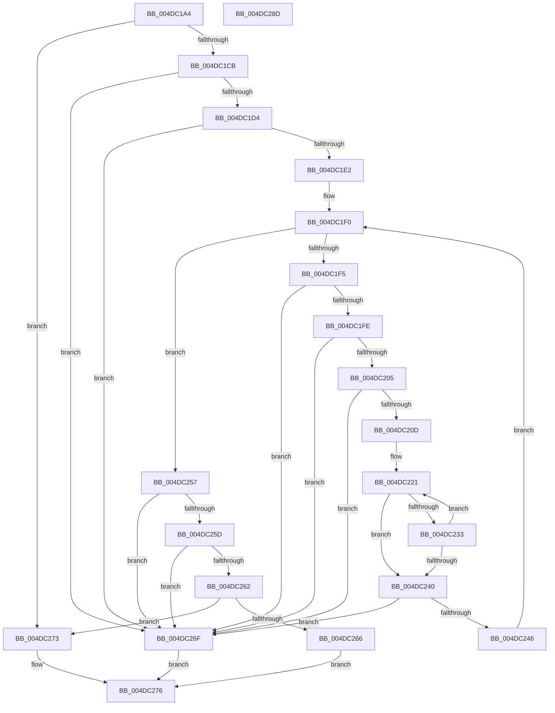

# IsTrustletCreateAttributeWellFormed

- RVA: `0x004DC1A4`–`0x004DC28E` (길이 `234` bytes)
- VA: `0x00000001404DC1A4`
- 실행 섹션: `.text`
- PDB 이름 있음: `예`; PDB Function 태그: `아니요`
- unwind 정보 RVA: `0x000A6CEC`
- 디코드: `68`개 명령, `234/234` bytes 표시
- 미해석 바이트: `0` (있으면 어셈블리에 `.byte`로 보존)

> 이 문서는 커널 이미지의 기계어와 PDB 기호를 분석해 생성했습니다. 4번과 5번은 함수 원형과 자료형을 바이너리 사용 방식에서 추정한 C 해석이며 원본 소스 복구 결과는 아닙니다.

## 1. Dependencies

- 직접 호출 지점: **0**; 고유 호출 대상: **0**
- 직접 호출자로 확인된 함수: **1**
- RIP 상대 이미지 참조: **1**

### Outgoing calls
- 직접 디코드된 call 명령이 없습니다.

### Direct callers
- [PspBuildCreateProcessContext](../../page/9E/PspBuildCreateProcessContext_function_009ED6E0.md) at `0x009EE1A6`

### Static image references
- `0x004DC212` → RVA `0x0000B5E0` (`.rdata`; read)

## 2. Other-region calls and transfers

- 다른 실행 섹션으로 향하는 call: **0**
- 별도 외부 분기/꼬리 이동을 확인하지 못했습니다.

## 3. Assembly (complete function range)

```asm
004DC1A4  48 8B C4                        mov rax, rsp
004DC1A7  48 89 58 08                     mov qword ptr [rax + 8], rbx
004DC1AB  48 89 68 10                     mov qword ptr [rax + 0x10], rbp
004DC1AF  48 89 70 18                     mov qword ptr [rax + 0x18], rsi
004DC1B3  48 89 78 20                     mov qword ptr [rax + 0x20], rdi
004DC1B7  41 56                           push r14
004DC1B9  32 DB                           xor bl, bl
004DC1BB  41 BE 01 00 00 00               mov r14d, 1
004DC1C1  48 83 FA 08                     cmp rdx, 8
004DC1C5  0F 84 A8 00 00 00               je 0x1404dc273
004DC1CB  F6 C2 07                        test dl, 7
004DC1CE  0F 85 9B 00 00 00               jne 0x1404dc26f
004DC1D4  48 8D 42 E8                     lea rax, [rdx - 0x18]
004DC1D8  48 83 F8 70                     cmp rax, 0x70
004DC1DC  0F 87 8D 00 00 00               ja 0x1404dc26f
004DC1E2  44 8D 4A F8                     lea r9d, [rdx - 8]
004DC1E6  45 33 C0                        xor r8d, r8d
004DC1E9  41 C1 E9 03                     shr r9d, 3
004DC1ED  45 33 DB                        xor r11d, r11d
004DC1F0  45 3B C1                        cmp r8d, r9d
004DC1F3  73 62                           jae 0x1404dc257
004DC1F5  42 8B 44 C1 0C                  mov eax, dword ptr [rcx + r8*8 + 0xc]
004DC1FA  84 C0                           test al, al
004DC1FC  75 71                           jne 0x1404dc26f
004DC1FE  3D 00 01 00 00                  cmp eax, 0x100
004DC203  73 6A                           jae 0x1404dc26f
004DC205  42 F6 44 C1 0B F0               test byte ptr [rcx + r8*8 + 0xb], 0xf0
004DC20B  75 62                           jne 0x1404dc26f
004DC20D  42 8A 74 C1 0A                  mov sil, byte ptr [rcx + r8*8 + 0xa]
004DC212  48 8D 3D C7 F3 B2 FF            lea rdi, [rip - 0x4d0c39]
004DC219  42 8B 6C C1 08                  mov ebp, dword ptr [rcx + r8*8 + 8]
004DC21E  45 33 D2                        xor r10d, r10d
004DC221  48 8B 07                        mov rax, qword ptr [rdi]
004DC224  40 80 FE 14                     cmp sil, 0x14
004DC228  0F B6 DB                        movzx ebx, bl
004DC22B  41 0F 44 DE                     cmove ebx, r14d
004DC22F  3B 28                           cmp ebp, dword ptr [rax]
004DC231  74 0D                           je 0x1404dc240
004DC233  45 03 D6                        add r10d, r14d
004DC236  48 83 C7 08                     add rdi, 8
004DC23A  41 83 FA 05                     cmp r10d, 5
004DC23E  72 E1                           jb 0x1404dc221
004DC240  41 83 FA 05                     cmp r10d, 5
004DC244  74 29                           je 0x1404dc26f
004DC246  42 0F B6 44 C1 09               movzx eax, byte ptr [rcx + r8*8 + 9]
004DC24C  45 03 DE                        add r11d, r14d
004DC24F  41 FF C0                        inc r8d
004DC252  44 03 C0                        add r8d, eax
004DC255  EB 99                           jmp 0x1404dc1f0
004DC257  41 83 FB 04                     cmp r11d, 4
004DC25B  77 12                           ja 0x1404dc26f
004DC25D  45 3B C1                        cmp r8d, r9d
004DC260  75 0D                           jne 0x1404dc26f
004DC262  84 DB                           test bl, bl
004DC264  75 0D                           jne 0x1404dc273
004DC266  48 83 39 00                     cmp qword ptr [rcx], 0
004DC26A  0F 95 C0                        setne al
004DC26D  EB 07                           jmp 0x1404dc276
004DC26F  32 C0                           xor al, al
004DC271  EB 03                           jmp 0x1404dc276
004DC273  41 8A C6                        mov al, r14b
004DC276  48 8B 5C 24 10                  mov rbx, qword ptr [rsp + 0x10]
004DC27B  48 8B 6C 24 18                  mov rbp, qword ptr [rsp + 0x18]
004DC280  48 8B 74 24 20                  mov rsi, qword ptr [rsp + 0x20]
004DC285  48 8B 7C 24 28                  mov rdi, qword ptr [rsp + 0x28]
004DC28A  41 5E                           pop r14
004DC28C  C3                              ret
004DC28D  CC                              int3
```

## 4. C-style interpretation (structured pseudocode)

```c
__int64 __fastcall IsTrustletCreateAttributeWellFormed(__int64 a1, __int64 a2, int a3)
{
    __int64 result;
    __int64 v_r10;
    __int64 v_r11;
    __int64 v_rbx;
    __int64 v_rdi;
    unsigned __int64 v_stack_p10;
    unsigned __int64 v_stack_p18;
    unsigned __int64 v_stack_p20;
    unsigned __int64 v_stack_p8;

    *(unsigned __int64 *)(v_rsp + 8) = v_rbx;
    *(unsigned __int64 *)(v_rsp + 16) = v_rbp;
    *(unsigned __int64 *)(v_rsp + 24) = v_rsi;
    *(unsigned __int64 *)(v_rsp + 32) = v_rdi;
    v_rbx = 0;
    if (a2 == 8) goto loc_004DC273;
    if ((((unsigned __int8)(a2)) & (7)) != 0) goto loc_004DC26F;
    if ((a2 - 24) > 112) goto loc_004DC26F;
    a3 = 0;
    a4 = (unsigned int)((a2 - 8) >> (3));
    v_r11 = 0;
loc_004DC1F0:
    if (0 >= ((unsigned int)(a4))) goto loc_004DC257;
    if ((unsigned __int8)((unsigned int)(*(unsigned int *)(a1 + a3 * 8 + 12))) != 0) goto loc_004DC26F;
    if (((unsigned int)((unsigned int)(*(unsigned int *)(a1 + a3 * 8 + 12)))) >= 256) goto loc_004DC26F;
    if (((*(unsigned __int8 *)(a1 + a3 * 8 + 11)) & (240)) != 0) goto loc_004DC26F;
    v_r10 = 0;
loc_004DC221:
    v_rbx = 0;
    if (((unsigned __int8)(*(unsigned __int8 *)(a1 + a3 * 8 + 10))) == 20) { v_rbx = 1; }
    if (((unsigned int)((unsigned int)(*(unsigned int *)(a1 + a3 * 8 + 8)))) == (*(unsigned int *)(*(unsigned __int64 *)(v_rip - 5049401)))) goto loc_004DC240;
    v_r10 = (unsigned int)((v_r10) + (1));
    v_rdi = (v_rip - 5049401) + (8);
    if (((unsigned int)(v_r10)) < 5) goto loc_004DC221;
loc_004DC240:
    if (((unsigned int)(v_r10)) == 5) goto loc_004DC26F;
    v_r11 = (unsigned int)((v_r11) + (1));
    a3 = (unsigned int)((a3) + 1);
    a3 = (unsigned int)((a3) + ((unsigned int)(*(unsigned __int8 *)(a1 + a3 * 8 + 9))));
    goto loc_004DC1F0;
loc_004DC257:
    if (((unsigned int)(v_r11)) > 4) goto loc_004DC26F;
    if (a3 != ((unsigned int)(a4))) goto loc_004DC26F;
    if ((unsigned __int8)(v_rbx) != 0) goto loc_004DC273;
    result = ((*(unsigned __int64 *)(a1)) != 0) ? 1 : 0;
    goto loc_004DC276;
loc_004DC26F:
    result = 0;
    goto loc_004DC276;
loc_004DC273:
loc_004DC276:
    return 1;
}
```

## 5. (Beta) C Style

```c
int64_t IsTrustletCreateAttributeWellFormed(void *Arg1, int64_t Arg2, int32_t Arg3)
{
    uint8_t *arg1 = (uint8_t *)Arg1;

    int64_t result;
    int64_t local_r10;
    int64_t local_r11;
    int64_t local_rbx;
    int64_t local_rdi;
    uint64_t v_stack_p10;
    uint64_t v_stack_p18;
    uint64_t v_stack_p20;
    uint64_t v_stack_p8;

    *(uint64_t *)(local_rsp + 0x8) = local_rbx;
    *(uint64_t *)(local_rsp + 0x10) = local_rbp;
    *(uint64_t *)(local_rsp + 0x18) = local_rsi;
    *(uint64_t *)(local_rsp + 0x20) = local_rdi;
    local_rbx = 0;
    if (Arg2 == 8) goto loc_004DC273;
    if ((((uint8_t)(Arg2)) & (7)) != 0) goto loc_004DC26F;
    if ((Arg2 - 24) > 112) goto loc_004DC26F;
    Arg3 = 0;
    a4 = (uint32_t)((Arg2 - 8) >> (3));
    local_r11 = 0;
loc_004DC1F0:
    if (0 >= ((uint32_t)(a4))) goto loc_004DC257;
    if ((uint8_t)((uint32_t)(*(uint32_t *)(arg1 + Arg3 * 8 + 0xC))) != 0) goto loc_004DC26F;
    if (((uint32_t)((uint32_t)(*(uint32_t *)(arg1 + Arg3 * 8 + 0xC)))) >= 256) goto loc_004DC26F;
    if (((*(uint8_t *)(arg1 + Arg3 * 8 + 0xB)) & (240)) != 0) goto loc_004DC26F;
    local_r10 = 0;
loc_004DC221:
    local_rbx = 0;
    if (((uint8_t)(*(uint8_t *)(arg1 + Arg3 * 8 + 0xA))) == 20) { local_rbx = 1; }
    if (((uint32_t)((uint32_t)(*(uint32_t *)(arg1 + Arg3 * 8 + 0x8)))) == (*(uint32_t *)(*(uint64_t *)(v_rip - 0x4D0C39)))) goto loc_004DC240;
    local_r10 = (uint32_t)((local_r10) + (1));
    local_rdi = (v_rip - 5049401) + (8);
    if (((uint32_t)(local_r10)) < 5) goto loc_004DC221;
loc_004DC240:
    if (((uint32_t)(local_r10)) == 5) goto loc_004DC26F;
    local_r11 = (uint32_t)((local_r11) + (1));
    Arg3 = (uint32_t)((Arg3) + 1);
    Arg3 = (uint32_t)((Arg3) + ((uint32_t)(*(uint8_t *)(arg1 + Arg3 * 8 + 0x9))));
    goto loc_004DC1F0;
loc_004DC257:
    if (((uint32_t)(local_r11)) > 4) goto loc_004DC26F;
    if (Arg3 != ((uint32_t)(a4))) goto loc_004DC26F;
    if ((uint8_t)(local_rbx) != 0) goto loc_004DC273;
    result = ((*(uint64_t *)(arg1)) != 0) ? 1 : 0;
    goto loc_004DC276;
loc_004DC26F:
    result = 0;
    goto loc_004DC276;
loc_004DC273:
loc_004DC276:
    return 1;
}
```

### 관측된 메모리 오프셋

구조체 형식이 확인되지 않은 접근은 인자 기준의 오프셋으로만 기록했습니다.

| 기준 인자 | 오프셋 표현 | 폭 (bit) | 접근 |
|---|---:|---:|---|
| `Arg1` | `+ 0x0` | `64` | `R` |
| `Arg1` | `+ 0x8 + r8*8` | `32` | `R` |
| `Arg1` | `+ 0x9 + r8*8` | `8` | `R` |
| `Arg1` | `+ 0xA + r8*8` | `8` | `R` |
| `Arg1` | `+ 0xB + r8*8` | `8` | `R` |
| `Arg1` | `+ 0xC + r8*8` | `32` | `R` |

## 6. Execution-region graph

[열기: 2D/3D 그래프와 함수 탐색 컨트롤 패널](../../../control-panel.html?section=text&rva=0x004DC1A4&view=graph)

- 2D 그래프는 위에서 아래로 흐르고, 3D 그래프는 빈 공간을 드래그해 회전합니다. Shift+드래그는 이동, 휠은 확대·축소, 함수 노드 선택은 대상 보고서 이동입니다.

### Static fallback


