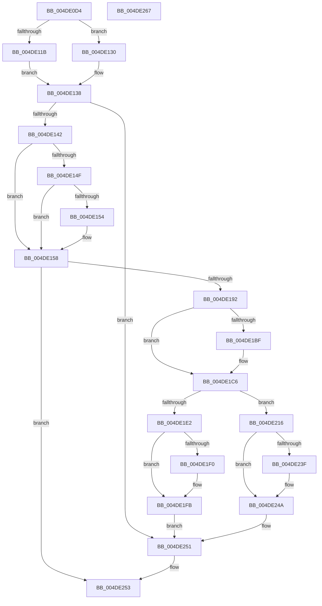

# IvtAllocateContextTable

- RVA: `0x004DE0D4`–`0x004DE268` (길이 `404` bytes)
- VA: `0x00000001404DE0D4`
- 실행 섹션: `.text`
- PDB 이름 있음: `예`; PDB Function 태그: `아니요`
- unwind 정보 RVA: `0x000BEC34`
- 디코드: `108`개 명령, `404/404` bytes 표시
- 미해석 바이트: `0` (있으면 어셈블리에 `.byte`로 보존)

> 이 문서는 커널 이미지의 기계어와 PDB 기호를 분석해 생성했습니다. 4번과 5번은 함수 원형과 자료형을 바이너리 사용 방식에서 추정한 C 해석이며 원본 소스 복구 결과는 아닙니다.

## 1. Dependencies

- 직접 호출 지점: **9**; 고유 호출 대상: **7**
- 직접 호출자로 확인된 함수: **4**
- RIP 상대 이미지 참조: **1**

### Outgoing calls
- `0x004DE185` → [ExtEnvAllocatePhysicalMemory](../56/ExtEnvAllocatePhysicalMemory_function_00561124.md) (function, `0x00561124`)
- `0x004DE1A4` → [memcpy](../6C/memcpy_function_006C6840.md) (function, `0x006C6840`)
- `0x004DE1C1` → [KiRaiseIrqlProcessIrqlFlags](../4F/KiRaiseIrqlProcessIrqlFlags_function_004F56FC.md) (function, `0x004F56FC`)
- `0x004DE1D2` → [KeAcquireInStackQueuedSpinLockAtDpcLevel](../27/KeAcquireInStackQueuedSpinLockAtDpcLevel_function_00275740.md) (function, `0x00275740`)
- `0x004DE1E2` → [KeReleaseInStackQueuedSpinLockFromDpcLevel](../21/KeReleaseInStackQueuedSpinLockFromDpcLevel_function_002171B0.md) (function, `0x002171B0`)
- `0x004DE1F6` → [KiLowerIrqlProcessIrqlFlags](../4F/KiLowerIrqlProcessIrqlFlags_function_004F5698.md) (function, `0x004F5698`)
- `0x004DE20F` → [ExtEnvFreePhysicalMemory](../56/ExtEnvFreePhysicalMemory_function_00561360.md) (function, `0x00561360`)
- `0x004DE231` → [KeReleaseInStackQueuedSpinLockFromDpcLevel](../21/KeReleaseInStackQueuedSpinLockFromDpcLevel_function_002171B0.md) (function, `0x002171B0`)
- `0x004DE245` → [KiLowerIrqlProcessIrqlFlags](../4F/KiLowerIrqlProcessIrqlFlags_function_004F5698.md) (function, `0x004F5698`)

### Direct callers
- [IvtAllocateTranslationStructures](../56/IvtAllocateTranslationStructures_function_0056EC58.md) at `0x0056ED17`
- [IvtLegacyAllocateTranslationStructures](../57/IvtLegacyAllocateTranslationStructures_function_00570E28.md) at `0x00570EAE`
- [IvtLegacySetDeviceSvmCapabilities](../57/IvtLegacySetDeviceSvmCapabilities_function_00571FB0.md) at `0x00571FBD`
- [IvtSetDeviceSvmCapabilities](../57/IvtSetDeviceSvmCapabilities_function_00572600.md) at `0x00572613`

### Static image references
- `0x004DE1B6` → RVA `0x00FC6D20` (`ALMOSTRO`; read)

## 2. Other-region calls and transfers

- 다른 실행 섹션으로 향하는 call: **0**
- 별도 외부 분기/꼬리 이동을 확인하지 못했습니다.

## 3. Assembly (complete function range)

```asm
004DE0D4  4C 8B DC                        mov r11, rsp
004DE0D7  49 89 5B 10                     mov qword ptr [r11 + 0x10], rbx
004DE0DB  55                              push rbp
004DE0DC  56                              push rsi
004DE0DD  57                              push rdi
004DE0DE  41 54                           push r12
004DE0E0  41 56                           push r14
004DE0E2  48 83 EC 50                     sub rsp, 0x50
004DE0E6  49 83 63 08 00                  and qword ptr [r11 + 8], 0
004DE0EB  33 C0                           xor eax, eax
004DE0ED  49 21 43 18                     and qword ptr [r11 + 0x18], rax
004DE0F1  0F 57 C0                        xorps xmm0, xmm0
004DE0F4  44 8A 89 40 01 00 00            mov r9b, byte ptr [rcx + 0x140]
004DE0FB  48 8B F9                        mov rdi, rcx
004DE0FE  0F 11 44 24 30                  movups xmmword ptr [rsp + 0x30], xmm0
004DE103  49 89 43 C8                     mov qword ptr [r11 - 0x38], rax
004DE107  8B C2                           mov eax, edx
004DE109  C1 E8 08                        shr eax, 8
004DE10C  C1 EA 03                        shr edx, 3
004DE10F  83 E2 1F                        and edx, 0x1f
004DE112  44 8D 04 00                     lea r8d, [rax + rax]
004DE116  45 84 C9                        test r9b, r9b
004DE119  74 15                           je 0x1404de130
004DE11B  48 8B 47 20                     mov rax, qword ptr [rdi + 0x20]
004DE11F  33 C9                           xor ecx, ecx
004DE121  83 FA 10                        cmp edx, 0x10
004DE124  0F 93 C1                        setae cl
004DE127  49 03 C8                        add rcx, r8
004DE12A  4C 8D 34 C8                     lea r14, [rax + rcx*8]
004DE12E  EB 08                           jmp 0x1404de138
004DE130  48 8B 41 20                     mov rax, qword ptr [rcx + 0x20]
004DE134  4E 8D 34 C0                     lea r14, [rax + r8*8]
004DE138  49 83 3E 00                     cmp qword ptr [r14], 0
004DE13C  0F 85 0F 01 00 00               jne 0x1404de251
004DE142  48 8B 47 10                     mov rax, qword ptr [rdi + 0x10]
004DE146  4A 8D 34 C0                     lea rsi, [rax + r8*8]
004DE14A  45 84 C9                        test r9b, r9b
004DE14D  74 09                           je 0x1404de158
004DE14F  83 FA 10                        cmp edx, 0x10
004DE152  72 04                           jb 0x1404de158
004DE154  48 83 C6 08                     add rsi, 8
004DE158  44 8B 8F 10 01 00 00            mov r9d, dword ptr [rdi + 0x110]
004DE15F  48 8D 84 24 80 00 00 00         lea rax, [rsp + 0x80]
004DE167  48 89 44 24 28                  mov qword ptr [rsp + 0x28], rax
004DE16C  41 BC 00 10 00 00               mov r12d, 0x1000
004DE172  48 8D 84 24 90 00 00 00         lea rax, [rsp + 0x90]
004DE17A  45 8B C4                        mov r8d, r12d
004DE17D  41 8B D4                        mov edx, r12d
004DE180  48 89 44 24 20                  mov qword ptr [rsp + 0x20], rax
004DE185  E8 9A 2F 08 00                  call 0x140561124
004DE18A  85 C0                           test eax, eax
004DE18C  0F 88 C1 00 00 00               js 0x1404de253
004DE192  48 8B AC 24 80 00 00 00         mov rbp, qword ptr [rsp + 0x80]
004DE19A  45 8B C4                        mov r8d, r12d
004DE19D  48 8B 57 28                     mov rdx, qword ptr [rdi + 0x28]
004DE1A1  48 8B CD                        mov rcx, rbp
004DE1A4  E8 97 86 1E 00                  call 0x1406c6840
004DE1A9  44 0F 20 C3                     mov rbx, cr8
004DE1AD  BA 0F 00 00 00                  mov edx, 0xf
004DE1B2  44 0F 22 C2                     mov cr8, rdx
004DE1B6  83 3D 63 8B AE 00 00            cmp dword ptr [rip + 0xae8b63], 0
004DE1BD  74 07                           je 0x1404de1c6
004DE1BF  8A CB                           mov cl, bl
004DE1C1  E8 36 75 01 00                  call 0x1404f56fc
004DE1C6  48 8D 8F D0 00 00 00            lea rcx, [rdi + 0xd0]
004DE1CD  48 8D 54 24 30                  lea rdx, [rsp + 0x30]
004DE1D2  E8 69 75 D9 FF                  call 0x140275740
004DE1D7  49 83 3E 00                     cmp qword ptr [r14], 0
004DE1DB  48 8D 4C 24 30                  lea rcx, [rsp + 0x30]
004DE1E0  74 34                           je 0x1404de216
004DE1E2  E8 C9 8F D3 FF                  call 0x1402171b0
004DE1E7  83 3D 32 8B AE 00 00            cmp dword ptr [rip + 0xae8b32], 0
004DE1EE  74 0B                           je 0x1404de1fb
004DE1F0  44 0F 20 C1                     mov rcx, cr8
004DE1F4  8A D3                           mov dl, bl
004DE1F6  E8 9D 74 01 00                  call 0x1404f5698
004DE1FB  0F B6 C3                        movzx eax, bl
004DE1FE  44 0F 22 C0                     mov cr8, rax
004DE202  44 8B 8F 10 01 00 00            mov r9d, dword ptr [rdi + 0x110]
004DE209  45 8B C4                        mov r8d, r12d
004DE20C  48 8B D5                        mov rdx, rbp
004DE20F  E8 4C 31 08 00                  call 0x140561360
004DE214  EB 3B                           jmp 0x1404de251
004DE216  48 8B 84 24 90 00 00 00         mov rax, qword ptr [rsp + 0x90]
004DE21E  48 99                           cqo
004DE220  49 89 2E                        mov qword ptr [r14], rbp
004DE223  49 F7 FC                        idiv r12
004DE226  48 C1 E0 0C                     shl rax, 0xc
004DE22A  48 83 C8 01                     or rax, 1
004DE22E  48 89 06                        mov qword ptr [rsi], rax
004DE231  E8 7A 8F D3 FF                  call 0x1402171b0
004DE236  83 3D E3 8A AE 00 00            cmp dword ptr [rip + 0xae8ae3], 0
004DE23D  74 0B                           je 0x1404de24a
004DE23F  44 0F 20 C1                     mov rcx, cr8
004DE243  8A D3                           mov dl, bl
004DE245  E8 4E 74 01 00                  call 0x1404f5698
004DE24A  0F B6 C3                        movzx eax, bl
004DE24D  44 0F 22 C0                     mov cr8, rax
004DE251  33 C0                           xor eax, eax
004DE253  48 8B 9C 24 88 00 00 00         mov rbx, qword ptr [rsp + 0x88]
004DE25B  48 83 C4 50                     add rsp, 0x50
004DE25F  41 5E                           pop r14
004DE261  41 5C                           pop r12
004DE263  5F                              pop rdi
004DE264  5E                              pop rsi
004DE265  5D                              pop rbp
004DE266  C3                              ret
004DE267  CC                              int3
```

## 4. C-style interpretation (structured pseudocode)

```c
__int64 __fastcall IvtAllocateContextTable(__int64 a1, int a2)
{
    __int64 result;
    __int64 v_rsi;
    __int64 v_rsp;
    unsigned __int64 v_stack_m48;
    unsigned __int64 v_stack_m50;
    unsigned __int64 v_stack_m58;
    unsigned __int64 v_stack_p10;
    unsigned __int64 v_stack_p18;
    unsigned __int64 v_stack_p8;

    *(unsigned __int64 *)(v_rsp + 16) = v_rbx;
    v_rsp = (v_rsp) - (80);
    result = 0;
    v_stack_m48 = v_xmm0;
    *(unsigned __int64 *)(v_rsp - 56) = 0;
    result = (unsigned int)(((unsigned int)(a2)) >> (8));
    a2 = (unsigned int)((a2) >> (3));
    a2 = (unsigned int)((a2) & (31));
    if ((unsigned __int8)(*(unsigned __int8 *)(a1 + 320)) == 0) goto loc_004DE130;
    a1 = 0;
    a1 = (a2 >= 16) ? 1 : 0;
    a1 = (a1) + (result + result * 1);
    goto loc_004DE138;
loc_004DE130:
loc_004DE138:
    if ((*(unsigned __int64 *)(*(unsigned __int64 *)(a1 + 32) + result + result * 1 * 8)) != 0) goto loc_004DE251;
    if ((unsigned __int8)(*(unsigned __int8 *)(a1 + 320)) == 0) goto loc_004DE158;
    v_rsi = *(unsigned __int64 *)(a1 + 16) + result + result * 1 * 8;
    if (a2 >= 16) {
        v_rsi = (*(unsigned __int64 *)(a1 + 16) + result + result * 1 * 8) + (8);
    }
    v_stack_m50 = v_stack_p8;
    v_stack_m58 = v_stack_p18;
    result = ExtEnvAllocatePhysicalMemory(a1, (unsigned int)((unsigned int)((unsigned int)(0x1000ULL))), (unsigned int)((unsigned int)((unsigned int)(0x1000ULL))), (unsigned int)(*(unsigned int *)(a1 + 272)));
    if (sign_flag) goto loc_004DE253;
    result = memcpy(v_stack_p8, *(unsigned __int64 *)(a1 + 40), (unsigned int)((unsigned int)((unsigned int)(0x1000ULL))), (unsigned int)(*(unsigned int *)(a1 + 272)));
    if ((*(unsigned int *)(v_rip + 11438947)) != 0) {
        a1 = (unsigned __int8)(v_cr8);
        result = KiRaiseIrqlProcessIrqlFlags(a1, 15, (unsigned int)((unsigned int)((unsigned int)(0x1000ULL))), (unsigned int)(*(unsigned int *)(a1 + 272)));
    }
    result = KeAcquireInStackQueuedSpinLockAtDpcLevel(a1 + 208, v_stack_m48, (unsigned int)((unsigned int)((unsigned int)(0x1000ULL))), (unsigned int)(*(unsigned int *)(a1 + 272)));
    if ((*(unsigned __int64 *)(*(unsigned __int64 *)(a1 + 32) + result + result * 1 * 8)) == 0) goto loc_004DE216;
    result = KeReleaseInStackQueuedSpinLockFromDpcLevel(v_stack_m48, v_stack_m48, (unsigned int)((unsigned int)((unsigned int)(0x1000ULL))), (unsigned int)(*(unsigned int *)(a1 + 272)));
    if ((*(unsigned int *)(v_rip + 11438898)) != 0) {
        a1 = 15;
        a2 = (unsigned __int8)(v_cr8);
        result = KiLowerIrqlProcessIrqlFlags(a1, a2, (unsigned int)((unsigned int)((unsigned int)(0x1000ULL))), (unsigned int)(*(unsigned int *)(a1 + 272)));
    }
    result = ExtEnvFreePhysicalMemory(a1, v_stack_p8, (unsigned int)((unsigned int)((unsigned int)(0x1000ULL))), (unsigned int)(*(unsigned int *)(a1 + 272)));
    goto loc_004DE251;
loc_004DE216:
    *(unsigned __int64 *)(*(unsigned __int64 *)(a1 + 32) + result + result * 1 * 8) = v_stack_p8;
    result = (v_stack_p18) << (12);
    result = (result) | (1);
    *(unsigned __int64 *)(v_rsi) = result;
    result = KeReleaseInStackQueuedSpinLockFromDpcLevel(a1, v_stack_p8, (unsigned int)((unsigned int)((unsigned int)(0x1000ULL))), (unsigned int)(*(unsigned int *)(a1 + 272)));
    if ((*(unsigned int *)(v_rip + 11438819)) != 0) {
        a1 = (unsigned __int8)(v_cr8);
        a2 = (unsigned __int8)(v_cr8);
        result = KiLowerIrqlProcessIrqlFlags(a1, a2, (unsigned int)((unsigned int)((unsigned int)(0x1000ULL))), (unsigned int)(*(unsigned int *)(a1 + 272)));
    }
loc_004DE251:
    result = 0;
loc_004DE253:
    v_rsp = (v_rsp) + (80);
    return result;
}
```

## 5. (Beta) C Style

```c
int64_t IvtAllocateContextTable(void *Arg1, int32_t Arg2)
{
    uint8_t *arg1 = (uint8_t *)Arg1;

    int64_t result;
    int64_t local_rsi;
    int64_t local_rsp;
    uint64_t v_stack_m48;
    uint64_t v_stack_m50;
    uint64_t v_stack_m58;
    uint64_t v_stack_p10;
    uint64_t v_stack_p18;
    uint64_t v_stack_p8;

    *(uint64_t *)(local_rsp + 0x10) = local_rbx;
    local_rsp = (local_rsp) - (80);
    result = 0;
    v_stack_m48 = v_xmm0;
    *(uint64_t *)(local_rsp - 0x38) = 0;
    result = (uint32_t)(((uint32_t)(Arg2)) >> (8));
    Arg2 = (uint32_t)((Arg2) >> (3));
    Arg2 = (uint32_t)((Arg2) & (31));
    if ((uint8_t)(*(uint8_t *)(arg1 + 0x140)) == 0) goto loc_004DE130;
    Arg1 = 0;
    Arg1 = (Arg2 >= 16) ? 1 : 0;
    Arg1 = (Arg1) + (result + result * 1);
    goto loc_004DE138;
loc_004DE130:
loc_004DE138:
    if ((*(uint64_t *)(*(uint64_t *)(arg1 + 0x20) + result + result * 1 * 8)) != 0) goto loc_004DE251;
    if ((uint8_t)(*(uint8_t *)(arg1 + 0x140)) == 0) goto loc_004DE158;
    local_rsi = *(uint64_t *)(arg1 + 0x10) + result + result * 1 * 8;
    if (Arg2 >= 16) {
        local_rsi = (*(uint64_t *)(arg1 + 0x10) + result + result * 1 * 8) + (8);
    }
    v_stack_m50 = v_stack_p8;
    v_stack_m58 = v_stack_p18;
    result = ExtEnvAllocatePhysicalMemory(Arg1, (uint32_t)((uint32_t)((uint32_t)(0x1000ULL))), (uint32_t)((uint32_t)((uint32_t)(0x1000ULL))), (uint32_t)(*(uint32_t *)(arg1 + 0x110)));
    if (sign_flag) goto loc_004DE253;
    result = memcpy(v_stack_p8, *(uint64_t *)(arg1 + 0x28), (uint32_t)((uint32_t)((uint32_t)(0x1000ULL))), (uint32_t)(*(uint32_t *)(arg1 + 0x110)));
    if ((*(uint32_t *)(v_rip + 0xAE8B63)) != 0) {
        Arg1 = (uint8_t)(v_cr8);
        result = KiRaiseIrqlProcessIrqlFlags(Arg1, 15, (uint32_t)((uint32_t)((uint32_t)(0x1000ULL))), (uint32_t)(*(uint32_t *)(arg1 + 0x110)));
    }
    result = KeAcquireInStackQueuedSpinLockAtDpcLevel(Arg1 + 208, v_stack_m48, (uint32_t)((uint32_t)((uint32_t)(0x1000ULL))), (uint32_t)(*(uint32_t *)(arg1 + 0x110)));
    if ((*(uint64_t *)(*(uint64_t *)(arg1 + 0x20) + result + result * 1 * 8)) == 0) goto loc_004DE216;
    result = KeReleaseInStackQueuedSpinLockFromDpcLevel(v_stack_m48, v_stack_m48, (uint32_t)((uint32_t)((uint32_t)(0x1000ULL))), (uint32_t)(*(uint32_t *)(arg1 + 0x110)));
    if ((*(uint32_t *)(v_rip + 0xAE8B32)) != 0) {
        Arg1 = 15;
        Arg2 = (uint8_t)(v_cr8);
        result = KiLowerIrqlProcessIrqlFlags(Arg1, Arg2, (uint32_t)((uint32_t)((uint32_t)(0x1000ULL))), (uint32_t)(*(uint32_t *)(arg1 + 0x110)));
    }
    result = ExtEnvFreePhysicalMemory(Arg1, v_stack_p8, (uint32_t)((uint32_t)((uint32_t)(0x1000ULL))), (uint32_t)(*(uint32_t *)(arg1 + 0x110)));
    goto loc_004DE251;
loc_004DE216:
    *(uint64_t *)(*(uint64_t *)(arg1 + 0x20) + result + result * 1 * 8) = v_stack_p8;
    result = (v_stack_p18) << (12);
    result = (result) | (1);
    *(uint64_t *)(local_rsi) = result;
    result = KeReleaseInStackQueuedSpinLockFromDpcLevel(Arg1, v_stack_p8, (uint32_t)((uint32_t)((uint32_t)(0x1000ULL))), (uint32_t)(*(uint32_t *)(arg1 + 0x110)));
    if ((*(uint32_t *)(v_rip + 0xAE8AE3)) != 0) {
        Arg1 = (uint8_t)(v_cr8);
        Arg2 = (uint8_t)(v_cr8);
        result = KiLowerIrqlProcessIrqlFlags(Arg1, Arg2, (uint32_t)((uint32_t)((uint32_t)(0x1000ULL))), (uint32_t)(*(uint32_t *)(arg1 + 0x110)));
    }
loc_004DE251:
    result = 0;
loc_004DE253:
    local_rsp = (local_rsp) + (80);
    return result;
}
```

### 관측된 메모리 오프셋

구조체 형식이 확인되지 않은 접근은 인자 기준의 오프셋으로만 기록했습니다.

| 기준 인자 | 오프셋 표현 | 폭 (bit) | 접근 |
|---|---:|---:|---|
| `Arg1` | `+ 0x10` | `64` | `R` |
| `Arg1` | `+ 0x20` | `64` | `R` |
| `Arg1` | `+ 0x28` | `64` | `R` |
| `Arg1` | `+ 0xD0` | `64` | `R` |
| `Arg1` | `+ 0x110` | `32` | `R` |
| `Arg1` | `+ 0x140` | `8` | `R` |

## 6. Execution-region graph

[열기: 2D/3D 그래프와 함수 탐색 컨트롤 패널](../../../control-panel.html?section=text&rva=0x004DE0D4&view=graph)

- 2D 그래프는 위에서 아래로 흐르고, 3D 그래프는 빈 공간을 드래그해 회전합니다. Shift+드래그는 이동, 휠은 확대·축소, 함수 노드 선택은 대상 보고서 이동입니다.

### Static fallback


