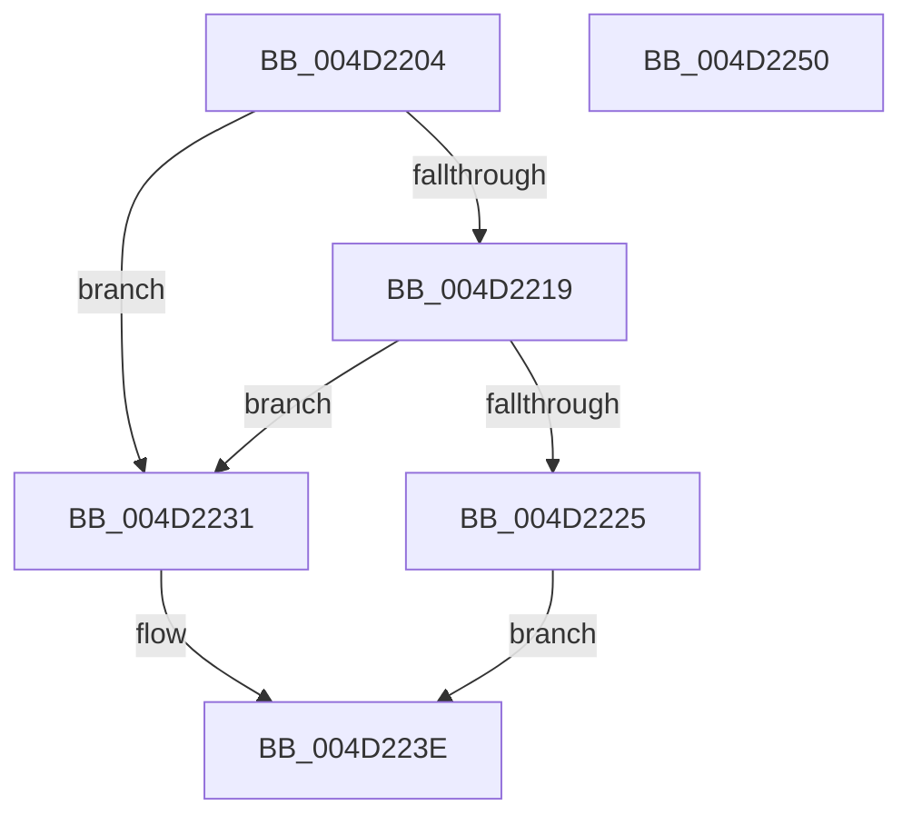

# IvtGetBlockedDomain

- RVA: `0x004D2204`–`0x004D2251` (길이 `77` bytes)
- VA: `0x00000001404D2204`
- 실행 섹션: `.text`
- PDB 이름 있음: `예`; PDB Function 태그: `아니요`
- unwind 정보 RVA: `0x0005CAAC`
- 디코드: `24`개 명령, `77/77` bytes 표시
- 미해석 바이트: `0` (있으면 어셈블리에 `.byte`로 보존)

> 이 문서는 커널 이미지의 기계어와 PDB 기호를 분석해 생성했습니다. 4번과 5번은 함수 원형과 자료형을 바이너리 사용 방식에서 추정한 C 해석이며 원본 소스 복구 결과는 아닙니다.

## 1. Dependencies

- 직접 호출 지점: **1**; 고유 호출 대상: **1**
- 직접 호출자로 확인된 함수: **5**
- RIP 상대 이미지 참조: **1**

### Outgoing calls
- `0x004D221B` → [HalpIvtFindReservedDomain](../57/HalpIvtFindReservedDomain_function_0057A118.md) (function, `0x0057A118`)

### Direct callers
- [IvtUpdateScalableModeTranslationStructures](../4C/IvtUpdateScalableModeTranslationStructures_function_004CD52C.md) at `0x004CD579`
- [IvtUpdateContextEntry](IvtUpdateContextEntry_function_004D207C.md) at `0x004D212A`
- [IvtConfigureAts](../56/IvtConfigureAts_function_0056F1F0.md) at `0x0056F271`
- [IvtLegacyUpdateScalableModeTranslationStructures](../57/IvtLegacyUpdateScalableModeTranslationStructures_function_0057237C.md) at `0x005723D8`
- [IvtInitializeIommu](../../pagelk/B6/IvtInitializeIommu_function_00B61FE0.md) at `0x00B62359`

### Static image references
- `0x004D2231` → RVA `0x00F8F7B8` (`.data`; read)

## 2. Other-region calls and transfers

- 다른 실행 섹션으로 향하는 call: **0**
- 별도 외부 분기/꼬리 이동을 확인하지 못했습니다.

## 3. Assembly (complete function range)

```asm
004D2204  48 89 5C 24 08                  mov qword ptr [rsp + 8], rbx
004D2209  57                              push rdi
004D220A  48 83 EC 20                     sub rsp, 0x20
004D220E  49 8B F8                        mov rdi, r8
004D2211  48 8B D9                        mov rbx, rcx
004D2214  48 85 D2                        test rdx, rdx
004D2217  74 18                           je 0x1404d2231
004D2219  8B 12                           mov edx, dword ptr [rdx]
004D221B  E8 F8 7E 0A 00                  call 0x14057a118
004D2220  48 85 C0                        test rax, rax
004D2223  74 0C                           je 0x1404d2231
004D2225  48 8B 48 08                     mov rcx, qword ptr [rax + 8]
004D2229  8B 00                           mov eax, dword ptr [rax]
004D222B  48 8B 51 10                     mov rdx, qword ptr [rcx + 0x10]
004D222F  EB 0D                           jmp 0x1404d223e
004D2231  48 8B 15 80 D5 AB 00            mov rdx, qword ptr [rip + 0xabd580]
004D2238  8B 83 04 01 00 00               mov eax, dword ptr [rbx + 0x104]
004D223E  48 C1 EA 0C                     shr rdx, 0xc
004D2242  48 89 17                        mov qword ptr [rdi], rdx
004D2245  48 8B 5C 24 30                  mov rbx, qword ptr [rsp + 0x30]
004D224A  48 83 C4 20                     add rsp, 0x20
004D224E  5F                              pop rdi
004D224F  C3                              ret
004D2250  CC                              int3
```

## 4. C-style interpretation (structured pseudocode)

```c
__int64 __fastcall IvtGetBlockedDomain(__int64 a1, __int64 a2, __int64 a3)
{
    __int64 result;
    __int64 v_rsp;
    unsigned __int64 v_stack_p8;

    v_stack_p8 = v_rbx;
    v_rsp = (v_rsp) - (32);
    if (a2 == 0) goto loc_004D2231;
    result = HalpIvtFindReservedDomain(a1, (unsigned int)(*(unsigned int *)(a2)), a3, a4);
    if (result == 0) goto loc_004D2231;
    goto loc_004D223E;
loc_004D2231:
loc_004D223E:
    a2 = (*(unsigned __int64 *)(v_rip + 11261312)) >> (12);
    *(unsigned __int64 *)(a3) = a2;
    v_rsp = (v_rsp) + (32);
    return (unsigned int)(*(unsigned int *)(a1 + 260));
}
```

## 5. (Beta) C Style

```c
int64_t IvtGetBlockedDomain(void *Arg1, int64_t Arg2, void *Arg3)
{
    uint8_t *arg1 = (uint8_t *)Arg1;
    uint8_t *arg3 = (uint8_t *)Arg3;

    int64_t result;
    int64_t local_rsp;
    uint64_t v_stack_p8;

    v_stack_p8 = local_rbx;
    local_rsp = (local_rsp) - (32);
    if (Arg2 == 0) goto loc_004D2231;
    result = HalpIvtFindReservedDomain(Arg1, (uint32_t)(*(uint32_t *)(Arg2)), Arg3, a4);
    if (result == 0) goto loc_004D2231;
    goto loc_004D223E;
loc_004D2231:
loc_004D223E:
    Arg2 = (*(uint64_t *)(v_rip + 0xABD580)) >> (12);
    *(uint64_t *)(arg3) = Arg2;
    local_rsp = (local_rsp) + (32);
    return (uint32_t)(*(uint32_t *)(arg1 + 0x104));
}
```

### 관측된 메모리 오프셋

구조체 형식이 확인되지 않은 접근은 인자 기준의 오프셋으로만 기록했습니다.

| 기준 인자 | 오프셋 표현 | 폭 (bit) | 접근 |
|---|---:|---:|---|
| `Arg1` | `+ 0x104` | `32` | `R` |
| `Arg3` | `+ 0x0` | `64` | `W` |

## 6. Execution-region graph

[열기: 2D/3D 그래프와 함수 탐색 컨트롤 패널](../../../control-panel.html?section=text&rva=0x004D2204&view=graph)

- 2D 그래프는 위에서 아래로 흐르고, 3D 그래프는 빈 공간을 드래그해 회전합니다. Shift+드래그는 이동, 휠은 확대·축소, 함수 노드 선택은 대상 보고서 이동입니다.

### Static fallback


