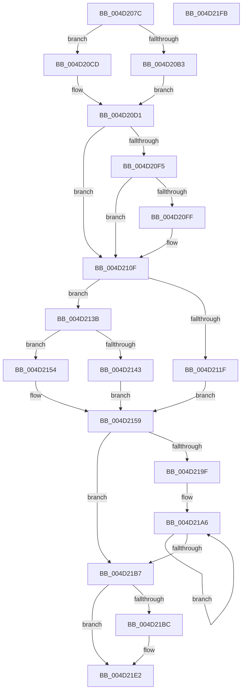

# IvtUpdateContextEntry

- RVA: `0x004D207C`–`0x004D21FC` (길이 `384` bytes)
- VA: `0x00000001404D207C`
- 실행 섹션: `.text`
- PDB 이름 있음: `예`; PDB Function 태그: `아니요`
- unwind 정보 RVA: `0x000BDE04`
- 디코드: `112`개 명령, `384/384` bytes 표시
- 미해석 바이트: `0` (있으면 어셈블리에 `.byte`로 보존)

> 이 문서는 커널 이미지의 기계어와 PDB 기호를 분석해 생성했습니다. 4번과 5번은 함수 원형과 자료형을 바이너리 사용 방식에서 추정한 C 해석이며 원본 소스 복구 결과는 아닙니다.

## 1. Dependencies

- 직접 호출 지점: **3**; 고유 호출 대상: **2**
- 직접 호출자로 확인된 함수: **2**
- RIP 상대 이미지 참조: **0**

### Outgoing calls
- `0x004D212A` → [IvtGetBlockedDomain](IvtGetBlockedDomain_function_004D2204.md) (function, `0x004D2204`)
- `0x004D21CA` → [IvtInvalidateContextEntry](../57/IvtInvalidateContextEntry_function_005708B4.md) (function, `0x005708B4`)
- `0x004D21DD` → [IvtInvalidateContextEntry](../57/IvtInvalidateContextEntry_function_005708B4.md) (function, `0x005708B4`)

### Direct callers
- [IvtUpdateTranslationStructures](../4F/IvtUpdateTranslationStructures_function_004F913C.md) at `0x004F9186`
- [IvtLegacyUpdateTranslationStructures](../57/IvtLegacyUpdateTranslationStructures_function_0057247C.md) at `0x005724BF`

### Static image references
- 디코드된 RIP-relative 메모리 참조가 없습니다.

## 2. Other-region calls and transfers

- 다른 실행 섹션으로 향하는 call: **0**
- 별도 외부 분기/꼬리 이동을 확인하지 못했습니다.

## 3. Assembly (complete function range)

```asm
004D207C  48 89 5C 24 10                  mov qword ptr [rsp + 0x10], rbx
004D2081  48 89 6C 24 18                  mov qword ptr [rsp + 0x18], rbp
004D2086  48 89 74 24 20                  mov qword ptr [rsp + 0x20], rsi
004D208B  57                              push rdi
004D208C  41 56                           push r14
004D208E  41 57                           push r15
004D2090  48 83 EC 40                     sub rsp, 0x40
004D2094  4C 8B 51 20                     mov r10, qword ptr [rcx + 0x20]
004D2098  4C 8B F2                        mov r14, rdx
004D209B  8B 12                           mov edx, dword ptr [rdx]
004D209D  48 8B F1                        mov rsi, rcx
004D20A0  8B C2                           mov eax, edx
004D20A2  C1 E8 08                        shr eax, 8
004D20A5  03 C0                           add eax, eax
004D20A7  80 B9 40 01 00 00 00            cmp byte ptr [rcx + 0x140], 0
004D20AE  44 8B C8                        mov r9d, eax
004D20B1  74 1A                           je 0x1404d20cd
004D20B3  33 C9                           xor ecx, ecx
004D20B5  8B C2                           mov eax, edx
004D20B7  25 F8 00 00 00                  and eax, 0xf8
004D20BC  3D 80 00 00 00                  cmp eax, 0x80
004D20C1  0F 93 C1                        setae cl
004D20C4  49 03 C9                        add rcx, r9
004D20C7  49 8D 04 CA                     lea rax, [r10 + rcx*8]
004D20CB  EB 04                           jmp 0x1404d20d1
004D20CD  49 8D 04 C2                     lea rax, [r10 + rax*8]
004D20D1  0F B6 FA                        movzx edi, dl
004D20D4  40 32 ED                        xor bpl, bpl
004D20D7  48 C1 E7 04                     shl rdi, 4
004D20DB  41 BF 00 00 01 00               mov r15d, 0x10000
004D20E1  48 03 38                        add rdi, qword ptr [rax]
004D20E4  0F 10 07                        movups xmm0, xmmword ptr [rdi]
004D20E7  66 48 0F 7E C0                  movq rax, xmm0
004D20EC  0F 11 44 24 30                  movups xmmword ptr [rsp + 0x30], xmm0
004D20F1  A8 01                           test al, 1
004D20F3  74 1A                           je 0x1404d210f
004D20F5  83 BC 24 80 00 00 00 00         cmp dword ptr [rsp + 0x80], 0
004D20FD  75 10                           jne 0x1404d210f
004D20FF  48 8B 44 24 38                  mov rax, qword ptr [rsp + 0x38]
004D2104  40 B5 01                        mov bpl, 1
004D2107  48 C1 E8 08                     shr rax, 8
004D210B  44 0F B7 F8                     movzx r15d, ax
004D210F  41 8B 40 04                     mov eax, dword ptr [r8 + 4]
004D2113  33 D2                           xor edx, edx
004D2115  48 89 54 24 60                  mov qword ptr [rsp + 0x60], rdx
004D211A  83 F8 01                        cmp eax, 1
004D211D  75 1C                           jne 0x1404d213b
004D211F  4C 8D 44 24 60                  lea r8, [rsp + 0x60]
004D2124  49 8B D6                        mov rdx, r14
004D2127  48 8B CE                        mov rcx, rsi
004D212A  E8 D5 00 00 00                  call 0x1404d2204
004D212F  48 8B 54 24 60                  mov rdx, qword ptr [rsp + 0x60]
004D2134  48 8B D8                        mov rbx, rax
004D2137  33 C9                           xor ecx, ecx
004D2139  EB 1E                           jmp 0x1404d2159
004D213B  41 8B 58 30                     mov ebx, dword ptr [r8 + 0x30]
004D213F  85 C0                           test eax, eax
004D2141  74 11                           je 0x1404d2154
004D2143  49 8B 50 28                     mov rdx, qword ptr [r8 + 0x28]
004D2147  48 C1 EA 0C                     shr rdx, 0xc
004D214B  48 89 54 24 60                  mov qword ptr [rsp + 0x60], rdx
004D2150  33 C9                           xor ecx, ecx
004D2152  EB 05                           jmp 0x1404d2159
004D2154  B9 02 00 00 00                  mov ecx, 2
004D2159  44 8B 8E F8 00 00 00            mov r9d, dword ptr [rsi + 0xf8]
004D2160  41 B8 01 00 00 00               mov r8d, 1
004D2166  48 C1 E2 0A                     shl rdx, 0xa
004D216A  41 83 E1 07                     and r9d, 7
004D216E  48 0B D1                        or rdx, rcx
004D2171  0F B7 C3                        movzx eax, bx
004D2174  48 C1 E0 08                     shl rax, 8
004D2178  4C 0B C8                        or r9, rax
004D217B  48 C1 E2 02                     shl rdx, 2
004D217F  41 8B 46 04                     mov eax, dword ptr [r14 + 4]
004D2183  48 83 CA 01                     or rdx, 1
004D2187  8B C8                           mov ecx, eax
004D2189  41 D3 E0                        shl r8d, cl
004D218C  B9 03 00 00 00                  mov ecx, 3
004D2191  2B C8                           sub ecx, eax
004D2193  B8 01 00 00 00                  mov eax, 1
004D2198  D3 E0                           shl eax, cl
004D219A  45 85 C0                        test r8d, r8d
004D219D  74 18                           je 0x1404d21b7
004D219F  48 C1 E0 04                     shl rax, 4
004D21A3  41 8B C8                        mov ecx, r8d
004D21A6  4C 89 4F 08                     mov qword ptr [rdi + 8], r9
004D21AA  90                              nop
004D21AB  48 89 17                        mov qword ptr [rdi], rdx
004D21AE  48 03 F8                        add rdi, rax
004D21B1  48 83 E9 01                     sub rcx, 1
004D21B5  75 EF                           jne 0x1404d21a6
004D21B7  40 84 ED                        test bpl, bpl
004D21BA  74 26                           je 0x1404d21e2
004D21BC  4D 8B C7                        mov r8, r15
004D21BF  C6 44 24 20 01                  mov byte ptr [rsp + 0x20], 1
004D21C4  49 8B D6                        mov rdx, r14
004D21C7  48 8B CE                        mov rcx, rsi
004D21CA  E8 E5 E6 09 00                  call 0x1405708b4
004D21CF  4C 8B C3                        mov r8, rbx
004D21D2  C6 44 24 20 01                  mov byte ptr [rsp + 0x20], 1
004D21D7  49 8B D6                        mov rdx, r14
004D21DA  48 8B CE                        mov rcx, rsi
004D21DD  E8 D2 E6 09 00                  call 0x1405708b4
004D21E2  48 8B 5C 24 68                  mov rbx, qword ptr [rsp + 0x68]
004D21E7  48 8B 6C 24 70                  mov rbp, qword ptr [rsp + 0x70]
004D21EC  48 8B 74 24 78                  mov rsi, qword ptr [rsp + 0x78]
004D21F1  48 83 C4 40                     add rsp, 0x40
004D21F5  41 5F                           pop r15
004D21F7  41 5E                           pop r14
004D21F9  5F                              pop rdi
004D21FA  C3                              ret
004D21FB  CC                              int3
```

## 4. C-style interpretation (structured pseudocode)

```c
__int64 __fastcall IvtUpdateContextEntry(__int64 a1, __int64 a2, __int64 a3, __int64 a4, unsigned int a5)
{
    __int64 result;
    __int64 v_r15;
    __int64 v_rbp;
    __int64 v_rdi;
    __int64 v_rsp;
    unsigned __int64 v_stack_m20;
    unsigned __int64 v_stack_m28;
    unsigned __int8 v_stack_m38;
    unsigned __int64 v_stack_p10;
    unsigned __int64 v_stack_p18;
    unsigned __int64 v_stack_p20;
    unsigned __int64 v_stack_p8;

    v_stack_p10 = v_rbx;
    v_stack_p18 = v_rbp;
    v_stack_p20 = v_rsi;
    v_rsp = (v_rsp) - (64);
    result = (unsigned int)(((unsigned int)((unsigned int)((unsigned int)(*(unsigned int *)(a2))))) >> (8));
    result = (unsigned int)((result) + ((unsigned int)(result)));
    if ((*(unsigned __int8 *)(a1 + 320)) == 0) goto loc_004D20CD;
    a1 = 0;
    result = (unsigned int)(((unsigned int)((unsigned int)((unsigned int)(*(unsigned int *)(a2))))) & (248));
    a1 = (((unsigned int)(result)) >= 128) ? 1 : 0;
    a1 = (a1) + ((unsigned int)((unsigned int)(result)));
    goto loc_004D20D1;
loc_004D20CD:
loc_004D20D1:
    v_rbp = 0;
    v_rdi = ((unsigned __int8)((unsigned int)(*(unsigned int *)(a2)))) << (4);
    v_rdi = (v_rdi) + (*(unsigned __int64 *)(*(unsigned __int64 *)(a1 + 32) + *(unsigned __int64 *)(a1 + 32) + a1 * 8 * 8));
    v_stack_m28 = v_xmm0;
    if ((((unsigned __int8)(*(unsigned __int64 *)(a1 + 32) + *(unsigned __int64 *)(a1 + 32) + a1 * 8 * 8)) & (1)) == 0) goto loc_004D210F;
    result = *(unsigned __int64 *)(a1 + 32) + *(unsigned __int64 *)(a1 + 32) + a1 * 8 * 8;
    v_r15 = (unsigned int)(0x10000ULL);
    if (a5 == 0) {
        result = v_stack_m20;
        v_rbp = 1;
        result = (result) >> (8);
        v_r15 = (unsigned __int16)(result);
    }
    a2 = 0;
    v_stack_p8 = 0;
    if (((unsigned int)((unsigned int)(*(unsigned int *)(a3 + 4)))) != 1) goto loc_004D213B;
    result = IvtGetBlockedDomain(a1, 0, v_stack_p8, (unsigned int)((unsigned int)(result)));
    a1 = 0;
    goto loc_004D2159;
loc_004D213B:
    if ((unsigned int)(result) == 0) goto loc_004D2154;
    a2 = (*(unsigned __int64 *)(v_stack_p8 + 40)) >> (12);
    v_stack_p8 = a2;
    a1 = 0;
    goto loc_004D2159;
loc_004D2154:
loc_004D2159:
    a2 = (a2) << (10);
    a4 = (unsigned int)(((unsigned int)(*(unsigned int *)(a1 + 248))) & (7));
    a2 = (a2) | (2);
    result = ((unsigned __int16)((unsigned int)(*(unsigned int *)(v_stack_p8 + 48)))) << (8);
    a4 = (a4) | (result);
    a2 = (a2) << (2);
    a2 = (a2) | (1);
    a3 = (unsigned int)((1) << ((unsigned __int8)((unsigned int)((unsigned int)((unsigned int)(*(unsigned int *)(a2 + 4)))))));
    a1 = (unsigned int)((3) - ((unsigned int)((unsigned int)(*(unsigned int *)(a2 + 4)))));
    result = (unsigned int)((1) << ((unsigned __int8)(a1)));
    if ((unsigned int)(a3) == 0) goto loc_004D21B7;
    result = (result) << (4);
loc_004D21A6:
    *(unsigned __int64 *)(v_rdi + 8) = a4;
    *(unsigned __int64 *)(v_rdi) = a2;
    v_rdi = (v_rdi) + (result);
    a1 = ((unsigned int)((unsigned int)(a3))) - (1);
    if (condition_is_not_equal) goto loc_004D21A6;
loc_004D21B7:
    if ((unsigned __int8)(v_rbp) != 0) {
        a3 = v_r15;
        v_stack_m38 = 1;
        a2 = a2;
        a1 = a1;
        result = IvtInvalidateContextEntry(a1, a2, a3, a4);
        a3 = (unsigned int)(*(unsigned int *)(v_stack_p8 + 48));
        v_stack_m38 = 1;
        a2 = a2;
        a1 = a1;
        result = IvtInvalidateContextEntry(a1, a2, a3, a4);
    }
    v_rsp = (v_rsp) + (64);
    return result;
}
```

## 5. (Beta) C Style

```c
int64_t IvtUpdateContextEntry(void *Arg1, void *Arg2, void *Arg3, int64_t Arg4, uint32_t Arg5)
{
    uint8_t *arg1 = (uint8_t *)Arg1;
    uint8_t *arg2 = (uint8_t *)Arg2;
    uint8_t *arg3 = (uint8_t *)Arg3;

    int64_t result;
    int64_t local_r15;
    int64_t local_rbp;
    int64_t local_rdi;
    int64_t local_rsp;
    uint64_t v_stack_m20;
    uint64_t v_stack_m28;
    uint8_t v_stack_m38;
    uint64_t v_stack_p10;
    uint64_t v_stack_p18;
    uint64_t v_stack_p20;
    uint64_t v_stack_p8;

    v_stack_p10 = local_rbx;
    v_stack_p18 = local_rbp;
    v_stack_p20 = local_rsi;
    local_rsp = (local_rsp) - (64);
    result = (uint32_t)(((uint32_t)((uint32_t)((uint32_t)(*(uint32_t *)(arg2))))) >> (8));
    result = (uint32_t)((result) + ((uint32_t)(result)));
    if ((*(uint8_t *)(arg1 + 0x140)) == 0) goto loc_004D20CD;
    Arg1 = 0;
    result = (uint32_t)(((uint32_t)((uint32_t)((uint32_t)(*(uint32_t *)(arg2))))) & (248));
    Arg1 = (((uint32_t)(result)) >= 128) ? 1 : 0;
    Arg1 = (Arg1) + ((uint32_t)((uint32_t)(result)));
    goto loc_004D20D1;
loc_004D20CD:
loc_004D20D1:
    local_rbp = 0;
    local_rdi = ((uint8_t)((uint32_t)(*(uint32_t *)(arg2)))) << (4);
    local_rdi = (local_rdi) + (*(uint64_t *)(*(uint64_t *)(arg1 + 0x20) + *(uint64_t *)(arg1 + 0x20) + arg1 * 8 * 8));
    v_stack_m28 = v_xmm0;
    if ((((uint8_t)(*(uint64_t *)(arg1 + 0x20) + *(uint64_t *)(arg1 + 0x20) + Arg1 * 8 * 8)) & (1)) == 0) goto loc_004D210F;
    result = *(uint64_t *)(arg1 + 0x20) + *(uint64_t *)(arg1 + 0x20) + Arg1 * 8 * 8;
    local_r15 = (uint32_t)(0x10000ULL);
    if (Arg5 == 0) {
        result = v_stack_m20;
        local_rbp = 1;
        result = (result) >> (8);
        local_r15 = (uint16_t)(result);
    }
    Arg2 = 0;
    v_stack_p8 = 0;
    if (((uint32_t)((uint32_t)(*(uint32_t *)(arg3 + 0x4)))) != 1) goto loc_004D213B;
    result = IvtGetBlockedDomain(Arg1, 0, v_stack_p8, (uint32_t)((uint32_t)(result)));
    Arg1 = 0;
    goto loc_004D2159;
loc_004D213B:
    if ((uint32_t)(result) == 0) goto loc_004D2154;
    Arg2 = (*(uint64_t *)(v_stack_p8 + 0x28)) >> (12);
    v_stack_p8 = Arg2;
    Arg1 = 0;
    goto loc_004D2159;
loc_004D2154:
loc_004D2159:
    Arg2 = (Arg2) << (10);
    Arg4 = (uint32_t)(((uint32_t)(*(uint32_t *)(arg1 + 0xF8))) & (7));
    Arg2 = (Arg2) | (2);
    result = ((uint16_t)((uint32_t)(*(uint32_t *)(v_stack_p8 + 0x30)))) << (8);
    Arg4 = (Arg4) | (result);
    Arg2 = (Arg2) << (2);
    Arg2 = (Arg2) | (1);
    Arg3 = (uint32_t)((1) << ((uint8_t)((uint32_t)((uint32_t)((uint32_t)(*(uint32_t *)(arg2 + 0x4)))))));
    Arg1 = (uint32_t)((3) - ((uint32_t)((uint32_t)(*(uint32_t *)(arg2 + 0x4)))));
    result = (uint32_t)((1) << ((uint8_t)(Arg1)));
    if ((uint32_t)(Arg3) == 0) goto loc_004D21B7;
    result = (result) << (4);
loc_004D21A6:
    *(uint64_t *)(local_rdi + 0x8) = Arg4;
    *(void **)(local_rdi) = Arg2;
    local_rdi = (local_rdi) + (result);
    Arg1 = ((uint32_t)((uint32_t)(Arg3))) - (1);
    if (condition_is_not_equal) goto loc_004D21A6;
loc_004D21B7:
    if ((uint8_t)(local_rbp) != 0) {
        Arg3 = local_r15;
        v_stack_m38 = 1;
        Arg2 = Arg2;
        Arg1 = Arg1;
        result = IvtInvalidateContextEntry(Arg1, Arg2, Arg3, Arg4);
        Arg3 = (uint32_t)(*(uint32_t *)(v_stack_p8 + 0x30));
        v_stack_m38 = 1;
        Arg2 = Arg2;
        Arg1 = Arg1;
        result = IvtInvalidateContextEntry(Arg1, Arg2, Arg3, Arg4);
    }
    local_rsp = (local_rsp) + (64);
    return result;
}
```

### 관측된 메모리 오프셋

구조체 형식이 확인되지 않은 접근은 인자 기준의 오프셋으로만 기록했습니다.

| 기준 인자 | 오프셋 표현 | 폭 (bit) | 접근 |
|---|---:|---:|---|
| `Arg1` | `+ 0x20` | `64` | `R` |
| `Arg1` | `+ 0xF8` | `32` | `R` |
| `Arg1` | `+ 0x140` | `8` | `R` |
| `Arg2` | `+ 0x0` | `32` | `R` |
| `Arg2` | `+ 0x4` | `32` | `R` |
| `Arg3` | `+ 0x4` | `32` | `R` |
| `Arg3` | `+ 0x28` | `64` | `R` |
| `Arg3` | `+ 0x30` | `32` | `R` |

## 6. Execution-region graph

[열기: 2D/3D 그래프와 함수 탐색 컨트롤 패널](../../../control-panel.html?section=text&rva=0x004D207C&view=graph)

- 2D 그래프는 위에서 아래로 흐르고, 3D 그래프는 빈 공간을 드래그해 회전합니다. Shift+드래그는 이동, 휠은 확대·축소, 함수 노드 선택은 대상 보고서 이동입니다.

### Static fallback


