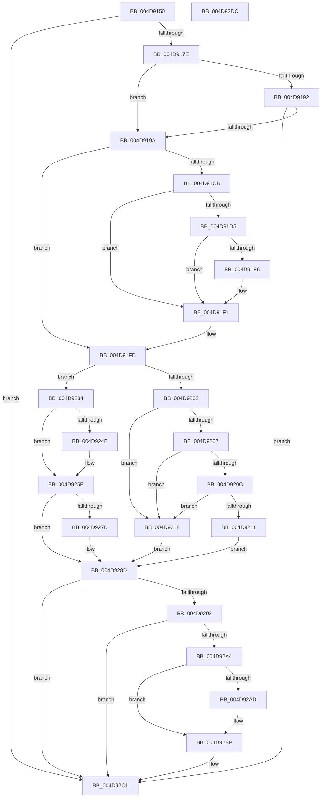

# KdPowerTransitionEx

- RVA: `0x004D9150`–`0x004D92DD` (길이 `397` bytes)
- VA: `0x00000001404D9150`
- 실행 섹션: `.text`
- PDB 이름 있음: `예`; PDB Function 태그: `아니요`
- unwind 정보 RVA: `0x00060300`
- 디코드: `106`개 명령, `397/397` bytes 표시
- 미해석 바이트: `0` (있으면 어셈블리에 `.byte`로 보존)

> 이 문서는 커널 이미지의 기계어와 PDB 기호를 분석해 생성했습니다. 4번과 5번은 함수 원형과 자료형을 바이너리 사용 방식에서 추정한 C 해석이며 원본 소스 복구 결과는 아닙니다.

## 1. Dependencies

- 직접 호출 지점: **11**; 고유 호출 대상: **8**
- 직접 호출자로 확인된 함수: **7**
- RIP 상대 이미지 참조: **8**

### Outgoing calls
- `0x004D91CB` → [KeGetEffectiveIrql](../2F/KeGetEffectiveIrql_function_002F8030.md) (function, `0x002F8030`)
- `0x004D91EC` → [KiRaiseIrqlProcessIrqlFlags](../4F/KiRaiseIrqlProcessIrqlFlags_function_004F56FC.md) (function, `0x004F56FC`)
- `0x004D91F8` → [KeAcquireSpinLockAtDpcLevel](../20/KeAcquireSpinLockAtDpcLevel_function_00208430.md) (function, `0x00208430`)
- `0x004D9224` → `kdcom.dll!KdPower` (import, 간접 대상; import `kdcom.dll!KdPower`)
- `0x004D923D` → [PpmCancelExitLatencyTrace](../5C/PpmCancelExitLatencyTrace_function_005CF47C.md) (function, `0x005CF47C`)
- `0x004D9242` → [KeGetEffectiveIrql](../2F/KeGetEffectiveIrql_function_002F8030.md) (function, `0x002F8030`)
- `0x004D9259` → [guard_dispatch_icall](../6B/guard_dispatch_icall_function_006BAAD0.md) (function, `0x006BAAD0`)
- `0x004D926A` → `kdcom.dll!KdPower` (import, 간접 대상; import `kdcom.dll!KdPower`)
- `0x004D9288` → [guard_dispatch_icall](../6B/guard_dispatch_icall_function_006BAAD0.md) (function, `0x006BAAD0`)
- `0x004D9299` → [KxReleaseSpinLock](../20/KxReleaseSpinLock_function_00206670.md) (function, `0x00206670`)
- `0x004D92B4` → [KiLowerIrqlProcessIrqlFlags](../4F/KiLowerIrqlProcessIrqlFlags_function_004F5698.md) (function, `0x004F5698`)

### Direct callers
- [PpmEnterCoordinatedIdle](../2D/PpmEnterCoordinatedIdle_function_002D19B0.md) at `0x002D1A4A`
- [KdPowerTransition](../4F/KdPowerTransition_function_004F9AC0.md) at `0x004F9AC6`
- [HalReturnToFirmware](../54/HalReturnToFirmware_function_00546550.md) at `0x0054657F`
- [HalReturnToFirmware](../54/HalReturnToFirmware_function_00546550.md) at `0x0054658E`
- [KdDisableDebuggerWithLock](../5B/KdDisableDebuggerWithLock_function_005B0918.md) at `0x005B09EF`
- [KdEnableDebuggerWithLock](../5B/KdEnableDebuggerWithLock_function_005B0A7C.md) at `0x005B0B4B`
- [PopFxDebuggerPowerCriticalTransitionCallback](../5D/PopFxDebuggerPowerCriticalTransitionCallback_function_005DA4A0.md) at `0x005DA4D6`
- [PopFxDebuggerPowerCriticalTransitionCallback](../5D/PopFxDebuggerPowerCriticalTransitionCallback_function_005DA4A0.md) at `0x005DA4E4`
- [sub_006DD378](../6D/Unknown_function_006DD378.md) at `0x006DD4E7`

### Static image references
- `0x004D916E` → RVA `0x00E0AA1C` (`.data`; read)
- `0x004D9189` → RVA `0x00F475F8` (`.data`; read)
- `0x004D91B8` → RVA `0x00E0AA48` (`.data`; read)
- `0x004D91DD` → RVA `0x00FC6D20` (`ALMOSTRO`; read)
- `0x004D91F1` → RVA `0x00FCF280` (`CACHEALI`; read)
- `0x004D921B` → RVA `0x00F475E0` (`.data`; read)
- `0x004D9224` → RVA `0x001516A8` (`kdcom.dll!KdPower (IAT)`; read)
- `0x004D924E` → RVA `0x00E00998` (`.data`; read)

## 2. Other-region calls and transfers

- 다른 실행 섹션으로 향하는 call: **0**
- 별도 외부 분기/꼬리 이동을 확인하지 못했습니다.

## 3. Assembly (complete function range)

```asm
004D9150  48 89 5C 24 08                  mov qword ptr [rsp + 8], rbx
004D9155  48 89 6C 24 10                  mov qword ptr [rsp + 0x10], rbp
004D915A  48 89 74 24 18                  mov qword ptr [rsp + 0x18], rsi
004D915F  57                              push rdi
004D9160  41 56                           push r14
004D9162  41 57                           push r15
004D9164  48 83 EC 20                     sub rsp, 0x20
004D9168  45 33 F6                        xor r14d, r14d
004D916B  40 8A EA                        mov bpl, dl
004D916E  44 38 35 A7 18 93 00            cmp byte ptr [rip + 0x9318a7], r14b
004D9175  41 8B FE                        mov edi, r14d
004D9178  0F 85 43 01 00 00               jne 0x1404d92c1
004D917E  8B C1                           mov eax, ecx
004D9180  25 00 00 00 40                  and eax, 0x40000000
004D9185  8B D8                           mov ebx, eax
004D9187  33 D9                           xor ebx, ecx
004D9189  44 38 35 68 E4 A6 00            cmp byte ptr [rip + 0xa6e468], r14b
004D9190  75 08                           jne 0x1404d919a
004D9192  85 C0                           test eax, eax
004D9194  0F 84 27 01 00 00               je 0x1404d92c1
004D919A  8B FB                           mov edi, ebx
004D919C  40 B6 FF                        mov sil, 0xff
004D919F  C1 FF 1F                        sar edi, 0x1f
004D91A2  41 BF 02 00 00 00               mov r15d, 2
004D91A8  81 E7 00 00 00 60               and edi, 0x60000000
004D91AE  81 C7 00 00 00 20               add edi, 0x20000000
004D91B4  23 FB                           and edi, ebx
004D91B6  33 DF                           xor ebx, edi
004D91B8  81 3D 86 18 93 00 80 04 00 00   cmp dword ptr [rip + 0x931886], 0x480
004D91C2  41 0F 45 FE                     cmovne edi, r14d
004D91C6  40 84 ED                        test bpl, bpl
004D91C9  74 32                           je 0x1404d91fd
004D91CB  E8 60 EE E1 FF                  call 0x1402f8030
004D91D0  41 3A C7                        cmp al, r15b
004D91D3  73 1C                           jae 0x1404d91f1
004D91D5  44 0F 20 C6                     mov rsi, cr8
004D91D9  45 0F 22 C7                     mov cr8, r15
004D91DD  44 39 35 3C DB AE 00            cmp dword ptr [rip + 0xaedb3c], r14d
004D91E4  74 0B                           je 0x1404d91f1
004D91E6  41 8A D7                        mov dl, r15b
004D91E9  40 8A CE                        mov cl, sil
004D91EC  E8 0B C5 01 00                  call 0x1404f56fc
004D91F1  48 8D 0D 88 60 AF 00            lea rcx, [rip + 0xaf6088]
004D91F8  E8 33 F2 D2 FF                  call 0x140208430
004D91FD  83 EB 01                        sub ebx, 1
004D9200  74 32                           je 0x1404d9234
004D9202  83 EB 01                        sub ebx, 1
004D9205  74 11                           je 0x1404d9218
004D9207  83 EB 01                        sub ebx, 1
004D920A  74 0C                           je 0x1404d9218
004D920C  83 FB 01                        cmp ebx, 1
004D920F  74 07                           je 0x1404d9218
004D9211  BF 0D 00 00 C0                  mov edi, 0xc000000d
004D9216  EB 75                           jmp 0x1404d928d
004D9218  83 CF 04                        or edi, 4
004D921B  48 8D 15 BE E3 A6 00            lea rdx, [rip + 0xa6e3be]
004D9222  8B CF                           mov ecx, edi
004D9224  48 FF 15 7D 84 C7 FF            call qword ptr [rip - 0x387b83]
004D922B  0F 1F 44 00 00                  nop dword ptr [rax + rax]
004D9230  8B F8                           mov edi, eax
004D9232  EB 59                           jmp 0x1404d928d
004D9234  65 48 8B 0C 25 20 00 00 00      mov rcx, qword ptr gs:[0x20]
004D923D  E8 3A 62 0F 00                  call 0x1405cf47c
004D9242  E8 E9 ED E1 FF                  call 0x1402f8030
004D9247  8A D8                           mov bl, al
004D9249  41 3A C7                        cmp al, r15b
004D924C  72 10                           jb 0x1404d925e
004D924E  48 8B 05 43 77 92 00            mov rax, qword ptr [rip + 0x927743]
004D9255  33 D2                           xor edx, edx
004D9257  B1 01                           mov cl, 1
004D9259  E8 72 18 1E 00                  call 0x1406baad0
004D925E  83 CF 01                        or edi, 1
004D9261  48 8D 15 78 E3 A6 00            lea rdx, [rip + 0xa6e378]
004D9268  8B CF                           mov ecx, edi
004D926A  48 FF 15 37 84 C7 FF            call qword ptr [rip - 0x387bc9]
004D9271  0F 1F 44 00 00                  nop dword ptr [rax + rax]
004D9276  8B F8                           mov edi, eax
004D9278  41 3A DF                        cmp bl, r15b
004D927B  72 10                           jb 0x1404d928d
004D927D  48 8B 05 14 77 92 00            mov rax, qword ptr [rip + 0x927714]
004D9284  33 D2                           xor edx, edx
004D9286  33 C9                           xor ecx, ecx
004D9288  E8 43 18 1E 00                  call 0x1406baad0
004D928D  40 84 ED                        test bpl, bpl
004D9290  74 2F                           je 0x1404d92c1
004D9292  48 8D 0D E7 5F AF 00            lea rcx, [rip + 0xaf5fe7]
004D9299  E8 D2 D3 D2 FF                  call 0x140206670
004D929E  40 80 FE FF                     cmp sil, 0xff
004D92A2  74 1D                           je 0x1404d92c1
004D92A4  44 39 35 75 DA AE 00            cmp dword ptr [rip + 0xaeda75], r14d
004D92AB  74 0C                           je 0x1404d92b9
004D92AD  44 0F 20 C1                     mov rcx, cr8
004D92B1  40 8A D6                        mov dl, sil
004D92B4  E8 DF C3 01 00                  call 0x1404f5698
004D92B9  40 0F B6 C6                     movzx eax, sil
004D92BD  44 0F 22 C0                     mov cr8, rax
004D92C1  48 8B 5C 24 40                  mov rbx, qword ptr [rsp + 0x40]
004D92C6  8B C7                           mov eax, edi
004D92C8  48 8B 6C 24 48                  mov rbp, qword ptr [rsp + 0x48]
004D92CD  48 8B 74 24 50                  mov rsi, qword ptr [rsp + 0x50]
004D92D2  48 83 C4 20                     add rsp, 0x20
004D92D6  41 5F                           pop r15
004D92D8  41 5E                           pop r14
004D92DA  5F                              pop rdi
004D92DB  C3                              ret
004D92DC  CC                              int3
```

## 4. C-style interpretation (structured pseudocode)

```c
__int64 __fastcall KdPowerTransitionEx(int a1, unsigned __int8 a2)
{
    __int64 result;
    __int64 v_r14;
    __int64 v_rbx;
    __int64 v_rdi;
    __int64 v_rsp;
    unsigned __int64 v_stack_p10;
    unsigned __int64 v_stack_p18;
    unsigned __int64 v_stack_p8;

    v_stack_p8 = v_rbx;
    v_stack_p10 = v_rbp;
    v_stack_p18 = v_rsi;
    v_rsp = (v_rsp) - (32);
    v_r14 = 0;
    if ((*(unsigned __int8 *)(v_rip + 9640103)) != 0) goto loc_004D92C1;
    result = (unsigned int)(((unsigned int)(a1)) & (0x40000000ULL));
    v_rbx = (unsigned int)(((unsigned int)((unsigned int)(result))) ^ (a1));
    if ((*(unsigned __int8 *)(v_rip + 10937448)) != 0) goto loc_004D919A;
    if ((unsigned int)(result) == 0) goto loc_004D92C1;
loc_004D919A:
    v_rdi = (unsigned int)(((unsigned int)((unsigned int)(v_rbx))) >> (31));
    v_rdi = (unsigned int)((v_rdi) & (0x60000000ULL));
    v_rdi = (unsigned int)((v_rdi) + (0x20000000ULL));
    v_rdi = (unsigned int)((v_rdi) & ((unsigned int)(v_rbx)));
    v_rbx = (unsigned int)((v_rbx) ^ ((unsigned int)(v_rdi)));
    if ((*(unsigned int *)(v_rip + 9640070)) != 0x480ULL) { v_rdi = 0; }
    if (a2 == 0) goto loc_004D91FD;
    result = KeGetEffectiveIrql(a1, a2, a3, a4);
    if (((unsigned __int8)(result)) >= 2) goto loc_004D91F1;
    if ((*(unsigned int *)(v_rip + 11459388)) != 0) {
        a2 = 2;
        a1 = (unsigned __int8)(v_cr8);
        result = KiRaiseIrqlProcessIrqlFlags(a1, a2, a3, a4);
    }
    result = KeAcquireSpinLockAtDpcLevel(v_rip + 11493512, a2, a3, a4);
loc_004D91FD:
    v_rbx = (unsigned int)((v_rbx) - (1));
    if (condition_is_equal) goto loc_004D9234;
    v_rbx = (unsigned int)((v_rbx) - (1));
    if (condition_is_equal) goto loc_004D9218;
    v_rbx = (unsigned int)((v_rbx) - (1));
    if (condition_is_equal) goto loc_004D9218;
    if (((unsigned int)(v_rbx)) == 1) goto loc_004D9218;
    goto loc_004D928D;
loc_004D9218:
    v_rdi = (unsigned int)(((unsigned int)(0xC000000DULL)) | (4));
    result = kdcom_dll_KdPower((unsigned int)((unsigned int)(v_rdi)), v_rip + 10937278, a3, a4);
    goto loc_004D928D;
loc_004D9234:
    result = PpmCancelExitLatencyTrace(*(unsigned __int64 *)(gs_base + (0 + 32)), v_rip + 10937278, a3, a4);
    result = KeGetEffectiveIrql(*(unsigned __int64 *)(gs_base + (0 + 32)), v_rip + 10937278, a3, a4);
    if (((unsigned __int8)(result)) >= 2) {
        result = *(unsigned __int64 *)(v_rip + 9598787);
        a2 = 0;
        a1 = 1;
        result = guard_dispatch_icall(a1, a2, a3, a4);
    }
    v_rdi = (unsigned int)(((unsigned int)((unsigned int)(result))) | (1));
    result = kdcom_dll_KdPower((unsigned int)((unsigned int)(v_rdi)), v_rip + 10937208, a3, a4);
    if (((unsigned __int8)((unsigned __int8)(result))) >= 2) {
        result = *(unsigned __int64 *)(v_rip + 9598740);
        a2 = 0;
        a1 = 0;
        result = guard_dispatch_icall(a1, a2, a3, a4);
    }
    if (0 == 0) goto loc_004D92C1;
    result = KxReleaseSpinLock(v_rip + 11493351, a2, a3, a4);
    if (((unsigned __int8)(v_cr8)) == 255) goto loc_004D92C1;
    if ((*(unsigned int *)(v_rip + 11459189)) != 0) {
        a1 = 2;
        a2 = (unsigned __int8)(v_cr8);
        result = KiLowerIrqlProcessIrqlFlags(a1, a2, a3, a4);
    }
loc_004D92C1:
    v_rsp = (v_rsp) + (32);
    return (unsigned int)((unsigned int)((unsigned int)((unsigned int)(result))));
}
```

## 5. (Beta) C Style

```c
int64_t KdPowerTransitionEx(int32_t Arg1, uint8_t Arg2)
{
    int64_t result;
    int64_t local_r14;
    int64_t local_rbx;
    int64_t local_rdi;
    int64_t local_rsp;
    uint64_t v_stack_p10;
    uint64_t v_stack_p18;
    uint64_t v_stack_p8;

    v_stack_p8 = local_rbx;
    v_stack_p10 = local_rbp;
    v_stack_p18 = local_rsi;
    local_rsp = (local_rsp) - (32);
    local_r14 = 0;
    if ((*(uint8_t *)(v_rip + 0x9318A7)) != 0) goto loc_004D92C1;
    result = (uint32_t)(((uint32_t)(Arg1)) & (0x40000000ULL));
    local_rbx = (uint32_t)(((uint32_t)((uint32_t)(result))) ^ (Arg1));
    if ((*(uint8_t *)(v_rip + 0xA6E468)) != 0) goto loc_004D919A;
    if ((uint32_t)(result) == 0) goto loc_004D92C1;
loc_004D919A:
    local_rdi = (uint32_t)(((uint32_t)((uint32_t)(local_rbx))) >> (31));
    local_rdi = (uint32_t)((local_rdi) & (0x60000000ULL));
    local_rdi = (uint32_t)((local_rdi) + (0x20000000ULL));
    local_rdi = (uint32_t)((local_rdi) & ((uint32_t)(local_rbx)));
    local_rbx = (uint32_t)((local_rbx) ^ ((uint32_t)(local_rdi)));
    if ((*(uint32_t *)(v_rip + 0x931886)) != 0x480ULL) { local_rdi = 0; }
    if (Arg2 == 0) goto loc_004D91FD;
    result = KeGetEffectiveIrql(Arg1, Arg2, a3, a4);
    if (((uint8_t)(result)) >= 2) goto loc_004D91F1;
    if ((*(uint32_t *)(v_rip + 0xAEDB3C)) != 0) {
        Arg2 = 2;
        Arg1 = (uint8_t)(v_cr8);
        result = KiRaiseIrqlProcessIrqlFlags(Arg1, Arg2, a3, a4);
    }
    result = KeAcquireSpinLockAtDpcLevel(v_rip + 11493512, Arg2, a3, a4);
loc_004D91FD:
    local_rbx = (uint32_t)((local_rbx) - (1));
    if (condition_is_equal) goto loc_004D9234;
    local_rbx = (uint32_t)((local_rbx) - (1));
    if (condition_is_equal) goto loc_004D9218;
    local_rbx = (uint32_t)((local_rbx) - (1));
    if (condition_is_equal) goto loc_004D9218;
    if (((uint32_t)(local_rbx)) == 1) goto loc_004D9218;
    goto loc_004D928D;
loc_004D9218:
    local_rdi = (uint32_t)(((uint32_t)(0xC000000DULL)) | (4));
    result = kernel_indirect_call((uint32_t)((uint32_t)(local_rdi)), v_rip + 10937278, a3, a4);
    goto loc_004D928D;
loc_004D9234:
    result = PpmCancelExitLatencyTrace(*(uint64_t *)(gs_base + (0 + 0x20)), v_rip + 10937278, a3, a4);
    result = KeGetEffectiveIrql(*(uint64_t *)(gs_base + (0 + 0x20)), v_rip + 10937278, a3, a4);
    if (((uint8_t)(result)) >= 2) {
        result = *(uint64_t *)(v_rip + 0x927743);
        Arg2 = 0;
        Arg1 = 1;
        result = guard_dispatch_icall(Arg1, Arg2, a3, a4);
    }
    local_rdi = (uint32_t)(((uint32_t)((uint32_t)(result))) | (1));
    result = kernel_indirect_call((uint32_t)((uint32_t)(local_rdi)), v_rip + 10937208, a3, a4);
    if (((uint8_t)((uint8_t)(result))) >= 2) {
        result = *(uint64_t *)(v_rip + 0x927714);
        Arg2 = 0;
        Arg1 = 0;
        result = guard_dispatch_icall(Arg1, Arg2, a3, a4);
    }
    if (0 == 0) goto loc_004D92C1;
    result = KxReleaseSpinLock(v_rip + 11493351, Arg2, a3, a4);
    if (((uint8_t)(v_cr8)) == 255) goto loc_004D92C1;
    if ((*(uint32_t *)(v_rip + 0xAEDA75)) != 0) {
        Arg1 = 2;
        Arg2 = (uint8_t)(v_cr8);
        result = KiLowerIrqlProcessIrqlFlags(Arg1, Arg2, a3, a4);
    }
loc_004D92C1:
    local_rsp = (local_rsp) + (32);
    return (uint32_t)((uint32_t)((uint32_t)((uint32_t)(result))));
}
```

## 6. Execution-region graph

[열기: 2D/3D 그래프와 함수 탐색 컨트롤 패널](../../../control-panel.html?section=text&rva=0x004D9150&view=graph)

- 2D 그래프는 위에서 아래로 흐르고, 3D 그래프는 빈 공간을 드래그해 회전합니다. Shift+드래그는 이동, 휠은 확대·축소, 함수 노드 선택은 대상 보고서 이동입니다.

### Static fallback


