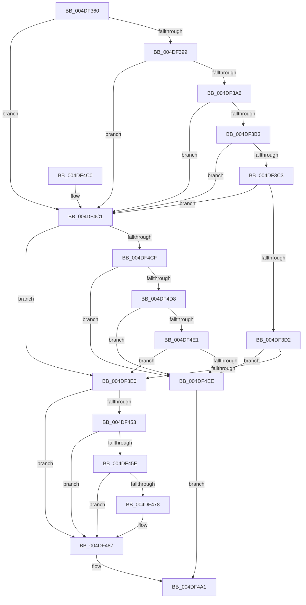

# KdpReport

- RVA: `0x004DF360`–`0x004DF4F2` (길이 `402` bytes)
- VA: `0x00000001404DF360`
- 실행 섹션: `.text`
- PDB 이름 있음: `예`; PDB Function 태그: `아니요`
- unwind 정보 RVA: `0x000956F8`
- 디코드: `91`개 명령, `402/402` bytes 표시
- 미해석 바이트: `0` (있으면 어셈블리에 `.byte`로 보존)

> 이 문서는 커널 이미지의 기계어와 PDB 기호를 분석해 생성했습니다. 4번과 5번은 함수 원형과 자료형을 바이너리 사용 방식에서 추정한 C 해석이며 원본 소스 복구 결과는 아닙니다.

## 1. Dependencies

- 직접 호출 지점: **7**; 고유 호출 대상: **6**
- 직접 호출자로 확인된 함수: **1**
- RIP 상대 이미지 참조: **3**

### Outgoing calls
- `0x004DF3E0` → [KdEnterDebugger](../../pagekd/B8/KdEnterDebugger_function_00B8A96C.md) (function, `0x00B8A96C`)
- `0x004DF404` → [KdpCopyContext](../../pagekd/B8/KdpCopyContext_function_00B851E8.md) (function, `0x00B851E8`)
- `0x004DF413` → [KiSaveProcessorControlState](../6B/KiSaveProcessorControlState_function_006B0EF0.md) (function, `0x006B0EF0`)
- `0x004DF425` → [KdpReportExceptionStateChange](../../pagekd/B8/KdpReportExceptionStateChange_function_00B8A1E0.md) (function, `0x00B8A1E0`)
- `0x004DF442` → [KdpCopyContext](../../pagekd/B8/KdpCopyContext_function_00B851E8.md) (function, `0x00B851E8`)
- `0x004DF48A` → [KiRestoreProcessorControlState](../6B/KiRestoreProcessorControlState_function_006B0E20.md) (function, `0x006B0E20`)
- `0x004DF492` → [KdExitDebugger](../../pagekd/B8/KdExitDebugger_function_00B85008.md) (function, `0x00B85008`)

### Direct callers
- [KdpTrap](../../pagekd/B8/KdpTrap_function_00B852B8.md) at `0x00B85466`

### Static image references
- `0x004DF3C3` → RVA `0x00FC42C0` (`.data`; read)
- `0x004DF44A` → RVA `0x01201842` (`CFGRO`; read)
- `0x004DF49A` → RVA `0x00F49B61` (`.data`; write)

## 2. Other-region calls and transfers

- 다른 실행 섹션으로 향하는 call: **5**
  - `0x004DF3E0` → [KdEnterDebugger](../../pagekd/B8/KdEnterDebugger_function_00B8A96C.md) (`.text` → `PAGEKD`)
  - `0x004DF404` → [KdpCopyContext](../../pagekd/B8/KdpCopyContext_function_00B851E8.md) (`.text` → `PAGEKD`)
  - `0x004DF425` → [KdpReportExceptionStateChange](../../pagekd/B8/KdpReportExceptionStateChange_function_00B8A1E0.md) (`.text` → `PAGEKD`)
  - `0x004DF442` → [KdpCopyContext](../../pagekd/B8/KdpCopyContext_function_00B851E8.md) (`.text` → `PAGEKD`)
  - `0x004DF492` → [KdExitDebugger](../../pagekd/B8/KdExitDebugger_function_00B85008.md) (`.text` → `PAGEKD`)
- 별도 외부 분기/꼬리 이동을 확인하지 못했습니다.

## 3. Assembly (complete function range)

```asm
004DF360  48 8B C4                        mov rax, rsp
004DF363  48 89 58 08                     mov qword ptr [rax + 8], rbx
004DF367  48 89 68 10                     mov qword ptr [rax + 0x10], rbp
004DF36B  48 89 70 18                     mov qword ptr [rax + 0x18], rsi
004DF36F  48 89 78 20                     mov qword ptr [rax + 0x20], rdi
004DF373  41 54                           push r12
004DF375  41 56                           push r14
004DF377  41 57                           push r15
004DF379  48 83 EC 20                     sub rsp, 0x20
004DF37D  45 8B 10                        mov r10d, dword ptr [r8]
004DF380  49 8B F1                        mov rsi, r9
004DF383  4D 8B F0                        mov r14, r8
004DF386  41 BC 01 00 00 00               mov r12d, 1
004DF38C  41 81 FA 03 00 00 80            cmp r10d, 0x80000003
004DF393  0F 84 28 01 00 00               je 0x1404df4c1
004DF399  41 81 FA 20 04 00 C0            cmp r10d, 0xc0000420
004DF3A0  0F 84 1B 01 00 00               je 0x1404df4c1
004DF3A6  41 81 FA 04 00 00 80            cmp r10d, 0x80000004
004DF3AD  0F 84 0E 01 00 00               je 0x1404df4c1
004DF3B3  41 8D 82 E2 FF FF BF            lea eax, [r10 - 0x4000001e]
004DF3BA  41 3B C4                        cmp eax, r12d
004DF3BD  0F 86 FE 00 00 00               jbe 0x1404df4c1
004DF3C3  8B 05 F7 4E AE 00               mov eax, dword ptr [rip + 0xae4ef7]
004DF3C9  41 84 C4                        test r12b, al
004DF3CC  0F 85 EF 00 00 00               jne 0x1404df4c1
004DF3D2  40 8A 7C 24 68                  mov dil, byte ptr [rsp + 0x68]
004DF3D7  40 84 FF                        test dil, dil
004DF3DA  0F 84 0E 01 00 00               je 0x1404df4ee
004DF3E0  E8 87 B5 6A 00                  call 0x140b8a96c
004DF3E5  65 48 8B 1C 25 20 00 00 00      mov rbx, qword ptr gs:[0x20]
004DF3EE  4C 8B C6                        mov r8, rsi
004DF3F1  8B 56 30                        mov edx, dword ptr [rsi + 0x30]
004DF3F4  44 8A F8                        mov r15b, al
004DF3F7  23 93 C8 8F 00 00               and edx, dword ptr [rbx + 0x8fc8]
004DF3FD  48 8B 8B C0 8F 00 00            mov rcx, qword ptr [rbx + 0x8fc0]
004DF404  E8 DF 5D 6A 00                  call 0x140b851e8
004DF409  48 8D AB 00 01 00 00            lea rbp, [rbx + 0x100]
004DF410  48 8B CD                        mov rcx, rbp
004DF413  E8 D8 1A 1D 00                  call 0x1406b0ef0
004DF418  48 8B 93 C0 8F 00 00            mov rdx, qword ptr [rbx + 0x8fc0]
004DF41F  44 8A C7                        mov r8b, dil
004DF422  49 8B CE                        mov rcx, r14
004DF425  E8 B6 AD 6A 00                  call 0x140b8a1e0
004DF42A  8B 7E 30                        mov edi, dword ptr [rsi + 0x30]
004DF42D  48 8B CE                        mov rcx, rsi
004DF430  4C 8B 83 C0 8F 00 00            mov r8, qword ptr [rbx + 0x8fc0]
004DF437  8B D7                           mov edx, edi
004DF439  23 93 C8 8F 00 00               and edx, dword ptr [rbx + 0x8fc8]
004DF43F  44 8A F0                        mov r14b, al
004DF442  E8 A1 5D 6A 00                  call 0x140b851e8
004DF447  89 7E 30                        mov dword ptr [rsi + 0x30], edi
004DF44A  F6 05 F1 23 D2 00 02            test byte ptr [rip + 0xd223f1], 2
004DF451  74 34                           je 0x1404df487
004DF453  B8 80 00 10 00                  mov eax, 0x100080
004DF458  23 F8                           and edi, eax
004DF45A  3B F8                           cmp edi, eax
004DF45C  75 29                           jne 0x1404df487
004DF45E  48 63 86 E8 04 00 00            movsxd rax, dword ptr [rsi + 0x4e8]
004DF465  48 8B 96 F8 00 00 00            mov rdx, qword ptr [rsi + 0xf8]
004DF46C  48 03 C6                        add rax, rsi
004DF46F  48 39 90 D8 04 00 00            cmp qword ptr [rax + 0x4d8], rdx
004DF476  74 0F                           je 0x1404df487
004DF478  66 44 09 A0 E2 04 00 00         or word ptr [rax + 0x4e2], r12w
004DF480  48 89 90 D8 04 00 00            mov qword ptr [rax + 0x4d8], rdx
004DF487  48 8B CD                        mov rcx, rbp
004DF48A  E8 91 19 1D 00                  call 0x1406b0e20
004DF48F  41 8A CF                        mov cl, r15b
004DF492  E8 71 5B 6A 00                  call 0x140b85008
004DF497  41 8A C6                        mov al, r14b
004DF49A  C6 05 C0 A6 A6 00 00            mov byte ptr [rip + 0xa6a6c0], 0
004DF4A1  48 8B 5C 24 40                  mov rbx, qword ptr [rsp + 0x40]
004DF4A6  48 8B 6C 24 48                  mov rbp, qword ptr [rsp + 0x48]
004DF4AB  48 8B 74 24 50                  mov rsi, qword ptr [rsp + 0x50]
004DF4B0  48 8B 7C 24 58                  mov rdi, qword ptr [rsp + 0x58]
004DF4B5  48 83 C4 20                     add rsp, 0x20
004DF4B9  41 5F                           pop r15
004DF4BB  41 5E                           pop r14
004DF4BD  41 5C                           pop r12
004DF4BF  C3                              ret
004DF4C0  CC                              int3
004DF4C1  40 8A 7C 24 68                  mov dil, byte ptr [rsp + 0x68]
004DF4C6  40 84 FF                        test dil, dil
004DF4C9  0F 85 11 FF FF FF               jne 0x1404df3e0
004DF4CF  41 81 FA 1D 00 00 40            cmp r10d, 0x4000001d
004DF4D6  76 16                           jbe 0x1404df4ee
004DF4D8  41 81 FA 37 00 00 C0            cmp r10d, 0xc0000037
004DF4DF  74 0D                           je 0x1404df4ee
004DF4E1  41 81 FA 20 00 00 40            cmp r10d, 0x40000020
004DF4E8  0F 8C F2 FE FF FF               jl 0x1404df3e0
004DF4EE  32 C0                           xor al, al
004DF4F0  EB AF                           jmp 0x1404df4a1
```

## 4. C-style interpretation (structured pseudocode)

```c
__int64 __fastcall KdpReport(__int64 a1, __int64 a2, __int64 a3, __int64 a4, __int64 a5, unsigned __int8 a6)
{
    __int64 result;
    __int64 v_rdi;
    __int64 v_rsp;
    unsigned __int64 v_stack_p10;
    unsigned __int64 v_stack_p18;
    unsigned __int64 v_stack_p20;
    unsigned __int64 v_stack_p8;

    *(unsigned __int64 *)(v_rsp + 8) = v_rbx;
    *(unsigned __int64 *)(v_rsp + 16) = v_rbp;
    *(unsigned __int64 *)(v_rsp + 24) = v_rsi;
    *(unsigned __int64 *)(v_rsp + 32) = v_rdi;
    v_rsp = (v_rsp) - (32);
    if (((unsigned int)((unsigned int)(*(unsigned int *)(a3)))) == 0x80000003ULL) goto loc_004DF4C1;
    if (((unsigned int)((unsigned int)(*(unsigned int *)(a3)))) == 0xC0000420ULL) goto loc_004DF4C1;
    if (((unsigned int)((unsigned int)(*(unsigned int *)(a3)))) == 0x80000004ULL) goto loc_004DF4C1;
    if (((unsigned int)((unsigned int)(*(unsigned int *)(a3)) - 1073741854)) <= 1) goto loc_004DF4C1;
    if (((1) & ((unsigned __int8)((unsigned int)(*(unsigned int *)(v_rip + 11423479))))) != 0) goto loc_004DF4C1;
    if (a6 == 0) goto loc_004DF4EE;
loc_004DF3E0:
    result = KdEnterDebugger(a1, a2, a3, a4);
    a2 = (unsigned int)(((unsigned int)(*(unsigned int *)(a4 + 48))) & (*(unsigned int *)(*(unsigned __int64 *)(gs_base + (0 + 32)) + 36808)));
    result = KdpCopyContext(*(unsigned __int64 *)(*(unsigned __int64 *)(gs_base + (0 + 32)) + 36800), a2, a4, a4);
    result = KiSaveProcessorControlState(*(unsigned __int64 *)(gs_base + (0 + 32)) + 256, a2, a4, a4);
    result = KdpReportExceptionStateChange(a3, *(unsigned __int64 *)(*(unsigned __int64 *)(gs_base + (0 + 32)) + 36800), a6, a4);
    a2 = (unsigned int)(((unsigned int)((unsigned int)((unsigned int)(*(unsigned int *)(a4 + 48))))) & (*(unsigned int *)(*(unsigned __int64 *)(gs_base + (0 + 32)) + 36808)));
    result = KdpCopyContext(a4, a2, *(unsigned __int64 *)(*(unsigned __int64 *)(gs_base + (0 + 32)) + 36800), a4);
    *(unsigned int *)(a4 + 48) = (unsigned int)((unsigned int)(*(unsigned int *)(a4 + 48)));
    if (((*(unsigned __int8 *)(v_rip + 13771761)) & (2)) == 0) goto loc_004DF487;
    v_rdi = (unsigned int)(((unsigned int)(*(unsigned int *)(a4 + 48))) & ((unsigned int)((unsigned int)(0x100080ULL))));
    if (((unsigned int)(v_rdi)) != ((unsigned int)((unsigned int)(0x100080ULL)))) goto loc_004DF487;
    result = ((int)(*(unsigned int *)(a4 + 1256))) + (a4);
    if ((*(unsigned __int64 *)(result + 1240)) != (*(unsigned __int64 *)(a4 + 248))) {
        *(unsigned __int64 *)(result + 1240) = *(unsigned __int64 *)(a4 + 248);
    }
    result = KiRestoreProcessorControlState(*(unsigned __int64 *)(gs_base + (0 + 32)) + 256, *(unsigned __int64 *)(a4 + 248), *(unsigned __int64 *)(*(unsigned __int64 *)(gs_base + (0 + 32)) + 36800), a4);
    result = KdExitDebugger((unsigned __int8)((unsigned __int8)(result)), *(unsigned __int64 *)(a4 + 248), *(unsigned __int64 *)(*(unsigned __int64 *)(gs_base + (0 + 32)) + 36800), a4);
    *(unsigned __int8 *)(v_rip + 10921664) = 0;
loc_004DF4A1:
    v_rsp = (v_rsp) + (32);
    return (unsigned __int8)((unsigned __int8)(result));
loc_004DF4C1:
    if (a6 != 0) goto loc_004DF3E0;
    if (((unsigned int)((unsigned int)(*(unsigned int *)(a3)))) <= 0x4000001DULL) goto loc_004DF4EE;
    if (((unsigned int)((unsigned int)(*(unsigned int *)(a3)))) == 0xC0000037ULL) goto loc_004DF4EE;
    if (((unsigned int)((unsigned int)(*(unsigned int *)(a3)))) < 0x40000020ULL) goto loc_004DF3E0;
loc_004DF4EE:
    result = 0;
    goto loc_004DF4A1;
}
```

## 5. (Beta) C Style

```c
int64_t KdpReport(int64_t Arg1, int64_t Arg2, void *Arg3, void *Arg4, uint64_t Arg5, uint8_t Arg6)
{
    uint8_t *arg3 = (uint8_t *)Arg3;
    uint8_t *arg4 = (uint8_t *)Arg4;

    int64_t result;
    int64_t local_rdi;
    int64_t local_rsp;
    uint64_t v_stack_p10;
    uint64_t v_stack_p18;
    uint64_t v_stack_p20;
    uint64_t v_stack_p8;

    *(uint64_t *)(local_rsp + 0x8) = local_rbx;
    *(uint64_t *)(local_rsp + 0x10) = local_rbp;
    *(uint64_t *)(local_rsp + 0x18) = local_rsi;
    *(uint64_t *)(local_rsp + 0x20) = local_rdi;
    local_rsp = (local_rsp) - (32);
    if (((uint32_t)((uint32_t)(*(uint32_t *)(arg3)))) == 0x80000003ULL) goto loc_004DF4C1;
    if (((uint32_t)((uint32_t)(*(uint32_t *)(arg3)))) == 0xC0000420ULL) goto loc_004DF4C1;
    if (((uint32_t)((uint32_t)(*(uint32_t *)(arg3)))) == 0x80000004ULL) goto loc_004DF4C1;
    if (((uint32_t)((uint32_t)(*(uint32_t *)(arg3)) - 1073741854)) <= 1) goto loc_004DF4C1;
    if (((1) & ((uint8_t)((uint32_t)(*(uint32_t *)(v_rip + 0xAE4EF7))))) != 0) goto loc_004DF4C1;
    if (Arg6 == 0) goto loc_004DF4EE;
loc_004DF3E0:
    result = KdEnterDebugger(Arg1, Arg2, Arg3, Arg4);
    Arg2 = (uint32_t)(((uint32_t)(*(uint32_t *)(arg4 + 0x30))) & (*(uint32_t *)(*(uint64_t *)(gs_base + (0 + 0x20)) + 0x8FC8)));
    result = KdpCopyContext(*(uint64_t *)(*(uint64_t *)(gs_base + (0 + 0x20)) + 0x8FC0), Arg2, Arg4, Arg4);
    result = KiSaveProcessorControlState(*(uint64_t *)(gs_base + (0 + 0x20)) + 256, Arg2, Arg4, Arg4);
    result = KdpReportExceptionStateChange(Arg3, *(uint64_t *)(*(uint64_t *)(gs_base + (0 + 0x20)) + 0x8FC0), Arg6, Arg4);
    Arg2 = (uint32_t)(((uint32_t)((uint32_t)((uint32_t)(*(uint32_t *)(arg4 + 0x30))))) & (*(uint32_t *)(*(uint64_t *)(gs_base + (0 + 0x20)) + 0x8FC8)));
    result = KdpCopyContext(Arg4, Arg2, *(uint64_t *)(*(uint64_t *)(gs_base + (0 + 0x20)) + 0x8FC0), Arg4);
    *(uint32_t *)(arg4 + 0x30) = (uint32_t)((uint32_t)(*(uint32_t *)(arg4 + 0x30)));
    if (((*(uint8_t *)(v_rip + 0xD223F1)) & (2)) == 0) goto loc_004DF487;
    local_rdi = (uint32_t)(((uint32_t)(*(uint32_t *)(arg4 + 0x30))) & ((uint32_t)((uint32_t)(0x100080ULL))));
    if (((uint32_t)(local_rdi)) != ((uint32_t)((uint32_t)(0x100080ULL)))) goto loc_004DF487;
    result = ((int32_t)(*(uint32_t *)(arg4 + 0x4E8))) + (Arg4);
    if ((*(uint64_t *)(result + 0x4D8)) != (*(uint64_t *)(arg4 + 0xF8))) {
        *(uint64_t *)(result + 0x4D8) = *(uint64_t *)(arg4 + 0xF8);
    }
    result = KiRestoreProcessorControlState(*(uint64_t *)(gs_base + (0 + 0x20)) + 256, *(uint64_t *)(arg4 + 0xF8), *(uint64_t *)(*(uint64_t *)(gs_base + (0 + 0x20)) + 0x8FC0), Arg4);
    result = KdExitDebugger((uint8_t)((uint8_t)(result)), *(uint64_t *)(arg4 + 0xF8), *(uint64_t *)(*(uint64_t *)(gs_base + (0 + 0x20)) + 0x8FC0), Arg4);
    *(uint8_t *)(v_rip + 0xA6A6C0) = 0;
loc_004DF4A1:
    local_rsp = (local_rsp) + (32);
    return (uint8_t)((uint8_t)(result));
loc_004DF4C1:
    if (Arg6 != 0) goto loc_004DF3E0;
    if (((uint32_t)((uint32_t)(*(uint32_t *)(arg3)))) <= 0x4000001DULL) goto loc_004DF4EE;
    if (((uint32_t)((uint32_t)(*(uint32_t *)(arg3)))) == 0xC0000037ULL) goto loc_004DF4EE;
    if (((uint32_t)((uint32_t)(*(uint32_t *)(arg3)))) < 0x40000020ULL) goto loc_004DF3E0;
loc_004DF4EE:
    result = 0;
    goto loc_004DF4A1;
}
```

### 관측된 메모리 오프셋

구조체 형식이 확인되지 않은 접근은 인자 기준의 오프셋으로만 기록했습니다.

| 기준 인자 | 오프셋 표현 | 폭 (bit) | 접근 |
|---|---:|---:|---|
| `Arg3` | `+ 0x0` | `32` | `R` |
| `Arg4` | `+ 0x30` | `32` | `R` |
| `Arg4` | `+ 0x30` | `32` | `W` |
| `Arg4` | `+ 0xF8` | `64` | `R` |
| `Arg4` | `+ 0x4E8` | `32` | `R` |

## 6. Execution-region graph

[열기: 2D/3D 그래프와 함수 탐색 컨트롤 패널](../../../control-panel.html?section=text&rva=0x004DF360&view=graph)

- 2D 그래프는 위에서 아래로 흐르고, 3D 그래프는 빈 공간을 드래그해 회전합니다. Shift+드래그는 이동, 휠은 확대·축소, 함수 노드 선택은 대상 보고서 이동입니다.

### Static fallback


