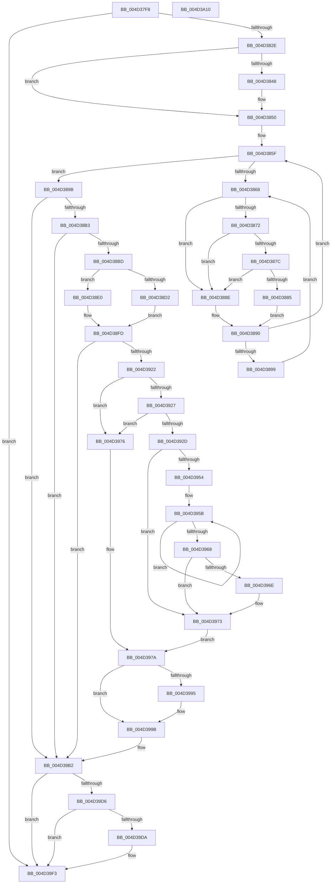

# KeBoostPriorityThread

- RVA: `0x004D37F8`–`0x004D3A11` (길이 `537` bytes)
- VA: `0x00000001404D37F8`
- 실행 섹션: `.text`
- PDB 이름 있음: `예`; PDB Function 태그: `아니요`
- unwind 정보 RVA: `0x0008C2BC`
- 디코드: `147`개 명령, `537/537` bytes 표시
- 미해석 바이트: `0` (있으면 어셈블리에 `.byte`로 보존)

> 이 문서는 커널 이미지의 기계어와 PDB 기호를 분석해 생성했습니다. 4번과 5번은 함수 원형과 자료형을 바이너리 사용 방식에서 추정한 C 해석이며 원본 소스 복구 결과는 아닙니다.

## 1. Dependencies

- 직접 호출 지점: **12**; 고유 호출 대상: **11**
- 직접 호출자로 확인된 함수: **2**
- RIP 상대 이미지 참조: **6**

### Outgoing calls
- `0x004D384B` → [KiRaiseIrqlProcessIrqlFlags](../4F/KiRaiseIrqlProcessIrqlFlags_function_004F56FC.md) (function, `0x004F56FC`)
- `0x004D387C` → [KiCheckVpBackingLongSpinWaitHypercall](../30/KiCheckVpBackingLongSpinWaitHypercall_function_0030F490.md) (function, `0x0030F490`)
- `0x004D3887` → [HvlNotifyLongSpinWait](../30/HvlNotifyLongSpinWait_function_0030F460.md) (function, `0x0030F460`)
- `0x004D38BD` → [Feature_StackingDecayBoosts__private_IsEnabledNoReportingNoInline](../4E/Feature_StackingDecayBoosts__private_IsEnabledNoReportingNoInline_function_004EF7C0.md) (function, `0x004EF7C0`)
- `0x004D38FD` → [Feature_StackingDecayBoosts__private_IsEnabledNoReportingNoInline](../4E/Feature_StackingDecayBoosts__private_IsEnabledNoReportingNoInline_function_004EF7C0.md) (function, `0x004EF7C0`)
- `0x004D3911` → [KiComputeThreadPriority](../3C/KiComputeThreadPriority_function_003C45F4.md) (function, `0x003C45F4`)
- `0x004D3937` → [KiUpdateTotalCyclesCurrentThread](../37/KiUpdateTotalCyclesCurrentThread_function_0037DE40.md) (function, `0x0037DE40`)
- `0x004D396E` → [KiRemoveSystemWorkPriorityKick](../26/KiRemoveSystemWorkPriorityKick_function_002631D0.md) (function, `0x002631D0`)
- `0x004D397D` → [KiQueryQuantumReset](../21/KiQueryQuantumReset_function_0021F6B4.md) (function, `0x0021F6B4`)
- `0x004D39AA` → [KiSetPriorityThread](../22/KiSetPriorityThread_function_00220E78.md) (function, `0x00220E78`)
- `0x004D39C5` → [KiProcessDeferredReadyList](../25/KiProcessDeferredReadyList_function_00250800.md) (function, `0x00250800`)
- `0x004D39EE` → [EtwTracePriority](../3C/EtwTracePriority_function_003C41A4.md) (function, `0x003C41A4`)

### Direct callers
- [ExpCreateWorkerThread](../../page/9E/ExpCreateWorkerThread_function_009ECEFC.md) at `0x009ECFAF`
- [NtSetInformationProcess](../../page/AE/NtSetInformationProcess_function_00AE5370.md) at `0x00AE5DF5`

### Static image references
- `0x004D3814` → RVA `0x00FCFF00` (`CACHEALI`; read)
- `0x004D3840` → RVA `0x00FC6D20` (`ALMOSTRO`; read)
- `0x004D386A` → RVA `0x00FC52AC` (`ALMOSTRO`; reference)
- `0x004D3872` → RVA `0x00FC6AB8` (`ALMOSTRO`; read)
- `0x004D3982` → RVA `0x00FC5098` (`ALMOSTRO`; read)
- `0x004D39CA` → RVA `0x00FC6B04` (`ALMOSTRO`; read)

## 2. Other-region calls and transfers

- 다른 실행 섹션으로 향하는 call: **0**
- 별도 외부 분기/꼬리 이동을 확인하지 못했습니다.

## 3. Assembly (complete function range)

```asm
004D37F8  4C 8B DC                        mov r11, rsp
004D37FB  49 89 5B 10                     mov qword ptr [r11 + 0x10], rbx
004D37FF  49 89 6B 18                     mov qword ptr [r11 + 0x18], rbp
004D3803  49 89 73 20                     mov qword ptr [r11 + 0x20], rsi
004D3807  57                              push rdi
004D3808  41 54                           push r12
004D380A  41 55                           push r13
004D380C  41 56                           push r14
004D380E  41 57                           push r15
004D3810  48 83 EC 30                     sub rsp, 0x30
004D3814  48 8D 05 E5 C6 AF 00            lea rax, [rip + 0xafc6e5]
004D381B  44 8B F2                        mov r14d, edx
004D381E  48 8B D9                        mov rbx, rcx
004D3821  48 39 81 20 02 00 00            cmp qword ptr [rcx + 0x220], rax
004D3828  0F 84 C5 01 00 00               je 0x1404d39f3
004D382E  49 83 63 08 00                  and qword ptr [r11 + 8], 0
004D3833  33 ED                           xor ebp, ebp
004D3835  45 0F 20 C4                     mov r12, cr8
004D3839  8D 55 02                        lea edx, [rbp + 2]
004D383C  44 0F 22 C2                     mov cr8, rdx
004D3840  39 2D DA 34 AF 00               cmp dword ptr [rip + 0xaf34da], ebp
004D3846  74 08                           je 0x1404d3850
004D3848  41 8A CC                        mov cl, r12b
004D384B  E8 AC 1E 02 00                  call 0x1404f56fc
004D3850  65 48 8B 34 25 20 00 00 00      mov rsi, qword ptr gs:[0x20]
004D3859  33 FF                           xor edi, edi
004D385B  4C 8B 6E 08                     mov r13, qword ptr [rsi + 8]
004D385F  F0 48 0F BA 6B 40 00            lock bts qword ptr [rbx + 0x40], 0
004D3866  73 33                           jae 0x1404d389b
004D3868  FF C7                           inc edi
004D386A  85 3D 3C 1A AF 00               test dword ptr [rip + 0xaf1a3c], edi
004D3870  75 1C                           jne 0x1404d388e
004D3872  8B 05 40 32 AF 00               mov eax, dword ptr [rip + 0xaf3240]
004D3878  A8 40                           test al, 0x40
004D387A  74 12                           je 0x1404d388e
004D387C  E8 0F BC E3 FF                  call 0x14030f490
004D3881  84 C0                           test al, al
004D3883  74 09                           je 0x1404d388e
004D3885  8B CF                           mov ecx, edi
004D3887  E8 D4 BB E3 FF                  call 0x14030f460
004D388C  EB 02                           jmp 0x1404d3890
004D388E  F3 90                           pause
004D3890  48 8B 43 40                     mov rax, qword ptr [rbx + 0x40]
004D3894  48 85 C0                        test rax, rax
004D3897  74 C6                           je 0x1404d385f
004D3899  EB CD                           jmp 0x1404d3868
004D389B  0F BE 83 66 03 00 00            movsx eax, byte ptr [rbx + 0x366]
004D38A2  44 0F BE BB C3 00 00 00         movsx r15d, byte ptr [rbx + 0xc3]
004D38AA  44 3B F0                        cmp r14d, eax
004D38AD  0F 8E FF 00 00 00               jle 0x1404d39b2
004D38B3  41 83 FF 10                     cmp r15d, 0x10
004D38B7  0F 8D F5 00 00 00               jge 0x1404d39b2
004D38BD  E8 FE BE 01 00                  call 0x1404ef7c0
004D38C2  85 C0                           test eax, eax
004D38C4  BA 0F 00 00 00                  mov edx, 0xf
004D38C9  0F BE 83 33 02 00 00            movsx eax, byte ptr [rbx + 0x233]
004D38D0  75 0E                           jne 0x1404d38e0
004D38D2  42 8D 3C 30                     lea edi, [rax + r14]
004D38D6  83 FF 10                        cmp edi, 0x10
004D38D9  0F 4D FA                        cmovge edi, edx
004D38DC  2B F8                           sub edi, eax
004D38DE  EB 1D                           jmp 0x1404d38fd
004D38E0  0F B7 8B 06 02 00 00            movzx ecx, word ptr [rbx + 0x206]
004D38E7  23 CA                           and ecx, edx
004D38E9  03 C8                           add ecx, eax
004D38EB  83 F9 10                        cmp ecx, 0x10
004D38EE  0F 4D CA                        cmovge ecx, edx
004D38F1  42 8D 3C 31                     lea edi, [rcx + r14]
004D38F5  83 FF 10                        cmp edi, 0x10
004D38F8  0F 4D FA                        cmovge edi, edx
004D38FB  2B F9                           sub edi, ecx
004D38FD  E8 BE BE 01 00                  call 0x1404ef7c0
004D3902  45 33 C0                        xor r8d, r8d
004D3905  40 88 BB 66 03 00 00            mov byte ptr [rbx + 0x366], dil
004D390C  33 D2                           xor edx, edx
004D390E  48 8B CB                        mov rcx, rbx
004D3911  E8 DE 0C EF FF                  call 0x1403c45f4
004D3916  44 8B F0                        mov r14d, eax
004D3919  41 3B C7                        cmp eax, r15d
004D391C  0F 8E 90 00 00 00               jle 0x1404d39b2
004D3922  49 3B DD                        cmp rbx, r13
004D3925  75 4F                           jne 0x1404d3976
004D3927  40 38 6E 20                     cmp byte ptr [rsi + 0x20], bpl
004D392B  75 49                           jne 0x1404d3976
004D392D  FA                              cli
004D392E  45 33 C0                        xor r8d, r8d
004D3931  48 8B D3                        mov rdx, rbx
004D3934  48 8B CE                        mov rcx, rsi
004D3937  E8 04 A5 EA FF                  call 0x14037de40
004D393C  65 48 8B 0C 25 20 00 00 00      mov rcx, qword ptr gs:[0x20]
004D3945  48 8B F8                        mov rdi, rax
004D3948  4C 8B 81 B8 8E 00 00            mov r8, qword ptr [rcx + 0x8eb8]
004D394F  4D 85 C0                        test r8, r8
004D3952  74 1F                           je 0x1404d3973
004D3954  41 0F 0D 08                     prefetchw byte ptr [r8]
004D3958  41 8B 00                        mov eax, dword ptr [r8]
004D395B  8B D0                           mov edx, eax
004D395D  0F BA F2 15                     btr edx, 0x15
004D3961  F0 41 0F B1 10                  lock cmpxchg dword ptr [r8], edx
004D3966  75 F3                           jne 0x1404d395b
004D3968  0F BA E0 15                     bt eax, 0x15
004D396C  73 05                           jae 0x1404d3973
004D396E  E8 5D F8 D8 FF                  call 0x1402631d0
004D3973  FB                              sti
004D3974  EB 04                           jmp 0x1404d397a
004D3976  48 8B 7B 48                     mov rdi, qword ptr [rbx + 0x48]
004D397A  48 8B CB                        mov rcx, rbx
004D397D  E8 32 BD D4 FF                  call 0x14021f6b4
004D3982  0F AF 05 0F 17 AF 00            imul eax, dword ptr [rip + 0xaf170f]
004D3989  8B D0                           mov edx, eax
004D398B  8B 43 78                        mov eax, dword ptr [rbx + 0x78]
004D398E  48 03 D7                        add rdx, rdi
004D3991  A8 20                           test al, 0x20
004D3993  74 06                           je 0x1404d399b
004D3995  F0 0F BA 73 78 05               lock btr dword ptr [rbx + 0x78], 5
004D399B  48 89 53 20                     mov qword ptr [rbx + 0x20], rdx
004D399F  45 8B C6                        mov r8d, r14d
004D39A2  48 8D 54 24 60                  lea rdx, [rsp + 0x60]
004D39A7  48 8B CB                        mov rcx, rbx
004D39AA  E8 C9 D4 D4 FF                  call 0x140220e78
004D39AF  41 8B EE                        mov ebp, r14d
004D39B2  45 8A C4                        mov r8b, r12b
004D39B5  48 C7 43 40 00 00 00 00         mov qword ptr [rbx + 0x40], 0
004D39BD  48 8D 54 24 60                  lea rdx, [rsp + 0x60]
004D39C2  48 8B CE                        mov rcx, rsi
004D39C5  E8 36 CE D7 FF                  call 0x140250800
004D39CA  F7 05 30 31 AF 00 00 20 00 00   test dword ptr [rip + 0xaf3130], 0x2000
004D39D4  74 1D                           je 0x1404d39f3
004D39D6  85 ED                           test ebp, ebp
004D39D8  74 19                           je 0x1404d39f3
004D39DA  48 83 64 24 20 00               and qword ptr [rsp + 0x20], 0
004D39E0  BA 30 05 00 00                  mov edx, 0x530
004D39E5  44 8B CD                        mov r9d, ebp
004D39E8  45 8B C7                        mov r8d, r15d
004D39EB  48 8B CB                        mov rcx, rbx
004D39EE  E8 B1 07 EF FF                  call 0x1403c41a4
004D39F3  48 8B 5C 24 68                  mov rbx, qword ptr [rsp + 0x68]
004D39F8  48 8B 6C 24 70                  mov rbp, qword ptr [rsp + 0x70]
004D39FD  48 8B 74 24 78                  mov rsi, qword ptr [rsp + 0x78]
004D3A02  48 83 C4 30                     add rsp, 0x30
004D3A06  41 5F                           pop r15
004D3A08  41 5E                           pop r14
004D3A0A  41 5D                           pop r13
004D3A0C  41 5C                           pop r12
004D3A0E  5F                              pop rdi
004D3A0F  C3                              ret
004D3A10  CC                              int3
```

## 4. C-style interpretation (structured pseudocode)

```c
__int64 __fastcall KeBoostPriorityThread(__int64 a1, int a2, int a3)
{
    __int64 result;
    __int64 v_rbp;
    __int64 v_rdi;
    __int64 v_rsp;
    unsigned __int64 v_stack_m38;
    unsigned __int64 v_stack_p10;
    unsigned __int64 v_stack_p18;
    unsigned __int64 v_stack_p20;
    unsigned __int64 v_stack_p8;

    *(unsigned __int64 *)(v_rsp + 16) = v_rbx;
    *(unsigned __int64 *)(v_rsp + 24) = v_rbp;
    *(unsigned __int64 *)(v_rsp + 32) = v_rsi;
    v_rsp = (v_rsp) - (48);
    if ((*(unsigned __int64 *)(a1 + 544)) == (v_rip + 11519717)) goto loc_004D39F3;
    v_rbp = 0;
    result = v_rip + 11519717;
    if ((*(unsigned int *)(v_rip + 11482330)) != 0) {
        a1 = (unsigned __int8)(v_cr8);
        result = KiRaiseIrqlProcessIrqlFlags(a1, v_rbp + 2, a3, a4);
    }
    v_rdi = 0;
loc_004D385F:
    if (condition_is_above_or_equal) goto loc_004D389B;
loc_004D3868:
    v_rdi = (unsigned int)((v_rdi) + 1);
    if (((*(unsigned int *)(v_rip + 11475516)) & ((unsigned int)(v_rdi))) != 0) goto loc_004D388E;
    if ((((unsigned __int8)((unsigned int)(*(unsigned int *)(v_rip + 11481664)))) & (64)) == 0) goto loc_004D388E;
    result = KiCheckVpBackingLongSpinWaitHypercall(a1, v_rbp + 2, a3, a4);
    if ((unsigned __int8)(result) == 0) goto loc_004D388E;
    result = HvlNotifyLongSpinWait((unsigned int)((unsigned int)(v_rdi)), v_rbp + 2, a3, a4);
    goto loc_004D3890;
loc_004D388E:
loc_004D3890:
    if (*(unsigned __int64 *)(a1 + 64) == 0) goto loc_004D385F;
    goto loc_004D3868;
loc_004D389B:
    if (((unsigned int)((unsigned int)(a2))) <= ((unsigned int)((__int8)(*(unsigned __int8 *)(a1 + 870))))) goto loc_004D39B2;
    if (((unsigned int)((__int8)(*(unsigned __int8 *)(a1 + 195)))) >= 16) goto loc_004D39B2;
    result = Feature_StackingDecayBoosts__private_IsEnabledNoReportingNoInline((unsigned int)((unsigned int)(v_rdi)), v_rbp + 2, a3, a4);
    if ((unsigned int)(result) != 0) goto loc_004D38E0;
    v_rdi = (__int8)(*(unsigned __int8 *)(a1 + 563)) + (unsigned int)(a2) * 1;
    if (((unsigned int)((__int8)(*(unsigned __int8 *)(a1 + 563)) + (unsigned int)(a2) * 1)) >= 16) { v_rdi = 15; }
    v_rdi = (unsigned int)((v_rdi) - ((unsigned int)((__int8)(*(unsigned __int8 *)(a1 + 563)))));
    goto loc_004D38FD;
loc_004D38E0:
    a1 = (unsigned int)((*(unsigned __int16 *)(a1 + 518)) & (15));
    a1 = (unsigned int)((a1) + ((unsigned int)((__int8)(*(unsigned __int8 *)(a1 + 563)))));
    if (((unsigned int)(a1)) >= 16) { a1 = 15; }
    v_rdi = a1 + (unsigned int)(a2) * 1;
    if (((unsigned int)(a1 + (unsigned int)(a2) * 1)) >= 16) { v_rdi = 15; }
    v_rdi = (unsigned int)((v_rdi) - ((unsigned int)(a1)));
loc_004D38FD:
    result = Feature_StackingDecayBoosts__private_IsEnabledNoReportingNoInline(a1, 15, a3, a4);
    a3 = 0;
    *(unsigned __int8 *)(a1 + 870) = (unsigned __int8)(v_rdi);
    a2 = 0;
    result = KiComputeThreadPriority(a1, a2, a3, a4);
    if (((unsigned int)(result)) <= ((unsigned int)((__int8)(*(unsigned __int8 *)(a1 + 195))))) goto loc_004D39B2;
    if (a1 != (*(unsigned __int64 *)(*(unsigned __int64 *)(gs_base + (0 + 32)) + 8))) goto loc_004D3976;
    if ((*(unsigned __int8 *)(*(unsigned __int64 *)(gs_base + (0 + 32)) + 32)) != 0) goto loc_004D3976;
    a3 = 0;
    result = KiUpdateTotalCyclesCurrentThread(*(unsigned __int64 *)(gs_base + (0 + 32)), a1, a3, a4);
    if (*(unsigned __int64 *)(*(unsigned __int64 *)(gs_base + (0 + 32)) + 36536) == 0) goto loc_004D3973;
loc_004D395B:
    if (*(unsigned __int64 *)(*(unsigned __int64 *)(gs_base + (0 + 32)) + 36536) != 0) goto loc_004D395B;
    result = (unsigned int)(*(unsigned int *)(*(unsigned __int64 *)(*(unsigned __int64 *)(gs_base + (0 + 32)) + 36536)));
    if (!(condition_is_above_or_equal)) {
        result = KiRemoveSystemWorkPriorityKick(*(unsigned __int64 *)(gs_base + (0 + 32)), (unsigned int)((unsigned int)((unsigned int)(*(unsigned int *)(*(unsigned __int64 *)(*(unsigned __int64 *)(gs_base + (0 + 32)) + 36536))))), *(unsigned __int64 *)(*(unsigned __int64 *)(gs_base + (0 + 32)) + 36536), a4);
    }
    goto loc_004D397A;
loc_004D3976:
loc_004D397A:
    result = KiQueryQuantumReset(a1, (unsigned int)((unsigned int)((unsigned int)(*(unsigned int *)(*(unsigned __int64 *)(*(unsigned __int64 *)(gs_base + (0 + 32)) + 36536))))), *(unsigned __int64 *)(*(unsigned __int64 *)(gs_base + (0 + 32)) + 36536), a4);
    result = (unsigned int)((result) * (*(unsigned int *)(v_rip + 11474703)));
    a2 = ((unsigned int)((unsigned int)(result))) + (*(unsigned __int64 *)(a1 + 72));
    if ((((unsigned __int8)((unsigned int)(*(unsigned int *)(a1 + 120)))) & (32)) != 0) {
    }
    *(unsigned __int64 *)(a1 + 32) = a2;
    result = KiSetPriorityThread(a1, v_stack_p8, (unsigned int)((unsigned int)((unsigned int)((unsigned int)(result)))), a4);
loc_004D39B2:
    *(unsigned __int64 *)(a1 + 64) = 0;
    result = KiProcessDeferredReadyList(*(unsigned __int64 *)(gs_base + (0 + 32)), v_stack_p8, (unsigned __int8)(v_cr8), a4);
    if (((*(unsigned int *)(v_rip + 11481392)) & (0x2000ULL)) == 0) goto loc_004D39F3;
    if ((unsigned int)((unsigned int)((unsigned int)((unsigned int)((unsigned int)(result))))) != 0) {
        a2 = 0x530ULL;
        a4 = (unsigned int)((unsigned int)((unsigned int)((unsigned int)((unsigned int)(result)))));
        a3 = (unsigned int)((__int8)(*(unsigned __int8 *)(a1 + 195)));
        a1 = a1;
        result = EtwTracePriority(a1, a2, a3, a4);
    }
    v_rsp = (v_rsp) + (48);
    return result;
}
```

## 5. (Beta) C Style

```c
int64_t KeBoostPriorityThread(void *Arg1, int32_t Arg2, int32_t Arg3)
{
    uint8_t *arg1 = (uint8_t *)Arg1;

    int64_t result;
    int64_t local_rbp;
    int64_t local_rdi;
    int64_t local_rsp;
    uint64_t v_stack_m38;
    uint64_t v_stack_p10;
    uint64_t v_stack_p18;
    uint64_t v_stack_p20;
    uint64_t v_stack_p8;

    *(uint64_t *)(local_rsp + 0x10) = local_rbx;
    *(uint64_t *)(local_rsp + 0x18) = local_rbp;
    *(uint64_t *)(local_rsp + 0x20) = local_rsi;
    local_rsp = (local_rsp) - (48);
    if ((*(uint64_t *)(arg1 + 0x220)) == (v_rip + 11519717)) goto loc_004D39F3;
    local_rbp = 0;
    result = v_rip + 11519717;
    if ((*(uint32_t *)(v_rip + 0xAF34DA)) != 0) {
        Arg1 = (uint8_t)(v_cr8);
        result = KiRaiseIrqlProcessIrqlFlags(Arg1, local_rbp + 2, Arg3, a4);
    }
    local_rdi = 0;
loc_004D385F:
    if (condition_is_above_or_equal) goto loc_004D389B;
loc_004D3868:
    local_rdi = (uint32_t)((local_rdi) + 1);
    if (((*(uint32_t *)(v_rip + 0xAF1A3C)) & ((uint32_t)(local_rdi))) != 0) goto loc_004D388E;
    if ((((uint8_t)((uint32_t)(*(uint32_t *)(v_rip + 0xAF3240)))) & (64)) == 0) goto loc_004D388E;
    result = KiCheckVpBackingLongSpinWaitHypercall(Arg1, local_rbp + 2, Arg3, a4);
    if ((uint8_t)(result) == 0) goto loc_004D388E;
    result = HvlNotifyLongSpinWait((uint32_t)((uint32_t)(local_rdi)), local_rbp + 2, Arg3, a4);
    goto loc_004D3890;
loc_004D388E:
loc_004D3890:
    if (*(uint64_t *)(arg1 + 0x40) == 0) goto loc_004D385F;
    goto loc_004D3868;
loc_004D389B:
    if (((uint32_t)((uint32_t)(Arg2))) <= ((uint32_t)((int8_t)(*(uint8_t *)(arg1 + 0x366))))) goto loc_004D39B2;
    if (((uint32_t)((int8_t)(*(uint8_t *)(arg1 + 0xC3)))) >= 16) goto loc_004D39B2;
    result = Feature_StackingDecayBoosts__private_IsEnabledNoReportingNoInline((uint32_t)((uint32_t)(local_rdi)), local_rbp + 2, Arg3, a4);
    if ((uint32_t)(result) != 0) goto loc_004D38E0;
    local_rdi = (int8_t)(*(uint8_t *)(arg1 + 0x233)) + (uint32_t)(Arg2) * 1;
    if (((uint32_t)((int8_t)(*(uint8_t *)(arg1 + 0x233)) + (uint32_t)(Arg2) * 1)) >= 16) { local_rdi = 15; }
    local_rdi = (uint32_t)((local_rdi) - ((uint32_t)((int8_t)(*(uint8_t *)(arg1 + 0x233)))));
    goto loc_004D38FD;
loc_004D38E0:
    Arg1 = (uint32_t)((*(uint16_t *)(arg1 + 0x206)) & (15));
    Arg1 = (uint32_t)((Arg1) + ((uint32_t)((int8_t)(*(uint8_t *)(arg1 + 0x233)))));
    if (((uint32_t)(Arg1)) >= 16) { Arg1 = 15; }
    local_rdi = Arg1 + (uint32_t)(Arg2) * 1;
    if (((uint32_t)(Arg1 + (uint32_t)(Arg2) * 1)) >= 16) { local_rdi = 15; }
    local_rdi = (uint32_t)((local_rdi) - ((uint32_t)(Arg1)));
loc_004D38FD:
    result = Feature_StackingDecayBoosts__private_IsEnabledNoReportingNoInline(Arg1, 15, Arg3, a4);
    Arg3 = 0;
    *(uint8_t *)(arg1 + 0x366) = (uint8_t)(local_rdi);
    Arg2 = 0;
    result = KiComputeThreadPriority(Arg1, Arg2, Arg3, a4);
    if (((uint32_t)(result)) <= ((uint32_t)((int8_t)(*(uint8_t *)(arg1 + 0xC3))))) goto loc_004D39B2;
    if (Arg1 != (*(uint64_t *)(*(uint64_t *)(gs_base + (0 + 0x20)) + 0x8))) goto loc_004D3976;
    if ((*(uint8_t *)(*(uint64_t *)(gs_base + (0 + 0x20)) + 0x20)) != 0) goto loc_004D3976;
    Arg3 = 0;
    result = KiUpdateTotalCyclesCurrentThread(*(uint64_t *)(gs_base + (0 + 0x20)), Arg1, Arg3, a4);
    if (*(uint64_t *)(*(uint64_t *)(gs_base + (0 + 0x20)) + 0x8EB8) == 0) goto loc_004D3973;
loc_004D395B:
    if (*(uint64_t *)(*(uint64_t *)(gs_base + (0 + 0x20)) + 0x8EB8) != 0) goto loc_004D395B;
    result = (uint32_t)(*(uint32_t *)(*(uint64_t *)(*(uint64_t *)(gs_base + (0 + 0x20)) + 0x8EB8)));
    if (!(condition_is_above_or_equal)) {
        result = KiRemoveSystemWorkPriorityKick(*(uint64_t *)(gs_base + (0 + 0x20)), (uint32_t)((uint32_t)((uint32_t)(*(uint32_t *)(*(uint64_t *)(*(uint64_t *)(gs_base + (0 + 0x20)) + 0x8EB8))))), *(uint64_t *)(*(uint64_t *)(gs_base + (0 + 0x20)) + 0x8EB8), a4);
    }
    goto loc_004D397A;
loc_004D3976:
loc_004D397A:
    result = KiQueryQuantumReset(Arg1, (uint32_t)((uint32_t)((uint32_t)(*(uint32_t *)(*(uint64_t *)(*(uint64_t *)(gs_base + (0 + 0x20)) + 0x8EB8))))), *(uint64_t *)(*(uint64_t *)(gs_base + (0 + 0x20)) + 0x8EB8), a4);
    result = (uint32_t)((result) * (*(uint32_t *)(v_rip + 0xAF170F)));
    Arg2 = ((uint32_t)((uint32_t)(result))) + (*(uint64_t *)(arg1 + 0x48));
    if ((((uint8_t)((uint32_t)(*(uint32_t *)(arg1 + 0x78)))) & (32)) != 0) {
    }
    *(uint64_t *)(arg1 + 0x20) = Arg2;
    result = KiSetPriorityThread(Arg1, v_stack_p8, (uint32_t)((uint32_t)((uint32_t)((uint32_t)(result)))), a4);
loc_004D39B2:
    *(uint64_t *)(arg1 + 0x40) = 0;
    result = KiProcessDeferredReadyList(*(uint64_t *)(gs_base + (0 + 0x20)), v_stack_p8, (uint8_t)(v_cr8), a4);
    if (((*(uint32_t *)(v_rip + 0xAF3130)) & (0x2000ULL)) == 0) goto loc_004D39F3;
    if ((uint32_t)((uint32_t)((uint32_t)((uint32_t)((uint32_t)(result))))) != 0) {
        Arg2 = 0x530ULL;
        a4 = (uint32_t)((uint32_t)((uint32_t)((uint32_t)((uint32_t)(result)))));
        Arg3 = (uint32_t)((int8_t)(*(uint8_t *)(arg1 + 0xC3)));
        Arg1 = Arg1;
        result = EtwTracePriority(Arg1, Arg2, Arg3, a4);
    }
    local_rsp = (local_rsp) + (48);
    return result;
}
```

### 관측된 메모리 오프셋

구조체 형식이 확인되지 않은 접근은 인자 기준의 오프셋으로만 기록했습니다.

| 기준 인자 | 오프셋 표현 | 폭 (bit) | 접근 |
|---|---:|---:|---|
| `Arg1` | `+ 0x40` | `64` | `R` |
| `Arg1` | `+ 0x40` | `64` | `R/W` |
| `Arg1` | `+ 0xC3` | `8` | `R` |
| `Arg1` | `+ 0x206` | `16` | `R` |
| `Arg1` | `+ 0x220` | `64` | `R` |
| `Arg1` | `+ 0x233` | `8` | `R` |
| `Arg1` | `+ 0x366` | `8` | `R` |
| `Arg1` | `+ 0x366` | `8` | `W` |

## 6. Execution-region graph

[열기: 2D/3D 그래프와 함수 탐색 컨트롤 패널](../../../control-panel.html?section=text&rva=0x004D37F8&view=graph)

- 2D 그래프는 위에서 아래로 흐르고, 3D 그래프는 빈 공간을 드래그해 회전합니다. Shift+드래그는 이동, 휠은 확대·축소, 함수 노드 선택은 대상 보고서 이동입니다.

### Static fallback


