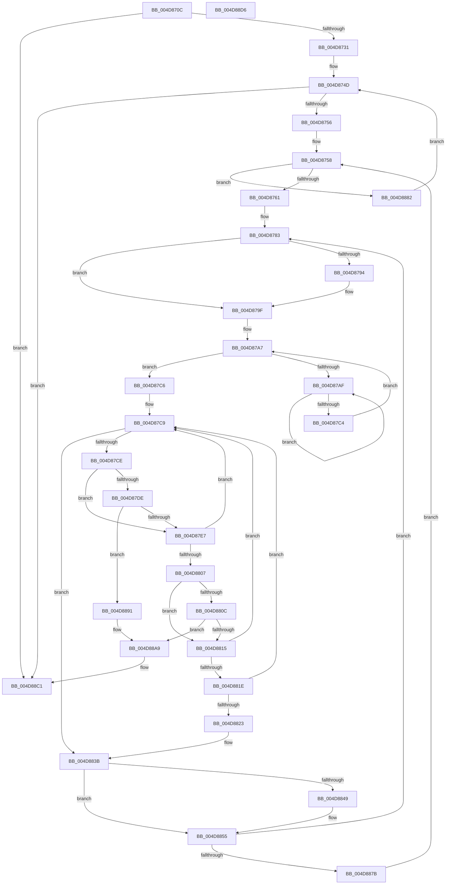

# KeCheckForTimer

- RVA: `0x004D870C`–`0x004D88D7` (길이 `459` bytes)
- VA: `0x00000001404D870C`
- 실행 섹션: `.text`
- PDB 이름 있음: `예`; PDB Function 태그: `아니요`
- unwind 정보 RVA: `0x000BE7D0`
- 디코드: `124`개 명령, `459/459` bytes 표시
- 미해석 바이트: `0` (있으면 어셈블리에 `.byte`로 보존)

> 이 문서는 커널 이미지의 기계어와 PDB 기호를 분석해 생성했습니다. 4번과 5번은 함수 원형과 자료형을 바이너리 사용 방식에서 추정한 C 해석이며 원본 소스 복구 결과는 아닙니다.

## 1. Dependencies

- 직접 호출 지점: **7**; 고유 호출 대상: **5**
- 직접 호출자로 확인된 함수: **4**
- RIP 상대 이미지 참조: **5**

### Outgoing calls
- `0x004D873A` → [KeQueryActiveProcessorCountEx](../24/KeQueryActiveProcessorCountEx_function_00249EF0.md) (function, `0x00249EF0`)
- `0x004D879A` → [KiRaiseIrqlProcessIrqlFlags](../4F/KiRaiseIrqlProcessIrqlFlags_function_004F56FC.md) (function, `0x004F56FC`)
- `0x004D87B7` → [KeYieldProcessorEx](../3F/KeYieldProcessorEx_function_003FBD00.md) (function, `0x003FBD00`)
- `0x004D8835` → [KeBugCheckEx](../4F/KeBugCheckEx_function_004FD660.md) (function, `0x004FD660`)
- `0x004D8850` → [KiLowerIrqlProcessIrqlFlags](../4F/KiLowerIrqlProcessIrqlFlags_function_004F5698.md) (function, `0x004F5698`)
- `0x004D88A3` → [KeBugCheckEx](../4F/KeBugCheckEx_function_004FD660.md) (function, `0x004FD660`)
- `0x004D88BB` → [KeBugCheckEx](../4F/KeBugCheckEx_function_004FD660.md) (function, `0x004FD660`)

### Direct callers
- [ExAllocateHeapPool](../35/ExAllocateHeapPool_function_0035BA30.md) at `0x0035E65E`
- [ExpFreePoolChecks](../35/ExpFreePoolChecks_function_0035F4F0.md) at `0x0035F56E`
- [sub_00360968](../36/Unknown_function_00360968.md) at `0x00360D77`
- [sub_00B8371E](../../poolcode/B8/Unknown_function_00B8371E.md) at `0x00B83B2E`

### Static image references
- `0x004D8720` → RVA `0x00E0B0E0` (`.data`; read)
- `0x004D8761` → RVA `0x00FC8C40` (`ALMOSTRO`; read)
- `0x004D878B` → RVA `0x00FC6D20` (`ALMOSTRO`; read)
- `0x004D87E7` → RVA `0x00FC6F78` (`ALMOSTRO`; read)
- `0x004D87FE` → RVA `0x00FC7250` (`ALMOSTRO`; read)

## 2. Other-region calls and transfers

- 다른 실행 섹션으로 향하는 call: **0**
- 별도 외부 분기/꼬리 이동을 확인하지 못했습니다.

## 3. Assembly (complete function range)

```asm
004D870C  48 89 5C 24 08                  mov qword ptr [rsp + 8], rbx
004D8711  55                              push rbp
004D8712  56                              push rsi
004D8713  57                              push rdi
004D8714  41 54                           push r12
004D8716  41 55                           push r13
004D8718  41 56                           push r14
004D871A  41 57                           push r15
004D871C  48 83 EC 30                     sub rsp, 0x30
004D8720  8B 05 BA 29 93 00               mov eax, dword ptr [rip + 0x9329ba]
004D8726  48 8B F9                        mov rdi, rcx
004D8729  A8 01                           test al, 1
004D872B  0F 84 90 01 00 00               je 0x1404d88c1
004D8731  48 8D 34 11                     lea rsi, [rcx + rdx]
004D8735  B9 FF FF 00 00                  mov ecx, 0xffff
004D873A  E8 B1 17 D7 FF                  call 0x140249ef0
004D873F  45 33 F6                        xor r14d, r14d
004D8742  89 84 24 88 00 00 00            mov dword ptr [rsp + 0x88], eax
004D8749  45 8D 56 02                     lea r10d, [r14 + 2]
004D874D  44 3B F0                        cmp r14d, eax
004D8750  0F 83 6B 01 00 00               jae 0x1404d88c1
004D8756  33 ED                           xor ebp, ebp
004D8758  41 3B EA                        cmp ebp, r10d
004D875B  0F 83 21 01 00 00               jae 0x1404d8882
004D8761  48 8D 0D D8 04 AF 00            lea rcx, [rip + 0xaf04d8]
004D8768  8B C5                           mov eax, ebp
004D876A  4A 8B 1C F1                     mov rbx, qword ptr [rcx + r14*8]
004D876E  45 33 ED                        xor r13d, r13d
004D8771  48 81 C3 00 43 00 00            add rbx, 0x4300
004D8778  48 C1 E0 0D                     shl rax, 0xd
004D877C  48 03 D8                        add rbx, rax
004D877F  4C 8D 7B 08                     lea r15, [rbx + 8]
004D8783  45 0F 20 C4                     mov r12, cr8
004D8787  45 0F 22 C2                     mov cr8, r10
004D878B  83 3D 8E E5 AE 00 00            cmp dword ptr [rip + 0xaee58e], 0
004D8792  74 0B                           je 0x1404d879f
004D8794  41 8A D2                        mov dl, r10b
004D8797  41 8A CC                        mov cl, r12b
004D879A  E8 5D CF 01 00                  call 0x1404f56fc
004D879F  83 A4 24 80 00 00 00 00         and dword ptr [rsp + 0x80], 0
004D87A7  F0 48 0F BA 2B 00               lock bts qword ptr [rbx], 0
004D87AD  73 17                           jae 0x1404d87c6
004D87AF  48 8D 8C 24 80 00 00 00         lea rcx, [rsp + 0x80]
004D87B7  E8 44 35 F2 FF                  call 0x1403fbd00
004D87BC  48 8B 03                        mov rax, qword ptr [rbx]
004D87BF  48 85 C0                        test rax, rax
004D87C2  75 EB                           jne 0x1404d87af
004D87C4  EB E1                           jmp 0x1404d87a7
004D87C6  49 8B 17                        mov rdx, qword ptr [r15]
004D87C9  49 3B D7                        cmp rdx, r15
004D87CC  74 6D                           je 0x1404d883b
004D87CE  48 8D 42 E0                     lea rax, [rdx - 0x20]
004D87D2  48 8B 12                        mov rdx, qword ptr [rdx]
004D87D5  4C 8D 4F C0                     lea r9, [rdi - 0x40]
004D87D9  49 3B C1                        cmp rax, r9
004D87DC  76 09                           jbe 0x1404d87e7
004D87DE  48 3B C6                        cmp rax, rsi
004D87E1  0F 82 AA 00 00 00               jb 0x1404d8891
004D87E7  48 8B 0D 8A E7 AE 00            mov rcx, qword ptr [rip + 0xaee78a]
004D87EE  4C 8B 40 30                     mov r8, qword ptr [rax + 0x30]
004D87F2  4C 33 C1                        xor r8, rcx
004D87F5  49 D3 C0                        rol r8, cl
004D87F8  4C 33 C0                        xor r8, rax
004D87FB  49 0F C8                        bswap r8
004D87FE  4C 33 05 4B EA AE 00            xor r8, qword ptr [rip + 0xaeea4b]
004D8805  74 C2                           je 0x1404d87c9
004D8807  4D 3B C1                        cmp r8, r9
004D880A  76 09                           jbe 0x1404d8815
004D880C  4C 3B C6                        cmp r8, rsi
004D880F  0F 82 94 00 00 00               jb 0x1404d88a9
004D8815  4D 8B 40 18                     mov r8, qword ptr [r8 + 0x18]
004D8819  4C 3B C7                        cmp r8, rdi
004D881C  72 AB                           jb 0x1404d87c9
004D881E  4C 3B C6                        cmp r8, rsi
004D8821  73 A6                           jae 0x1404d87c9
004D8823  4C 8B CF                        mov r9, rdi
004D8826  48 89 74 24 20                  mov qword ptr [rsp + 0x20], rsi
004D882B  BA 02 00 00 00                  mov edx, 2
004D8830  B9 C7 00 00 00                  mov ecx, 0xc7
004D8835  E8 26 4E 02 00                  call 0x1404fd660
004D883A  CC                              int3
004D883B  F0 48 83 23 00                  lock and qword ptr [rbx], 0
004D8840  83 3D D9 E4 AE 00 00            cmp dword ptr [rip + 0xaee4d9], 0
004D8847  74 0C                           je 0x1404d8855
004D8849  44 0F 20 C1                     mov rcx, cr8
004D884D  41 8A D4                        mov dl, r12b
004D8850  E8 43 CE 01 00                  call 0x1404f5698
004D8855  41 0F B6 C4                     movzx eax, r12b
004D8859  44 0F 22 C0                     mov cr8, rax
004D885D  49 83 C7 20                     add r15, 0x20
004D8861  41 FF C5                        inc r13d
004D8864  48 83 C3 20                     add rbx, 0x20
004D8868  41 BA 02 00 00 00               mov r10d, 2
004D886E  41 81 FD 00 01 00 00            cmp r13d, 0x100
004D8875  0F 82 08 FF FF FF               jb 0x1404d8783
004D887B  FF C5                           inc ebp
004D887D  E9 D6 FE FF FF                  jmp 0x1404d8758
004D8882  8B 84 24 88 00 00 00            mov eax, dword ptr [rsp + 0x88]
004D8889  41 FF C6                        inc r14d
004D888C  E9 BC FE FF FF                  jmp 0x1404d874d
004D8891  4C 8B CF                        mov r9, rdi
004D8894  48 89 74 24 20                  mov qword ptr [rsp + 0x20], rsi
004D8899  4C 8B C0                        mov r8, rax
004D889C  33 D2                           xor edx, edx
004D889E  B9 C7 00 00 00                  mov ecx, 0xc7
004D88A3  E8 B8 4D 02 00                  call 0x1404fd660
004D88A8  CC                              int3
004D88A9  4C 8B CF                        mov r9, rdi
004D88AC  48 89 74 24 20                  mov qword ptr [rsp + 0x20], rsi
004D88B1  BA 01 00 00 00                  mov edx, 1
004D88B6  B9 C7 00 00 00                  mov ecx, 0xc7
004D88BB  E8 A0 4D 02 00                  call 0x1404fd660
004D88C0  CC                              int3
004D88C1  48 8B 5C 24 70                  mov rbx, qword ptr [rsp + 0x70]
004D88C6  48 83 C4 30                     add rsp, 0x30
004D88CA  41 5F                           pop r15
004D88CC  41 5E                           pop r14
004D88CE  41 5D                           pop r13
004D88D0  41 5C                           pop r12
004D88D2  5F                              pop rdi
004D88D3  5E                              pop rsi
004D88D4  5D                              pop rbp
004D88D5  C3                              ret
004D88D6  CC                              int3
```

## 4. C-style interpretation (structured pseudocode)

```c
__int64 __fastcall KeCheckForTimer(__int64 a1, __int64 a2)
{
    __int64 result;
    __int64 v_r13;
    __int64 v_r14;
    __int64 v_r15;
    __int64 v_rbp;
    __int64 v_rbx;
    __int64 v_rsp;
    unsigned __int64 v_stack_m48;
    unsigned int v_stack_p18;
    unsigned int v_stack_p20;
    unsigned __int64 v_stack_p8;

    v_stack_p8 = v_rbx;
    v_rsp = (v_rsp) - (48);
    if ((((unsigned __int8)((unsigned int)(*(unsigned int *)(v_rip + 9644474)))) & (1)) == 0) goto loc_004D88C1;
    result = KeQueryActiveProcessorCountEx((unsigned int)(0xFFFFULL), a2, a3, a4);
    v_r14 = 0;
    v_stack_p20 = (unsigned int)(result);
loc_004D874D:
    if (0 >= ((unsigned int)(result))) goto loc_004D88C1;
    v_rbp = 0;
loc_004D8758:
    if (0 >= ((unsigned int)(v_r14 + 2))) goto loc_004D8882;
    v_r13 = 0;
    v_rbx = (*(unsigned __int64 *)(v_rip + 11470040 + v_r14 * 8)) + (0x4300ULL);
    result = (0) << (13);
    v_rbx = (v_rbx) + (result);
loc_004D8783:
    if ((*(unsigned int *)(v_rip + 11462030)) != 0) {
        a2 = (unsigned __int8)(v_r14 + 2);
        a1 = (unsigned __int8)(v_cr8);
        result = KiRaiseIrqlProcessIrqlFlags(a1, a2, a3, a4);
    }
loc_004D87A7:
    if ((*(unsigned int *)(v_rip + 11462030)) >= 0) goto loc_004D87C6;
loc_004D87AF:
    result = KeYieldProcessorEx(v_stack_p18, a2, a3, a4);
    if (*(unsigned __int64 *)(v_rbx) != 0) goto loc_004D87AF;
    goto loc_004D87A7;
loc_004D87C6:
loc_004D87C9:
    if ((*(unsigned __int64 *)(v_rbx + 8)) == (v_rbx + 8)) goto loc_004D883B;
    if ((*(unsigned __int64 *)(v_rbx + 8) - 32) <= (a1 - 64)) goto loc_004D87E7;
    if ((*(unsigned __int64 *)(v_rbx + 8) - 32) < (a1 + a2 * 1)) goto loc_004D8891;
loc_004D87E7:
    a3 = (*(unsigned __int64 *)(*(unsigned __int64 *)(v_rbx + 8) - 32 + 48)) ^ (*(unsigned __int64 *)(v_rip + 11462538));
    a3 = (a3) ^ (*(unsigned __int64 *)(v_rbx + 8) - 32);
    a3 = (a3) ^ (*(unsigned __int64 *)(v_rip + 11463243));
    if (condition_is_equal) goto loc_004D87C9;
    if (a3 <= (a1 - 64)) goto loc_004D8815;
    if (a3 < (a1 + a2 * 1)) goto loc_004D88A9;
loc_004D8815:
    if ((*(unsigned __int64 *)(a3 + 24)) < a1) goto loc_004D87C9;
    if ((*(unsigned __int64 *)(a3 + 24)) >= (a1 + a2 * 1)) goto loc_004D87C9;
    v_stack_m48 = a1 + a2 * 1;
    result = KeBugCheckEx(199, 2, *(unsigned __int64 *)(a3 + 24), a1);
loc_004D883B:
    if ((*(unsigned int *)(v_rip + 11461849)) != 0) {
        a1 = v_r14 + 2;
        a2 = (unsigned __int8)(v_cr8);
        result = KiLowerIrqlProcessIrqlFlags(a1, a2, *(unsigned __int64 *)(a3 + 24), a1);
    }
    v_r15 = (v_rbx + 8) + (32);
    v_r13 = (unsigned int)((v_r13) + 1);
    v_rbx = (v_rbx) + (32);
    if (((unsigned int)(v_r13)) < 256) goto loc_004D8783;
    v_rbp = (unsigned int)((v_rbp) + 1);
    goto loc_004D8758;
loc_004D8882:
    v_r14 = (unsigned int)((v_r14) + 1);
    goto loc_004D874D;
loc_004D8891:
    v_stack_m48 = a1 + a2 * 1;
    a2 = 0;
    result = KeBugCheckEx(199, a2, (unsigned int)(v_stack_p20), a1);
loc_004D88A9:
    v_stack_m48 = a1 + a2 * 1;
    result = KeBugCheckEx(199, 1, (unsigned int)(v_stack_p20), a1);
loc_004D88C1:
    v_rsp = (v_rsp) + (48);
    return result;
}
```

## 5. (Beta) C Style

```c
int64_t KeCheckForTimer(void *Arg1, int64_t Arg2)
{
    uint8_t *arg1 = (uint8_t *)Arg1;

    int64_t result;
    int64_t local_r13;
    int64_t local_r14;
    int64_t local_r15;
    int64_t local_rbp;
    int64_t local_rbx;
    int64_t local_rsp;
    uint64_t v_stack_m48;
    uint32_t v_stack_p18;
    uint32_t v_stack_p20;
    uint64_t v_stack_p8;

    v_stack_p8 = local_rbx;
    local_rsp = (local_rsp) - (48);
    if ((((uint8_t)((uint32_t)(*(uint32_t *)(v_rip + 0x9329BA)))) & (1)) == 0) goto loc_004D88C1;
    result = KeQueryActiveProcessorCountEx((uint32_t)(0xFFFFULL), Arg2, a3, a4);
    local_r14 = 0;
    v_stack_p20 = (uint32_t)(result);
loc_004D874D:
    if (0 >= ((uint32_t)(result))) goto loc_004D88C1;
    local_rbp = 0;
loc_004D8758:
    if (0 >= ((uint32_t)(local_r14 + 2))) goto loc_004D8882;
    local_r13 = 0;
    local_rbx = (*(uint64_t *)(v_rip + 0xAF04D8 + local_r14 * 8)) + (0x4300ULL);
    result = (0) << (13);
    local_rbx = (local_rbx) + (result);
loc_004D8783:
    if ((*(uint32_t *)(v_rip + 0xAEE58E)) != 0) {
        Arg2 = (uint8_t)(local_r14 + 2);
        Arg1 = (uint8_t)(v_cr8);
        result = KiRaiseIrqlProcessIrqlFlags(Arg1, Arg2, a3, a4);
    }
loc_004D87A7:
    if ((*(uint32_t *)(v_rip + 0xAEE58E)) >= 0) goto loc_004D87C6;
loc_004D87AF:
    result = KeYieldProcessorEx(v_stack_p18, Arg2, a3, a4);
    if (*(uint64_t *)(local_rbx) != 0) goto loc_004D87AF;
    goto loc_004D87A7;
loc_004D87C6:
loc_004D87C9:
    if ((*(uint64_t *)(local_rbx + 0x8)) == (local_rbx + 8)) goto loc_004D883B;
    if ((*(uint64_t *)(local_rbx + 0x8) - 32) <= (Arg1 - 64)) goto loc_004D87E7;
    if ((*(uint64_t *)(local_rbx + 0x8) - 32) < (Arg1 + Arg2 * 1)) goto loc_004D8891;
loc_004D87E7:
    a3 = (*(uint64_t *)(*(uint64_t *)(local_rbx + 0x8) - 0x20 + 0x30)) ^ (*(uint64_t *)(v_rip + 0xAEE78A));
    a3 = (a3) ^ (*(uint64_t *)(local_rbx + 0x8) - 32);
    a3 = (a3) ^ (*(uint64_t *)(v_rip + 0xAEEA4B));
    if (condition_is_equal) goto loc_004D87C9;
    if (a3 <= (Arg1 - 64)) goto loc_004D8815;
    if (a3 < (Arg1 + Arg2 * 1)) goto loc_004D88A9;
loc_004D8815:
    if ((*(uint64_t *)(a3 + 0x18)) < Arg1) goto loc_004D87C9;
    if ((*(uint64_t *)(a3 + 0x18)) >= (Arg1 + Arg2 * 1)) goto loc_004D87C9;
    v_stack_m48 = Arg1 + Arg2 * 1;
    result = KeBugCheckEx(199, 2, *(uint64_t *)(a3 + 0x18), Arg1);
loc_004D883B:
    if ((*(uint32_t *)(v_rip + 0xAEE4D9)) != 0) {
        Arg1 = local_r14 + 2;
        Arg2 = (uint8_t)(v_cr8);
        result = KiLowerIrqlProcessIrqlFlags(Arg1, Arg2, *(uint64_t *)(a3 + 0x18), Arg1);
    }
    local_r15 = (local_rbx + 8) + (32);
    local_r13 = (uint32_t)((local_r13) + 1);
    local_rbx = (local_rbx) + (32);
    if (((uint32_t)(local_r13)) < 256) goto loc_004D8783;
    local_rbp = (uint32_t)((local_rbp) + 1);
    goto loc_004D8758;
loc_004D8882:
    local_r14 = (uint32_t)((local_r14) + 1);
    goto loc_004D874D;
loc_004D8891:
    v_stack_m48 = Arg1 + Arg2 * 1;
    Arg2 = 0;
    result = KeBugCheckEx(199, Arg2, (uint32_t)(v_stack_p20), Arg1);
loc_004D88A9:
    v_stack_m48 = Arg1 + Arg2 * 1;
    result = KeBugCheckEx(199, 1, (uint32_t)(v_stack_p20), Arg1);
loc_004D88C1:
    local_rsp = (local_rsp) + (48);
    return result;
}
```

### 관측된 메모리 오프셋

구조체 형식이 확인되지 않은 접근은 인자 기준의 오프셋으로만 기록했습니다.

| 기준 인자 | 오프셋 표현 | 폭 (bit) | 접근 |
|---|---:|---:|---|
| `Arg1` | `- 0x40` | `64` | `R` |
| `Arg1` | `+ 0x0 + rdx*1` | `64` | `R` |

## 6. Execution-region graph

[열기: 2D/3D 그래프와 함수 탐색 컨트롤 패널](../../../control-panel.html?section=text&rva=0x004D870C&view=graph)

- 2D 그래프는 위에서 아래로 흐르고, 3D 그래프는 빈 공간을 드래그해 회전합니다. Shift+드래그는 이동, 휠은 확대·축소, 함수 노드 선택은 대상 보고서 이동입니다.

### Static fallback


