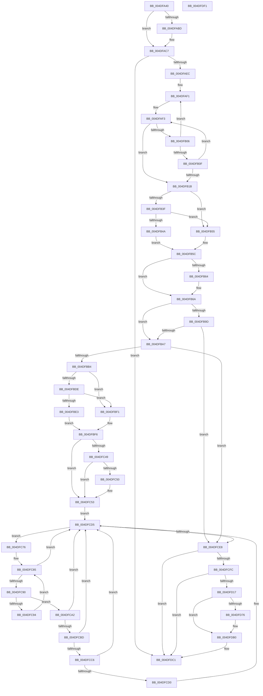

# KeFreezeExecution

- RVA: `0x004DFA40`–`0x004DFDF2` (길이 `946` bytes)
- VA: `0x00000001404DFA40`
- 실행 섹션: `.text`
- PDB 이름 있음: `예`; PDB Function 태그: `아니요`
- unwind 정보 RVA: `0x000BEF08`
- 디코드: `220`개 명령, `946/946` bytes 표시
- 미해석 바이트: `0` (있으면 어셈블리에 `.byte`로 보존)

> 이 문서는 커널 이미지의 기계어와 PDB 기호를 분석해 생성했습니다. 4번과 5번은 함수 원형과 자료형을 바이너리 사용 방식에서 추정한 C 해석이며 원본 소스 복구 결과는 아닙니다.

## 1. Dependencies

- 직접 호출 지점: **19**; 고유 호출 대상: **17**
- 직접 호출자로 확인된 함수: **2**
- RIP 상대 이미지 참조: **28**

### Outgoing calls
- `0x004DFA7F` → [memset](../6C/memset_function_006C6C40.md) (function, `0x006C6C40`)
- `0x004DFAA0` → [KeDisableInterrupts](../21/KeDisableInterrupts_function_00217BE0.md) (function, `0x00217BE0`)
- `0x004DFAC2` → [KiRaiseIrqlProcessIrqlFlags](../4F/KiRaiseIrqlProcessIrqlFlags_function_004F56FC.md) (function, `0x004F56FC`)
- `0x004DFAFA` → [KxTryToAcquireSpinLock](../46/KxTryToAcquireSpinLock_function_0046BE18.md) (function, `0x0046BE18`)
- `0x004DFB11` → [KeStallExecutionProcessor](../44/KeStallExecutionProcessor_function_0044F620.md) (function, `0x0044F620`)
- `0x004DFB30` → [KeAcquireSpinLockAtDpcLevel](../20/KeAcquireSpinLockAtDpcLevel_function_00208430.md) (function, `0x00208430`)
- `0x004DFB76` → [KiStartDebugAccumulation](../5C/KiStartDebugAccumulation_function_005C3460.md) (function, `0x005C3460`)
- `0x004DFB87` → [guard_dispatch_icall](../6B/guard_dispatch_icall_function_006BAAD0.md) (function, `0x006BAAD0`)
- `0x004DFBC8` → [KiSetDebuggerOwner](../4F/KiSetDebuggerOwner_function_004FCE94.md) (function, `0x004FCE94`)
- `0x004DFC12` → [memset](../6C/memset_function_006C6C40.md) (function, `0x006C6C40`)
- `0x004DFC28` → [KiCopyAffinityEx](../2C/KiCopyAffinityEx_function_002CE860.md) (function, `0x002CE860`)
- `0x004DFC35` → [KeRemoveProcessorAffinityEx](../30/KeRemoveProcessorAffinityEx_function_00304E10.md) (function, `0x00304E10`)
- `0x004DFC5B` → [KiSendFreeze](../5C/KiSendFreeze_function_005C3364.md) (function, `0x005C3364`)
- `0x004DFC99` → [KeStallExecutionProcessor](../44/KeStallExecutionProcessor_function_0044F620.md) (function, `0x0044F620`)
- `0x004DFCD0` → [VslRequestSecureKernelDebuggerBreakIn](../58/VslRequestSecureKernelDebuggerBreakIn_function_0058F380.md) (function, `0x0058F380`)
- `0x004DFCDF` → [KeEnumerateNextProcessor](../41/KeEnumerateNextProcessor_function_00415480.md) (function, `0x00415480`)
- `0x004DFD0A` → [RtlWriteTryAcquireTickLock](../39/RtlWriteTryAcquireTickLock_function_0039D3D8.md) (function, `0x0039D3D8`)
- `0x004DFD1C` → [KeQueryPerformanceCounter](../37/KeQueryPerformanceCounter_function_0037E7E0.md) (function, `0x0037E7E0`)
- `0x004DFDCB` → [_security_check_cookie](../6A/_security_check_cookie_function_006AC640.md) (function, `0x006AC640`)

### Direct callers
- [ExpWaitForBootDevices](../65/ExpWaitForBootDevices_function_00657D90.md) at `0x00657E36`
- [KdEnterDebugger](../../pagekd/B8/KdEnterDebugger_function_00B8A96C.md) at `0x00B8A9D4`

### Static image references
- `0x004DFA64` → RVA `0x00E0A740` (`.data`; read)
- `0x004DFAB4` → RVA `0x00FC6D20` (`ALMOSTRO`; read)
- `0x004DFACC` → RVA `0x00F231EC` (`.data`; write)
- `0x004DFAF3` → RVA `0x00FCF280` (`CACHEALI`; read)
- `0x004DFB06` → RVA `0x00FCF2C0` (`CACHEALI`; read)
- `0x004DFB3F` → RVA `0x00F231EC` (`.data`; read)
- `0x004DFB55` → RVA `0x00E664AC` (`.data`; write)
- `0x004DFB5C` → RVA `0x00F10E18` (`.data`; read)
- `0x004DFB64` → RVA `0x00F10E18` (`.data`; write)
- `0x004DFB7B` → RVA `0x00E00998` (`.data`; read)
- `0x004DFB8C` → RVA `0x00FC6A80` (`ALMOSTRO`; read)
- `0x004DFB92` → RVA `0x00F21FAD` (`.data`; write)
- `0x004DFBA7` → RVA `0x00F0BD23` (`.data`; read)
- `0x004DFBB4` → RVA `0x00F10E08` (`.data`; write)
- `0x004DFBCD` → RVA `0x00E67684` (`.data`; read)
- `0x004DFBD4` → RVA `0x00E0AFC8` (`.data`; read)
- `0x004DFC1C` → RVA `0x00FC7120` (`ALMOSTRO`; read)
- `0x004DFC3A` → RVA `0x00F4754C` (`.data`; read)
- `0x004DFC40` → RVA `0x00F10908` (`.data`; read)
- `0x004DFC7A` → RVA `0x00FC8C40` (`ALMOSTRO`; read)
- `0x004DFCA2` → RVA `0x00F231EC` (`.data`; read/write)
- `0x004DFCAB` → RVA `0x00F10DF8` (`.data`; read)
- `0x004DFCB4` → RVA `0x00FC6A84` (`ALMOSTRO`; read)
- `0x004DFCBD` → RVA `0x00F475F8` (`.data`; read)
- `0x004DFCEF` → RVA `0x00F10DEC` (`.data`; write)
- `0x004DFCFC` → RVA `0x00FC5008` (`ALMOSTRO`; read)
- `0x004DFD21` → RVA `0x00FC6AA0` (`ALMOSTRO`; read)
- `0x004DFD8B` → RVA `0x00E66898` (`.data`; write)

## 2. Other-region calls and transfers

- 다른 실행 섹션으로 향하는 call: **0**
- 별도 외부 분기/꼬리 이동을 확인하지 못했습니다.

## 3. Assembly (complete function range)

```asm
004DFA40  48 89 5C 24 08                  mov qword ptr [rsp + 8], rbx
004DFA45  48 89 74 24 10                  mov qword ptr [rsp + 0x10], rsi
004DFA4A  48 89 7C 24 18                  mov qword ptr [rsp + 0x18], rdi
004DFA4F  55                              push rbp
004DFA50  41 54                           push r12
004DFA52  41 55                           push r13
004DFA54  41 56                           push r14
004DFA56  41 57                           push r15
004DFA58  48 8D 6C 24 90                  lea rbp, [rsp - 0x70]
004DFA5D  48 81 EC 70 01 00 00            sub rsp, 0x170
004DFA64  48 8B 05 D5 AC 92 00            mov rax, qword ptr [rip + 0x92acd5]
004DFA6B  48 33 C4                        xor rax, rsp
004DFA6E  48 89 45 60                     mov qword ptr [rbp + 0x60], rax
004DFA72  33 D2                           xor edx, edx
004DFA74  48 8D 4C 24 50                  lea rcx, [rsp + 0x50]
004DFA79  41 B8 08 01 00 00               mov r8d, 0x108
004DFA7F  E8 BC 71 1E 00                  call 0x1406c6c40
004DFA84  45 33 ED                        xor r13d, r13d
004DFA87  33 C0                           xor eax, eax
004DFA89  0F 57 C0                        xorps xmm0, xmm0
004DFA8C  48 89 44 24 40                  mov qword ptr [rsp + 0x40], rax
004DFA91  0F 11 44 24 30                  movups xmmword ptr [rsp + 0x30], xmm0
004DFA96  44 89 6C 24 20                  mov dword ptr [rsp + 0x20], r13d
004DFA9B  4C 89 6C 24 28                  mov qword ptr [rsp + 0x28], r13
004DFAA0  E8 3B 81 D3 FF                  call 0x140217be0
004DFAA5  44 8A E0                        mov r12b, al
004DFAA8  45 0F 20 C7                     mov r15, cr8
004DFAAC  41 8D 5D 0F                     lea ebx, [r13 + 0xf]
004DFAB0  44 0F 22 C3                     mov cr8, rbx
004DFAB4  44 39 2D 65 72 AE 00            cmp dword ptr [rip + 0xae7265], r13d
004DFABB  74 0A                           je 0x1404dfac7
004DFABD  8A D3                           mov dl, bl
004DFABF  41 8A CF                        mov cl, r15b
004DFAC2  E8 35 5C 01 00                  call 0x1404f56fc
004DFAC7  BE 04 00 00 00                  mov esi, 4
004DFACC  89 35 1A 37 A4 00               mov dword ptr [rip + 0xa4371a], esi
004DFAD2  65 48 8B 04 25 20 00 00 00      mov rax, qword ptr gs:[0x20]
004DFADB  8B 88 88 2D 00 00               mov ecx, dword ptr [rax + 0x2d88]
004DFAE1  22 CB                           and cl, bl
004DFAE3  40 3A CE                        cmp cl, sil
004DFAE6  0F 84 D5 02 00 00               je 0x1404dfdc1
004DFAEC  BB B0 71 0B 00                  mov ebx, 0xb71b0
004DFAF1  8B FB                           mov edi, ebx
004DFAF3  48 8D 0D 86 F7 AE 00            lea rcx, [rip + 0xaef786]
004DFAFA  E8 19 C3 F8 FF                  call 0x14046be18
004DFAFF  44 8A F0                        mov r14b, al
004DFB02  84 C0                           test al, al
004DFB04  75 15                           jne 0x1404dfb1b
004DFB06  4C 39 2D B3 F7 AE 00            cmp qword ptr [rip + 0xaef7b3], r13
004DFB0D  75 E2                           jne 0x1404dfaf1
004DFB0F  8B CE                           mov ecx, esi
004DFB11  E8 0A FB F6 FF                  call 0x14044f620
004DFB16  83 C7 FF                        add edi, -1
004DFB19  75 D8                           jne 0x1404dfaf3
004DFB1B  2B DF                           sub ebx, edi
004DFB1D  48 8D 0D 9C F7 AE 00            lea rcx, [rip + 0xaef79c]
004DFB24  C1 E3 02                        shl ebx, 2
004DFB27  41 8A C6                        mov al, r14b
004DFB2A  F6 D8                           neg al
004DFB2C  1B F6                           sbb esi, esi
004DFB2E  23 F3                           and esi, ebx
004DFB30  E8 FB 88 D2 FF                  call 0x140208430
004DFB35  BF 01 00 00 00                  mov edi, 1
004DFB3A  45 84 F6                        test r14b, r14b
004DFB3D  75 16                           jne 0x1404dfb55
004DFB3F  8B 05 A7 36 A4 00               mov eax, dword ptr [rip + 0xa436a7]
004DFB45  40 84 C7                        test dil, al
004DFB48  74 0B                           je 0x1404dfb55
004DFB4A  83 C8 08                        or eax, 8
004DFB4D  89 05 99 36 A4 00               mov dword ptr [rip + 0xa43699], eax
004DFB53  EB 07                           jmp 0x1404dfb5c
004DFB55  44 88 35 50 69 98 00            mov byte ptr [rip + 0x986950], r14b
004DFB5C  3B 35 B6 12 A3 00               cmp esi, dword ptr [rip + 0xa312b6]
004DFB62  76 06                           jbe 0x1404dfb6a
004DFB64  89 35 AE 12 A3 00               mov dword ptr [rip + 0xa312ae], esi
004DFB6A  65 48 8B 1C 25 20 00 00 00      mov rbx, qword ptr gs:[0x20]
004DFB73  48 8B CB                        mov rcx, rbx
004DFB76  E8 E5 38 0E 00                  call 0x1405c3460
004DFB7B  48 8B 05 16 0E 92 00            mov rax, qword ptr [rip + 0x920e16]
004DFB82  33 D2                           xor edx, edx
004DFB84  40 8A CF                        mov cl, dil
004DFB87  E8 44 AF 1D 00                  call 0x1406baad0
004DFB8C  8B 05 EE 6E AE 00               mov eax, dword ptr [rip + 0xae6eee]
004DFB92  44 88 2D 14 24 A4 00            mov byte ptr [rip + 0xa42414], r13b
004DFB99  3B C7                           cmp eax, edi
004DFB9B  77 0A                           ja 0x1404dfba7
004DFB9D  44 39 6B 24                     cmp dword ptr [rbx + 0x24], r13d
004DFBA1  0F 86 41 01 00 00               jbe 0x1404dfce8
004DFBA7  44 38 2D 75 C1 A2 00            cmp byte ptr [rip + 0xa2c175], r13b
004DFBAE  0F 85 34 01 00 00               jne 0x1404dfce8
004DFBB4  48 89 1D 4D 12 A3 00            mov qword ptr [rip + 0xa3124d], rbx
004DFBBB  48 8B CB                        mov rcx, rbx
004DFBBE  C7 83 88 2D 00 00 04 00 00 00   mov dword ptr [rbx + 0x2d88], 4
004DFBC8  E8 C7 D2 01 00                  call 0x1404fce94
004DFBCD  44 8B 05 B0 7A 98 00            mov r8d, dword ptr [rip + 0x987ab0]
004DFBD4  8B 05 EE B3 92 00               mov eax, dword ptr [rip + 0x92b3ee]
004DFBDA  85 C0                           test eax, eax
004DFBDC  74 13                           je 0x1404dfbf1
004DFBDE  45 85 C0                        test r8d, r8d
004DFBE1  75 0E                           jne 0x1404dfbf1
004DFBE3  8B 05 DF B3 92 00               mov eax, dword ptr [rip + 0x92b3df]
004DFBE9  69 F0 20 4E 00 00               imul esi, eax, 0x4e20
004DFBEF  EB 05                           jmp 0x1404dfbf6
004DFBF1  BE 20 4E 00 00                  mov esi, 0x4e20
004DFBF6  89 BB A0 83 00 00               mov dword ptr [rbx + 0x83a0], edi
004DFBFC  48 8D 4C 24 58                  lea rcx, [rsp + 0x58]
004DFC01  33 D2                           xor edx, edx
004DFC03  48 C7 44 24 50 01 00 20 00      mov qword ptr [rsp + 0x50], 0x200001
004DFC0C  41 B8 00 01 00 00               mov r8d, 0x100
004DFC12  E8 29 70 1E 00                  call 0x1406c6c40
004DFC17  0F B7 54 24 52                  movzx edx, word ptr [rsp + 0x52]
004DFC1C  4C 8D 05 FD 74 AE 00            lea r8, [rip + 0xae74fd]
004DFC23  48 8D 4C 24 50                  lea rcx, [rsp + 0x50]
004DFC28  E8 33 EC DE FF                  call 0x1402ce860
004DFC2D  8B 53 24                        mov edx, dword ptr [rbx + 0x24]
004DFC30  48 8D 4C 24 50                  lea rcx, [rsp + 0x50]
004DFC35  E8 D6 51 E2 FF                  call 0x140304e10
004DFC3A  8B 05 0C 79 A6 00               mov eax, dword ptr [rip + 0xa6790c]
004DFC40  44 38 2D C1 0C A3 00            cmp byte ptr [rip + 0xa30cc1], r13b
004DFC47  75 0A                           jne 0x1404dfc53
004DFC49  83 E0 03                        and eax, 3
004DFC4C  3C 03                           cmp al, 3
004DFC4E  75 03                           jne 0x1404dfc53
004DFC50  41 8A FD                        mov dil, r13b
004DFC53  40 8A D7                        mov dl, dil
004DFC56  48 8D 4C 24 50                  lea rcx, [rsp + 0x50]
004DFC5B  E8 04 37 0E 00                  call 0x1405c3364
004DFC60  48 8B 44 24 58                  mov rax, qword ptr [rsp + 0x58]
004DFC65  48 89 44 24 38                  mov qword ptr [rsp + 0x38], rax
004DFC6A  48 8D 44 24 50                  lea rax, [rsp + 0x50]
004DFC6F  48 89 44 24 30                  mov qword ptr [rsp + 0x30], rax
004DFC74  EB 5F                           jmp 0x1404dfcd5
004DFC76  8B 44 24 20                     mov eax, dword ptr [rsp + 0x20]
004DFC7A  48 8D 1D BF 8F AE 00            lea rbx, [rip + 0xae8fbf]
004DFC81  48 8B 1C C3                     mov rbx, qword ptr [rbx + rax*8]
004DFC85  8B 83 88 2D 00 00               mov eax, dword ptr [rbx + 0x2d88]
004DFC8B  83 F8 02                        cmp eax, 2
004DFC8E  74 45                           je 0x1404dfcd5
004DFC90  85 F6                           test esi, esi
004DFC92  74 0E                           je 0x1404dfca2
004DFC94  B9 32 00 00 00                  mov ecx, 0x32
004DFC99  E8 82 F9 F6 FF                  call 0x14044f620
004DFC9E  FF CE                           dec esi
004DFCA0  EB E3                           jmp 0x1404dfc85
004DFCA2  83 0D 43 35 A4 00 02            or dword ptr [rip + 0xa43543], 2
004DFCA9  33 C0                           xor eax, eax
004DFCAB  F0 48 0F B1 1D 44 11 A3 00      lock cmpxchg qword ptr [rip + 0xa31144], rbx
004DFCB4  44 38 2D C9 6D AE 00            cmp byte ptr [rip + 0xae6dc9], r13b
004DFCBB  74 18                           je 0x1404dfcd5
004DFCBD  44 38 2D 34 79 A6 00            cmp byte ptr [rip + 0xa67934], r13b
004DFCC4  74 0F                           je 0x1404dfcd5
004DFCC6  8B 05 80 78 A6 00               mov eax, dword ptr [rip + 0xa67880]
004DFCCC  A8 03                           test al, 3
004DFCCE  75 05                           jne 0x1404dfcd5
004DFCD0  E8 AB F6 0A 00                  call 0x14058f380
004DFCD5  48 8D 54 24 30                  lea rdx, [rsp + 0x30]
004DFCDA  48 8D 4C 24 20                  lea rcx, [rsp + 0x20]
004DFCDF  E8 9C 57 F3 FF                  call 0x140415480
004DFCE4  85 C0                           test eax, eax
004DFCE6  74 8E                           je 0x1404dfc76
004DFCE8  44 38 2D 34 C0 A2 00            cmp byte ptr [rip + 0xa2c034], r13b
004DFCEF  44 88 3D F6 10 A3 00            mov byte ptr [rip + 0xa310f6], r15b
004DFCF6  0F 85 C5 00 00 00               jne 0x1404dfdc1
004DFCFC  48 8B 1D 05 53 AE 00            mov rbx, qword ptr [rip + 0xae5305]
004DFD03  48 8D 8B 40 03 00 00            lea rcx, [rbx + 0x340]
004DFD0A  E8 C9 D6 EB FF                  call 0x14039d3d8
004DFD0F  84 C0                           test al, al
004DFD11  0F 84 AA 00 00 00               je 0x1404dfdc1
004DFD17  48 8D 4C 24 28                  lea rcx, [rsp + 0x28]
004DFD1C  E8 BF EA E9 FF                  call 0x14037e7e0
004DFD21  44 8B 0D 78 6D AE 00            mov r9d, dword ptr [rip + 0xae6d78]
004DFD28  33 D2                           xor edx, edx
004DFD2A  48 B9 50 03 00 00 80 F7 FF FF   movabs rcx, 0xfffff78000000350
004DFD34  48 2B 01                        sub rax, qword ptr [rcx]
004DFD37  8B 4C 24 28                     mov ecx, dword ptr [rsp + 0x28]
004DFD3B  48 69 C0 80 96 98 00            imul rax, rax, 0x989680
004DFD42  48 F7 F1                        div rcx
004DFD45  48 8B 0D BC 52 AE 00            mov rcx, qword ptr [rip + 0xae52bc]
004DFD4C  4C 8B C0                        mov r8, rax
004DFD4F  48 B8 08 00 00 00 80 F7 FF FF   movabs rax, 0xfffff78000000008
004DFD59  4C 03 00                        add r8, qword ptr [rax]
004DFD5C  49 8B D0                        mov rdx, r8
004DFD5F  48 C1 EA 20                     shr rdx, 0x20
004DFD63  89 51 10                        mov dword ptr [rcx + 0x10], edx
004DFD66  48 8B 0D 9B 52 AE 00            mov rcx, qword ptr [rip + 0xae529b]
004DFD6D  4C 89 41 08                     mov qword ptr [rcx + 8], r8
004DFD71  45 85 C9                        test r9d, r9d
004DFD74  74 3A                           je 0x1404dfdb0
004DFD76  33 D2                           xor edx, edx
004DFD78  49 8B C0                        mov rax, r8
004DFD7B  49 F7 F1                        div r9
004DFD7E  48 8B D0                        mov rdx, rax
004DFD81  8D 48 01                        lea ecx, [rax + 1]
004DFD84  41 0F AF C9                     imul ecx, r9d
004DFD88  41 2B C8                        sub ecx, r8d
004DFD8B  89 0D 07 6B 98 00               mov dword ptr [rip + 0x986b07], ecx
004DFD91  48 8B 0D 70 52 AE 00            mov rcx, qword ptr [rip + 0xae5270]
004DFD98  48 C1 EA 20                     shr rdx, 0x20
004DFD9C  89 91 28 03 00 00               mov dword ptr [rcx + 0x328], edx
004DFDA2  48 8B 0D 5F 52 AE 00            mov rcx, qword ptr [rip + 0xae525f]
004DFDA9  48 89 81 20 03 00 00            mov qword ptr [rcx + 0x320], rax
004DFDB0  48 8B 83 40 03 00 00            mov rax, qword ptr [rbx + 0x340]
004DFDB7  48 FF C0                        inc rax
004DFDBA  48 89 83 40 03 00 00            mov qword ptr [rbx + 0x340], rax
004DFDC1  41 8A C4                        mov al, r12b
004DFDC4  48 8B 4D 60                     mov rcx, qword ptr [rbp + 0x60]
004DFDC8  48 33 CC                        xor rcx, rsp
004DFDCB  E8 70 C8 1C 00                  call 0x1406ac640
004DFDD0  4C 8D 9C 24 70 01 00 00         lea r11, [rsp + 0x170]
004DFDD8  49 8B 5B 30                     mov rbx, qword ptr [r11 + 0x30]
004DFDDC  49 8B 73 38                     mov rsi, qword ptr [r11 + 0x38]
004DFDE0  49 8B 7B 40                     mov rdi, qword ptr [r11 + 0x40]
004DFDE4  49 8B E3                        mov rsp, r11
004DFDE7  41 5F                           pop r15
004DFDE9  41 5E                           pop r14
004DFDEB  41 5D                           pop r13
004DFDED  41 5C                           pop r12
004DFDEF  5D                              pop rbp
004DFDF0  C3                              ret
004DFDF1  CC                              int3
```

## 4. C-style interpretation (structured pseudocode)

```c
__int64 __fastcall KeFreezeExecution(__int64 a1, int a2)
{
    __int64 result;
    __int64 v_r13;
    __int64 v_rbx;
    __int64 v_rdi;
    __int64 v_rsi;
    __int64 v_rsp;
    unsigned __int64 v_stack_m140;
    unsigned __int16 v_stack_m146;
    unsigned __int64 v_stack_m148;
    unsigned __int64 v_stack_m158;
    unsigned __int64 v_stack_m160;
    unsigned __int64 v_stack_m168;
    unsigned __int64 v_stack_m170;
    unsigned int v_stack_m178;
    unsigned __int64 v_stack_m28;
    unsigned __int64 v_stack_m38;
    unsigned __int64 v_stack_m98;
    unsigned __int64 v_stack_p10;
    unsigned __int64 v_stack_p18;
    unsigned __int64 v_stack_p8;

    v_stack_p8 = v_rbx;
    v_stack_p10 = v_rsi;
    v_stack_p18 = v_rdi;
    v_rsp = (v_rsp) - (368);
    result = (*(unsigned __int64 *)(v_rip + 9612501)) ^ (v_rsp);
    v_stack_m38 = result;
    a2 = 0;
    result = memset(v_stack_m148, a2, 264, a4);
    v_r13 = 0;
    result = 0;
    v_stack_m158 = 0;
    v_stack_m168 = v_xmm0;
    v_stack_m178 = 0;
    v_stack_m170 = 0;
    result = KeDisableInterrupts(v_stack_m148, a2, 264, a4);
    if ((*(unsigned int *)(v_rip + 11432549)) != 0) {
        a2 = (unsigned __int8)(v_r13 + 15);
        a1 = (unsigned __int8)(v_cr8);
        result = KiRaiseIrqlProcessIrqlFlags(a1, a2, 264, a4);
    }
    *(unsigned int *)(v_rip + 10762010) = 4;
    a1 = (unsigned __int8)(((unsigned int)(*(unsigned int *)(*(unsigned __int64 *)(gs_base + (0 + 32)) + 11656))) & ((unsigned __int8)(v_r13 + 15)));
    if (((unsigned __int8)(a1)) == 4) goto loc_004DFDC1;
loc_004DFAF1:
loc_004DFAF3:
    result = KxTryToAcquireSpinLock(v_rip + 11466630, a2, 264, a4);
    if ((unsigned __int8)(result) != 0) goto loc_004DFB1B;
    if ((*(unsigned __int64 *)(v_rip + 11466675)) != 0) goto loc_004DFAF1;
    result = KeStallExecutionProcessor(4, a2, 264, a4);
    v_rdi = (unsigned int)(((unsigned int)((unsigned int)((unsigned int)(0xB71B0ULL)))) + (-1));
    if (condition_is_not_equal) goto loc_004DFAF3;
loc_004DFB1B:
    v_rbx = (unsigned int)(((unsigned int)(0xB71B0ULL)) - ((unsigned int)(v_rdi)));
    v_rbx = (unsigned int)((v_rbx) << (2));
    result = (unsigned __int8)(-((unsigned __int8)((unsigned __int8)(result))));
    v_rsi = (unsigned int)((4) & ((unsigned int)(v_rbx)));
    result = KeAcquireSpinLockAtDpcLevel(v_rip + 11466652, a2, 264, a4);
    if ((unsigned __int8)((unsigned __int8)(result)) != 0) goto loc_004DFB55;
    if (((1) & ((unsigned __int8)((unsigned int)(*(unsigned int *)(v_rip + 10761895))))) == 0) goto loc_004DFB55;
    result = (unsigned int)(((unsigned int)(*(unsigned int *)(v_rip + 10761895))) | (8));
    *(unsigned int *)(v_rip + 10761881) = (unsigned int)(result);
    goto loc_004DFB5C;
loc_004DFB55:
    *(unsigned __int8 *)(v_rip + 9988432) = (unsigned __int8)((unsigned __int8)(result));
loc_004DFB5C:
    if (((unsigned int)(v_rsi)) >= = (*(unsigned int *)(v_rip + 10687158))) {
        *(unsigned int *)(v_rip + 10687150) = (unsigned int)(v_rsi);
    }
    result = KiStartDebugAccumulation(*(unsigned __int64 *)(gs_base + (0 + 32)), a2, 264, a4);
    a2 = 0;
    result = guard_dispatch_icall(1, a2, 264, a4);
    *(unsigned __int8 *)(v_rip + 10757140) = 0;
    if (((unsigned int)((unsigned int)(*(unsigned int *)(v_rip + 11431662)))) > 1) goto loc_004DFBA7;
    if ((*(unsigned int *)(*(unsigned __int64 *)(gs_base + (0 + 32)) + 36)) <= 0) goto loc_004DFCE8;
loc_004DFBA7:
    if ((*(unsigned __int8 *)(v_rip + 10666357)) != 0) goto loc_004DFCE8;
    *(unsigned __int64 *)(v_rip + 10687053) = *(unsigned __int64 *)(gs_base + (0 + 32));
    *(unsigned int *)(*(unsigned __int64 *)(gs_base + (0 + 32)) + 11656) = 4;
    result = KiSetDebuggerOwner(*(unsigned __int64 *)(gs_base + (0 + 32)), a2, 264, a4);
    if ((unsigned int)((unsigned int)(*(unsigned int *)(v_rip + 9614318))) == 0) goto loc_004DFBF1;
    if ((unsigned int)((unsigned int)(*(unsigned int *)(v_rip + 9992880))) != 0) goto loc_004DFBF1;
    v_rsi = (unsigned int)((v_rsi) * ((unsigned int)((unsigned int)(*(unsigned int *)(v_rip + 9614303)))));
    goto loc_004DFBF6;
loc_004DFBF1:
loc_004DFBF6:
    *(unsigned int *)(*(unsigned __int64 *)(gs_base + (0 + 32)) + 33696) = 1;
    a2 = 0;
    v_stack_m148 = 0x200001ULL;
    result = memset(v_stack_m140, a2, 256, a4);
    result = KiCopyAffinityEx(v_stack_m148, v_stack_m146, v_rip + 11433213, a4);
    result = KeRemoveProcessorAffinityEx(v_stack_m148, (unsigned int)(*(unsigned int *)(*(unsigned __int64 *)(gs_base + (0 + 32)) + 36)), v_rip + 11433213, a4);
    if ((*(unsigned __int8 *)(v_rip + 10685633)) != 0) goto loc_004DFC53;
    result = (unsigned int)(((unsigned int)(*(unsigned int *)(v_rip + 10909964))) & (3));
    v_rdi = 1;
    if (((unsigned __int8)(result)) == 3) {
        v_rdi = 0;
    }
    result = KiSendFreeze(v_stack_m148, (unsigned __int8)(v_rdi), v_rip + 11433213, a4);
    v_stack_m160 = v_stack_m140;
    v_stack_m168 = v_stack_m148;
    goto loc_004DFCD5;
loc_004DFC76:
loc_004DFC85:
    if (((unsigned int)((unsigned int)(*(unsigned int *)(*(unsigned __int64 *)(v_rip + 11440063 + (unsigned int)(v_stack_m178) * 8) + 11656)))) == 2) goto loc_004DFCD5;
    if ((unsigned int)((unsigned int)(0x4E20ULL)) == 0) goto loc_004DFCA2;
    result = KeStallExecutionProcessor(50, (unsigned __int8)(v_rdi), v_rip + 11433213, a4);
    v_rsi = (unsigned int)(((unsigned int)(0x4E20ULL)) - 1);
    goto loc_004DFC85;
loc_004DFCA2:
    result = 0;
    if ((*(unsigned __int8 *)(v_rip + 11431369)) == 0) goto loc_004DFCD5;
    if ((*(unsigned __int8 *)(v_rip + 10910004)) == 0) goto loc_004DFCD5;
    result = (unsigned int)(*(unsigned int *)(v_rip + 10909824));
    if ((((unsigned __int8)((unsigned int)(*(unsigned int *)(v_rip + 10909824)))) & (3)) == 0) {
        result = VslRequestSecureKernelDebuggerBreakIn(50, (unsigned __int8)(v_rdi), v_rip + 11433213, a4);
    }
    result = KeEnumerateNextProcessor(v_stack_m178, v_stack_m168, v_rip + 11433213, a4);
    if ((unsigned int)(result) == 0) goto loc_004DFC76;
loc_004DFCE8:
    *(unsigned __int8 *)(v_rip + 10686710) = (unsigned __int8)(v_cr8);
    if ((*(unsigned __int8 *)(v_rip + 10666036)) != 0) goto loc_004DFDC1;
    result = RtlWriteTryAcquireTickLock(*(unsigned __int64 *)(v_rip + 11424517) + 832, v_stack_m168, v_rip + 11433213, a4);
    if ((unsigned __int8)(result) == 0) goto loc_004DFDC1;
    result = KeQueryPerformanceCounter(v_stack_m170, v_stack_m168, v_rip + 11433213, a4);
    a2 = 0;
    result = (result) - (*(unsigned __int64 *)(v_stack_m170));
    result = (result) * (result);
    a3 = (result) + (*(unsigned __int64 *)(result));
    a2 = (a3) >> (32);
    *(unsigned int *)(*(unsigned __int64 *)(v_rip + 11424444) + 16) = a2;
    *(unsigned __int64 *)(*(unsigned __int64 *)(v_rip + 11424411) + 8) = a3;
    if ((unsigned int)((unsigned int)(*(unsigned int *)(v_rip + 11431288))) != 0) {
        a2 = 0;
        result = a3;
        a2 = result;
        a1 = result + 1;
        a1 = (unsigned int)((a1) * ((unsigned int)((unsigned int)(*(unsigned int *)(v_rip + 11431288)))));
        a1 = (unsigned int)((a1) - ((unsigned int)(a3)));
        *(unsigned int *)(v_rip + 9988871) = (unsigned int)(a1);
        a1 = *(unsigned __int64 *)(v_rip + 11424368);
        a2 = (a2) >> (32);
        *(unsigned int *)(a1 + 808) = a2;
        a1 = *(unsigned __int64 *)(v_rip + 11424351);
        *(unsigned __int64 *)(a1 + 800) = result;
    }
    result = (*(unsigned __int64 *)(*(unsigned __int64 *)(v_rip + 11424517) + 832)) + 1;
    *(unsigned __int64 *)(*(unsigned __int64 *)(v_rip + 11424517) + 832) = result;
loc_004DFDC1:
    a1 = (v_stack_m38) ^ (v_rsp);
    result = _security_check_cookie(a1, a2, a3, (unsigned int)(*(unsigned int *)(v_rip + 11431288)));
    return result;
}
```

## 5. (Beta) C Style

```c
int64_t KeFreezeExecution(int64_t Arg1, int32_t Arg2)
{
    int64_t result;
    int64_t local_r13;
    int64_t local_rbx;
    int64_t local_rdi;
    int64_t local_rsi;
    int64_t local_rsp;
    uint64_t v_stack_m140;
    uint16_t v_stack_m146;
    uint64_t v_stack_m148;
    uint64_t v_stack_m158;
    uint64_t v_stack_m160;
    uint64_t v_stack_m168;
    uint64_t v_stack_m170;
    uint32_t v_stack_m178;
    uint64_t v_stack_m28;
    uint64_t v_stack_m38;
    uint64_t v_stack_m98;
    uint64_t v_stack_p10;
    uint64_t v_stack_p18;
    uint64_t v_stack_p8;

    v_stack_p8 = local_rbx;
    v_stack_p10 = local_rsi;
    v_stack_p18 = local_rdi;
    local_rsp = (local_rsp) - (368);
    result = (*(uint64_t *)(v_rip + 0x92ACD5)) ^ (local_rsp);
    v_stack_m38 = result;
    Arg2 = 0;
    result = memset(v_stack_m148, Arg2, 264, a4);
    local_r13 = 0;
    result = 0;
    v_stack_m158 = 0;
    v_stack_m168 = v_xmm0;
    v_stack_m178 = 0;
    v_stack_m170 = 0;
    result = KeDisableInterrupts(v_stack_m148, Arg2, 264, a4);
    if ((*(uint32_t *)(v_rip + 0xAE7265)) != 0) {
        Arg2 = (uint8_t)(local_r13 + 15);
        Arg1 = (uint8_t)(v_cr8);
        result = KiRaiseIrqlProcessIrqlFlags(Arg1, Arg2, 264, a4);
    }
    *(uint32_t *)(v_rip + 0xA4371A) = 4;
    Arg1 = (uint8_t)(((uint32_t)(*(uint32_t *)(*(uint64_t *)(gs_base + (0 + 0x20)) + 0x2D88))) & ((uint8_t)(local_r13 + 15)));
    if (((uint8_t)(Arg1)) == 4) goto loc_004DFDC1;
loc_004DFAF1:
loc_004DFAF3:
    result = KxTryToAcquireSpinLock(v_rip + 11466630, Arg2, 264, a4);
    if ((uint8_t)(result) != 0) goto loc_004DFB1B;
    if ((*(uint64_t *)(v_rip + 0xAEF7B3)) != 0) goto loc_004DFAF1;
    result = KeStallExecutionProcessor(4, Arg2, 264, a4);
    local_rdi = (uint32_t)(((uint32_t)((uint32_t)((uint32_t)(0xB71B0ULL)))) + (-1));
    if (condition_is_not_equal) goto loc_004DFAF3;
loc_004DFB1B:
    local_rbx = (uint32_t)(((uint32_t)(0xB71B0ULL)) - ((uint32_t)(local_rdi)));
    local_rbx = (uint32_t)((local_rbx) << (2));
    result = (uint8_t)(-((uint8_t)((uint8_t)(result))));
    local_rsi = (uint32_t)((4) & ((uint32_t)(local_rbx)));
    result = KeAcquireSpinLockAtDpcLevel(v_rip + 11466652, Arg2, 264, a4);
    if ((uint8_t)((uint8_t)(result)) != 0) goto loc_004DFB55;
    if (((1) & ((uint8_t)((uint32_t)(*(uint32_t *)(v_rip + 0xA436A7))))) == 0) goto loc_004DFB55;
    result = (uint32_t)(((uint32_t)(*(uint32_t *)(v_rip + 0xA436A7))) | (8));
    *(uint32_t *)(v_rip + 0xA43699) = (uint32_t)(result);
    goto loc_004DFB5C;
loc_004DFB55:
    *(uint8_t *)(v_rip + 0x986950) = (uint8_t)((uint8_t)(result));
loc_004DFB5C:
    if (((uint32_t)(local_rsi)) >= = (*(uint32_t *)(v_rip + 0xA312B6))) {
        *(uint32_t *)(v_rip + 0xA312AE) = (uint32_t)(local_rsi);
    }
    result = KiStartDebugAccumulation(*(uint64_t *)(gs_base + (0 + 0x20)), Arg2, 264, a4);
    Arg2 = 0;
    result = guard_dispatch_icall(1, Arg2, 264, a4);
    *(uint8_t *)(v_rip + 0xA42414) = 0;
    if (((uint32_t)((uint32_t)(*(uint32_t *)(v_rip + 0xAE6EEE)))) > 1) goto loc_004DFBA7;
    if ((*(uint32_t *)(*(uint64_t *)(gs_base + (0 + 0x20)) + 0x24)) <= 0) goto loc_004DFCE8;
loc_004DFBA7:
    if ((*(uint8_t *)(v_rip + 0xA2C175)) != 0) goto loc_004DFCE8;
    *(uint64_t *)(v_rip + 0xA3124D) = *(uint64_t *)(gs_base + (0 + 0x20));
    *(uint32_t *)(*(uint64_t *)(gs_base + (0 + 0x20)) + 0x2D88) = 4;
    result = KiSetDebuggerOwner(*(uint64_t *)(gs_base + (0 + 0x20)), Arg2, 264, a4);
    if ((uint32_t)((uint32_t)(*(uint32_t *)(v_rip + 0x92B3EE))) == 0) goto loc_004DFBF1;
    if ((uint32_t)((uint32_t)(*(uint32_t *)(v_rip + 0x987AB0))) != 0) goto loc_004DFBF1;
    local_rsi = (uint32_t)((local_rsi) * ((uint32_t)((uint32_t)(*(uint32_t *)(v_rip + 0x92B3DF)))));
    goto loc_004DFBF6;
loc_004DFBF1:
loc_004DFBF6:
    *(uint32_t *)(*(uint64_t *)(gs_base + (0 + 0x20)) + 0x83A0) = 1;
    Arg2 = 0;
    v_stack_m148 = 0x200001ULL;
    result = memset(v_stack_m140, Arg2, 256, a4);
    result = KiCopyAffinityEx(v_stack_m148, v_stack_m146, v_rip + 11433213, a4);
    result = KeRemoveProcessorAffinityEx(v_stack_m148, (uint32_t)(*(uint32_t *)(*(uint64_t *)(gs_base + (0 + 0x20)) + 0x24)), v_rip + 11433213, a4);
    if ((*(uint8_t *)(v_rip + 0xA30CC1)) != 0) goto loc_004DFC53;
    result = (uint32_t)(((uint32_t)(*(uint32_t *)(v_rip + 0xA6790C))) & (3));
    local_rdi = 1;
    if (((uint8_t)(result)) == 3) {
        local_rdi = 0;
    }
    result = KiSendFreeze(v_stack_m148, (uint8_t)(local_rdi), v_rip + 11433213, a4);
    v_stack_m160 = v_stack_m140;
    v_stack_m168 = v_stack_m148;
    goto loc_004DFCD5;
loc_004DFC76:
loc_004DFC85:
    if (((uint32_t)((uint32_t)(*(uint32_t *)(*(uint64_t *)(v_rip + 0xAE8FBF + (uint32_t)(v_stack_m178) * 8) + 0x2D88)))) == 2) goto loc_004DFCD5;
    if ((uint32_t)((uint32_t)(0x4E20ULL)) == 0) goto loc_004DFCA2;
    result = KeStallExecutionProcessor(50, (uint8_t)(local_rdi), v_rip + 11433213, a4);
    local_rsi = (uint32_t)(((uint32_t)(0x4E20ULL)) - 1);
    goto loc_004DFC85;
loc_004DFCA2:
    result = 0;
    if ((*(uint8_t *)(v_rip + 0xAE6DC9)) == 0) goto loc_004DFCD5;
    if ((*(uint8_t *)(v_rip + 0xA67934)) == 0) goto loc_004DFCD5;
    result = (uint32_t)(*(uint32_t *)(v_rip + 0xA67880));
    if ((((uint8_t)((uint32_t)(*(uint32_t *)(v_rip + 0xA67880)))) & (3)) == 0) {
        result = VslRequestSecureKernelDebuggerBreakIn(50, (uint8_t)(local_rdi), v_rip + 11433213, a4);
    }
    result = KeEnumerateNextProcessor(v_stack_m178, v_stack_m168, v_rip + 11433213, a4);
    if ((uint32_t)(result) == 0) goto loc_004DFC76;
loc_004DFCE8:
    *(uint8_t *)(v_rip + 0xA310F6) = (uint8_t)(v_cr8);
    if ((*(uint8_t *)(v_rip + 0xA2C034)) != 0) goto loc_004DFDC1;
    result = RtlWriteTryAcquireTickLock(*(uint64_t *)(v_rip + 0xAE5305) + 832, v_stack_m168, v_rip + 11433213, a4);
    if ((uint8_t)(result) == 0) goto loc_004DFDC1;
    result = KeQueryPerformanceCounter(v_stack_m170, v_stack_m168, v_rip + 11433213, a4);
    Arg2 = 0;
    result = (result) - (*(uint64_t *)(v_stack_m170));
    result = (result) * (result);
    a3 = (result) + (*(uint64_t *)(result));
    Arg2 = (a3) >> (32);
    *(uint32_t *)(*(uint64_t *)(v_rip + 0xAE52BC) + 0x10) = Arg2;
    *(uint64_t *)(*(uint64_t *)(v_rip + 0xAE529B) + 0x8) = a3;
    if ((uint32_t)((uint32_t)(*(uint32_t *)(v_rip + 0xAE6D78))) != 0) {
        Arg2 = 0;
        result = a3;
        Arg2 = result;
        Arg1 = result + 1;
        Arg1 = (uint32_t)((Arg1) * ((uint32_t)((uint32_t)(*(uint32_t *)(v_rip + 0xAE6D78)))));
        Arg1 = (uint32_t)((Arg1) - ((uint32_t)(a3)));
        *(uint32_t *)(v_rip + 0x986B07) = (uint32_t)(Arg1);
        Arg1 = *(uint64_t *)(v_rip + 0xAE5270);
        Arg2 = (Arg2) >> (32);
        *(uint32_t *)(Arg1 + 0x328) = Arg2;
        Arg1 = *(uint64_t *)(v_rip + 0xAE525F);
        *(uint64_t *)(Arg1 + 0x320) = result;
    }
    result = (*(uint64_t *)(*(uint64_t *)(v_rip + 0xAE5305) + 0x340)) + 1;
    *(uint64_t *)(*(uint64_t *)(v_rip + 0xAE5305) + 0x340) = result;
loc_004DFDC1:
    Arg1 = (v_stack_m38) ^ (local_rsp);
    result = _security_check_cookie(Arg1, Arg2, a3, (uint32_t)(*(uint32_t *)(v_rip + 0xAE6D78)));
    return result;
}
```

## 6. Execution-region graph

[열기: 2D/3D 그래프와 함수 탐색 컨트롤 패널](../../../control-panel.html?section=text&rva=0x004DFA40&view=graph)

- 2D 그래프는 위에서 아래로 흐르고, 3D 그래프는 빈 공간을 드래그해 회전합니다. Shift+드래그는 이동, 휠은 확대·축소, 함수 노드 선택은 대상 보고서 이동입니다.

### Static fallback


