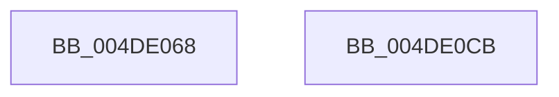

# KeQueryCpuSetsProcess

- RVA: `0x004DE068`–`0x004DE0CC` (길이 `100` bytes)
- VA: `0x00000001404DE068`
- 실행 섹션: `.text`
- PDB 이름 있음: `예`; PDB Function 태그: `아니요`
- unwind 정보 RVA: `0x00066400`
- 디코드: `30`개 명령, `100/100` bytes 표시
- 미해석 바이트: `0` (있으면 어셈블리에 `.byte`로 보존)

> 이 문서는 커널 이미지의 기계어와 PDB 기호를 분석해 생성했습니다. 4번과 5번은 함수 원형과 자료형을 바이너리 사용 방식에서 추정한 C 해석이며 원본 소스 복구 결과는 아닙니다.

## 1. Dependencies

- 직접 호출 지점: **3**; 고유 호출 대상: **3**
- 직접 호출자로 확인된 함수: **2**
- RIP 상대 이미지 참조: **0**

### Outgoing calls
- `0x004DE090` → [KiAcquireProcessLockShared](../2C/KiAcquireProcessLockShared_function_002CF9A0.md) (function, `0x002CF9A0`)
- `0x004DE0A1` → [KiQueryCpuSetsProcessWithLock](../4F/KiQueryCpuSetsProcessWithLock_function_004F6080.md) (function, `0x004F6080`)
- `0x004DE0AF` → [KiReleaseProcessLockShared](../2C/KiReleaseProcessLockShared_function_002CE7FC.md) (function, `0x002CE7FC`)

### Direct callers
- [KiCpuPartitionCheckAffinitization](../5C/KiCpuPartitionCheckAffinitization_function_005C1420.md) at `0x005C14DA`
- [NtQueryInformationProcess](../../page/9A/NtQueryInformationProcess_function_009AA250.md) at `0x009AE141`

### Static image references
- 디코드된 RIP-relative 메모리 참조가 없습니다.

## 2. Other-region calls and transfers

- 다른 실행 섹션으로 향하는 call: **0**
- 별도 외부 분기/꼬리 이동을 확인하지 못했습니다.

## 3. Assembly (complete function range)

```asm
004DE068  48 8B C4                        mov rax, rsp
004DE06B  48 89 58 08                     mov qword ptr [rax + 8], rbx
004DE06F  48 89 68 10                     mov qword ptr [rax + 0x10], rbp
004DE073  48 89 70 18                     mov qword ptr [rax + 0x18], rsi
004DE077  57                              push rdi
004DE078  48 83 EC 30                     sub rsp, 0x30
004DE07C  48 8B F2                        mov rsi, rdx
004DE07F  C6 40 E8 00                     mov byte ptr [rax - 0x18], 0
004DE083  48 8D 50 E8                     lea rdx, [rax - 0x18]
004DE087  41 8B D9                        mov ebx, r9d
004DE08A  41 8B F8                        mov edi, r8d
004DE08D  48 8B E9                        mov rbp, rcx
004DE090  E8 0B 19 DF FF                  call 0x1402cf9a0
004DE095  44 8B CB                        mov r9d, ebx
004DE098  44 8B C7                        mov r8d, edi
004DE09B  48 8B D6                        mov rdx, rsi
004DE09E  48 8B CD                        mov rcx, rbp
004DE0A1  E8 DA 7F 01 00                  call 0x1404f6080
004DE0A6  8A 54 24 20                     mov dl, byte ptr [rsp + 0x20]
004DE0AA  48 8B CD                        mov rcx, rbp
004DE0AD  8B D8                           mov ebx, eax
004DE0AF  E8 48 07 DF FF                  call 0x1402ce7fc
004DE0B4  48 8B 6C 24 48                  mov rbp, qword ptr [rsp + 0x48]
004DE0B9  8B C3                           mov eax, ebx
004DE0BB  48 8B 5C 24 40                  mov rbx, qword ptr [rsp + 0x40]
004DE0C0  48 8B 74 24 50                  mov rsi, qword ptr [rsp + 0x50]
004DE0C5  48 83 C4 30                     add rsp, 0x30
004DE0C9  5F                              pop rdi
004DE0CA  C3                              ret
004DE0CB  CC                              int3
```

## 4. C-style interpretation (structured pseudocode)

```c
__int64 __fastcall KeQueryCpuSetsProcess(__int64 a1, __int64 a2, int a3, int a4)
{
    __int64 result;
    __int64 v_rsp;
    unsigned __int8 v_stack_m18;
    unsigned __int64 v_stack_p10;
    unsigned __int64 v_stack_p18;
    unsigned __int64 v_stack_p8;

    *(unsigned __int64 *)(v_rsp + 8) = v_rbx;
    *(unsigned __int64 *)(v_rsp + 16) = v_rbp;
    *(unsigned __int64 *)(v_rsp + 24) = v_rsi;
    v_rsp = (v_rsp) - (48);
    *(unsigned __int8 *)(v_rsp - 24) = 0;
    result = KiAcquireProcessLockShared(a1, v_rsp - 24, a3, a4);
    result = KiQueryCpuSetsProcessWithLock(a1, a2, (unsigned int)((unsigned int)((unsigned int)(a3))), (unsigned int)((unsigned int)((unsigned int)(a4))));
    result = KiReleaseProcessLockShared(a1, v_stack_m18, (unsigned int)((unsigned int)((unsigned int)(a3))), (unsigned int)((unsigned int)((unsigned int)(a4))));
    v_rsp = (v_rsp) + (48);
    return (unsigned int)((unsigned int)((unsigned int)((unsigned int)(result))));
}
```

## 5. (Beta) C Style

```c
int64_t KeQueryCpuSetsProcess(int64_t Arg1, int64_t Arg2, int32_t Arg3, int32_t Arg4)
{
    int64_t result;
    int64_t local_rsp;
    uint8_t v_stack_m18;
    uint64_t v_stack_p10;
    uint64_t v_stack_p18;
    uint64_t v_stack_p8;

    *(uint64_t *)(local_rsp + 0x8) = local_rbx;
    *(uint64_t *)(local_rsp + 0x10) = local_rbp;
    *(uint64_t *)(local_rsp + 0x18) = local_rsi;
    local_rsp = (local_rsp) - (48);
    *(uint8_t *)(local_rsp - 0x18) = 0;
    result = KiAcquireProcessLockShared(Arg1, local_rsp - 24, Arg3, Arg4);
    result = KiQueryCpuSetsProcessWithLock(Arg1, Arg2, (uint32_t)((uint32_t)((uint32_t)(Arg3))), (uint32_t)((uint32_t)((uint32_t)(Arg4))));
    result = KiReleaseProcessLockShared(Arg1, v_stack_m18, (uint32_t)((uint32_t)((uint32_t)(Arg3))), (uint32_t)((uint32_t)((uint32_t)(Arg4))));
    local_rsp = (local_rsp) + (48);
    return (uint32_t)((uint32_t)((uint32_t)((uint32_t)(result))));
}
```

## 6. Execution-region graph

[열기: 2D/3D 그래프와 함수 탐색 컨트롤 패널](../../../control-panel.html?section=text&rva=0x004DE068&view=graph)

- 2D 그래프는 위에서 아래로 흐르고, 3D 그래프는 빈 공간을 드래그해 회전합니다. Shift+드래그는 이동, 휠은 확대·축소, 함수 노드 선택은 대상 보고서 이동입니다.

### Static fallback


